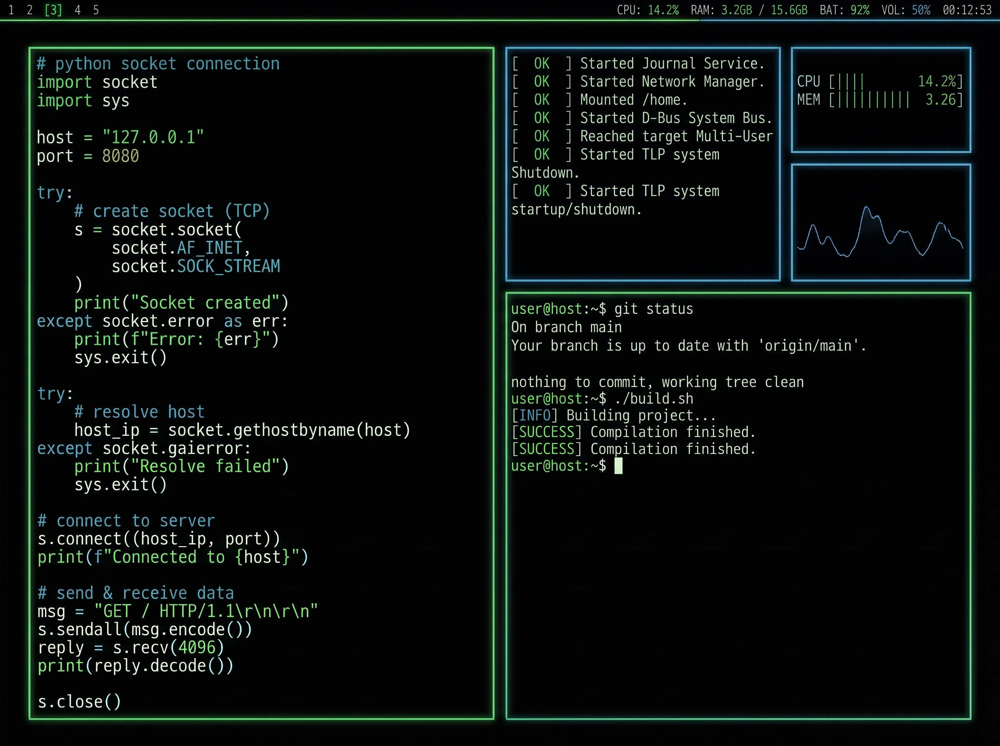

<div align="center">
    <figure>
        
    </figure>
</div>

<br>

```shell
hellhound@system:~/portfolio$ cat PORTFOLIO.md

[SYS_WARNING]: Bienvenido a mi portfolio, aquí encontrarás $WRITEUPS, $ARTICULOS y 'próximamente' mi $CONTACTO.

hellhound@system:~/articles$ ls -la --group-directories-first ./
```

<br>

<div align="center">

| Sección | Descripción |
|---|---|
| [WriteUps](./challenges/CHALLENGES.md) | Sección donde encontrarás la resolución, métodos y herramientas de distintas plataformas |
| [Artículos](./articles/ARTICLES.md) | Revisa los artículos informativos que publico periódicamente |
| Contacto | *Próximamente: Llave pública GPG* |

</div>

<br>

---

<div align="center">

**HellHound DevSecOps**<br>
*Ciberseguridad, Análisis de Sistemas & Reports*

[](https://github.com/xhellhoundx/)
[](https://www.youtube.com/@H3llH0undDSO)
[](https://x.com/hellhoundso)

</div>