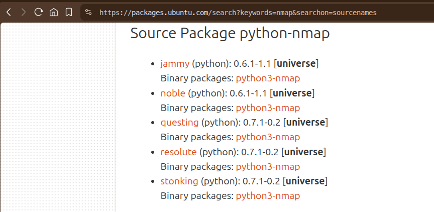
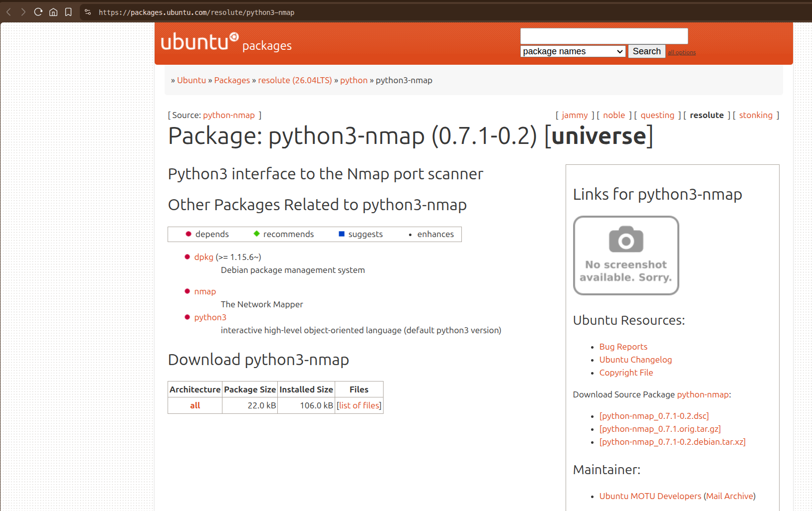

# Instalando módulos externos en python3 sin el uso de pip; PEP 668; incompatibilidades y soluciones

## Introducción:

Alguna vez hemos estado desarrollando algún script o aplicación con Python (*espacialmente Python3*) sin la necesidad de usar, o simplemente porque no queremos, un entorno visual (venv) en adición con el uso de los **módulos** externos del lenguaje los cuales pueden variar dependiendo de la **distro** que estemos usando, tal vez tengas algunas preguntas (o por lo menos yo las tuve) como: *«¿Los módulos nativos varían dependiendo de la distro?»*, *«¿Necesito hacer pasos extra para instalar estos módulos?»*, *«¿Es diferente la instalación de los paquetes del sistema operativo de un entorno virtual (venv)?»*, y algunas otras preguntas que puedan surgir. La respuesta casi siempre será **Si**, hay diferencia entre la instalación de los paquetes para la distro (Sistema operativo base) y en el entorno virtual.

En este artículo te comentaré algunas de las diferencias, cómo instalar estos módulos o paquetes, problemas de compabibilidad y algunas buenas prácticas para que puedas instalar dependencias externas de forma predeterminada, para eso necesitamos abarcar algunos conceptos:

## Términología:

#### distro
Podríamos definirlo como: la abreviatura coloquial de **distribución de Linux**, el cual es un sistema operativo basado en el núcleo (kernel) de Linux que agrupa software adicional (de terceros) para facilitar y complementar su uso. Estas distribuciones combinan el kernel con herramientas del proyecto [**GNU**](https://www.gnu.org/gnu/thegnuproject.es.html), un sistema de gestión de paquetes (como [APT](https://wiki.debian.org/PackageManagement) o [Pacman](https://wiki.archlinux.org/title/Pacman)), aplicaciones/softwares preinstalados y un *entorno de escritorio* (como [GNOME](https://www.gnome.org/en/), [KDE Plasma](https://kde.org/plasma-desktop/), [XFCE](https://xfce.org/), entre otras). Estas combinaciones permiten a los usuarios instalar y mantener un sistema funcional sin la necesidad de compilar cada componente.

#### módulo
Los **módulos nativos**, también conocidos como **módulos de la biblioteca estándar** son archivos con extensión `.py` que se instalan por defecto con el lenguaje y proporcionan funcionalidades extra sin necesidad de descargas adicionales. Estos módulos permiten organizar el código en [**namespaces**](https://labex.io/es/tutorials/python-how-to-use-namespaces-in-python-398268) únicos facilitando la **reutilización** y la estructura lógica de los programas mediante la importación de funciones, clases y variables. La biblioteca estándar incluye más de 200 módulos preinstalados.

#### paquete (linux)
Un **paquete en Linux** es un archivo comprimido que contine todos los archivos necesarios para instalar, actualizar o eliminar un software específico, junto con los **metadatos** y las **instrucciones** que indican al sistema cómo manejar dichos archivos. Estos archivos se agrupan para facilitar la gestión del software mediante **gestores de paquetes**. Los formatos dependen de la distribución: **.deb** Utilizado por Debian, Ubuntu y derivados, gestionados por herramientas como **dpkg** y **apt**; **.rpm** Utilizado por Red Hat, Fedora y SUSE, gestionado por **rpm**, y **dnf**/**yum**; Otros formatos como `.tar.gz` o sistemas como **Snap** y **Flatpak** que ofrecen paquetería independiente de la distribución.

#### PEPs
**PEP** significa **Python Enhancement Proposals** (español: *propuestas de mejoras de python*) son documentos de diseño que describen nuevas características, estándares o procesos para el lenguaje de programación **Python**. Actúan como el mecanismo principal para proponer mejoras, recopilar opiniones de la comunidad y documentar desiciones de diseño. Los PEP deben proporcionar especificación técnica consisa de la función y justificación de la misma.

> *Véase más en*:
>
> [https://peps.python.org/#introduction](https://peps.python.org/#introduction)

#### venv (entorno virtual - *virtual environment*)
Un **entorno virtual** en Python es un directorio autónomo y aislado que contiene una instalación independiente del intérprete de Python y sus propias bibliotecas o paquetes. Esta herramienta permite gestionar las dependencias de manera específica para cada proyecto, evitando conflictos entre versiones de librerías requeridas. Al estar aislado un entorno virtual actúa como una "burbuja" que no afecta la instalación global de Python en el SO.

#### dependencias
Las **dependencias de paquetes** o **dependencias de software** son aplicaciones, bibliotecas o archivos adicionales que un software específico requiere para instalarse y funcionar correctamente. Cuando se intenta instalar el paquete, el sistema verifica la presencia de estos componentes; si faltan, el gestor de paquetes suele descargarlos automáticamente o informar un error para evitar incompatibilidades.

<br>

---

## Origen de los conflictos
Un problema que tiene una larga trayectoria para los usuarios de Python en las distros de Linux (los sistemas operativos que tomaré para este artículo) es los conflictos entre los administradores de paquetes del sistema operativo y la gestión de los paquetes de Python (por ejemplo, **pip**).

Las herramientas de gestión de paquetes de Python siempre han tenido *valores predeterminados* para instalar paquetes en un contexto global en nuestro sistema operativo. Luego con la llegada y estandarización de los entornos virtuales, una solución para la mayoría (no todos) los casos es utilizar una herramienta de gestión de paquetes en un entorno virtual de Python.

Según lo dice el [**PEP 668**](https://peps.python.org/pep-0668/) las distribuciones de Linux Fedora, Debian y muchas otras, se usa el binario `/usr/bin/python3` que proporciona el comando `python3` porque no existen versiones binarias oficiales de Python para Linux/UNIX, así que todos los usuarios utilizan el intérprete *creado y enviado* con su distribución.

El ejecutable `python3` disponible para usuarios y como dependencia para otro software en la distribución suelen ser el mismo binario. Esto quiere decir que si un usuario instala un módulo usando un gestor de paquetes como `pip`, fuera del contexto de entorno virtual, este es visible ante el software por el lenguaje Python enviado a la distro. Si el paquete instalado (o una de sus dependencias) es una versión diferente, antigua o nueva, podría romper el software usado por la distro. Es decir, si un módulo instalado con `pip` instala o actualiza una de las librerías secundarias o dependencias a otra versión de la que está  instalada actualmente y que espera el sistema operativo, podría romper herramientas del sistema que dependan de esa versión específica.

Esto propone un problema crítico para la integridad de las distro, que tienen sus propios gestores de paquetes, los cuales, en muchos casos, son escritos en Python. Incluso cuando se intenta instalar con `sudo pip install` como root; o con `pip install --user` como usuario, presenta problemas ya que la locación de los módulos de `sys.path` siguen estando en `/usr/bin/python3`.

Hay un problema aún más grave con las instalaciones y dependencias del sistema: si itentas recuperar los daños causados por instalaciones externas hechas con `pip` en el sistema operativo con `sudo pip uninstall`, terminarás eliminando las dependencias necesarias para lo que ya existe, por lo que tendrás que reinstalar las dependencias eliminadas, lastimosamente esto ya no podrá recuperar el sistema en un estado consistente usando sólo el software que queda en él.

> *Véase más en*:
> 
> [https://peps.python.org/pep-0668/](https://peps.python.org/pep-0668/)

<br>

---

## Soluciones (basadas en Debian)
Según el [**PEP 668**](https://peps.python.org/pep-0668/) hay algunas alternativas para gestionar módulos externos, que aún así podrían presentar irregularidades en el sistema: crear un archivo marcador llamado `EXTERNALLY-MANAGED`, cuya presencia indica que las instalaciones de paquetes en el sistema operativo se administrarán por un medio externo a Python, como un gestor de paquetes aislado. Este archivo estaría especificado para residir en el **stdlib** (*standart library*) del esquema **sysconfig**, que marca el intérprete y la instalación en conjunto, no una ubcación particular en `sys.path`. Como ya se dijo anteriormente, hay dos problemas relacionados que corren el riesgo de romper un sistema gestionado externamente por Python: la instalación de una versión nueva incompatible de un paquete en todo el sistema que podría instalar el paquete en la cuenta de usuario pero en una ubicación estándar de Python.

El otro comportamiento aprovecha lo que existe en la puesta en marcha de `sysconfig` en distros que ya han encontrado este tipo de problemas, y direcciona el problema a un gestor de paquetes específico de Python que elimina o sobreescribe archivos que son propiedad de un gestor de paquetes externo.

**NOTA**: Hasta este punto el **PEP 668** nos habla de forma clara y consisa, sin embargo he decidido exponer una solución basada en **PoC** (Proof of Concept; *español: Prueba de Concepto*) que me funcionó y es mucho más recomendable en el caso de presentar incompatibilidades, ya que Python interpretará de forma separada cada instalación hecha fuera del contexto estándar.

Para instalar un módulo externo de Python a nivel global en el sistema (fuera de entornos virtuales), la forma recomendada en versiones recientes de Linux depende del gestor de paquetes de la distribución (**apt** en este caso):

```bash
# Descargar la información de todas las fuentes configuradas
sudo apt update
# Descargar e instalar el módulo que se desee
sudo apt install python3-<módulo>
```

Una vez se haya instalado el módulo, comprobamos que se haya quedado disponible para su uso:

```bash
python3 -c 'import <módulo>; print(<módulo>.__file__)'
# Esto debería retornar una ruta tal como:
/usr/lib/python3/dist-packages/<módulo>/__init__.py
```

La instalación de módulos externos a la **stdlib** de Python a través del gestor del paquete del sistema, responde a un modelo de administración donde el sistema operativo asume el control de las dependiencias, la estabilidad y ciclo de vida del software.

#### 1. Integración en el árbol de dependencias del SO
A diferencia de `pip`, `apt` maneja una base de datos unificada de dependencias y código ([dpkg](https://linux.die.net/man/1/dpkg)).

* **Garantía de compatibilidad (Co-testing)**: Los desarrolladores/mantenedores de la distribución auditan y prueban, en conjunto, las versiones de las librerías de Python para asegurar que funcionen de forma congruente entre sí y con las herramientas del sistema que las usan.

>
> [https://www.debian.org/doc/packaging-manuals/python-policy/](https://www.debian.org/doc/packaging-manuals/python-policy/)
>
> *Sección 2.1*: Removal of the unversioned packages
>
> *Sección 2.2*: Unversioned python commands


* **Resolución de dependencias compartidas**: Si un módulo de Python depende de librerías nativas en C/C++, `apt` resuelve e instala automáticamente tanto el módulo de Python como los paquetes compartidos del sistema, garantizando que la compilación o [*vinculación dinámica*](https://es.wikipedia.org/wiki/Enlace_din%C3%A1mico) no falle.

>
> [https://www.debian.org/doc/debian-policy/ch-relationships.html](https://www.debian.org/doc/debian-policy/ch-relationships.html)
> 
> *Capítulo 7.2*: Binary Dependencies
>
> *Capítulo 7.3*: Packages which break other packages

#### 2. Gestión centralizada de seguridad y parches
* **Parches de seguridad del desarrollador**: Las distribuciones aplican parches de seguridad críticos a las versiones de librerías incluidas en sus repositorios sin alterar la versión principal del módulo. Esto evita romper la compatibilidad (*breaking changes*) mientras mantiene el sistema protegido.

>
> [5.9.5.1. Debian Security Tracker](https://www.debian.org/doc/manuals/developers-reference/pkgs.html#handling-security-related-bugs)
>

* **Actualizaciones unificadas**: Con una sola ejecución de `sudo apt update && sudo apt upgrade`, se actualizan tanto el sistema operativo como todas las librerías externas de Python instaladas por esta vía.

#### 3. Trazabilidad y gobernanza del sistema de archivos
* **Ubicación estandarizada**: `apt` ubica los módulos en `/usr/lib/python3/dist-packages/`, el cual es un directorio reservado para el código gestionado por la distribución, manteniendo intacto `/usr/local/lib/python3.x/dist-packages/` y los entornos del usuario.

> [https://refspecs.linuxfoundation.org/FHS_3.0/fhs/index.html](https://refspecs.linuxfoundation.org/FHS_3.0/fhs/index.html)
>
> *Capítulo 4.6*: /usr/lib: Libraries for programming and packages
>
> *Capítulo 4.9*: /usr/local: Local hierarchy

<br>

> [https://www.debian.org/doc/packaging-manuals/python-policy/#module-path](https://www.debian.org/doc/packaging-manuals/python-policy/#module-path)
> 
> Sección 3.6: Module Path

Nótese este caso particular es precisamente lo que se conversa a fondo en el **PEP 668** sobre el `sys.path` que es donde se establecen los módulos que vienen de forma predeterminada con el lenguaje. Y para que quede mucho más claro voy a dejar plasmado un **PoC**:

```bash
# Imprimir a través de python3 el sys.path
python3 -c 'import sys; print(sys.path)'
# Esto tendría que dar como resultado:
['', '/usr/lib/python314.zip', '/usr/lib/python3.14', '/usr/lib/python3.14/lib-dynload', '/usr/local/lib/python3.14/dist-packages', '/usr/lib/python3/dist-packages']
```

Además dejaré el **PoC** de un módulo externo llamado **prompt_toolkit**, el cual es muy interesante para mantener una *Shell* interactiva muy útil:

```bash
ls -lav /usr/lib/python3/dist-packages/ | grep prompt_toolkit
drwxr-xr-x root root 4.0 KB Fri Aug 14 12:49:31 2026 prompt_toolkit
drwxr-xr-x root root 4.0 KB Fri Aug 14 12:49:31 2026 prompt_toolkit-3.0.52.dist-info
```

* **Sin conflictos de permisos**: Todos los archivos son instalados con permisos y propietarios correctos registrados en la base de datos de `dpkg`. Esto permite auditar los archivos de cualquier módulo con el comando `dpkg -L python3-<módulo>`, verificar su integridad con `dpkg -V`; o eliminar la librería por completo sin dejar archivos huérfanos o residuos de compilación.

> [https://manpages.debian.org/trixie/dpkg/dpkg.1.en.html](https://manpages.debian.org/trixie/dpkg/dpkg.1.en.html)
>
> *Manual de dpkg*: Documenta las funciones de auditoría del sistema de archivos (`-L` para listar archivos; `-V` para verificar sumas de comprobación)

#### 4. Determinación en los despliegues e infraestructura:
* **Entornos reproducibles sin compilación**: Los paquetes de `apt` contienen binarios precompilados (incluidas las extensiones en C). En entornos de producción o contenedores, esto elimina la necesidad de contar con herramientas de compilación (`gcc`, `make`, `python3-dev`) en el sistema final, reduciendo la superficie de ataque y los tiempos de despliegue.

> [https://www.debian.org/doc/manuals/packaging-tutorial/packaging-tutorial.en.pdf](https://www.debian.org/doc/manuals/packaging-tutorial/packaging-tutorial.en.pdf)
>
> *Sección 3*: Building Packages & Binary Wheels

<br>

> [https://ubuntu.com/server/docs/](https://ubuntu.com/server/docs/)
>
> [*Getting Started*: System Basics: Managing software](https://ubuntu.com/server/docs/tutorial/managing-software/#managing-software)
> 
> [*Getting Started*: System Basics: Customizing package files](https://ubuntu.com/server/docs/explanation/software/changing-package-files/#changing-package-files)
>
> [*Managing your system*: Managing software: Package management](https://ubuntu.com/server/docs/how-to/software/package-management/#package-management)

<br>

---

## Curiosidades, sugerencias y buenas prácticas

Una **curiosidad** que considero buena abarcar en este artículo es “**¿Por qué las diferentes distribuciones de Debian tienen módulos de Python diferentes?**” y para eso empezaremos viendo un preámbulo de las distros basadas en Debian y cómo gestionan los módulos nativos de Python, luego dejaré algunos consejos para la correcta descarga de los paquetes que incluyen los módulos externos de Python. La siguiente información está basada en las dos distro que uso (**Ubuntu 26.04 resolute** y **Parrot-Security 7.3 echo**) y la diferencia entre los módulos nativos para cada una.

«*La diferencia en la cantidad de módulos de Python3 presentes por defecto entre Ubuntu y Parrot OS responde directamente al "propósito de diseño" (target audience), la "filosofía de empaquetado" y las "herramientas preinstaladas" en cada distribución, a pesar de que ambas compartan a Debian como base común*»

### Preámbulo: El ecosistema Debian y la modularización de Python
En el ecosistema Debian y sus derivados, el paquete base `python3` no incluye la biblioteca estándar completa de Python ni módulos adicionales de terceros por defecto. Debian aplica una política de **granularidad estricta**:
* **Descomposición de la biblioteca estándar**: Los módulos que en Python forman parte de la biblioteca estándar (como **tkinter**, **gdbm** o **sqlite3**) se separan en paquetes Debian independientes (**python3-tk**, **python3-gdbm**, **python3-sqlite3**).

> [*Sección 3.2*:  Main packages](https://www.debian.org/doc/packaging-manuals/python-policy/#main-packages)
>

* **Inclusión basada en dependencias**: Un módulo adicional de Python (`python3-<módulo>`) solo se instala en la imagen base de una distribución si una herramienta o paquete preinstalado en esa imagen lo declara formalmente como dependencia (**Depends** o **Recommends** en los metadatos de **dpkg**).

> [*Debian Policy Manual - Sección 5.6.10*: Package interrelationship fields](https://www.debian.org/doc/debian-policy/ch-controlfields.html#package-interrelationship-fields-depends-pre-depends-recommends-suggests-breaks-conflicts-provides-replaces-enhances)
>

### Factores clave: Ubuntu vs Parrot Security OS

#### 1. Caso de uso y folosofía de la distribución:
* **Ubuntu (Minimalismo y uso general)**: Ubuntu está diseñado como un sistema operativo de propósito general (escritorio y servidor). Su filosofía para la instalación base es mantener la imagen lo más reducida posible (*minimal installation footprint*), incluyendo solo las dependencias estrictamente necesarias para el entorno de escritorio (GNOME) y la administración del sistema.

* **Parrot Security OS (Distribución especializada "Out-of-the-Box")**: Parrot está hecho como una plataforma lista para pruebas de penetración, análisis forense e ingeniería inversa (reverse engineering). Para garantizar que sus herramientas funcionen sin qrequerir conexión a internet en el campo, Parrot preinstala cientos de utilidades de seguridad (como marcos de trabajo, scanners, exploiters y scripts).

> [*ParrotOS Documentation*](https://parrotsec.org/docs/)
>

#### 2. Árbol de dependencias de las herramientas preinstaladas
Algunas de las razones por las cuales podemos encontrar más módulos de `Python en /usr/lib/python3/dist-packages/` en Parrot OS es la presencia de herramientas escritas en Python:
* Muchas herramientas y utilidades de auditorias de seguridad (como scripts para recolectar información, frameworks de red, analizadores de tráfico y herramientas de análisis web) están escritas en Python.
* Al estar estas herramientas incluidas en la ISO por defecto, el gestor de paquetes `apt` descarga automáticamente todas sus dependencias en Python como en paquetes `.deb` preinstalados (por ejemplo, librerías de red, manipulación de paquetes, criptografía y parsing de datos).
* En Ubuntu, al no incluirse este conjunto de herramientas especializadas por defecto, esos módulos de Python simplemente no se instalan hasta que el usuario o un software específico los requiera.

#### 3. Metapaquetes y perfiles de instalación
Parrot OS utiliza metapaquetes (como `parrot-tools-full` o `parrot-pwn`) que agrupan cientos de software especializados y sus respectivas librerías de Python. Ubuntu en cambio, utiliza metapaquetes orientados al entorno de escritorio (`ubuntu-desktop` o `ubuntu-desktop-minimal`), donde las únicas librerías de Python requeridas son las que soportan utilidades internas o la interfaz gráfica del instalador.

### Sugerencias y buenas prácticas
Si queremos obtener la información de los módulos que están instalados en nuestra `stdlib` y adicionales podemos hacer el comando:

```bash
python3 -c 'print(help("modules"))'
```

Como ya lo mencioné anteriormente, para instalar un módulo externo, debemos usar los comandos

```bash
sudo apt update && sudo apt install python3-<módulo>
# Recuerden que siempre podemos usar el flag "-y" al final para que no lance el prompt que verifica la instalación
```

Sin embargo, me gustaría aclarar que, antes de instalar un módulo extra verifiquemos la versión que estamos instalando contra la página oficial de dicho módulo  y esté *rolling* para nuestra versión de distro, por ejemplo, mostraré cómo sería instalar el módulo `python3-nmap`:

```bash
sudo apt search python3-nmap
python3-nmap/resolute 0.7.1-0.2 all
  Python3 interface to the Nmap port scanner
```

Adicional hago una búsqueda para asegurarme que todo está corriendo bien y estoy descargando las versiones correctas:

<figure>
    
    <figcaption style="font-size: 0.85em; color: #8b949e; margin-top: 8px;">Figura 1: Búsqueda del paquete encontrado en APT contra la web oficial</figcaption>
</figure>

<br>

<figure>
    
    <figcaption style="font-size: 0.85em; color: #8b949e; margin-top: 8px;">Figura 2: Página oficial del paquete, versión, recursos y mantenedores</figcaption>
</figure>

En este punto ya tenemos una visión clara de lo que estamos por descargar, está mantenido por los servidores de `apt` y podemos proceder con la instalación del paquete:

<br>

```bash
sudo apt update && sudo apt python3-nmap
```
