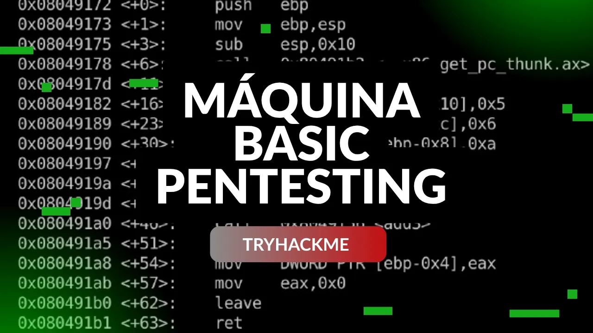

<div align="center">
    <figure>
        
    </figure>
</div>

<div align="center">

# Basic Pentesting <!-- omit in toc -->
<!-- Fácil-#228B06 | Media-#BFA907 | Difícil-#A62100 -->


</div>

<br>

<div align="center">

  ## Video de resolución <!-- omit in toc -->

  <a href="https://youtu.be/J4f7RcnK-6w">
    
    <br>
    Ver video en Youtube
  </a>
</div>

<br><br>

<div align="center">
  <a href="./assets/basicpentesting-cti.pdf">📄 Informe Oficial (PDF)</a>
</div>

<br><br>

## Informe de Inteligencia de Amenazas - Máquina "Basic Pentesting" <!-- omit in toc -->

<br>

## Índice <!-- omit in toc -->
- [RESUMEN EJECUTIVO (Executive Summary)](#resumen-ejecutivo-executive-summary)
- [ENTORNO OBJETIVO](#entorno-objetivo)
- [FASE DE RECONOCIMIENTO Y RECOLECCIÓN (Recon­naissance \& Enumeration)](#fase-de-reconocimiento-y-recolección-reconnaissance--enumeration)
  - [Escaneo de Red y Servicios Expuestos](#escaneo-de-red-y-servicios-expuestos)
- [Hallazgos de Enumeración Web y SMB](#hallazgos-de-enumeración-web-y-smb)
- [CADENA DE ATAQUE (Kill Chain \& Technical Analysis)](#cadena-de-ataque-kill-chain--technical-analysis)
  - [Acceso Inicial (Initial Access)](#acceso-inicial-initial-access)
  - [Puntuación y Métrica CVSS v3.1](#puntuación-y-métrica-cvss-v31)
  - [Establecimiento de Persistencia y Movimiento Lateral](#establecimiento-de-persistencia-y-movimiento-lateral)
- [INDICADORES DE COMPROMISO (IoCs)](#indicadores-de-compromiso-iocs)
  - [Indicadores de Red (Network IoCs)](#indicadores-de-red-network-iocs)
  - [Indicadores en Host (Host-Based IoCs)](#indicadores-en-host-host-based-iocs)
- [MAPEO DE TÁCTICAS Y TÉCNICAS (MITRE ATT\&CK)](#mapeo-de-tácticas-y-técnicas-mitre-attck)
- [RECOMENDACIONES Y MITIGACIONES (Actionable Intel­ligence)](#recomendaciones-y-mitigaciones-actionable-intelligence)
  - [Mitigaciones Inmediatas (Tácticas)](#mitigaciones-inmediatas-tácticas)
  - [Mitigaciones a Largo Plazo (Estratégicas)](#mitigaciones-a-largo-plazo-estratégicas)

<br>

### RESUMEN EJECUTIVO (Executive Summary)
* **Propósito**: Proporcionar una visión técnica y operativa sobre la instrusión realizada contra el objetivo en el entorno controlado, detallando las vulnerabilidades explotadas, el movimiento lateral y las medidas para mitigar los riesgos.
* **Impacto Principal**: Acceso no autorizado a nivel de usuario en el sistema operativo objetivo (**Linux Ubuntu 20.04**), permitiendo la lectura de archivos locales, enumeración de la configuración interna y extracción de llaves de acceso privadas de otros usuarios.
* **Vector de Entrada**: Ataque de fuerza bruta/diccionario sobre el servicio SSH (puerto 22/TCP) tras la enumeración exitosa de nombres de usuario mediante el servicio Samba/SMB.
* **Movimiento Lateral**: Compromiso del usuario `kay` mediante la extracción externa de su clave privada SSH (*id_rsa*) almacenada con permisos débiles en `/home/kay/.ssh`, seguida del descifrado offline de su frase de paso (*passphrase*).
* **Resumen**: Durante la auditoría/ataque de seguridad del host BasicPentesting, se identi­ficó la exposición de servicios SMB y SSH. Mediante enumeración de usuarios en Samba, se obtuvo el nombre de cuenta de los usuarios `jan` y `kay`. Un ataque de fuerza bruta posterior contra el puerto 22 permitió obtener acceso inicial. Una vez dentro, se identificó una mala configuración en los permisos del directorio personal del usuario `kay`, lo que permitió copiar su clave privada SSH y realizar un movimiento lateral dentro del sistema.

--- 

### ENTORNO OBJETIVO
* **Nombre de la Amenaza / Host**: TryHackMe - Basic Pentesting
* **Dirección IP / Alcance**: `10.113.159.246`
* **Sistema Operativo**: Linux Ubuntu 20.04.6 LTS (Focal Fossa)
* **Objetivo Comercial/Función**: Servidor web simulado.

---

### FASE DE RECONOCIMIENTO Y RECOLECCIÓN (Recon­naissance & Enumeration)

####  Escaneo de Red y Servicios Expuestos
Se ejecutó un escaneo completo de puertos mediante Nmap para determinar los servicios
expuestos en la red:
```bash
nmap -p- --open -T4 -Pn -n -vvv -oN target.log 10.113.159.246
```
```bash
nmap -p22,80,139,445,8009,8080 -sV -sC -vvv -oN ports-info.log 10.113.159.246
```

| Puerto | Servicio | Versión | Estado |
|---|---|---|---|
| 22/TCP | SSH | OpenSSH 8.2p1 Ubuntu 4ubuntu0.13 | Abierto |
| 80/TCP | HTTP | Apache httpd 2.4.41 ((Ubuntu)) | Abierto |
| 139/TCP | netbios-ssn | Samba smbd 4 | Abierto |
| 445/TCP | netbios-ssn | Samba smbd 4 | Abierto |
| 8009 | ajp13 | Apache Jserv (Protocol v1.3) | Abierto |
| 8080 | HTTP | Apache Tomcat 9.0.7 | Abierto |

---

### Hallazgos de Enumeración Web y SMB
* **Enumeración Web**: Tras revisar el código fuente de la página principal (`http://10.113.159.246/`), se identificó un comentario de los desarrolladores indicando la existencia de una ruta oculta, haciendo referencia a **«dev note»**. Esto permitió descubrir la ruta `http://10.113.159.246/development` (HTTP 200) en donde se hallaron dos archivos de texto (`dev.txt` y `j.txt`) con notas internas de los desarrolladores indicando que la contraseña de uno de los usuarios era débil.
* **Enumeración SMB**: Se utilizó la herramienta `enum4linux` para consultar el servicio **Samba** en los puertos 139/445, logrando descubrir usuarios válidos del sistema operativo, entre
ellos las cuentas de `kay` y `jan`.

---

### CADENA DE ATAQUE (Kill Chain & Technical Analysis)

#### Acceso Inicial (Initial Access)
* **Táctica MITRE ATT&CK**: Brute Force: Pasword Cracking (T1110.002)
* **Vulnerabilidad Explotada**: Credenciales débiles en el servicio OpenSSH (CWE-1391 / CWE-522 / CWE-521)
* **Descripción del Exploit**:
  - Con el usuario **jan** confirmado mediante enum4linux y la pista de clave débil en `/development/`, se ejecutó un ataque de diccionario automatizado contra el puerto SSH (22/TCP)
* Prueba de Concepto (PoC):
```bash
# Ataque de diccionario para obtener credenciales
hydra -l jan -P /usr/share/wordlists/rockyou.txt ssh://10.113.159.246
# Acceso inicial vía SSH
ssh jan@10.113.159.246
```
#### Puntuación y Métrica CVSS v3.1
* Puntuación Base: 8.2 (Alto - High)
* Vector CVSS: `CVSS:3.1/AV:N/AC:L/PR:N/UI:N/S:U/C:H/I:L/A:N`

#### Establecimiento de Persistencia y Movimiento Lateral
* **Táctica MITRE ATT&CK**: Unsecure Credentials: Private Keys (T1552.004) / Remote Services: SSH (T1021.004).
* **Descripción**: Durante la exploración del sistema de archivos local como el usuario jan, se inspeccionó el directorio `/home/kay`. Se detectó que el directorio `.ssh` de kay tenía permisos de lectura abiertos a otros usuarios (rwxr-xr-x/766), permitiendo la extracción del archivo de clave privada **id_rsa**.
* **Payload Utilizado**:
```bash
# Copia de la llave privada desde la máquina objetivo
scp -r jan@10.113.159.246:/home/kay/.ssh .
# Extracción del hash y crack del mismo
ssh2john id_rsa > hash.txt
john --wordlist=/usr/share/wordlists/rockyou.txt hash.txt
# Conexión SSH autenticado como el usuario kay
ssh kay@10.113.159.246 -i id_rsa
```

---

### INDICADORES DE COMPROMISO (IoCs)

#### Indicadores de Red (Network IoCs)
* **IPs Maliciosas Relacionadas**: `192.168.137.56` (IP de la máquina atacante en la VPN)
* **URLs Afectadas**: `http://10.113.159.246/development/`
* **User-Agents Inusuales e Intentos de Conexión**: Múltiples solicitudes de autenticación SSH fallidas registradas desde la IP del atacante (generadas por hydra)

#### Indicadores en Host (Host-Based IoCs)

* Rutas de Archivos Sensibles Accesibles:
  - `/home/kay/.ssh` (Clave privada SSH expuesta a lectura de otros usuarios)
  - `/var/www/html/development/dev.txt` y `j.txt`
* Registros y Eventos de Autenticación:
  - Posibles entradas en `/var/log/auth.log` que reflejan el inicio de sesión exitoso vía SSH para el usuario `jan`, seguido de intentos de lecutra sobre el directorio `/home/kay/.ssh`.

---

### MAPEO DE TÁCTICAS Y TÉCNICAS (MITRE ATT&CK)

| Fase de la Cadena | ID Técnica | Nombre de la Técnica |
|---|---|---|
| Reconnaissance | TT1595.002 | Active Scanning: Vulnerability Scanning |
| Reconnaissance | T1590 | Gather Victim Network Information |
| Credential Access | T1110.002 | Brute Force: Password Cracking (Hydra) |
| Execution | T1059.004 | Command and Scripting Interpreter: Unix Shell |
| Credential Access | T1552.004 | Unsecured Credentials: Private Keys |
| Credential Access | T1110.002 | Brute Force: Password Cracking (JohnTheRip­per) |
| Lateral Movement | T1021.004 | Remote Services: SSH |

---

### RECOMENDACIONES Y MITIGACIONES (Actionable Intel­ligence)

#### Mitigaciones Inmediatas (Tácticas)
1. **Fortalecimiento de Contraseñas**: Gestionar el cambio inmediato de clave para la cuenta jan, implementando una política de contraseñas robustas (mínimo 16 carac­teres, uso de símbolos, números y mayúsculas).
1. **Remoción de Permisos**: Restringir los permisos del directorio /home/kay/.ssh y sus archivos contenidos usando:
```bash
# Directorio
chmod 700 /home/kay/.ssh
# Archivo
chmod 600 /home/kay/.ssh
```
1. **Protección Contra Fuerza Bruta**: Implementar `fail2ban` en el servicio SSH para bloquear direcciones IP tras un límite de intentos fallidos.

#### Mitigaciones a Largo Plazo (Estratégicas)

1. *Deshabilitar Autenticación por contraseña SSH*: Configurar PasswordAuthentication no en el archivo /etc/ssh/sshd_config para uso exclusivo de llaves SSH con “passphrase” robusta.
2. *Auditoría periódica de archivos sensibles*: Implementar escaneos automatizados para verificar que ninguna clave o secreto quede almacenado con permisos de lectura para grupos o usuarios no autorizados (*other*).

<br><br>

---

<div align="center">

**HellHound DevSecOps**<br>
*Ciberseguridad, Análisis de Sistemas & Reports*

[](https://github.com/xhellhoundx/)
[](https://www.youtube.com/@H3llH0undDSO)
[](https://x.com/hellhoundso)

</div>