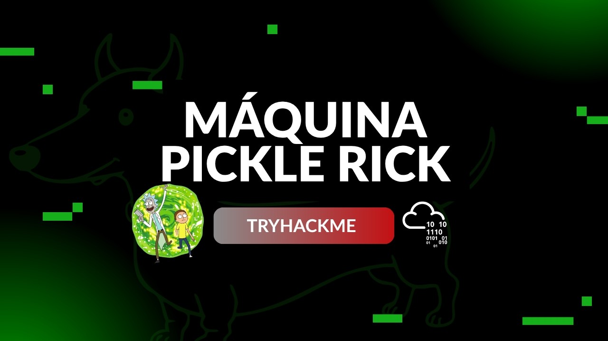

  

# Pickle Rick <!-- omit in toc -->
<!-- Fácil-#228B06 | Media-#BFA907 | Difícil-#A62100 -->

 

  ## Video de resolución

  <a href="https://youtu.be/aaffB-pdbD8">
    
     
    Ver video en Youtube
  </a>

  

  ## Este video no cuenta con Informe de Inteligencia

  Dada la naturaleza ficticia y la facilidad del reto, no encaja un Informe de Inteligencia de amenazas en este ámbito, sin embargo la resolución exponiendo métodos y herramientas sigue estando disponible en el video para aquellos que les pueda ayudar.

  Espero lo disfruten

  

---

**HellHound DevSecOps** 
*Ciberseguridad, Análisis de Sistemas & Reports*

